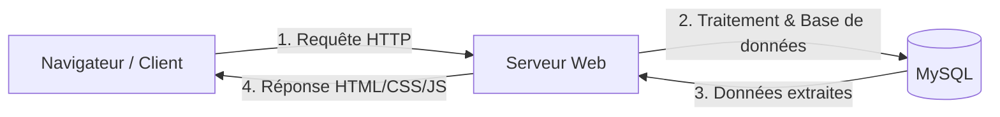

# Règles de rédaction - Domaine Veille Technologique & Culture Web

Ce skill définit les règles spécifiques à appliquer lors de la rédaction ou de la modification de tutoriels appartenant au domaine de la veille technologique, de la culture web et de la compréhension de l'écosystème numérique (domaine D.161.1).

## 1. Clarté Pédagogique et Vulgarisation Accessible (Règle d'or)

Les tutoriels de culture technologique s'adressent à des apprenants débutants qui découvrent le vocabulaire du web :
* **Définir immédiatement tout terme technique** : Ne jamais introduire d'acronyme ou de concept (ex: DNS, HTTP, IP, Client/Serveur, API, Framework) sans fournir une définition concise et une métaphore concrète issue de la vie courante.
* **Privilégier les analogies simples** :
  - L'adresse IP = l'adresse postale d'une maison.
  - Le serveur DNS = l'annuaire téléphonique qui transforme un nom de domaine en adresse IP.
  - L'architecture Client/Serveur = le client qui passe commande au serveur dans un restaurant.
* **Phrases courtes et directes** : Maintenir un niveau de français A1–A2 accessible aux apprenants non natifs.

## 2. Supports Visuels et Schémas Explicatifs

Les concepts de réseau et d'architecture web sont abstraits. **Tout tutoriel de ce domaine doit obligatoirement inclure un schéma visuel** :
* Utiliser **Mermaid** pour les flux d'échanges (ex: client → requête HTTP → serveur web → réponse HTML).
* Utiliser des tableaux comparatifs pour différencier les technologies (ex: Langages Frontend vs Langages Backend, Site Web vs Application Web).

**Exemple de flux recommandé :**

## 3. Démarche d'Auto-Évaluation et Synthèse

* **Pas d'exercice de code lourd** : L'objectif de ce domaine est la compréhension conceptuelle et non l'implémentation algorithmique.
* **Activités pratiques recommandées** :
  - Compléter un schéma conceptuel ou un tableau comparatif.
  - Rédiger une fiche de synthèse synthétique (1 page max).
  - Préparer un support de présentation court (Google Slides ou Markdown) pour restituer un concept technique lors d'un atelier par les pairs.
  - Répondre à un quiz d'auto-évaluation (vrai/faux, questions à choix multiples).

## 4. Livrables Attendus

* Fiche de synthèse au format Markdown ou document structuré.
* Présentation partagée (lien Google Slides ou fichier de diapositives) résumant un sujet technologique clé.

## Procédure de vérification du rédacteur

Avant de finaliser un tutoriel de veille technologique, vérifiez systématiquement :
> "Tous les acronymes et termes techniques sont-ils expliqués avec des mots simples ?"
> "Un schéma visuel clair (Mermaid ou tableau) accompagne-t-il la théorie ?"
> "L'exercice pratique demande-t-il une restitution ou synthèse concrète plutôt que du code hors sujet ?"
