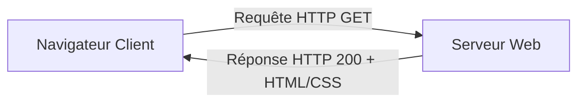

# Domaine Veille Technologique & Culture Numérique (`domaine-veille-tech`)

> **Ressource Didactique — Solicode**  
> **Compétence associée :** `tutorial-writer`  
> **Périmètre :** Culture web, vulgarisation, protocoles, architectures Internet, veille.

---

## 1. Vulgarisation & Analogies Concrètes
Définir chaque terme technique abstrait avec une analogie issue de la vie courante :
- *DNS* = Annuaire téléphonique.
- *Adresse IP* = Adresse postale du bâtiment.
- *Client / Serveur* = Client passant commande et serveur apportant le plat au restaurant.
- *Protocole HTTP* = Langue parlée entre le navigateur et le serveur.

---

## 2. Supports Visuels Systématiques
Tout concept abstrait doit être accompagné d'un diagramme Mermaid de flux :

---

## 3. Livrables & Délimitation
- Livrables : Synthèse d'une page Markdown, quiz d'auto-évaluation, ou support de restitution partagé.
- Aucun code technique lourd n'est exigé dans ce domaine de culture générale.
