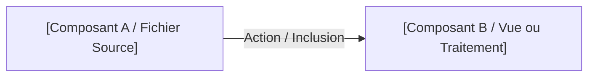

# Gabarit Normé — Plan de Réalisation d'une Session

Ce gabarit sert de modèle de référence pour tout fichier `plan-developpement.md` sous `_plan-réalisation-tutos/SX/`.

---

```markdown
# Plan de Réalisation — Progression [Nom du Domaine / Voie] (Session S[X])

**Voie de progression :** [Ex: Développement Web Applicatif Fil Rouge (HTML, CSS, PHP, SQL, Architecture)]  
**Session :** S[X] — [Titre clair de la session]  
**Mini-code :** `[slug-de-la-session]`  
**Niveau :** N1 (Débutant)  

---

## 1. Contexte & Objectif de la Progression

[Description concise du saut qualitatif opéré par l'apprenant dans cette session. 
Expliciter la transition par rapport à la session précédente.]

* **Objectif central :** [Objectif concret et observable]
* **Stack technique :** [Technologies, outils, versions exactes]
* **Architecture / Flux de données :** [Brève explication de l'organisation des fichiers]



---

## 2. Articulation Temporelle de la Progression

### ⏮️ Acquis Passés (Sessions S1 à S[X-1])
- [Acquis 1 mobilisé avec référence d'UA]
- [Acquis 2 mobilisé avec référence d'UA]

### 🎯 Unités d'Apprentissage & Tutoriels Mobilisés dans ce Sprint (Session S[X])
> **Règle de Granularité Cognitive :** De préférence **une seule UA (1 UA)** d'un domaine donné par session, afin d'éviter la surcharge cognitive.  
> *Exception admise :* Démarrage d'un nouveau langage/technologie nécessitant de dissocier le sas d'installation/démarrage de la pratique applicative.

#### [Domaine Principal] ([Code Domaine], [slug-domaine])

* **UA.[Code] — [Titre Logique de l'UA] :**  
  [Description du rôle de l'UA dans la session]

  - **T.[Code].1 — [Titre Technique Concret]**  
    *Objectif logique : [Titre logique / pédagogique]*  
    *Livrable :* [Description du livrable] | *Fichier :* `[nom-fichier]`

  - **T.[Code].2 — [Titre Technique Concret]**  
    *Objectif logique : [Titre logique / pédagogique]*  
    *Livrable :* [Description du livrable] | *Fichier :* `[nom-fichier]`

### ⏭️ Perspectives Futures (Sessions S[X+1] à ...)
- **S[X+1] :** [Continuité de la progression sur les prochaines sessions]

---

## 3. Fiches de Conception Détaillées des Tutoriels

<!-- 
RÈGLES STRICTES DE TITRAGE & PROGRESSION :
1. Le titre H3 porte OBLIGATOIREMENT le TITRE TECHNIQUE (outils, syntaxe, fonctions, commandes).
2. Le SOUS-TITRE en italique indique l'OBJECTIF LOGIQUE (conceptuel / pédagogique).
3. Le code de départ (E_n-1) est EXACTEMENT le résultat du tutoriel précédent.
-->

### T.[Code].1 — [Titre Technique : Commande, Fonction ou Syntaxe Précise]
*Objectif logique : [Titre logique / conceptuel]*

- **Objectif opérationnel :** [Action concrète que l'apprenant réalise].
- **Description :** [Déroulement pas-à-pas de l'activité].
- **Notions techniques manipulées :** [Mots-clés, fonctions, balises exactes].
- **État de départ ($E_{n-1}$) :** [Fichier ou code initial requis].
- **État d'arrivée ($E_n$) :** [Brique de code ajoutée sans rupture].
- **Livrable :** [Résultat observable et vérifiable].
- **Fichier cible dans `code-a-apprendre/` :** `[chemin/nom-fichier]`.

---

### T.[Code].2 — [Titre Technique : Commande, Fonction ou Syntaxe Précise]
*Objectif logique : [Titre logique / conceptuel]*

- **Objectif opérationnel :** [Action concrète que l'apprenant réalise].
- **Description :** [Déroulement pas-à-pas de l'activité].
- **Notions techniques manipulées :** [Mots-clés, fonctions, balises exactes].
- **État de départ ($E_{n-1}$) :** [Code issu de T.[Code].1].
- **État d'arrivée ($E_n$) :** [Nouvelle brique cumulée].
- **Livrable :** [Résultat observable et vérifiable].
- **Fichier cible dans `code-a-apprendre/` :** `[chemin/nom-fichier]`.

---

## 4. Articulation vers les Projets de l'Apprenant (Triade Active LMS)

1. **Tutoriels (Comprendre) :** Chaque tutoriel ci-dessus apporte le minimum de code nécessaire pour comprendre la notion isolée.
2. **Projet d'Imitation (Reproduire) :** L'apprenant réunit l'ensemble des livrables des tutoriels pour produire le livrable final de la session (ex: page d'accueil dynamique complète).
3. **Projet Prototype (Expérimenter en autonomie) :** L'apprenant applique immédiatement les notions acquises sur un cas d'étude similaire sans assistance pas-à-pas (ex: catalogue produit).
4. **Projet Fil Rouge (Réutiliser & Compétence) :** L'apprenant transfère la compétence métier dans son grand projet annuel.
```
