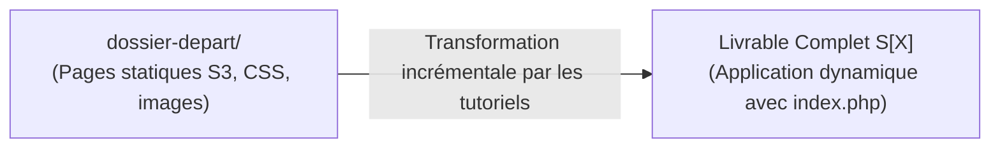

# Gabarit Normé — Plan de Réalisation d'une Session

Ce gabarit sert de modèle de référence pour tout fichier `plan-developpement.md` sous `_plan-réalisation-tutos/SX/`.  
Il constitue le **contrat technique et pédagogique complet** qui relie le `dossier-depart/` (reçu au début de la session) au **livrable complet final** (dossier de départ enrichi et transformé avec le `code-a-apprendre/`).  
Une fois ce plan validé, le skill `tutorial-writer` dispose de l'intégralité des éléments techniques pour rédiger les tutoriels sans avoir à deviner la progression.

---

```markdown
---
session: "S[X]"
version: "1.0.0"
audite: true
date_audit: "AAAA-MM-JJ"
statut: "audité et validé"
---

# Plan de Réalisation — Progression [Nom du Domaine / Voie] (Session S[X])

**Voie de progression :** [Ex: Développement Web Applicatif Fil Rouge (HTML, CSS, PHP, SQL, Architecture)]  
**Session :** S[X] — [Titre clair de la session]  
**Mini-code :** `[slug-de-la-session]`  
**Niveau :** N1 (Débutant)  

---

## 1. Contexte & Objectif de la Progression

[Description concise du saut qualitatif opéré par l'apprenant dans cette session. 
Expliciter la transition par rapport à la session précédente.]

* **Objectif central :** [Objectif concret et observable de développement applicatif]
* **Stack technique :** [Technologies, outils, versions exactes]
* **Architecture / Flux de données :** [Brève explication de l'organisation des fichiers]
* **Point de départ technique :** Dossier `dossier-depart/` contenant [lister les fichiers hérités de la session précédente].
* **Livrable attendu de la session :** Le `dossier-depart/` enrichi et transformé avec le `code-a-apprendre/` formant une application Web locale opérationnelle.



---

## 2. Articulation Temporelle de la Progression

### ⏮️ Acquis Passés (Sessions S1 à S[X-1])
- [Acquis 1 mobilisé avec référence d'UA]
- [Acquis 2 mobilisé avec référence d'UA]

### 🎯 Unités d'Apprentissage & Tutoriels Mobilisés dans ce Sprint (Session S[X])
> **Règle de Granularité des UAs :**  
> - **Par défaut :** Exactement **une seule Unité d'Apprentissage (1 UA)** par domaine de compétence par session.  
> - **Exception de Démarrage Technologique :** Lorsqu'une nouvelle technologie/langage est abordé pour la première fois, le domaine comprend **exactement deux UAs (2 UAs)** :  
>   1. **L'Unité « Bien démarrer avec [Technologie] »** (installation, serveur local, affichage des erreurs, premier script autonome).  
>   2. **L'Unité de formation du Projet d'imitation** (regroupant l'ensemble des notions applicatives nécessaires au livrable de la session).

#### [Domaine Principal] ([Code Domaine], [slug-domaine])

* **UA.[Code] — [Titre Logique de l'UA] :**  
  [Description du rôle de l'UA dans la session]

  - **T.[Code].1 — [Titre Équilibré : Un Seul Objectif Technique Concret]**  
    *Objectif logique : [Titre logique / pédagogique]*  
    *Livrable :* [Description du livrable] | *Fichier :* `[nom-fichier]`

  - **T.[Code].2 — [Titre Équilibré : Un Seul Objectif Technique Concret]**  
    *Objectif logique : [Titre logique / pédagogique]*  
    *Livrable :* [Description du livrable] | *Fichier :* `[nom-fichier]`

### ⏭️ Perspectives Futures (Sessions S[X+1] à ...)
- **S[X+1] :** [Continuité de la progression sur les prochaines sessions]

---

## 3. Fiches de Conception Détaillées des Tutoriels

<!-- 
RÈGLES DE TITRAGE ÉQUILIBRÉ :
1. Le titre H3 exprime UN SEUL OBJECTIF TECHNIQUE CONCRET CENTRÉ SUR LA NOTION À APPRENDRE.
2. INTERDICTION FORMELLE DE MENTIONNER LES ENTITÉS MÉTIER DU PROJET DANS LE TITRE (pas d'Article, Catégorie, Produit, etc. qui ne sont que des données d'illustration). L'application concrète sur le projet se fait dans la description technique et la pratique.
3. Le SOUS-TITRE en italique indique l'OBJECTIF LOGIQUE (conceptuel / pédagogique).
4. Le code de départ (E_n-1) est EXACTEMENT le résultat du tutoriel précédent.
-->

### T.[Code].1 — [Titre Équilibré : Un Seul Objectif Technique Concret]
*Objectif logique : [Titre logique / conceptuel]*  
*Unité d'Apprentissage (UA) :* UA.[Code] — [Libellé officiel de l'UA] ([Domaine])

- **Progression pédagogique (Brique de code vers le Projet d'imitation) :**
  [Explication claire de la brique de code spécifique ajoutée ou transformée à cette étape pour faire progresser le code hérité vers le livrable final du projet d'imitation].

- **1. Ce que l'apprenant doit apprendre :**
  - **Notions cibles :** [Concepts techniques exacts à assimiler].
  - **Syntaxe & Outils :** [Commandes CLI, fonctions, mots-clés, directives à manipuler].
  - **Règles & Bonnes pratiques :** [Ex: sécurité, affichage des erreurs, conventions de code].

- **2. Description technique de la réalisation (Développement du projet) :**
  - [Explication pas-à-pas de l'action technique à mener].
  - [Préciser comment cette étape modifie ou enrichit les fichiers issus de `dossier-depart/`].

- **3. Fichiers impactés :**
  - Fichier(s) modifié(s) ou créé(s) : `[chemin/nom-fichier]`.

- **4. État de départ ($E_{n-1}$) :**
  - [Fichier ou code initial requis, issu du dossier-depart ou du tutoriel précédent].
  ```php
  // Extrait représentatif du code avant manipulation
  ```

- **5. État d'arrivée ($E_n$) :**
  - [Brique de code ajoutée ou transformée sans rupture].
  ```php
  // Extrait représentatif du code après manipulation
  ```

- **6. Livrable physique tapé par l'apprenant :**
  - [Code source effectivement écrit par l'apprenant ou fichier commandes.md citant les commandes exécutées. Zéro justification verbale ou constat visuel sans code].
  - **Fichier cible dans le projet :** `[chemin/nom-fichier]`.

---

### T.[Code].2 — [Titre Équilibré : Un Seul Objectif Technique Concret]
*Objectif logique : [Titre logique / conceptuel]*  
*Unité d'Apprentissage (UA) :* UA.[Code] — [Libellé officiel de l'UA] ([Domaine])

- **Progression pédagogique (Brique de code vers le Projet d'imitation) :**
  [Explication claire de la brique de code spécifique ajoutée ou transformée à cette étape pour faire progresser le code hérité vers le livrable final du projet d'imitation].

- **1. Ce que l'apprenant doit apprendre :**
  - **Notions cibles :** [Concepts techniques exacts].
  - **Syntaxe & Outils :** [Fonctions, boucles, conditions, instructions].
  - **Règles & Bonnes pratiques :** [Formatage, typage, modularité].

- **2. Description technique de la réalisation (Développement du projet) :**
  - [Explication pas-à-pas de la transformation appliquée au code de T.[Code].1].

- **3. Fichiers impactés :**
  - Fichier(s) modifié(s) ou créé(s) : `[chemin/nom-fichier]`.

- **4. État de départ ($E_{n-1}$) :**
  - [Code issu de l'étape T.[Code].1].
  ```php
  // Extrait représentatif du code avant manipulation
  ```

- **5. État d'arrivée ($E_n$) :**
  - [Code final intégrant la nouvelle notion].
  ```php
  // Extrait représentatif du code après manipulation
  ```

- **6. Livrable physique tapé par l'apprenant :**
  - [Code source effectivement écrit par l'apprenant ou fichier commandes.md citant les commandes exécutées. Zéro justification verbale ou constat visuel sans code].
  - **Fichier cible dans le projet :** `[chemin/nom-fichier]`.

---

## 4. Articulation vers les Projets de l'Apprenant (Triade Active LMS)

1. **Tutoriels (Comprendre avec le minimum de code) :**  
   Chaque tutoriel ci-dessus isole une difficulté technique et apporte le minimum de code pour valider la compréhension sur le projet guidé.
2. **Projet d'Imitation (Reproduire pour maîtriser le fil conducteur) :**  
   L'accumulation ordonnée des livrables de chaque tutoriel transforme le `dossier-depart/` pour aboutir au **livrable complet de la session** (ex: page d'accueil dynamique complète avec contrôleur et template).
3. **Projet Prototype (Expérimenter en autonomie sur un cas similaire) :**  
   L'apprenant réinvestit immédiatement la même stack et la même logique sur un cas d'étude parallèle sans assistance pas-à-pas (ex: catalogue e-commerce).
4. **Projet Fil Rouge (Réutiliser & Développer la compétence métier) :**  
   L'apprenant transfère l'ensemble des compétences validées dans la réalisation de son projet annuel professionnel.
```
