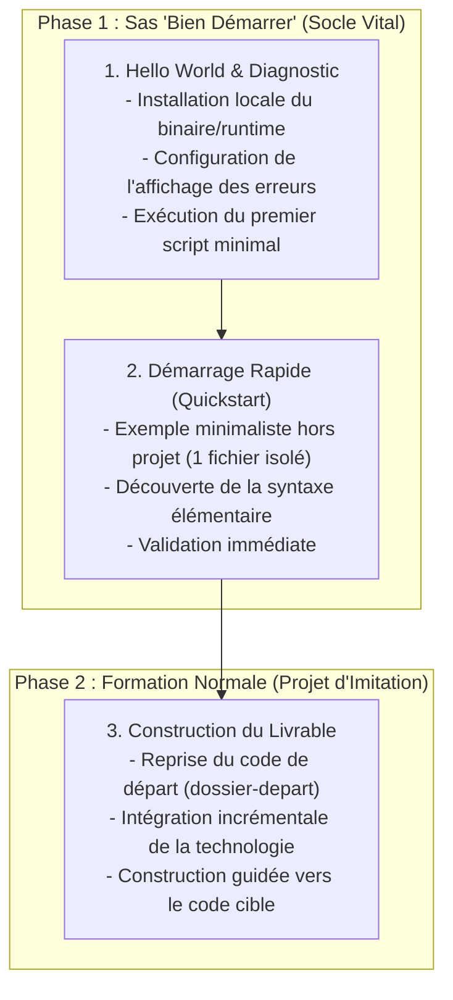

# Méthode Pédagogique « Bien Démarrer » (Getting Started Générique)

Ce guide méthodologique définit le protocole pédagogique obligatoire lors de l'introduction de tout nouveau langage de programmation, runtime, outil en ligne de commande ou framework au sein du cursus Solicode (Niveaux N1, N2, N3).

---

## 1. Pourquoi le Sas « Bien Démarrer » est Indispensable

Plonger directement un apprenant débutant dans la réalisation d'une maquette ou d'un livrable applicatif complexe avec une technologie qu'il n'a jamais manipulée crée une **rupture cognitive brutale** :
- L'apprenant doit simultanément appréhender l'installation de l'environnement, le fonctionnement du serveur/runtime, la nouvelle syntaxe, la logique applicative et l'intégration dans les fichiers existants.
- Si le script échoue (ex: erreur de syntaxe ou serveur mal configuré), l'absence d'affichage des erreurs le laisse devant un écran blanc (*White Screen of Death*), provoquant panique et blocage.

Pour garantir un apprentissage fluide et sécurisant, **toute nouvelle technologie commence impérativement par la phase « Bien Démarrer »** avant toute intégration dans le Projet d'imitation.

---

## 2. Les Trois Phases du Découpage Pédagogique

---

### Phase 1.1 — Hello World & Diagnostic Environnement
*Objectif : Vérifier que l'outil est installé, qu'il fonctionne et que les erreurs sont immédiatement visibles.*

1. **Vérification de l'installation :**
   - Comment vérifier que l'outil est présent sur la machine (`php -v`, `node -v`, `python --version`, `git --version`).
   - Guide d'installation pas-à-pas minimal si absent (ex: XAMPP, PHP binaire, runtime).
2. **Configuration vitale de l'affichage des erreurs :**
   - **Règle absolue :** Un débutant ne doit JAMAIS coder sur un environnement où les erreurs sont masquées.
   - En PHP : activer `display_errors = On` et `error_reporting = E_ALL` dans `php.ini` ou directement en tête de script avec `ini_set('display_errors', '1');`.
   - En JavaScript / Web : ouvrir et utiliser systématiquement la console de développement (F12).
   - En Python / CLI : comprendre la trace d'erreur (*Traceback*).
3. **Premier script minimal observable :**
   - Un fichier unique (`hello.php`, `test.js`), sans HTML complexe.
   - Affichage d'un texte simple (*« Hello World »*).
   - Exécution soit en CLI (`php hello.php`), soit sur serveur de développement local (`php -S localhost:8000`).

---

### Phase 1.2 — Démarrage Rapide (Quickstart Isolé)
*Objectif : Manipuler la syntaxe minimale sur un exemple court et autonome avant la complexité applicative.*

- Réaliser le premier exemple rapide le plus simple possible :
  - Déclaration d'une variable.
  - Affichage ou concaténation simple.
  - Une opération ou condition élémentaire.
- Ce travail s'effectue dans un **fichier de bac à sable isolé** (ex: `demo-bases.php`).
- **Principe de charge minimale :** Pas de CSS, pas de mise en page, pas de base de données. L'apprenant valide qu'il comprend comment la technologie réagit avant de toucher au projet.

---

### Phase 1.3 — Bascule vers la Formation Normale (Projet d'Imitation)
*Objectif : Construire le livrable métier incrémental à partir du dossier de départ.*

- L'apprenant dispose maintenant d'un environnement opérationnel, sait comment déboguer ses erreurs et connaît la syntaxe minimale.
- Il peut alors ouvrir en toute confiance le `dossier-depart/` du projet d'imitation (ex: le Blog statique HTML/CSS) et commencer à transformer les fichiers pour atteindre le `code-a-apprendre/`.

---

## 3. Matrice d'Application Générique par Domaine

| Domaine / Technologie | Étape Hello World (Diagnostic & Erreurs) | Étape Démarrage Rapide (Quickstart) | Transition Projet d'Imitation |
| :--- | :--- | :--- | :--- |
| **PHP Procédural** | Installation PHP, `php -v`, `php -S localhost:8000`, `display_errors = On` | `hello.php` avec variable `$nom` et `echo` | Remplacement du titre statique dans `index.php` du Blog |
| **JavaScript DOM** | Ouverture console DevTools F12, `console.log("Hello")` | Déclaration `let/const`, manipulation d'une balise avec `document.querySelector` | Animation du menu burger ou des cartes du Blog |
| **Bases de données SQL** | Connexion au serveur MySQL/MariaDB, `SHOW DATABASES;` | Création d'une table test `SELECT 1 + 1;` | Schéma des tables Article et Catégorie du Blog |
| **Framework CSS (Tailwind / Bootstrap)** | Inclusion CDN ou compilation locale, inspection de l'élément | Application de classes utilitaires simples (`text-red-500`, `p-4`) sur un bouton test | Stylisation des composants du Blog |
| **Framework JS / PHP (React, Laravel)** | Initialisation runtime, serveur de dev (`npm run dev` ou `php artisan serve`), écran d'accueil | Création d'un composant minimal ou d'une route test `Route::get('/test', ...)` | Intégration de la logique métier du projet |

---

## 4. Checklist Binaire d'Alignement « Bien Démarrer »
- [ ] Le binaire ou runtime est-il formellement vérifié ou installé avant toute écriture de code ?
- [ ] L'affichage des erreurs ou le mode de débogage est-il activé et testé explicitement par l'apprenant ?
- [ ] Un script minimal observable (Hello World) est-il exécuté avec succès ?
- [ ] Un exemple de démarrage rapide isole-t-il la syntaxe de base avant toute modification du projet applicatif ?
- [ ] Le passage au projet d'imitation s'appuie-t-il sur les acquis confirmés du sas de démarrage ?
