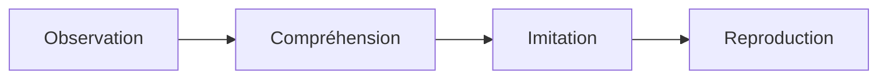

# Configuration du Site Jekyll d'Autoformation

## 1. Vue d'Ensemble Technique

La plateforme d'**Autoformations Web Solicode** est un site statique généré avec **Jekyll** et basé sur le thème **Just the Docs**.

Ce document décrit en détail :
- Les paramètres du fichier de configuration principal `_config.yml`.
- La configuration du thème Just the Docs, du moteur de recherche et des diagrammes Mermaid.
- La déclaration des collections et leur comportement dans la navigation.
- L'organisation modulaire des styles (`assets/css/`) et des scripts interactifs (`assets/js/`).
- Les standards techniques obligatoires du projet.

---

## 2. Configuration Principale (`_config.yml`)

Le fichier [`_config.yml`](../_config.yml) est la colonne vertébrale du site.

### 2.1. Métadonnées Globales & Chemins

```yaml
title: Autoformations Web
description: Autoformations Solicode

theme: just-the-docs

url: https://solicode-web-mobile.github.io
baseurl: /autoformations-web

repository: solicode-web-mobile/autoformations-web

aux_links:
  "Solicode.co": https://solicode.co/

aux_links_new_tab: true
```

- **`title`** : Titre affiché dans l'onglet du navigateur et dans l'en-tête de la barre latérale.
- **`url`** : Domaine GitHub Pages de production.
- **`baseurl`** : Préfixe d'accès du site (`/autoformations-web`).  
  > [!IMPORTANT]
  > Pour tous les liens internes, images ou scripts, utilisez impérativement le filtre Liquid `| relative_url`. Ne codez jamais de chemins absolus en dur comme `/assets/...` ; écrivez `{{ '/assets/...' | relative_url }}`.

---

### 2.2. Options du Thème Just the Docs

```yaml
search_enabled: true
nav_enabled: true
heading_anchors: true
enable_copy_code_button: true
nav_error_report: true
show_collapsed: true

back_to_top: true
back_to_top_text: "Retour en haut"
```

- **`search_enabled`** : Active la barre de recherche instantanée en haut de page. Elle indexe automatiquement les titres et contenus du site.
- **`heading_anchors`** : Ajoute des liens d'ancrage cliquables sur les titres `<h2>`, `<h3>`, etc.
- **`enable_copy_code_button`** : Affiche automatiquement un bouton « Copier » sur chaque bloc de code formaté avec des triples backticks.
- **`show_collapsed`** : Masque par défaut les sous-niveaux de navigation pour ne pas surcharger le menu latéral.

---

### 2.3. Diagrammes Mermaid

```yaml
mermaid:
  version: "12.0.0"
```

Le site intègre **Mermaid v12.0.0** pour dessiner des schémas fonctionnels, des diagrammes de classes, des diagrammes de séquence ou des organigrammes directement depuis le markdown :

````markdown

````

> [!NOTE]
> Dans certains layouts (ex: onglets ou accordéons masqués au chargement), la bibliothèque Mermaid nécessite un rafraîchissement dynamique (`mermaid.run()`) dès l'ouverture du volet parent pour éviter un rendu réduit à `0x0` pixels.

---

### 2.4. Blocs d'Information (*Callouts*)

Le site configure 5 styles d'encadrés informatifs utilisables dans toutes les pages :

```yaml
highlighter: none
callouts_level: quiet

callouts:
  highlight:
    color: yellow
  important:
    title: Important
    color: blue
  new:
    title: Nouveau
    color: green
  note:
    title: Note
    color: purple
  warning:
    title: Attention
    color: red
```

**Syntaxe markdown recommandée :**

```markdown
> [!NOTE]
> Ceci est une information complémentaire pour l'apprenant.

> [!IMPORTANT]
> Ceci est une consigne essentielle ou une étape obligatoire.

> [!WARNING]
> Ceci signale une erreur fréquente à éviter.
```

---

### 2.5. Déclaration des Collections Jekyll

Jekyll permet de découper les contenus en collections indépendantes. Elles sont toutes déclarées avec `output: true` pour générer des pages HTML accessibles via une URL dédiée :

```yaml
collections:
  sessions:
    output: true
    permalink: /sessions/:slug/

  labs:
    output: true
    permalink: /labs/:slug/

  prototypes:
    output: true
    permalink: /prototypes/:slug/

  projets:
    output: true
    permalink: /projets/:slug/

  missions:
    output: true
    permalink: /missions/:slug/

  competences:
    output: true
    permalink: /competences/:slug/

  domaines:
    output: true
    permalink: /formations/:slug/

  uas:
    output: true
    permalink: /uas/:slug/

  tutos:
    output: true
```

---

### 2.6. Intégration dans la Navigation Latérale

La section `just_the_docs.collections` contrôle quelles collections apparaissent dans le menu de gauche :

```yaml
just_the_docs:
  collections:
    sessions:
      name: "Parcours par sessions"
      nav_exclude: false

    missions:
      name: "Formations"
      nav_exclude: false

    domaines:
      name: "Formations"
      nav_exclude: true

    competences:
      name: "Compétences"
      nav_exclude: true

    uas:
      name: "Unités d'apprentissage"
      nav_exclude: true

    tutos:
      name: "Tutoriels"
      nav_exclude: true

    labs:
      name: "Labs"
      nav_exclude: true

    prototypes:
      name: "Prototypes"
      nav_exclude: true

    projets:
      name: "Sprints"
      nav_exclude: true
```

- **Seules `sessions` et `missions` sont affichées directement dans le menu principal (`nav_exclude: false`).**
- Les autres collections (`uas`, `tutos`, `prototypes`, etc.) sont masquées du menu latéral (`nav_exclude: true`). Elles sont consultées de manière fluide et contextuelle à l'intérieur des pages de Session, de Domaine ou d'UA grâce aux gabarits Liquid.

---

## 3. Architecture des Assets (`assets/`)

```text
assets/
├── css/
│   ├── base.css              # Styles partagés, boutons, badges, cartes communes
│   ├── session.css           # Styles spécifiques au layout session
│   ├── ua.css                # Styles spécifiques au layout ua
│   ├── domaine.css           # Styles spécifiques au layout domaine
│   ├── competence.css        # Styles spécifiques au layout competence
│   ├── mission.css           # Styles spécifiques au layout mission
│   ├── tuto.css              # Styles spécifiques au layout tuto
│   ├── prototype.css         # Styles spécifiques au layout prototype
│   ├── lab.css               # Styles spécifiques au layout lab
│   ├── projet.css            # Styles spécifiques au layout projet (sprint)
│   ├── editor.css            # Styles de l'éditeur de code interactif
│   └── algo-svg.css          # Styles des composants visuels d'algorithmique
└── js/
    ├── tutorial-navigation.js # Gestion de l'historique et des boutons étape suivante/précédente
    ├── text-resizer.js        # Contrôle de la taille de police (A+ / A-)
    ├── iframe-controls.js     # Redimensionnement et habillage des démonstrateurs
    ├── code-editor-injector.js# Montage de l'éditeur de code dynamique
    ├── fullscreen-block.js    # Agrandissement plein écran des démonstrateurs
    └── sidebar-toggle.js      # Ouverture et fermeture du panneau latéral
```

### 3.1. Inclusion Dynamique des Feuilles de Style

Le fichier [`_includes/head_custom.html`](../_includes/head_custom.html) charge systématiquement `base.css`, puis charge la feuille de style spécifique selon le `page.layout` :

```liquid
<link rel="stylesheet" href="{{ '/assets/css/base.css' | relative_url }}">


  
    <link rel="stylesheet" href="{{ '/assets/css/mission.css' | relative_url }}">
  
    <link rel="stylesheet" href="{{ '/assets/css/competence.css' | relative_url }}">
  
    <link rel="stylesheet" href="{{ '/assets/css/domaine.css' | relative_url }}">
  
    <link rel="stylesheet" href="{{ '/assets/css/ua.css' | relative_url }}">
  
    <link rel="stylesheet" href="{{ '/assets/css/session.css' | relative_url }}">
  
    <link rel="stylesheet" href="{{ '/assets/css/tuto.css' | relative_url }}">
  
    <link rel="stylesheet" href="{{ '/assets/css/prototype.css' | relative_url }}">
  
    <link rel="stylesheet" href="{{ '/assets/css/lab.css' | relative_url }}">
  
    <link rel="stylesheet" href="{{ '/assets/css/projet.css' | relative_url }}">

```

---

## 4. Règles Techniques Obligatoires

### Règle 1 : Encodage Strict UTF-8 sans BOM
Tous les fichiers (`.md`, `.html`, `.css`, `.js`, `.yml`) doivent être encodés en **UTF-8 sans BOM**. L'ajout d'un BOM sous Windows provoque des erreurs d'affichage de caractères invisibles dans l'en-tête YAML.

### Règle 2 : Zéro CSS Inline
- **Interdiction absolue** d'insérer des balises `<style>` ou des attributs `style="..."` dans les fichiers markdown, les layouts ou les includes.
- Si une classe est utilisée dans plusieurs layouts : placez-la dans `assets/css/base.css`.
- Si une classe est propre à une seule vue : placez-la dans son fichier CSS dédié (ex: `assets/css/session.css`).

### Règle 3 : Utilisation Sécurisée de `jsonify`
Dans les scripts JavaScript intégrés dans des gabarits Liquid :
- Le filtre `| jsonify` génère déjà automatiquement les guillemets.
- **Interdiction :** N'écrivez jamais `var titre = "{{ page.title | jsonify }}";` (cela produit `""Mon Titre""` et casse le script).
- **Syntaxe correcte :** `var titre = {{ page.title | jsonify }};`.

### Règle 4 : Synchronisation avec le Core Theme
Le socle technique (styles, gabarits partagés) est géré en liaison avec le dépôt parent `autoformations-core-theme` via `theme-sync.json`.
- Ne lancez jamais de synchronisation automatique sans décision explicite de l'équipe de conception.
- Pour plus d'informations, consultez [`docs/synchronisation-theme.md`](../docs/synchronisation-theme.md).
