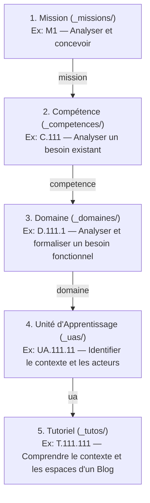
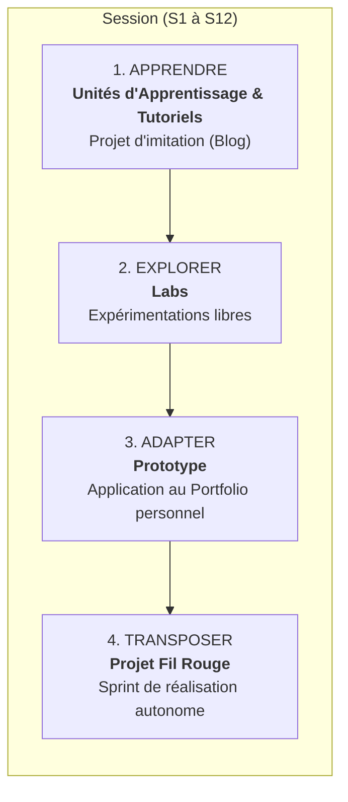
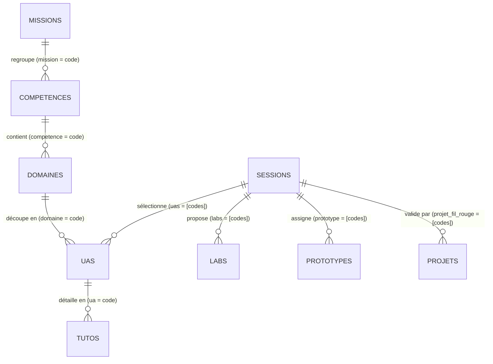

# Architecture & Relations des Collections Jekyll

## 1. Vue d'Ensemble du Modèle de Données

Le cursus d'**Autoformations Web Solicode** s'appuie sur **9 collections Jekyll**. 

Ce modèle articule deux visions complémentaires :
1. **L'Axe Référentiel Académique (Structure Statique) :** Découpe les savoirs et savoir-faire depuis les grandes missions professionnelles jusqu'aux tutoriels techniques élémentaires.
2. **L'Axe Déroulement Pédagogique (Structure Dynamique par Session) :** Guide l'apprenant semaine après semaine à travers les 4 phases de l'apprentissage actif (*Apprendre $\rightarrow$ Explorer $\rightarrow$ Adapter $\rightarrow$ Transposer*).

---

## 2. L'Axe Référentiel Académique

Le référentiel académique est structuré selon une hiérarchie stricte en 5 niveaux :

$$\text{Mission (M)} \longrightarrow \text{Compétence (C)} \longrightarrow \text{Domaine (D)} \longrightarrow \text{Unité d'Apprentissage (UA)} \longrightarrow \text{Tutoriel (T)}$$



### Rôle de chaque niveau académique

1. **Mission (`_missions/`) :** Représente une grande mission métier du profil Développeur Web (ex: *M1 — Analyser et concevoir*, *M2 — Développer une interface utilisateur*).
2. **Compétence (`_competences/`) :** Définit une compétence opérationnelle mesurable associée à une mission et rattachée au référentiel officiel DWB (ex: *C.111 — Analyser un besoin existant*).
3. **Domaine (`_domaines/`) :** Regroupe un ensemble homogène de savoirs techniques ou méthodologiques rattachés à une compétence (ex: *D.122.1 — HTML*, *D.122.2 — CSS*, *D.122.3 — JavaScript*, *D.124.1 — SQL*).
4. **Unité d'Apprentissage (`_uas/`) :** Délimite un apprentissage précis d'une durée type (souvent 1 à 2 heures), avec un objectif concret, des notions clés et un livrable attendu.
5. **Tutoriel (`_tutos/`) :** Contenu pédagogique d'autoformation pas-à-pas (théorie synthétique, exemple concret du Blog, manipulation guidée ou éditeur de code interactif).

---

## 3. L'Axe Déroulement Pédagogique par Session

Chaque session de formation (`_sessions/S[X].md`) est une unité de temps (généralement 1 à 2 semaines) qui orchestre le travail des apprenants selon le **cycle pédagogique en 4 phases** :



### Les 4 Phases Expliquées

| Phase | Collection Source | Rôle Pédagogique | Exemple en Session 1 |
| :--- | :--- | :--- | :--- |
| **1. Apprendre** | `_uas/` et `_tutos/` | Observation, compréhension et imitation sur l'application fil rouge (*Le Blog Personnel*). | Étude du contexte et de la maquette du Blog, premiers scripts JS. |
| **2. Explorer** | `_labs/` | Découverte guidée et expérimentation ciblée d'une technologie ou d'un outil. | *Lab L.101 — Découvrir le rôle du HTML*. |
| **3. Adapter** | `_prototypes/` | Réinvestissement individuel des notions apprises sur un cas personnel. | *Prototype 1 — Analyser le contexte et les acteurs de son Portfolio*. |
| **4. Transposer** | `_projets/` | Réalisation concrète en conditions réelles dans le cadre d'un sprint d'équipe. | *Sprint 1 — Identifier le contexte et les acteurs du projet fil rouge*. |

---

## 4. Schéma Relationnel Global des 9 Collections

Ce schéma illustre comment les 9 collections interagissent via leurs clés de liaison dans le moteur Liquid :



---

## 5. Mécanique des Liaisons Liquid

Les gabarits du dossier `_layouts/` créent dynamiquement les liaisons entre les pages grâce aux filtres Liquid de Jekyll.

### 5.1. Comment une Session affiche ses Unités d'Apprentissage

Dans `_sessions/S1.md`, la liste des codes est déclarée :
```yaml
uas:
  - "UA.162.11"
  - "UA.111.11"
```

Dans `_layouts/session.html`, le gabarit recherche chaque objet UA dans la collection `site.uas` :
```liquid

  
  
    <!-- Affichage du titre, du lien et de l'objectif de l'UA -->
  
    <p class="content-error">UA introuvable : {{ ua_code }}</p>
  

```

> [!WARNING]
> Si le code saisi dans `page.uas` ne correspond pas exactement au champ `code:` d'un fichier du dossier `_uas/`, Just the Docs affichera un message d'erreur rouge **`UA introuvable : UA.xxx.xx`** sur la page de la session.

### 5.2. Comment une UA affiche ses Tutoriels

Dans `_layouts/ua.html`, le gabarit recherche automatiquement tous les tutoriels rattachés au code de l'UA courante :
```liquid


```

Il n'est pas nécessaire de déclarer manuellement la liste des tutoriels dans le fichier de l'UA : **c'est le tutoriel qui indique à quelle UA il appartient** via son champ `ua: "UA.xxx.xx"`.

### 5.3. Comment un Tutoriel affiche son Fil d'Ariane

Dans `_layouts/tuto.html`, à partir du champ `page.ua`, Liquid remonte automatiquement toute la chaîne :
1. Recherche de l'UA correspondante (`site.uas | where: "code", page.ua`).
2. Recherche du Domaine associé (`site.domaines | where: "code", current_ua.domaine`).
3. Recherche de la Compétence associée (`site.competences | where: "code", current_ua.competence`).
4. Recherche de la Mission associée (`site.missions | where: "code", current_competence.mission`).

L'en-tête du tutoriel génère ainsi un fil d'ariane complet et cliquable :
$$\text{M1} > \text{C.111} > \text{Analyser et formaliser un besoin} > \text{Identifier le contexte et les acteurs}$$
