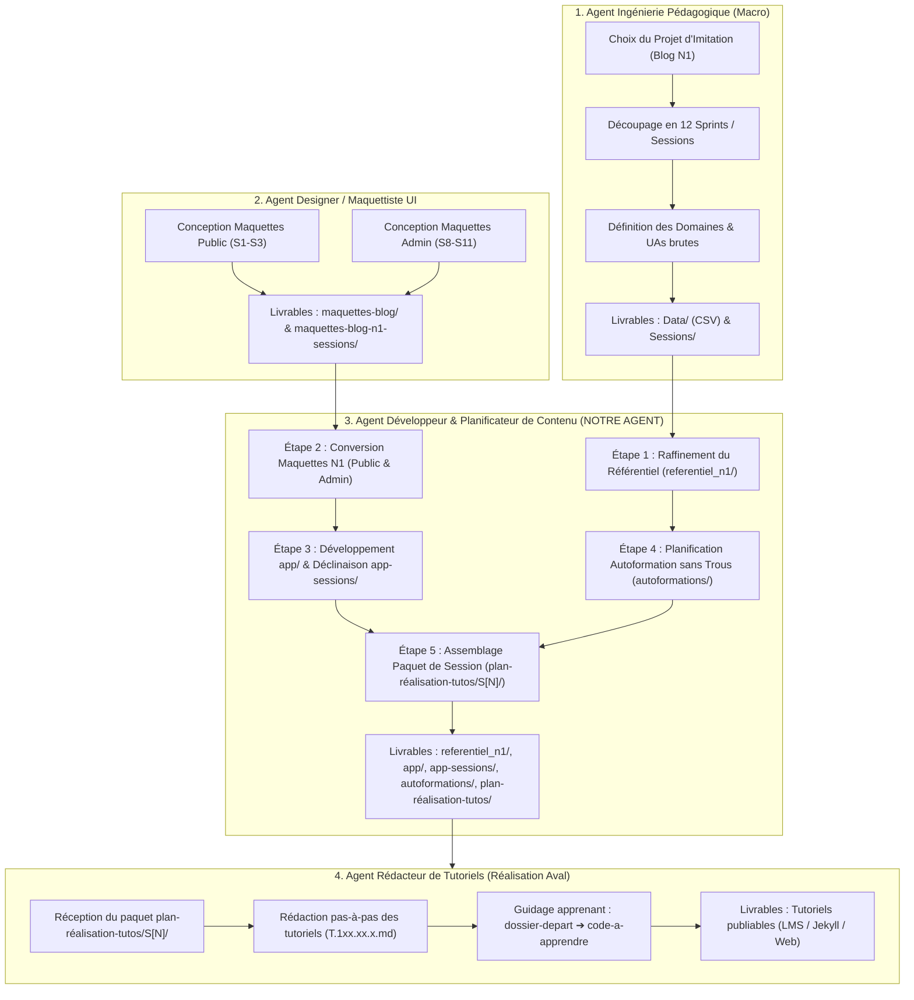

# Plan Global de Réalisation des Tutoriels

## 1. Introduction & Contexte Général

La création des contenus de formation pour la **Spartel Dev Academy** (Niveau N1 — Débutant) s'appuie sur une pédagogie active par projet d'imitation (*Observation → Compréhension → Imitation → Reproduction*). 

Pour produire des tutoriels cohérents, progressifs et directement reliés au code source de l'application fil rouge (**Le Blog Personnel**), le travail est réparti au sein d'une chaîne séquentielle de **4 Agents spécialisés**.

Ce document formalise :
1. Le rôle et les interactions des **4 agents** de la chaîne de production.
2. Le workflow interne complet et opérationnel de **notre agent** (*Développeur & Planificateur de Contenu*).
3. Le rôle pivot du dossier **`referentiel_n1/`** pour garantir une couverture pédagogique sans trous conceptuels.
4. La matrice des **skills** mobilisés et à concevoir.
5. La **structuration normalisée** des dossiers et livrables du dépôt.

---

## 2. Chaîne de Production Globale : Les 4 Agents Spécialisés



### Matrice des Responsabilités des 4 Agents :

| Agent | Identité & Posture | Mission Principale | Données en Entrée | Livrables Produits |
| :--- | :--- | :--- | :--- | :--- |
| **Agent 1** | **Ingénieur Pédagogique (Macro)** | Cadrage macro de la formation : définit le projet cible, organise le découpage en 12 sprints et formalise la liste des compétences et des Unités d'Apprentissage (UA). | Cahier des charges, Compétences du référentiel N1 | `Data/` (`Sessions.csv`, `uas.csv`, `Domaines-Compétence.csv`) et `Sessions/S[N]-.../S[N].md` |
| **Agent 2 (UI)** | **Designer / Maquettiste UI** | Conception ergonomique et visuelle : produit les maquettes graphiques et wireframes des écrans publics et d'administration. | Spécifications fonctionnelles, Parcours utilisateur | Dossiers de maquettes : `maquettes-blog/` et `maquettes-blog-n1-sessions/` |
| **Agent 3 (NOUS)** | **Développeur & Planificateur de Contenu** | **Cœur du projet actuel :**<br>1. Affine le référentiel amont (`referentiel_n1/`).<br>2. Convertit les maquettes en HTML/CSS pur.<br>3. Développe le projet final (`app/`) et le décline par sprint (`app-sessions/`).<br>4. Planifie les tutoriels par domaine sans trous conceptuels (`autoformations/`).<br>5. Assemble les paquets finaux par session (`plan-réalisation-tutos/S[N]/`). | `Data/`, `Sessions/`, Maquettes UI | `referentiel_n1/`, `app/`, `app-sessions/`, `autoformations/`, `plan-réalisation-tutos/` |
| **Agent 4** | **Rédacteur de Tutoriels** *(Projet Aval)* | Rédaction finale détaillée : produit les fiches pas-à-pas (`T.1xx.xx.x.md`) avec explications, captures et consignes pour guider l'apprenant vers le livrable. | Paquets préparés dans `plan-réalisation-tutos/S[N]/` | Fiches tutoriels complètes publiables sur la plateforme d'apprentissage (LMS) |

---

## 3. Stratégie Pédagogique : Les 3 Voies de Progression & Règle d'Or

> Pour une analyse approfondie et une matrice synoptique session par session, consulter la fiche dédiée :  
> 👉 [2.Les trois voies de progression pédagogique.md](2.Les%20trois%20voies%20de%20progression%20p%C3%A9dagogique.md)

L'ingénierie de formation N1 s'articule autour de **trois chemins de progression pédagogique** parallèles et complémentaires :

### 🛣️ Voie 1 : Le Sandbox Algorithmique avec JavaScript
* **Finalité :** Développer la logique algorithmique pure indépendamment de l'interface graphique et sans complexité serveur.
* **Progression propre :** Variables et types simples ➔ calculs et expressions ➔ conditions logiques ➔ boucles et répétitions ➔ fonctions modulaires ➔ manipulation de collections et tableaux en mémoire.
* **Rôle d'amorce :** Les concepts logiques sont assimilés et validés dans le Sandbox en JavaScript avant d'être réinvestis dans la programmation serveur PHP (à partir de S4).

### 🛣️ Voie 2 : Analyse et Conception des Données (De la Maquette au MLD)
* **Finalité :** Modéliser les données réelles d'une application informatique en partant de l'observation visuelle des écrans.
* **Progression propre :** Observation des maquettes ➔ repérage des données et dictionnaire de données (S1-S2) ➔ dépendances fonctionnelles et entités (S3) ➔ relations, cardinalités et construction du MCD complet (S4-S5) ➔ transformation relationnelle en MLD et création des tables MySQL (S6).
* **Règle clé :** L'apprenant ne reçoit pas un schéma abstrait préétabli ; il découvre et construit pas-à-pas le modèle de données à partir des écrans du Blog.

### 🛣️ Voie 3 : Développement Web Applicatif — Le Fil Rouge (HTML, CSS, JS, PHP, SQL, Architecture)
* **Finalité :** Construire l'application Web complète du Blog personnel. Cette voie constitue la **colonne vertébrale active sur l'ensemble des 12 sessions**.
* **Deux grandes phases de réalisation :**
  1. **Phase A — La Partie Publique (Sessions S1 à S7) :**
     - S1-S3 : Intégration statique en HTML5 sémantique et CSS3 pur (Détail et Accueil).
     - S4-S5 : Dynamisation en PHP procédural avec séparation logique / vue (templates) et manipulation de collections en mémoire.
     - S6-S7 : Connexion MySQL avec PDO, requêtes SQL dynamiques et filtrage par catégorie.
  2. **Phase B — La Partie Administration (Sessions S8 à S12) :**
     - S8-S9 : Séparation Public/Admin et CRUD complet (Gestion des catégories en S8, Gestion des articles en S9 avec validation des formulaires).
     - S10 : Sécurité, gestion des sessions utilisateur et authentification de l'administrateur.
     - S11 : Recherche multicritères, filtres avancés et interactions DOM JavaScript.
     - S12 : Recette globale, corrections et présentation du projet final.

---

### Règle d'Or de Réalisation des Tutoriels : Session par Session vs Première Mobilisation

Pour garantir une charge cognitive équilibrée et une efficacité pédagogique maximale :

1. **Développement Web Applicatif (HTML, CSS, JS DOM, PHP, SQL, Architecture) :**
   - **Réalisation Session par Session (Sprint par Sprint) :**
   - Les tutoriels de cette voie sont scindés et planifiés dans **chacune des 12 sessions**.
   - Ils partent obligatoirement du `dossier-depart/` (hérité de $S[N-1]$) et guident l'apprenant pour produire le `code-a-apprendre/` du livrable de la session $S[N]$.

2. **Autres Domaines Transverses (Git, Déploiement Local, Débogage, Tests, Gestion, Veille) :**
   - **Rédaction Complète dès la Première Mobilisation :** Dès qu'un domaine transverse apparaît pour la première fois dans une session (ex: Git en S2, Déploiement en S1/S6, Débogage en S2, etc.), **l'intégralité du contenu des tutoriels de ce domaine pour l'ensemble des 12 sessions est rédigée et formalisée d'un coup**.
   - **Réalisation Progressive Session par Session par l'Apprenant :** L'apprenant **réalise** ces tutoriels de façon échelonnée, **session par session**, au fur et à mesure des sessions qui les mobilisent, en exploitant le contenu déjà intégralement formalisé.

---

## 4. Workflow Opérationnel Interne de Notre Agent (5 Étapes)

Notre agent intervient en tant que pivot technique et méthodologique à travers 5 étapes chronologiques :

### Étape 1 : Raffinement du Référentiel Pédagogique (`referentiel_n1/`)
* **Problématique :** Les données brutes issues de `Data/uas.csv` définissent les grandes unités mais comportent parfois des sauts conceptuels ou des manques pour un apprenant débutant N1.
* **Travail réalisé :**
  - Pour chaque domaine de compétence (`php`, `html`, `css`, `sql`, `architecture`, `conception`, etc.), générer et structurer une fiche de référence dans `referentiel_n1/[mini-code]/notions.md`.
  - Structuration obligatoire en **3 parties normées** :
    1. *1. Notions générales N1 :* Connaissances et posture attendues pour un débutant.
    2. *2. Notions existantes :* Liste exacte des UAs issues de `Data/uas.csv` enrichies (Description, Travail à faire adapté au projet, Session d'application, Livrable dans "app").
    3. *3. Notions indispensables N1 NON existantes :* Recommandations d'expertise pour combler les lacunes et **garantir l'absence de tout trou conceptuel**.
* **Livrable :** L'ensemble des fiches consolidées dans `referentiel_n1/`.

### Étape 2 : Intégration et Conversion des Maquettes UI
* **Problématique :** Les maquettes fournies par l'Agent UI (souvent en Tailwind, Figma ou maquettes riches) doivent être transformées en code simple et lisible pour un niveau N1.
* **Travail réalisé :**
  - Utilisation du skill `convertisseur-maquette-n1`.
  - Conversion en **HTML5 sémantique** et **CSS3 pur** (sans framework utilitaire complexe).
  - Couverture complète de l'application :
    - **Pages publiques :** Accueil et Détail d'article (S1 à S3).
    - **Pages d'administration :** Gestion des catégories, des articles, authentification et recherche (S8 à S11).
* **Livrable :** Templates et intégrations dans `maquette-blog-n1-sessions/`.

### Étape 3 : Développement du Projet Final & Déclinaison par Sprint
* **Problématique :** Pour que les tutoriels mènent à un résultat concret, le formateur et l'apprenant doivent disposer d'un code source de référence testé et fonctionnel.
* **Travail réalisé :**
  - **1. Réalisation du Projet Final (`app/`) :** Développement de l'application complète cible du Blog (PHP pur, PDO MySQL, architecture séparant logique et templates, espace public et espace admin sécurisé).
  - **2. Déclinaison par Sprint (`app-sessions/S1` à `S12`) :** Découpage du code pour chaque sprint de façon à fournir le livrable exact attendu à chaque fin de session.
* **Livrable :** Dossiers de code `app/` (application complète) et `app-sessions/S1/` à `app-sessions/S12/`.

### Étape 4 : Planification des Tutoriels par Domaine — Zéro Trou Conceptuel (`autoformations/`)
* **Problématique :** Comment passer d'une Unité d'Apprentissage globale à une suite d'exercices progressifs et assimilables par l'apprenant ?
* **Travail réalisé :**
  - À partir du référentiel raffiné dans `referentiel_n1/`, concevoir pour chaque domaine un parcours d'autoformation détaillé.
  - Découper chaque UA en tutoriels atomiques identifiés par un code univoque (`T.1xx.xx.x`).
  - Définir pour chaque tutoriel : Titre, Objectif pédagogique, Notions abordées, Livrable attendu, et Extrait de code cible.
  - Ordonner rigoureusement les tutoriels du plus simple au plus élaboré pour éviter tout blocage cognitif.
* **Livrable :** Fichiers `autoformations/[domaine]/plan-des-tutos.md`.

### Étape 5 : Assemblage et Planification Finale par Session (`plan-réalisation-tutos/`)
* **Problématique :** L'Agent 4 (Rédacteur) a besoin pour chaque session d'un dossier autonome qui contextualise la session, fournit la base de départ de l'apprenant et isole le code à concevoir.
* **Travail réalisé :**
  - **1. Vue globale des 12 sessions :** Maintien du document unique `plan-réalisation-tutos/Plan-12-session.md` pour donner le panorama complet du cursus.
  - **2. Scission pédagogique du code source :**
    - `dossier-depart/` : code remis à l'apprenant au début de la session (hérité de la session précédente $S[N-1]$).
    - `code-a-apprendre/` : strictement le code spécifique à concevoir et à apprendre durant les tutoriels de cette session (extrait de `app-sessions/S[N]`).
  - **3. Fichiers de planification modulaires :**
    - `README.md` : Synthèse globale du sprint, objectifs, récapitulatif des livrables et index pointant vers les plans de progression.
    - `plan-developpement.md` : Plan dédié à la progression du développement web applicatif (HTML, CSS, PHP, SQL, Architecture), articulant le `dossier-depart/` et le `code-a-apprendre/` avec les fiches tutoriels détaillées.
    - `plan-[domaine].md` : Un fichier distinct par domaine technique dont les tutoriels sont formalisés/créés dans la session courante (ex: `plan-conception.md` pour la modélisation en S4, `plan-algo.md` pour le Sandbox, `plan-git.md` pour les transverses).
    - Chaque plan de domaine ou de développement structure obligatoirement ses compétences selon la chronologie en 3 volets :
      * ⏮️ **Acquis (Déjà vu) :** UAs acquises lors des sessions passées ($S1$ à $S[N-1]$).
      * 🎯 **Mobilisé (Session actuelle) :** UAs de la session $S[N]$ avec les fiches complètes des tutoriels associés.
      * ⏭️ **Perspectives (Prochainement) :** Notions qui seront abordées dans les sessions futures ($S[N+1]$ à $S12$).
* **Livrable :** Paquets autonomes et modulaires prêts pour rédaction dans `plan-réalisation-tutos/S[N]/`.

---

## 5. Matrice des Skills de l'Agent

| Compétence / Skill | Statut | Rôle et Responsabilités |
| :--- | :--- | :--- |
| **`concepteur-macro`** | **Opérationnel (v1.1.0)** | Lit `Data/uas.csv` et `Data/Sessions.csv`, génère les dossiers `Sessions/` et produit les fiches `referentiel_n1/[domaine]/notions.md` en 3 parties (Étape 1). |
| **`convertisseur-maquette-n1`** | **Opérationnel (v1.1.0)** | Convertit les maquettes UI en HTML5/CSS3 pur pour le niveau débutant (pages publiques S1-S3 et écrans d'administration S8-S11) (Étape 2). |
| **`developpeur-projet-sessions`** | **Opérationnel (v1.0.0)** | Développe l'application complète finale dans `app/` et décline le code source fonctionnel par sprint dans `app-sessions/S1` à `S12` selon la stack pure N1 (Étape 3). |
| **`concepteur-plan-domaine`** | **Opérationnel (v1.0.0)** | Analyse un domaine technique à partir de `referentiel_n1/` et produit le plan détaillé des tutoriels sans trous conceptuels dans `autoformations/[domaine]/` (Étape 4). |
| **`planificateur-tutoriels-session`** | **Opérationnel (v1.0.0)** | Assemble le paquet autonome de chaque session dans `plan-réalisation-tutos/S[N]/` avec `dossier-depart/`, `code-a-apprendre/` et `README.md` (Étape 5). |
| **`plugin-dev`** | **Opérationnel (v1.2.0)** | Assure la gouvernance, le respect des 10 rubriques normées et la conformité des compétences de l'écosystème. |

---

## 6. Structuration Normée des Dossiers et Fichiers

```text
contenu.n1.blog/
├── Data/                              # [INPUT AGENT 1] Référentiel brut de la conception pédagogique
│   ├── Domaines-Compétence.csv        # Référentiel des domaines et compétences N1
│   ├── Sessions.csv                   # Liste des 12 sessions et objectifs macro
│   ├── uas.csv                        # Cartographie exhaustive des UAs
│   └── chapitres.csv                  # Répertoire des tutoriels socles et liens
│
├── Sessions/                          # [INPUT AGENT 1] Fiches descriptives des 12 sessions
│   ├── S1-decouverte-projet/S1.md
│   ├── ...
│   └── S12-projet-final/S12.md
│
├── maquettes-blog-n1-sessions/        # [INPUT AGENT 2 - UI] Maquettes d'écrans (Public & Admin)
│
├── referentiel_n1/                    # [NOTRE AGENT - ÉTAPE 1] Référentiel raffiné et complété
│   ├── php/notions.md                 # Structure stricte en 3 parties (Général, Existant, Indispensable ajouté)
│   ├── css/notions.md
│   ├── architecture/notions.md
│   └── ...
│
├── app/                               # [NOTRE AGENT - ÉTAPE 3] Application complète finale de référence
│   ├── admin/                         # Espace d'administration complet
│   ├── css/, images/                  # Feuilles de style pures et médias partagés
│   ├── index.php, index-template.php  # Architecture séparant logique et vue
│   └── database.sql                   # Schéma de base de données relationnelle
│
├── app-sessions/                      # [NOTRE AGENT - ÉTAPE 3] Code de référence décliné par sprint
│   ├── S1/ à S12/                     # Livrable cible fonctionnel de chaque session
│
├── autoformations/                    # [NOTRE AGENT - ÉTAPE 4] Plans de tutoriels d'autoformation (zéro trou)
│   ├── php/plan-des-tutos-php.md
│   ├── architecture/2.plan-tutos/plan-des-tutos.md
│   ├── conception/3.unites-apprentissage/liste-ua-tuto.md
│   └── ...
│
├── plan-réalisation-tutos/            # [NOTRE AGENT - ÉTAPE 5] Paquets de réalisation prêts pour l'Agent 4
│   ├── Plan-12-session.md             # Synthèse globale permanente des 12 sessions
│   └── S[N]/                          # Paquet autonome pour le sprint S[N] (ex: S4)
│       ├── README.md                  # Synthèse du sprint et index des livrables
│       ├── plan-developpement.md      # Plan de réalisation de la progression Web (HTML, CSS, PHP, SQL)
│       ├── plan-[domaine].md          # Plan par domaine créé dans la session (ex: plan-conception.md)
│       ├── dossier-depart/            # Code de base remis à l'apprenant (hérité de S[N-1])
│       └── code-a-apprendre/          # Code cible spécifique à apprendre dans ce sprint
│
├── docs/                              # [DOCUMENTATION MÉTHODOLOGIQUE]
│   └── 1.Plan de réalisation des tutoriels.md  # Ce document de référence
│
└── .agent/                            # [OUTILS] Compétences opérationnelles
    ├── rules/rules.md
    └── skills/
        ├── concepteur-macro/
        ├── convertisseur-maquette-n1/
        ├── developpeur-projet-sessions/
        ├── concepteur-plan-domaine/
        ├── planificateur-tutoriels-session/
        └── plugin-dev/
```
