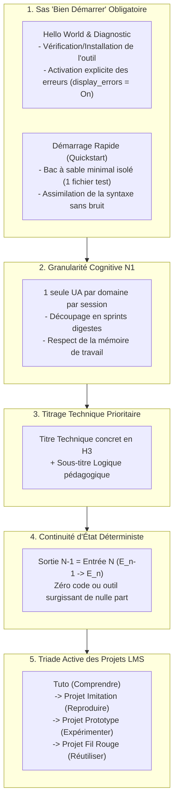

# Analyse Didactique : De la Rupture Cognitive à l'Apprentissage Sans Rupture

Ce document documente le retour d'expérience terrain, l'analyse des causes de rupture cognitive chez les apprenants débutants (N1) de Solicode, ainsi que les solutions pédagogiques et techniques appliquées par le skill `tutorial-planer` pour produire des tutoriels continus et sécurisants.

---

## 1. Définition : Qu'est-ce qu'une Rupture Cognitive en N1 ?

Chez un apprenant débutant (Niveau N1), la **rupture cognitive** survient dès qu'une tâche exige :
1. Une connaissance implicite non transmise préalablement.
2. Un environnement non configuré ou incapable d'indiquer pourquoi le code échoue.
3. Une surcharge simultanée d'informations dépassant la capacité de sa mémoire de travail.

Lorsque la rupture se produit, l'apprenant ne sait plus quoi faire, perd confiance, s'attribue faussement l'échec (*« Je ne suis pas fait pour le code »*) et décroche de la formation.

---

## 2. Comment Nous Avions Généré la Rupture Cognitive (Analyse du Cas S4)

L'audit du plan initial de la session **S4 (Transition vers le PHP dynamique)** a mis en lumière cinq mécanismes générateurs de rupture cognitive :

### 2.1. L'Illusion de l'Évidence Environnementale (Le saut sans installation)
- **Ce qui était fait :** Le plan démarrait directement par le tutoriel `T.123.111 — Écrire son premier script PHP` dans `index.php` au milieu des dossiers HTML/CSS du Blog.
- **Pourquoi cela générait une rupture :** On présupposait que PHP était déjà installé sur la machine de l'apprenant, configuré dans le PATH et opérationnel. En réalité, un apprenant débutant sur Windows n'a pas nécessairement PHP fonctionnel en ligne de commande ni de serveur local lancé. Tenter d'ouvrir un fichier `.php` par double-clic dans un navigateur affiche le code source brut au lieu de l'exécuter, plongeant l'apprenant dans l'incompréhension.

### 2.2. Le Piège Fatal du Silence des Erreurs (*White Screen of Death*)
- **Ce qui était fait :** Aucun tutoriel ne traitait de la configuration du fichier `php.ini` ou de l'affichage des erreurs.
- **Pourquoi cela générait une rupture :** Par défaut dans de nombreuses installations, la directive PHP `display_errors` est positionnée sur `Off`. Si l'apprenant commet la moindre erreur de syntaxe (oubli d'un point-virgule `;`, faute de frappe dans une variable `$atricle`), le navigateur renvoie **une page blanche totale** sans aucun message d'erreur. Privé de message de diagnostic et ignorant l'existence des journaux d'erreurs, l'apprenant est totalement bloqué.

### 2.3. La Surcharge Massive par Saturation d'Unités d'Apprentissage (UA)
- **Ce qui était fait :** La même session S4 concentrait **4 Unités d'Apprentissage PHP complètes** :
  - `UA.123.11` (Scripts et echo)
  - `UA.123.12` (Variables et Tableaux associatifs)
  - `UA.123.13` (Conditions if/else)
  - `UA.123.14` (Boucles foreach et formatage)
  - En plus de `UA.125.13` (Architecture MVC/Require) et `UA.112.14` (Conception MCD Merise) !
- **Pourquoi cela générait une rupture :** Assimiler en un seul sprint la syntaxe d'un nouveau langage, les tableaux multidimensionnels en mémoire, les structures algorithmiques de contrôle et la séparation logicielle contrôleur/vue sature instantanément l'esprit d'un apprenant N1.

### 2.4. Des Titres Abstraits et Conceptuels
- **Ce qui était fait :** Titrer les étapes avec des formulations académiques :  
  *« Contrôler un traitement »*, *« Répéter un traitement »*, *« Manipuler les expressions »*.
- **Pourquoi cela générait une rupture :** Les apprenants débutants ne mémorisent pas ces abstractions. En situation pratique, ils cherchent : *« Comment faire un if ? »*, *« Comment faire une boucle foreach ? »*, *« Dans quel fichier j'écris ? »*. Ne pas lier l'étape au vocabulaire technique concret empêche la fixation durable des réflexes professionnels.

### 2.5. Le Saut Direct dans la Maquette Complexe sans Bac à Sable
- **Ce qui était fait :** Injecter dès la première ligne de code le script PHP dans la page complète du Blog (avec balises `<header>`, `<nav>`, balisage CSS complexe, etc.).
- **Pourquoi cela générait une rupture :** Mélanger l'apprentissage de la syntaxe de base d'un langage avec les contraintes d'une maquette Web existante crée une dispersion visuelle. L'apprenant ne distingue plus ce qui relève du HTML/CSS statique et ce qui relève de l'interpréteur serveur.

---

## 3. Comment Nous Produisons Désormais des Tutoriels Sans Rupture Cognitive

Grâce au standard outillé par le skill **`tutorial-planer`**, toute progression de tutoriels obéit désormais à cinq piliers invariables :

---

### Pilier A : Le Sas « Bien Démarrer » Systématique (Getting Started)
Avant de toucher au code de l'application fil rouge, tout nouveau langage ou outil passe par deux étapes préalables :
1. **Hello World & Diagnostic d'Erreurs :**
   - Vérifier la présence du binaire (`php -v`).
   - Lancer un serveur local de test (`php -S localhost:8000`).
   - **Activer formellement l'affichage des erreurs :** Configurer `display_errors = On` et `error_reporting = E_ALL` pour qu'aucune erreur ne reste invisible.
   - Observer immédiatement le résultat d'un premier message.
2. **Démarrage Rapide (Quickstart) en Bac à Sable :**
   - Écrire un script ultra-simple dans un fichier isolé (`demo.php`) pour tester variables et affichages sans aucune balise HTML superflue.
3. **Bascule Sécurisée :** L'apprenant sait que sa machine fonctionne et qu'en cas de bogue, le message d'erreur s'affichera à l'écran. Il peut alors entrer sereinement dans le projet applicatif.

---

### Pilier B : Règle de Granularité (1 UA par Domaine par Session)
- **Principe :** Une session/sprint se concentre de préférence sur **une seule Unité d'Apprentissage (1 UA)** d'un domaine donné.
- **Bénéfice :** L'apprenant approfondit une seule difficulté technique majeure à la fois. Les notions complémentaires (ex: fonctions modulaires, requêtes PDO SQL) sont planifiées dans les sessions suivantes (S5, S6) de manière ordonnée et progressive.

---

### Pilier C : Titrage Technique Concret en Priorité
- **Principe :** Le titre principal d'un tutoriel doit mentionner la **technique concrète**, la commande, la fonction ou le fichier manipulé. Le titre conceptuel devient le sous-titre pédagogique.
- **Exemple concret :**
  - *Ancien titre :* `T.123.131 — Contrôler un traitement avec des conditions`
  - *Nouveau titre normé :* `T.123.131 — Conditionner l'affichage du badge avec if / else`  
    *Objectif logique : Contrôler dynamiquement le rendu visuel selon une donnée*
- **Bénéfice :** Repérage instantané dans la documentation, recherche facilitée et ancrage mémoriel fort.

---

### Pilier D : Continuité d'État Inviolable ($E_{n-1} \rightarrow E_n$)
- Chaque tutoriel $N$ démarre très exactement avec les fichiers et le code produits à la fin du tutoriel $N-1$.
- Aucune brique de code n'est ajoutée en "secret" ou par magie.
- Si une variable ou une fonction est utilisée à l'étape 3, elle a été explicitement déclarée et comprise à l'étape 1 ou 2.

---

### Pilier E : Articulation dans la Triade Active des 3 Projets LMS
Le plan de réalisation s'intègre harmonieusement dans le cycle de pédagogie active Solicode :
1. **Tutoriels (Comprendre) :** Faire comprendre la notion avec le strict minimum de code (un seul cas d'application).
2. **Projet d'Imitation (Reproduire) :** Assembler les briques des tutoriels pour construire pas-à-pas la page complète du Blog dynamique.
3. **Projet Prototype (Expérimenter) :** Rejouer en autonomie sur un cas analogue (ex: catalogue e-commerce) pour valider l'acquisition des automatismes.
4. **Projet Fil Rouge (Réutiliser & Compétence) :** Transférer l'ensemble des compétences dans la réalisation du grand projet professionnel annuel.

---

## 4. Tableau Synthétique : Avant vs Après sur la Session S4

| Critère Pédagogique | Conception Initiale (Avec Ruptures) | Conception Corrigée par `tutorial-planer` |
| :--- | :--- | :--- |
| **Prise en main de PHP** | Aucune installation mentionnée, saut direct dans `index.php`. | Sas "Bien Démarrer" : installation, serveur local, Hello World autonome. |
| **Gestion des erreurs** | Non abordée (`display_errors = Off` par défaut $\rightarrow$ risque d'écran blanc). | Tutoriel dédié activant `display_errors = On` et simulation d'une erreur pour apprendre à la lire. |
| **Bac à sable initial** | Aucun (code PHP immédiatement mélangé au template HTML du Blog). | Quickstart isolé dans un micro-fichier de test sans HTML superflue. |
| **Nombre d'UAs par session** | 4 UAs PHP (`UA.123.11` à `UA.123.14`) empilées $\rightarrow$ surcharge cognitive. | Découpage respectueux de la charge mentale, centré sur le flux vital de rendu dynamique. |
| **Formulation des Titres** | Titres logiques académiques (*« Répéter un traitement »*). | Titres techniques précis (*« Boucler sur $articles avec foreach et sécuriser avec htmlspecialchars »*). |
| **Continuité des codes** | Trous de cohérence entre les exemples et les fichiers finaux. | Chaînage strict $E_{n-1} \rightarrow E_n$, documenté et traçable pas-à-pas. |
| **Pédagogie d'ensemble** | Focalisée sur le rendu final sans ancrage des bases. | Cycle actif complet : Comprendre $\rightarrow$ Reproduire $\rightarrow$ Expérimenter $\rightarrow$ Réaliser. |
