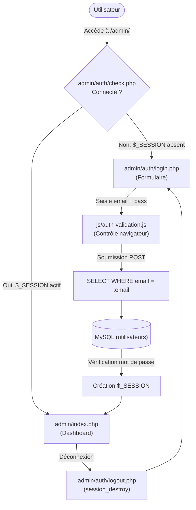

# Plan de Réalisation — Progression Développement Web (Session S10)

**Progression :** Développement Web Applicatif (Authentification, Sessions PHP & Contrôle d'accès)  
**Session :** S10 — Gérer l’authentification de l’Admin  
**Niveau :** N1 (Débutant)  

---

## 1. Contexte & Objectif du Sprint S10

Dans cette dixième session, l'apprenant sécurise l'ensemble du Back-Office du Blog en créant le **parcours complet d'authentification et de contrôle d'accès**.

* **Problème résolu :** Jusqu'à présent, n'importe qui connaissant l'URL `/admin/` pouvait accéder aux modules de gestion des articles et des catégories.
* **Solution pédagogique :**
  1. Construire l'interface de connexion [code-a-apprendre/admin/auth/login.php](code-a-apprendre/admin/auth/login.php) et [code-a-apprendre/admin/auth/login-template.php](code-a-apprendre/admin/auth/login-template.php).
  2. Valider la saisie côté client avec JavaScript pour informer immédiatement l'utilisateur (`UA.122.34`).
  3. Vérifier l'existence du compte en base de données avec une requête SQL ciblée (`UA.124.16`).
  4. Valider le mot de passe hashé avec `password_verify()` et initialiser la session utilisateur `$_SESSION` (`UA.124.25`).
  5. Créer le garde de sécurité [code-a-apprendre/admin/auth/check.php](code-a-apprendre/admin/auth/check.php) pour protéger toutes les pages d'administration.
  6. Développer la déconnexion avec destruction de session [code-a-apprendre/admin/auth/logout.php](code-a-apprendre/admin/auth/logout.php).

---

## 2. Articulation Temporelle de la Progression

### ⏮️ Acquis Passés (Sessions S1 à S9)
- Formulaires HTML et soumission en méthode `POST` (`UA.122.15`).
- Contrôle des données serveur avec `trim()` et messages d'erreur (`UA.123.17`).
- Requêtes préparées avec PDO pour interroger les tables (`UA.124.13`).
- Structuration de l'espace administration `admin/` (`UA.125.16`).

### 🎯 Unités d'Apprentissage & Tutoriels Mobilisés dans ce Sprint (Session S10)

#### Construire l’interface (D.122.1, html & js)

* **UA.122.34 — Contrôler les données saisies côté navigateur :**  
  Intercepter la soumission du formulaire de connexion avec JavaScript pour vérifier la présence d'une adresse email valide et d'un mot de passe non vide avant l'envoi au serveur.
  - **T.122.341 — Valider le formulaire de connexion côté client avec JavaScript**  
    *Livrable :* Script client alertant l'utilisateur en cas de saisie incomplète | *Fichier :* `js/auth-validation.js`

#### Réaliser le traitement serveur (D.123.1, php)

* **UA.123.18 — Organiser un traitement PHP complet (Sécurisation des accès) :**  
  Créer le mécanisme de protection par session PHP avec `session_start()`, initialisation des variables de session et redirection automatique si l'accès est refusé.
  - **T.123.182 — Gérer la session utilisateur et le verrou d'accès check.php**  
    *Livrable :* Fichier `check.php` protégeant les pages et script `logout.php` | *Fichier :* `admin/auth/check.php`, `admin/auth/logout.php`

#### Exploiter les données (D.124.1, sql)

* **UA.124.16 — Combiner les critères d’une requête :**  
  Construire une requête SQL combinant les critères de recherche pour identifier l'utilisateur administrateur par son email unique (`WHERE email = :email`).
  - **T.124.161 — Rechercher et identifier l'administrateur en SQL**  
    *Livrable :* Requête préparée ciblant l'utilisateur par son adresse email | *Fichier :* `admin/auth/login.php`

* **UA.124.25 — Vérifier et corriger l’exploitation des données :**  
  Contrôler la validité de l'empreinte de mot de passe (`password_verify()`), identifier les éventuelles erreurs d'authentification et afficher un message sécurisé sans dévoiler d'informations sensibles.
  - **T.124.251 — Vérifier le mot de passe et gérer les erreurs d'authentification**  
    *Livrable :* Contrôleur `login.php` complet avec gestion des échecs de connexion | *Fichier :* `admin/auth/login.php`

### ⏭️ Perspectives Futures (Sessions S11 & S12)
- **S11 :** Construire le moteur de recherche d'articles par mot-clé (`LIKE`) et les filtres dynamiques dans l'espace administration.
- **S12 :** Adapter l'interface aux différentes tailles d'écrans (responsive design) et présenter le projet complet en soutenance finale.

---

## 3. Fiches de Conception Détaillées des Tutoriels

### T.122.341 — Valider le formulaire de connexion côté client avec JavaScript
- **Objectif :** Offrir un retour immédiat à l'utilisateur avant même que la requête HTTP ne parte vers le serveur.
- **Notions :** Sélection du formulaire avec `document.querySelector()`, ciblage des champs avec `document.getElementById()`, écouteur d'événement `submit`, vérification de chaîne (`includes('@')`), annulation de l'envoi avec `event.preventDefault()`.
- **Consigne pour l'apprenant :**
  1. Dans [code-a-apprendre/js/auth-validation.js](code-a-apprendre/js/auth-validation.js), écouter l'événement `submit` sur le formulaire de connexion.
  2. Vérifier que les champs email et mot de passe ne sont pas vides après suppression des espaces.
  3. Vérifier que le champ email contient le caractère `@`. Si ce n'est pas le cas, bloquer la soumission et afficher une alerte.
- **Résultat attendu :** Une erreur de saisie est signalée instantanément à l'utilisateur sans rechargement de page.

---

### T.124.161 — Rechercher et identifier l'administrateur en SQL
- **Objectif :** Récupérer de façon sécurisée les informations de l'administrateur à partir de son email.
- **Notions :** Requête préparée `$pdo->prepare()`, clause `WHERE email = :email`, méthode `fetch()`.
- **Consigne pour l'apprenant :**
  1. Dans [code-a-apprendre/admin/auth/login.php](code-a-apprendre/admin/auth/login.php), inclure la connexion à la base `../../db.php`.
  2. Écrire la requête préparée pour sélectionner l'enregistrement correspondant à l'adresse email soumise.
  3. Récupérer la ligne utilisateur avec `$stmt->fetch()`.
- **Résultat attendu :** Le compte utilisateur correspondant est extrait de la table `utilisateurs`.

---

### T.124.251 — Vérifier le mot de passe et gérer les erreurs d'authentification
- **Objectif :** Valider l'accès de façon sécurisée et gérer les situations où les identifiants sont erronés.
- **Notions :** Fonction PHP `password_verify($password, $hash)`, initialisation de `$_SESSION`, message d'erreur générique.
- **Consigne pour l'apprenant :**
  1. Comparer le mot de passe saisi en clair avec le hash stocké en base grâce à `password_verify()`.
  2. Si la correspondance est exacte, enregistrer `id` et `prenom` dans `$_SESSION` et rediriger vers `../categories/liste.php`.
  3. Si l'utilisateur n'existe pas ou si le mot de passe est faux, définir le message d'erreur générique : *"Email ou mot de passe incorrect."*.
- **Résultat attendu :** Seul un utilisateur possédant les identifiants exacts peut ouvrir une session d'administration.

---

### T.123.182 — Gérer la session utilisateur et le verrou d'accès check.php
- **Objectif :** Verrouiller l'accès à toutes les pages sensibles de l'espace administration et gérer la déconnexion complète.
- **Notions :** `session_start()`, tableau superglobal `$_SESSION`, vérification `isset($_SESSION['utilisateur_id'])`, vidage des variables avec `session_unset()`, destruction complète avec `session_destroy()`.
- **Consigne pour l'apprenant :**
  1. Créer le script [code-a-apprendre/admin/auth/check.php](code-a-apprendre/admin/auth/check.php) qui vérifie la présence de `$_SESSION['utilisateur_id']`.
  2. Si la variable n'est pas définie, rediriger immédiatement vers `../auth/login.php` avec `exit()`.
  3. Créer le script [code-a-apprendre/admin/auth/logout.php](code-a-apprendre/admin/auth/logout.php) qui appelle `session_start()`, vide les données avec `session_unset()`, détruit la session avec `session_destroy()` et redirige vers la page de login.
  4. Inclure `require_once '../auth/check.php';` en haut de chaque page d'administration.
- **Résultat attendu :** Toute tentative d'accès direct sans être connecté redirige automatiquement vers le formulaire de connexion.
