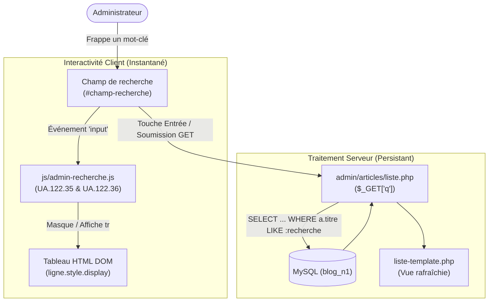

# Plan de Réalisation — Progression Développement Web (Session S11)

**Progression :** Développement Web Applicatif (Recherche SQL textuelle & Filtrage DOM interactif)  
**Session :** S11 — Rechercher et filtrer les articles dans l’Admin  
**Niveau :** N1 (Débutant)  

---

## 1. Contexte & Objectif du Sprint S11

Dans cette onzième session, l'apprenant enrichit le module des articles avec des fonctionnalités de **recherche textuelle et de filtrage dynamique**, côté serveur et côté client.

* **Problème résolu :** Lorsque le Blog contient plusieurs dizaines d'articles, les faire défiler tous manuellement devient inefficace et fastidieux.
* **Solution pédagogique :**
  1. Implémenter la recherche textuelle côté serveur via la clause SQL `WHERE ... LIKE :recherche` et le paramètre `$_GET['q']` (`UA.124.17`).
  2. Vérifier et corriger les erreurs courantes de jokers `%` et de concaténation dans les requêtes préparées (`UA.124.17`).
  3. Enrichir l'interface avec du JavaScript dynamique instantané : filtrer les lignes du tableau en direct au clavier sans recharger la page (`UA.122.35`).
  4. Combiner plusieurs interactions DOM : écouteur `input`, manipulation de style `display`, et injection dynamique d'un message d'absence de résultat (`UA.122.36`).

---

## 2. Articulation Temporelle de la Progression

### ⏮️ Acquis Passés (Sessions S1 à S10)
- Exécution de requêtes préparées avec clauses `WHERE` (`UA.124.13`, `UA.124.16`).
- Suppression sécurisée en base avec `DELETE FROM` et redirection `header()` (`UA.124.23`, S8 et S9).
- Protection d'accès de l'espace administration avec `check.php` et session PHP (`UA.123.18`, S10).
- Formatage des dates avec `date()` et `strtotime()`, échappement avec `htmlspecialchars()` (`UA.123.14`, S4).
- Boîtes de dialogue de confirmation utilisateur dans le DOM avec `confirm()` (`UA.122.32`, S8).
- Jointures SQL multi-tables entre articles, catégories et auteurs (`UA.124.24`, S9).

### 🎯 Unités d'Apprentissage & Tutoriels Mobilisés dans ce Sprint (Session S11)

#### Construire l’interface (D.122.1, html & js)

* **UA.122.35 — Modifier dynamiquement l’interface :**  
  Modifier l'affichage des lignes du tableau d'articles sans rechargement de page en altérant dynamiquement leur visibilité via la propriété CSS `style.display`.
  - **T.122.35.1 — Filtrer les lignes d'un tableau HTML en temps réel**  
    *Livrable :* Script client filtrant le tableau au fur et à mesure de la frappe | *Fichier :* `js/admin-recherche.js`

* **UA.122.36 — Combiner les interactions JavaScript :**  
  Combiner l'événement `input` sur le champ de recherche, le comptage des résultats visibles, et la création dynamique d'une ligne d'avertissement avec `document.createElement()` si aucun article ne correspond.
  - **T.122.36.1 — Gérer les retours visuels et l'état vide en JavaScript**  
    *Livrable :* Message interactif injecté dans le DOM si aucun résultat n'est trouvé | *Fichier :* `js/admin-recherche.js`

#### Exploiter les données (D.124.1, sql)

* **UA.124.17 — Vérifier et corriger une requête SQL simple :**  
  Observer le résultat d'une requête de recherche avec `LIKE`, diagnostiquer les erreurs de syntaxe ou de placement des pourcentages (`%`), et corriger la requête pour obtenir les correspondances attendues.
  - **T.124.17.1 — Construire et corriger la recherche textuelle avec LIKE**  
    *Livrable :* Requête préparée SQL fonctionnelle filtrant sur le titre des articles | *Fichier :* `admin/articles/liste.php`

### ⏭️ Perspectives Futures (Session S12)
- **S12 :** Adapter l'interface aux formats mobiles et tablettes (Responsive design - `UA.122.25`) et dérouler la recette finale pour préparer la soutenance du Projet Fil Rouge devant le jury.

---

## 3. Fiches de Conception Détaillées des Tutoriels

### T.124.17.1 — Construire et corriger la recherche textuelle avec LIKE
- **Objectif :** Récupérer uniquement les articles dont le titre contient le mot ou les lettres recherchés.
- **Notions :** Opérateur SQL `LIKE`, jokers de remplacement `%`, paramètre préparé nommé `:recherche`, transmission `$_GET['q']`.
- **Consigne pour l'apprenant :**
  1. Dans [code-a-apprendre/admin/articles/liste.php](code-a-apprendre/admin/articles/liste.php), intercepter le paramètre `$_GET['q']`.
  2. Si une chaîne est saisie, préparer la requête SQL avec `WHERE a.titre LIKE :recherche`.
  3. Lier la valeur avec les jokers de début et de fin : `['recherche' => '%' . $recherche . '%']`.
  4. Tester la recherche avec des minuscules, des majuscules et des lettres intermédiaires, et corriger la requête si les résultats sont incomplets.
- **Résultat attendu :** La liste serveur ne conserve que les articles dont le titre contient le mot-clé recherché.

---

### T.122.35.1 — Filtrer les lignes d'un tableau HTML en temps réel
- **Objectif :** Rendre l'interface ultra-réactive en filtrant directement les lignes affichées au clavier sans attendre de requête serveur.
- **Notions :** Événement `input`, méthode `toLowerCase()`, méthode `includes()`, style CSS `display = 'none'` / `display = ''`.
- **Consigne pour l'apprenant :**
  1. Dans [code-a-apprendre/js/admin-recherche.js](code-a-apprendre/js/admin-recherche.js), sélectionner le champ `#champ-recherche`.
  2. Écouter chaque frappe de touche avec l'événement `input`.
  3. Parcourir chaque ligne `<tr class="ligne-article">` et vérifier si le texte du titre contient la valeur du champ.
  4. Masquer les lignes sans correspondance (`ligne.style.display = 'none'`) et afficher les lignes correspondantes.
- **Résultat attendu :** Le tableau se réduit instantanément à mesure que l'utilisateur tape son texte.

---

### T.122.36.1 — Gérer les retours visuels et l'état vide en JavaScript
- **Objectif :** Informer explicitement l'utilisateur si aucun article ne correspond à son filtre direct.
- **Notions :** Compteur d'éléments visibles, `document.createElement('tr')`, manipulation de `appendChild()`.
- **Consigne pour l'apprenant :**
  1. Dans le script, compter le nombre de lignes restant visibles après chaque filtrage.
  2. Si le compteur tombe à zéro, créer dynamiquement un élément `<tr>` contenant une cellule `<td>` avec le message *"Aucun article ne correspond à votre saisie."*.
  3. Masquer ce message dès qu'une lettre est effacée et qu'au moins un article réapparaît.
- **Résultat attendu :** L'utilisateur n'est jamais laissé face à un tableau blanc sans explication claire.
