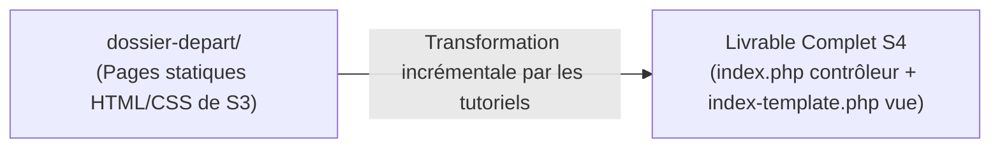

# Plan de Réalisation — Progression Développement Web Applicatif (Session S4)

**Voie de progression :** Développement Web Applicatif Fil Rouge (HTML, CSS, PHP, SQL, Architecture)  
**Session :** S4 — Construire la page d’accueil dynamique du Blog  
**Mini-code :** `page-accueil-dynamique`  
**Niveau :** N1 (Débutant)  

---

## 1. Contexte & Objectif de la Progression

Dans cette session S4, la progression de développement Web applicatif opère la transition majeure du cursus : **le passage d'un site vitrine statique en HTML/CSS vers une application Web dynamique en PHP**.

* **Objectif central :** Transformer la page d'accueil statique du Blog en une page dynamique pilotée par un script serveur PHP et des collections de données en mémoire.
* **Stack technique :** Pure PHP (procédural simple), sans framework, sans base de données MySQL à ce stade (réservée à S6).
* **Architecture :** Séparation nette entre la préparation des données (`index.php`) et le rendu visuel HTML (`index-template.php`).
* **Point de départ technique :** Dossier `dossier-depart/` hérité de la session S3 comprenant la page d'accueil statique (`public-index.html`), la page de lecture (`public-article.html`), les feuilles de style CSS et les images.
* **Livrable complet attendu de la session :** Le `dossier-depart/` enrichi et transformé avec le `code-a-apprendre/` formant une application Web dynamique complète, navigable et exécutable sur le serveur local (`php -S localhost:8000`).



---

## 2. Articulation Temporelle de la Progression

### ⏮️ Acquis Passés (Sessions S1 à S3)
- Création de pages HTML5 sémantiques et mise en forme CSS moderne avec Flexbox (`UA.122.11` à `UA.122.23`).
- Structuration des dossiers du projet Web (`css/`, `images/`) en S2 et S3 (`UA.125.11`, `UA.125.12`).
- Pratique des variables, boucles et conditions en JavaScript dans le Sandbox Algorithmique (`UA.121.11`, `UA.121.12`).

### 🎯 Unités d'Apprentissage & Tutoriels Mobilisés dans ce Sprint (Session S4)
> **Règle de Granularité des UAs :**  
> - **Par défaut :** Exactement **une seule Unité d'Apprentissage (1 UA)** par domaine de compétence par session.  
> - **Exception de Démarrage Technologique (PHP en S4) :** Le domaine `D.123.1` comprend **exactement deux UAs (2 UAs)** :  
>   1. **L'Unité « Bien démarrer avec PHP » (`UA.123.11`)** : Sas d'installation locale, vérification du serveur et premier script autonome.  
>   2. **L'Unité de formation du Projet d'imitation (`UA.123.12`)** : Regroupant l'ensemble des notions de données et d'affichage dynamique nécessaires au livrable de la session.

#### Réaliser le traitement serveur (D.123.1, php) : Exactement 2 UAs

* **UA.123.11 — Bien démarrer avec PHP :**  
  Prendre en main l'environnement local d'exécution serveur et écrire un premier script autonome hors projet.
  - **T.123.11.0 — Installer PHP et préparer l'environnement local**  
    *Objectif logique : Valider l'installation de PHP et l'environnement d'exécution local*  
    *Livrable :* Fichier `commandes.md` (CLI) et script de diagnostic | *Fichiers :* `commandes.md`, `test-serveur.php`
  - **T.123.11.1 — Écrire son premier script avec echo**  
    *Objectif logique : Démarrage rapide sur la syntaxe PHP élémentaire*  
    *Livrable :* Script minimal autonome | *Fichier :* `hello.php`

* **UA.123.12 — Construire une page Web dynamique avec PHP :**  
  Manipuler des structures de données en mémoire et générer dynamiquement le contenu HTML du Blog.
  - **T.123.12.1 — Déclarer et manipuler un tableau associatif**  
    *Objectif logique : Modéliser et stocker une collection de données en mémoire*  
    *Livrable :* Tableau `$articles` structuré en mémoire | *Fichier :* `index.php`
  - **T.123.12.2 — Parcourir une collection avec la boucle foreach**  
    *Objectif logique : Générer dynamiquement une liste d'éléments sécurisés*  
    *Livrable :* Boucle `foreach` dynamique avec `htmlspecialchars()` | *Fichier :* `index-template.php`
  - **T.123.12.3 — Adapter l'affichage avec la condition if / else**  
    *Objectif logique : Contrôler dynamiquement le rendu visuel selon une donnée*  
    *Livrable :* Structure conditionnelle adaptant la couleur | *Fichier :* `index-template.php`
  - **T.123.12.4 — Générer des liens dynamiques avec la boucle foreach**  
    *Objectif logique : Répéter un affichage de liens avec paramètres*  
    *Livrable :* Boucle sur `$categories` finalisant les filtres | *Fichiers :* `index.php`, `index-template.php`

#### Structurer et déboguer une solution (D.125.1, architecture) : 1 seule UA

* **UA.125.13 — Structurer une page avec traitement serveur :**  
  Séparer la logique de préparation des données du template de rendu HTML dès le démarrage du projet applicatif.
  - **T.125.13.1 — Séparer les données et l'affichage avec require**  
    *Objectif logique : Structurer la page en contrôleur et template HTML*  
    *Livrable :* Séparation effective entre contrôleur et vue | *Fichiers :* `index.php`, `index-template.php`

### ⏭️ Perspectives Futures (Sessions S5 à S12)
- **S5 :** Extraire les données dans des fonctions personnalisées modulaires avec `fonctions.php` (`UA.123.15`).
- **S6 :** Connecter la page d'accueil à une base de données MySQL via PDO et exécuter des requêtes SELECT (`UA.124.11` à `UA.124.22`).

---

## 3. Fiches de Conception Détaillées des Tutoriels

<!-- 
CONTRAT D'INTERFACE AVEC TUTORIAL-WRITER :
Chaque fiche fournit la spécification technique et pédagogique complète du tutoriel.
Il ne reste à tutorial-writer qu'à rédiger le guide d'apprentissage à partir de ces informations.
-->

### T.123.11.0 — Installer PHP et préparer l'environnement local
*Objectif logique : Valider l'installation de PHP et l'environnement d'exécution local*  
*Unité d'Apprentissage (UA) :* `UA.123.11` — Bien démarrer avec PHP (`D.123.1.php`)

- **Progression pédagogique (Brique de code vers le Projet d'imitation) :**  
  Avant d'aborder les fichiers du Blog, cette étape pose le socle d'exécution serveur. L'apprenant écrit un script de test minimal qui configure l'affichage des erreurs avec `ini_set('display_errors', '1')`. Cette brique garantit que pour tout le reste de la session, aucune faute de frappe ne produira d'écran blanc bloquant.

- **1. Ce que l'apprenant doit apprendre :**
  - **Notions cibles :** Rôle de l'interpréteur serveur, fonctionnement du serveur Web de développement local.
  - **Syntaxe & Outils :** Commande `php -v`, commande serveur `php -S localhost:8000`, directive `display_errors = On` et fonction `ini_set()`.
  - **Règles & Bonnes pratiques :** Ne jamais coder sans retour visuel d'erreurs en phase d'apprentissage.

- **2. Description technique de la réalisation (Développement du projet) :**
  - Ouvrir le terminal dans un dossier de bac à sable local.
  - Vérifier la présence de PHP via la commande `php -v`.
  - Créer un fichier `test-serveur.php` contenant `<?php ini_set('display_errors', '1'); echo "Serveur PHP opérationnel"; ?>`.
  - Démarrer le serveur local via `php -S localhost:8000` et ouvrir l'adresse dans le navigateur pour vérifier la réponse.

- **3. Fichiers impactés :**
  - `commandes.md` (nouveau fichier de relevé des commandes).
  - `test-serveur.php` (nouveau fichier de test).

- **4. État de départ ($E_{n-1}$) :**
  Terminal ouvert, aucun interpréteur ni serveur Web local actif.

- **5. État d'arrivée ($E_n$) :**
  Serveur actif sur `http://localhost:8000`, message de confirmation visible dans le navigateur.
  ```php
  <?php
  ini_set('display_errors', '1');
  echo "Serveur PHP opérationnel";
  ```

- **6. Livrable physique tapé par l'apprenant :**
  - Fichier `commandes.md` contenant les commandes CLI exécutées (`php -v`, `php -S localhost:8000`).
  - Fichier `test-serveur.php` écrit par l'apprenant.

---

### T.123.11.1 — Écrire son premier script avec echo
*Objectif logique : Démarrage rapide sur la syntaxe PHP élémentaire*  
*Unité d'Apprentissage (UA) :* `UA.123.11` — Bien démarrer avec PHP (`D.123.1.php`)

- **Progression pédagogique (Brique de code vers le Projet d'imitation) :**  
  Cette étape constitue le bac à sable syntaxique isolé. L'apprenant découvre la syntaxe des variables scalaires et de l'instruction `echo` sur un fichier vierge `hello.php`. Cette maîtrise syntaxique préalable lui permet d'aborder la modification de la maquette du Blog sans confusion entre balisage HTML et code PHP.

- **1. Ce que l'apprenant doit apprendre :**
  - **Notions cibles :** Balises d'ouverture/fermeture PHP, variables scalaires en mémoire, instruction d'affichage.
  - **Syntaxe & Outils :** `<?php ... ?>`, opérateur d'assignation `$nom = "valeur";`, opérateur de concaténation `.`, instruction `echo`.
  - **Règles & Bonnes pratiques :** Clôturer impérativement chaque instruction par un point-virgule `;`.

- **2. Description technique de la réalisation (Développement du projet) :**
  - Créer un fichier autonome `hello.php`.
  - Déclarer une variable texte `$titre` et une variable numérique `$annee`.
  - Utiliser `echo` et la concaténation `.` pour afficher une phrase dynamique combinant les deux variables.
  - Exécuter le script via le navigateur sur `http://localhost:8000/hello.php`.

- **3. Fichiers impactés :**
  - `hello.php` (création).

- **4. État de départ ($E_{n-1}$) :**
  Fichier `hello.php` vierge.

- **5. État d'arrivée ($E_n$) :**
  ```php
  <?php
  $titre = "Mon Blog";
  $annee = 2026;
  echo "Bienvenue sur " . $titre . " (" . $annee . ")";
  ```

- **6. Livrable physique tapé par l'apprenant :**
  - Fichier `hello.php` complet écrit par l'apprenant.

---

### T.125.13.1 — Séparer les données et l'affichage avec require
*Objectif logique : Structurer la page en contrôleur et template HTML*  
*Unité d'Apprentissage (UA) :* `UA.125.13` — Structurer une page avec traitement serveur (`D.125.1.architecture`)

- **Progression pédagogique (Brique de code vers le Projet d'imitation) :**  
  C'est l'entrée dans le projet d'imitation (le Blog). L'apprenant prend la page statique `public-index.html` issue du `dossier-depart/` et la transforme en architecture applicative : la vue devient `index-template.php`, et le point d'entrée devient `index.php` qui charge la vue via `require`. Cette brique crée le socle architectural indispensable avant d'injecter des données dynamiques.

- **1. Ce que l'apprenant doit apprendre :**
  - **Notions cibles :** Séparation des responsabilités (données serveur vs template de rendu), inclusion de fichier PHP.
  - **Syntaxe & Outils :** Instruction d'inclusion obligatoire `require 'fichier.php';`.
  - **Règles & Bonnes pratiques :** Ne jamais mélanger le traitement logique serveur et la structure du balisage HTML dans un fichier unique.

- **2. Description technique de la réalisation (Développement du projet) :**
  - Dupliquer et renommer `dossier-depart/public-index.html` en `index-template.php`.
  - Créer le fichier contrôleur `index.php`.
  - Dans `index.php`, insérer l'instruction `require 'index-template.php';`.
  - Lancer le serveur local sur le dossier du projet et vérifier que `http://localhost:8000/index.php` restitue la page d'accueil à l'identique.

- **3. Fichiers impactés :**
  - `index.php` (création).
  - `index-template.php` (création par renommage de `public-index.html`).

- **4. État de départ ($E_{n-1}$) :**
  `dossier-depart/public-index.html` (page HTML statique figée).

- **5. État d'arrivée ($E_n$) :**
  Architecture modulaire fonctionnelle. `index.php` contient :
  ```php
  <?php
  require 'index-template.php';
  ```

- **6. Livrable physique tapé par l'apprenant :**
  - Fichier `index.php` écrit par l'apprenant.
  - Fichier `index-template.php` prêt à être dynamisé.

---

### T.123.12.1 — Déclarer et manipuler un tableau associatif
*Objectif logique : Modéliser et stocker une collection de données en mémoire*  
*Unité d'Apprentissage (UA) :* `UA.123.12` — Construire une page Web dynamique avec PHP (`D.123.1.php`)

- **Progression pédagogique (Brique de code vers le Projet d'imitation) :**  
  Cette étape introduit les données métier qui vont alimenter la page. Au lieu de laisser le contenu figé dans le HTML, l'apprenant modélise les articles sous la forme d'un tableau associatif multidimensionnel `$articles` placé en tête de `index.php`. Cette brique prépare la source de données que la vue affichera.

- **1. Ce que l'apprenant doit apprendre :**
  - **Notions cibles :** Tableaux indexés, tableaux associatifs (`clé => valeur`), collections multidimensionnelles.
  - **Syntaxe & Outils :** Syntaxe de tableau court `[...]`, paires `'cle' => 'valeur'`, séparateur virgule `,`.
  - **Règles & Bonnes pratiques :** Utiliser des clés explicites et cohérentes pour représenter un modèle de données réaliste.

- **2. Description technique de la réalisation (Développement du projet) :**
  - Ouvrir `index.php`.
  - Avant l'instruction `require 'index-template.php';`, déclarer la variable `$articles` contenant 2 articles sous forme de tableaux associatifs (clés : `id`, `titre`, `contenu`, `image`, `date_creation`, `categorie_libelle`, `categorie_couleur`).
  - Vérifier la structure des données en mémoire à l'aide d'un `var_dump($articles);` temporaire.

- **3. Fichiers impactés :**
  - `index.php` (modification).

- **4. État de départ ($E_{n-1}$) :**
  `index.php` ne contenant que le `require`.

- **5. État d'arrivée ($E_n$) :**
  ```php
  <?php
  $articles = [
      [
          'id' => 1,
          'titre' => 'Comment structurer ses composants UI avec Atomic Design ?',
          'contenu' => 'Découvrez les concepts fondamentaux...',
          'image' => 'article-example.png',
          'date_creation' => '2026-02-14',
          'categorie_libelle' => 'Développement',
          'categorie_couleur' => 'bleu'
      ],
      [
          'id' => 2,
          'titre' => 'Maîtriser les micro-interactions UX',
          'contenu' => 'Une interface belle n\'est pas suffisante...',
          'image' => 'article-example.png',
          'date_creation' => '2026-02-10',
          'categorie_libelle' => 'Design UI/UX',
          'categorie_couleur' => 'rose'
      ]
  ];

  require 'index-template.php';
  ```

- **6. Livrable physique tapé par l'apprenant :**
  - Fichier `index.php` enrichi du code de déclaration de `$articles`.

---

### T.123.12.2 — Parcourir une collection avec la boucle foreach
*Objectif logique : Générer dynamiquement une liste d'éléments sécurisés*  
*Unité d'Apprentissage (UA) :* `UA.123.12` — Construire une page Web dynamique avec PHP (`D.123.1.php`)

- **Progression pédagogique (Brique de code vers le Projet d'imitation) :**  
  C'est le saut dynamique central de la session S4. Dans `index-template.php`, l'apprenant remplace les cartes statiques dupliquées par une seule carte enveloppée dans une boucle `foreach ($articles as $article)`. Il sécurise l'affichage avec `htmlspecialchars()`. Le contenu visuel de la page est désormais piloté par les données PHP en mémoire.

- **1. Ce que l'apprenant doit apprendre :**
  - **Notions cibles :** Parcours itératif d'une collection, syntaxe alternative PHP pour les templates HTML, injection sécurisée de données.
  - **Syntaxe & Outils :** `foreach ($articles as $article): ... endforeach;`, balise courte d'affichage `<?= ... ?>`, fonction de protection XSS `htmlspecialchars()`, troncature `mb_substr()`, formatage de date `date()`.
  - **Règles & Bonnes pratiques :** Ne jamais afficher une donnée sans l'échapper systématiquement avec `htmlspecialchars()`.

- **2. Description technique de la réalisation (Développement du projet) :**
  - Ouvrir `index-template.php`.
  - Dans la division `<div class="grille-articles">`, supprimer les cartes statiques dupliquées et n'en conserver qu'une seule.
  - Envelopper cette carte dans la boucle `<?php foreach ($articles as $article): ?> ... <?php endforeach; ?>`.
  - Remplacer le titre en dur par `<?= htmlspecialchars($article['titre']) ?>`.
  - Remplacer le paragraphe par `<?= htmlspecialchars(mb_substr($article['contenu'], 0, 100)) ?>...`.
  - Dynamiser la date de publication avec `date('d M Y', strtotime($article['date_creation']))`.

- **3. Fichiers impactés :**
  - `index-template.php` (modification).

- **4. État de départ ($E_{n-1}$) :**
  Cartes d'articles dupliquées en dur dans le balisage HTML de `index-template.php`.

- **5. État d'arrivée ($E_n$) :**
  ```html
  <div class="grille-articles">
      <?php foreach ($articles as $article): ?>
          <div class="carte-article">
              <a href="article.php?id=<?= $article['id'] ?>" class="carte-image">
                  " alt="Illustration">
              </a>
              <span class="etiquette-categorie"><?= htmlspecialchars($article['categorie_libelle']) ?></span>
              <div class="carte-contenu">
                  <h3><a href="article.php?id=<?= $article['id'] ?>"><?= htmlspecialchars($article['titre']) ?></a></h3>
                  <p><?= htmlspecialchars(mb_substr($article['contenu'], 0, 100)) ?>...</p>
                  <div class="carte-meta">
                      <span><?= date('d M Y', strtotime($article['date_creation'])) ?></span>
                      <span>5 min</span>
                  </div>
              </div>
          </div>
      <?php endforeach; ?>
  </div>
  ```

- **6. Livrable physique tapé par l'apprenant :**
  - Fichier `index-template.php` modifié intégrant la boucle dynamique sécurisée.

---

### T.123.12.3 — Adapter l'affichage avec la condition if / else
*Objectif logique : Contrôler dynamiquement le rendu visuel selon une donnée*  
*Unité d'Apprentissage (UA) :* `UA.123.12` — Construire une page Web dynamique avec PHP (`D.123.1.php`)

- **Progression pédagogique (Brique de code vers le Projet d'imitation) :**  
  Pour donner vie à la maquette, l'apprenant introduit une condition `if/else` dans le template. Cette brique de code adapte la couleur de l'étiquette de catégorie (`bleu` ou `rose`) selon la valeur présente dans le tableau. L'affichage s'adapte dynamiquement à la nature de la donnée.

- **1. Ce que l'apprenant doit apprendre :**
  - **Notions cibles :** Prise de décision algorithmique dans une vue, syntaxe alternative de condition.
  - **Syntaxe & Outils :** `if (...) : ... else : ... endif;`, opérateur de comparaison d'égalité `==`.
  - **Règles & Bonnes pratiques :** Éviter les logiques métier lourdes dans la vue ; se limiter à l'adaptation de l'affichage.

- **2. Description technique de la réalisation (Développement du projet) :**
  - Dans `index-template.php`, localiser la balise `<span class="etiquette-categorie">`.
  - Injecter dynamiquement la classe CSS de couleur (`bleu` ou `rose`) issue de `$article['categorie_couleur']`.
  - Ajouter une condition `if` pour afficher un badge spécial ou un libellé par défaut si la couleur n'est pas spécifiée.

- **3. Fichiers impactés :**
  - `index-template.php` (modification).

- **4. État de départ ($E_{n-1}$) :**
  Étiquette de catégorie sans classe de couleur dynamique.

- **5. État d'arrivée ($E_n$) :**
  ```html
  <span class="etiquette-categorie <?= htmlspecialchars($article['categorie_couleur']) ?>">
      <?= htmlspecialchars($article['categorie_libelle']) ?>
  </span>
  ```

- **6. Livrable physique tapé par l'apprenant :**
  - Fichier `index-template.php` complété avec le code conditionnel.

---

### T.123.12.4 — Générer des liens dynamiques avec la boucle foreach
*Objectif logique : Répéter un affichage de liens avec paramètres*  
*Unité d'Apprentissage (UA) :* `UA.123.12` — Construire une page Web dynamique avec PHP (`D.123.1.php`)

- **Progression pédagogique (Brique de code vers le Projet d'imitation) :**  
  Cette étape finalise la page d'accueil en réinvestissant la boucle `foreach` sur une collection secondaire. L'apprenant déclare `$categories` dans `index.php` et génère dynamiquement la liste des pilules de filtres par thème dans `index-template.php`. À l'issue de ce tutoriel, l'ensemble du `dossier-depart/` a été transformé et le livrable complet de la session S4 est atteint (100% conforme à `code-a-apprendre/`).

- **1. Ce que l'apprenant doit apprendre :**
  - **Notions cibles :** Parcours d'une collection secondaire, construction de liens dynamiques paramétrés.
  - **Syntaxe & Outils :** Boucle `foreach ($categories as $cat): ... endforeach;`, construction d'attributs `href="categorie.php?id=<?= $cat['id'] ?>"`.
  - **Règles & Bonnes pratiques :** Consolidation du réflexe de parcours de collection pour des composants de navigation.

- **2. Description technique de la réalisation (Développement du projet) :**
  - Dans `index.php`, déclarer le tableau `$categories = [['id' => 1, 'libelle' => 'Développement'], ['id' => 2, 'libelle' => 'Design UI/UX']];`.
  - Dans `index-template.php`, localiser la section `<section class="filtre-categories">`.
  - Conserver le lien fixe `<a href="index.php" class="pilule-filtre actif">Tous les articles</a>`.
  - Remplacer les autres pilules statiques par une boucle `foreach ($categories as $cat)` générant les balises `<a>` dynamiques.

- **3. Fichiers impactés :**
  - `index.php` (modification).
  - `index-template.php` (modification).

- **4. État de départ ($E_{n-1}$) :**
  Liens de filtres statiques dans `index-template.php`.

- **5. État d'arrivée ($E_n$) :**
  ```html
  <div class="liste-filtres">
      <a href="index.php" class="pilule-filtre actif">Tous les articles</a>
      <?php foreach ($categories as $cat): ?>
          <a href="categorie.php?id=<?= $cat['id'] ?>" class="pilule-filtre">
              <?= htmlspecialchars($cat['libelle']) ?>
          </a>
      <?php endforeach; ?>
  </div>
  ```

- **6. Livrable physique tapé par l'apprenant :**
  - Fichiers `index.php` et `index-template.php` finalisés, complétant le livrable opérationnel de la session S4.

---

## 4. Articulation vers les Projets de l'Apprenant (Triade Active LMS)

1. **Tutoriels (Comprendre avec le minimum de code) :**  
   Chaque tutoriel ci-dessus isole une notion technique précise (environnement, variables, inclusion, tableaux, boucle, condition) et apporte le strict minimum de code nécessaire pour valider la compréhension sur le projet guidé.
2. **Projet d'Imitation (Reproduire pour maîtriser le fil conducteur) :**  
   L'accumulation ordonnée des livrables de chaque tutoriel transforme le `dossier-depart/` pour aboutir au **livrable complet de la session S4** : la page d'accueil dynamique complète du Blog avec son contrôleur `index.php` et sa vue `index-template.php`.
3. **Projet Prototype (Expérimenter en autonomie sur un cas similaire) :**  
   L'apprenant réinvestit immédiatement la même architecture et les mêmes boucles sur un cas d'étude parallèle sans assistance pas-à-pas (ex: catalogue e-commerce de produits).
4. **Projet Fil Rouge (Réutiliser & Développer la compétence métier) :**  
   L'apprenant transfère l'ensemble des compétences validées dans la réalisation de son grand projet annuel professionnel.
