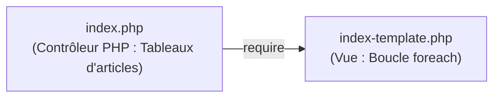

# Plan de Réalisation — Progression Développement Web Applicatif (Session S4)

**Voie de progression :** Développement Web Applicatif Fil Rouge (HTML, CSS, PHP, SQL, Architecture)  
**Session :** S4 — Construire la page d’accueil dynamique du Blog  
**Mini-code :** `page-accueil-dynamique`  
**Niveau :** N1 (Débutant)  

---

## 1. Contexte & Objectif de la Progression

Dans cette session S4, la progression de développement Web applicatif opère la transition majeure du projet : **le passage d'un site vitrine statique en HTML/CSS vers une application Web dynamique en PHP**.

* **Objectif central :** Remplacer le contenu statique figé de la page d'accueil par une génération dynamique à partir de variables et de tableaux de données en mémoire.
* **Stack technique :** Pure PHP (procédural simple), sans framework, sans base de données MySQL à ce stade (réservée à S6).
* **Architecture :** Séparation nette entre la préparation des données (`index.php`) et le rendu visuel HTML (`index-template.php`).

---

## 2. Articulation Temporelle de la Progression

### ⏮️ Acquis Passés (Sessions S1 à S3)
- Création de pages HTML5 sémantiques et mise en forme CSS moderne avec Flexbox (`UA.122.11` à `UA.122.23`).
- Structuration des dossiers du projet Web (`css/`, `images/`) en S2 et S3 (`UA.125.11`, `UA.125.12`).
- Pratique des variables, boucles et conditions en JavaScript dans le Sandbox Algorithmique (`UA.121.11`, `UA.121.12`).

### 🎯 Unités d'Apprentissage & Tutoriels Mobilisés dans ce Sprint (Session S4)

#### Réaliser le traitement serveur (D.123.1, php)

* **UA.123.11 — Écrire et exécuter un script PHP :**  
  Écrire un premier script PHP simple, l'exécuter sur un serveur local et afficher le résultat.
  - **T.123.11.1 — Écrire son premier script PHP**  
    *Livrable :* Script affichant dynamiquement le titre du Blog | *Fichier :* `index.php`

* **UA.123.12 — Manipuler les variables et les expressions en PHP :**  
  Déclarer des variables et tableaux associatifs pour stocker les données d'articles en mémoire.
  - **T.123.12.1 — Variables et Tableaux associatifs en PHP**  
    *Livrable :* Tableau `$articles` contenant 2 à 3 articles réalistes | *Fichier :* `index.php`

* **UA.123.13 — Contrôler un traitement avec des conditions :**  
  Construire des traitements PHP capables de prendre des décisions selon des conditions données (badge récent, statut).
  - **T.123.13.1 — Contrôler un traitement avec des conditions**  
    *Livrable :* Condition gérant l'affichage conditionnel d'un badge | *Fichiers :* `index.php`, `index-template.php`

* **UA.123.14 — Répéter un traitement avec PHP :**  
  Construire un traitement PHP permettant de parcourir une collection de données et d’appliquer une opération répétée avec `foreach`.
  - **T.123.14.1 — Répéter un traitement avec foreach**  
    *Livrable :* Boucle affichant dynamiquement l'ensemble des cartes d'articles | *Fichier :* `index-template.php`

#### Structurer et déboguer une solution (D.125.1, architecture)

* **UA.125.13 — Structurer une page avec traitement serveur :**  
  Séparer la logique de préparation des données du rendu HTML dans deux fichiers distincts.
  - **T.125.13.1 — Séparer traitement et affichage en PHP**  
    *Livrable :* Séparation effective et fonctionnelle entre contrôleur et vue | *Fichiers :* `index.php`, `index-template.php`

### ⏭️ Perspectives Futures (Sessions S5 à S12)
- **S5 :** Extraire les données dans des fonctions personnalisées modulaires avec `fonctions.php` (`UA.123.15`, `UA.123.19`).
- **S6 :** Connecter la page d'accueil à une base de données MySQL via PDO et exécuter des requêtes SELECT (`UA.124.11` à `UA.124.22`).

---

## 3. Fiches de Conception Détaillées des Tutoriels

### T.123.11.1 — Écrire son premier script PHP
- **Objectif :** Exécuter un script simple sur serveur local et afficher une variable PHP dans du code HTML.
- **Description :** L'apprenant crée son premier fichier PHP, déclare une variable `$titreBlog` et l'affiche dynamiquement avec `<?php echo ...; ?>` dans la balise `<h1>`.
- **Notions abordées :** Balises `<?php ... ?>`, instruction `echo`, variables scalaires, exécution sur serveur web local.
- **Livrable :** Script affichant dynamiquement le titre du Blog.
- **Fichier cible dans `code-a-apprendre/` :** `index.php`.

---

### T.123.12.1 — Variables et Tableaux associatifs en PHP
- **Objectif :** Représenter un article et une collection d'articles sous forme de tableau associatif en mémoire.
- **Description :** L'apprenant définit la structure d'un article (`titre`, `contenu`, `date_creation`, `categorie_libelle`, `image`) puis regroupe plusieurs articles dans un tableau `$articles`.
- **Notions abordées :** Types de données PHP, tableaux indexés, tableaux associatifs (clés et valeurs).
- **Livrable :** Tableau `$articles` contenant 2 à 3 articles réalistes en mémoire.
- **Fichier cible dans `code-a-apprendre/` :** `index.php`.

---

### T.123.13.1 — Contrôler un traitement avec des conditions
- **Objectif :** Appliquer une condition logique simple lors du rendu d'un article.
- **Description :** L'apprenant ajoute un champ booléen ou une couleur de badge et utilise une condition `if` pour adapter le rendu visuel.
- **Notions abordées :** Opérateurs logiques, structures conditionnelles `if / else`.
- **Livrable :** Condition gérant l'affichage conditionnel d'un badge ou d'un élément.
- **Fichiers cibles dans `code-a-apprendre/` :** `index.php` et `index-template.php`.

---

### T.123.14.1 — Répéter un traitement avec foreach et formater les données
- **Objectif :** Remplacer les blocs répétitifs HTML figés par une boucle dynamique et sécuriser/formater les champs d'affichage.
- **Description :** L'apprenant remplace la liste statique d'articles de `public-index.html` par une boucle `foreach ($articles as $article)` qui génère les cartes d'articles, sécurise les textes avec `htmlspecialchars()`, tronque le résumé avec `mb_substr()` et formate la date de publication.
- **Notions abordées :**
  - Boucle `foreach ($articles as $article)`.
  - Syntaxe alternative dans les templates HTML (`foreach (...) : ... endforeach;`).
  - Sécurisation contre les failles d'injection avec `htmlspecialchars()`.
  - Extraction d'un court résumé de texte avec `mb_substr($texte, 0, 100)`.
  - Formatage lisible d'une date avec `date('d M Y', strtotime($date_brute))`.
- **Livrable :** Boucle affichant dynamiquement l'ensemble des articles formatés et sécurisés.
- **Fichier cible dans `code-a-apprendre/` :** `index-template.php`.

---

### T.125.13.1 — Séparer traitement et affichage en PHP
- **Objectif :** Découper la page d'accueil dynamique en deux fichiers aux responsabilités claires : un contrôleur/script de données (`index.php`) et un fichier d'affichage/vue (`index-template.php`).
- **Description :** L'apprenant prépare le tableau `$articles` au début de `index.php`, puis appelle `require 'index-template.php';` pour injecter ces données dans la structure visuelle sans mélanger la logique métier au balisage HTML.
- **Notions abordées :** Responsabilité unique de fichier, données préparées vs vue de rendu, inclusion de fichier (`require`).
- **Livrable :** Séparation effective et fonctionnelle entre `index.php` et `index-template.php`.
- **Fichiers cibles dans `code-a-apprendre/` :** `index.php` et `index-template.php`.
