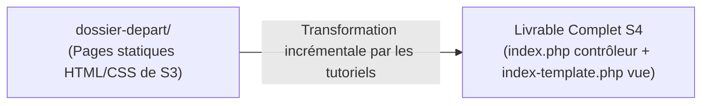

# Plan de Réalisation — Progression Développement Web Applicatif (Session S4)

**Voie de progression :** Développement Web Applicatif Fil Rouge (HTML, CSS, PHP, SQL, Architecture)  
**Session :** S4 — Construire la page d’accueil dynamique du Blog  
**Mini-code :** `page-accueil-dynamique`  
**Niveau :** N1 (Débutant)  

---

## 1. Contexte & Objectif de la Progression

Dans cette session S4, la progression de développement Web applicatif opère la transition majeure du cursus : **le passage d'un site vitrine statique en HTML/CSS vers une application Web dynamique en PHP**.

* **Objectif central :** Transformer la page d'accueil statique du Blog en une page dynamique pilotée par un script serveur PHP et des collections de données en mémoire.
* **Stack technique :** Pure PHP (procédural simple), sans framework, sans base de données MySQL à ce stade (réservée à S6).
* **Architecture :** Séparation nette entre la préparation des données (`index.php`) et le rendu visuel HTML (`index-template.php`).
* **Point de départ technique :** Dossier `dossier-depart/` hérité de la session S3 comprenant la page d'accueil statique (`public-index.html`), la page de lecture (`public-article.html`), les feuilles de style CSS et les images.
* **Livrable complet attendu de la session :** Le `dossier-depart/` enrichi et transformé avec le `code-a-apprendre/` formant une application Web dynamique complète, navigable et exécutable sur le serveur local (`php -S localhost:8000`).



---

## 2. Articulation Temporelle de la Progression

### ⏮️ Acquis Passés (Sessions S1 à S3)
- Création de pages HTML5 sémantiques et mise en forme CSS moderne avec Flexbox (`UA.122.11` à `UA.122.23`).
- Structuration des dossiers du projet Web (`css/`, `images/`) en S2 et S3 (`UA.125.11`, `UA.125.12`).
- Pratique des variables, boucles et conditions en JavaScript dans le Sandbox Algorithmique (`UA.121.11`, `UA.121.12`).

### 🎯 Unités d'Apprentissage & Tutoriels Mobilisés dans ce Sprint (Session S4)
> **Règle de Granularité des UAs :**  
> - **Par défaut :** Exactement **une seule Unité d'Apprentissage (1 UA)** par domaine de compétence par session.  
> - **Exception de Démarrage Technologique (PHP en S4) :** Le domaine `D.123.1` comprend **exactement deux UAs (2 UAs)** :  
>   1. **L'Unité « Bien démarrer avec PHP » (`UA.123.11`)** : Sas d'installation locale, vérification du serveur et premier script autonome.  
>   2. **L'Unité de formation du Projet d'imitation (`UA.123.12`)** : Regroupant l'ensemble des notions de données et d'affichage dynamique nécessaires au livrable de la session.

#### Réaliser le traitement serveur (D.123.1, php) : Exactement 2 UAs

* **UA.123.11 — Bien démarrer avec PHP :**  
  Prendre en main l'environnement local d'exécution serveur et écrire un premier script autonome hors projet.
  - **T.123.110 — Installer PHP et préparer l'environnement local**  
    *Objectif logique : Valider l'installation de PHP et la préparation de l'environnement local*  
    *Livrable :* Fichier `commandes.md` (CLI) et script de vérification | *Fichiers :* `commandes.md`, `test-serveur.php`
  - **T.123.111 — Écrire son premier script avec echo**  
    *Objectif logique : Démarrage rapide sur la syntaxe PHP élémentaire*  
    *Livrable :* Script minimal autonome | *Fichier :* `hello.php`

* **UA.123.12 — Construire une page Web dynamique avec PHP :**  
  Manipuler des structures de données en mémoire et générer dynamiquement le contenu HTML du Blog.
  - **T.123.121 — Déclarer et manipuler un tableau associatif**  
    *Objectif logique : Modéliser et stocker une collection de données en mémoire*  
    *Livrable :* Tableau `$articles` structuré en mémoire | *Fichier :* `index.php`
  - **T.123.122 — Parcourir une collection avec la boucle foreach**  
    *Objectif logique : Générer dynamiquement une liste d'éléments sécurisés*  
    *Livrable :* Boucle `foreach` dynamique avec `htmlspecialchars()` | *Fichier :* `index-template.php`
  - **T.123.123 — Adapter l'affichage avec la condition if / else**  
    *Objectif logique : Contrôler dynamiquement le rendu visuel selon une donnée*  
    *Livrable :* Structure conditionnelle adaptant la couleur | *Fichier :* `index-template.php`
  - **T.123.124 — Générer des liens dynamiques avec la boucle foreach**  
    *Objectif logique : Répéter un affichage de liens avec paramètres*  
    *Livrable :* Boucle sur `$categories` finalisant les filtres | *Fichiers :* `index.php`, `index-template.php`

### ⏭️ Perspectives Futures (Sessions S5 à S12)
- **S5 :** Extraire les données dans des fonctions personnalisées modulaires avec `fonctions.php` (`UA.123.15`).
- **S6 :** Connecter la page d'accueil à une base de données MySQL via PDO et exécuter des requêtes SELECT (`UA.124.11` à `UA.124.22`).

---

## 3. Fiches de Conception Détaillées des Tutoriels

<!-- 
CONTRAT D'INTERFACE AVEC TUTORIAL-WRITER :
Chaque fiche fournit la spécification technique et pédagogique complète du tutoriel.
Il ne reste à tutorial-writer qu'à rédiger le guide d'apprentissage à partir de ces informations.
-->

### T.123.110 — Installer PHP et préparer l'environnement local
*Objectif logique : Valider l'installation de PHP et la préparation de l'environnement local*  
*Unité d'Apprentissage (UA) :* `UA.123.11` — Bien démarrer avec PHP (`D.123.1.php`)

- **Progression pédagogique (Brique de code vers le Projet d'imitation) :**  
  Avant d'aborder les fichiers du Blog, cette étape pose le socle d'exécution serveur. L'apprenant installe le binaire officiel de PHP sous Windows dans `C:\php`, ajoute le dossier au `PATH` et démarre le serveur local de développement. Cette brique garantit que l'apprenant dispose d'un environnement d'exécution local fonctionnel pour exécuter ses scripts tout au long de la session.

- **1. Ce que l'apprenant doit apprendre :**
  - **Notions cibles :** Binaire officiel d'un langage, variable d'environnement système `PATH`, rôle de l'interpréteur serveur, fonctionnement du serveur Web de développement local intégré.
  - **Syntaxe & Outils :** Extraction de l'archive officielle dans `C:\php`, configuration du `PATH`, commande de vérification `php -v`, commande de démarrage du serveur local `php -S localhost:8000`.
  - **Règles & Bonnes pratiques :** Privilégier le binaire officiel léger sans suite tierce (pas de XAMPP), et vérifier la commande dans un terminal neuf après modification du `PATH`.

- **2. Description technique de la réalisation (Développement du projet) :**
  - Télécharger l'archive Zip du binaire officiel sur `windows.php.net/download` (version VS16 x64 Thread Safe).
  - Extraire l'archive dans `C:\php` et créer `php.ini` depuis `php.ini-development`.
  - Ajouter `C:\php` à la variable d'environnement système `Path`.
  - Ouvrir un nouveau terminal et vérifier la présence de PHP via la commande `php -v`.
  - Créer un fichier de test `test-serveur.php` contenant : `<?php echo "Environnement local PHP opérationnel"; ?>`.
  - Démarrer le serveur local via la commande `php -S localhost:8000`.
  - Ouvrir le navigateur à l'adresse `http://localhost:8000/test-serveur.php` pour valider la réponse du serveur local.

- **3. Fichiers impactés :**
  - `commandes.md` (nouveau fichier de relevé des commandes).
  - `test-serveur.php` (nouveau fichier de test).

- **4. État de départ ($E_{n-1}$) :**
  Machine sans binaire PHP configuré dans le PATH, aucun serveur Web local actif.

- **5. État d'arrivée ($E_n$) :**
  PHP officiel installé dans `C:\php`, disponible en CLI via `php -v`, serveur actif sur `http://localhost:8000`, message de confirmation visible dans le navigateur.
  ```php
  <?php
  echo "Environnement local PHP opérationnel";
  ```

- **6. Livrable physique tapé par l'apprenant :**
  - Fichier `commandes.md` contenant les commandes CLI exécutées (`php -v`, `php -S localhost:8000`).
  - Fichier `test-serveur.php` écrit par l'apprenant.

---

### T.123.111 — Écrire son premier script avec echo
*Objectif logique : Démarrage rapide sur la syntaxe PHP élémentaire*  
*Unité d'Apprentissage (UA) :* `UA.123.11` — Bien démarrer avec PHP (`D.123.1.php`)

- **Progression pédagogique (Brique de code vers le Projet d'imitation) :**  
  Cette étape constitue le bac à sable syntaxique isolé. L'apprenant découvre la syntaxe des variables scalaires et de l'instruction `echo` sur un fichier vierge `hello.php`. Cette maîtrise syntaxique préalable lui permet d'aborder la modification de la maquette du Blog sans confusion entre balisage HTML et code PHP.

- **1. Ce que l'apprenant doit apprendre :**
  - **Notions cibles :** Balises d'ouverture/fermeture PHP, variables scalaires en mémoire, instruction d'affichage.
  - **Syntaxe & Outils :** `<?php ... ?>`, opérateur d'assignation `$nom = "valeur";`, opérateur de concaténation `.`, instruction `echo`.
  - **Règles & Bonnes pratiques :** Clôturer impérativement chaque instruction par un point-virgule `;`.

- **2. Description technique de la réalisation (Développement du projet) :**
  - Créer un fichier autonome `hello.php`.
  - Déclarer une variable texte `$titre` et une variable numérique `$annee`.
  - Utiliser `echo` et la concaténation `.` pour afficher une phrase dynamique combinant les deux variables.
  - Exécuter le script via le navigateur sur `http://localhost:8000/hello.php`.

- **3. Fichiers impactés :**
  - `hello.php` (création).

- **4. État de départ ($E_{n-1}$) :**
  Fichier `hello.php` vierge.

- **5. État d'arrivée ($E_n$) :**
  ```php
  <?php
  $titre = "Mon Blog";
  $annee = 2026;
  echo "Bienvenue sur " . $titre . " (" . $annee . ")";
  ```

- **6. Livrable physique tapé par l'apprenant :**
  - Fichier `hello.php` complet écrit par l'apprenant.

---

### T.123.121 — Déclarer et manipuler un tableau associatif
*Objectif logique : Modéliser et stocker une collection de données en mémoire*  
*Unité d'Apprentissage (UA) :* `UA.123.12` — Construire une page Web dynamique avec PHP (`D.123.1.php`)

- **Progression pédagogique (Brique de code vers le Projet d'imitation) :**  
  Cette étape introduit les données métier qui vont alimenter la page. L'apprenant consulte le dossier de départ sur GitHub (`https://github.com/solicode-web-mobile/dossiers-depart-n1/tree/master/S4/dossier-depart`) et analyse les éléments d'une carte d'article dans `public-index.html`. Dans un nouveau fichier `index.php`, il modélise les articles sous la forme d'un tableau associatif multidimensionnel `$articles` et manipule les données avec `echo`.

- **1. Ce que l'apprenant doit apprendre :**
  - **Notions cibles :** Observation des données du dossier de départ, tableaux indexés, tableaux associatifs (`clé => valeur`), collections multidimensionnelles.
  - **Syntaxe & Outils :** Syntaxe de tableau court `[...]`, paires `'cle' => 'valeur'`, séparateur virgule `,`, accès aux valeurs `$articles[0]['titre']`.
  - **Règles & Bonnes pratiques :** Utiliser des clés explicites et cohérentes pour représenter un modèle de données réaliste.

- **2. Description technique de la réalisation (Développement du projet) :**
  - Consulter le dossier de départ sur GitHub : `https://github.com/solicode-web-mobile/dossiers-depart-n1/tree/master/S4/dossier-depart`.
  - Repérer la structure d'une carte d'article dans `public-index.html` (titre, contenu, image, date, catégorie).
  - Créer le fichier `index.php`.
  - Déclarer la variable `$articles` contenant 2 articles sous forme de tableaux associatifs.
  - Manipuler et afficher les données en mémoire avec `echo`.

- **3. Fichiers impactés :**
  - `index.php` (création).

- **4. État de départ ($E_{n-1}$) :**
  Dossier de départ téléchargé (`public-index.html`, `css/`, `images/`). Aucun fichier `index.php` ni `index-template.php` n'existe encore.

- **5. État d'arrivée ($E_n$) :**
  ```php
  <?php
  $articles = [
      [
          'id' => 1,
          'titre' => 'Comment structurer ses composants UI avec Atomic Design ?',
          'contenu' => 'Découvrez les concepts fondamentaux...',
          'image' => 'article-example.png',
          'date_creation' => '2026-02-14',
          'categorie_libelle' => 'Développement',
          'categorie_couleur' => 'bleu'
      ],
      [
          'id' => 2,
          'titre' => 'Maîtriser les micro-interactions UX',
          'contenu' => 'Une interface belle n\'est pas suffisante...',
          'image' => 'article-example.png',
          'date_creation' => '2026-02-10',
          'categorie_libelle' => 'Design UI/UX',
          'categorie_couleur' => 'rose'
      ]
  ];

  echo "Article 1 : " . $articles[0]['titre'] . " (" . $articles[0]['categorie_libelle'] . ")<br>";
  echo "Article 2 : " . $articles[1]['titre'] . " (" . $articles[1]['categorie_libelle'] . ")";
  ```

- **6. Livrable physique tapé par l'apprenant :**
  - Fichier `index.php` contenant la déclaration et l'affichage de vérification du tableau `$articles`.

---

### T.123.122 — Parcourir une collection avec la boucle foreach
*Objectif logique : Générer dynamiquement une liste d'éléments sécurisés*  
*Unité d'Apprentissage (UA) :* `UA.123.12` — Construire une page Web dynamique avec PHP (`D.123.1.php`)

- **Progression pédagogique (Brique de code vers le Projet d'imitation) :**  
  C'est le saut dynamique central de la session S4. Dans `index-template.php`, l'apprenant remplace les cartes statiques dupliquées par une seule carte enveloppée dans une boucle `foreach ($articles as $article)`. Il sécurise l'affichage avec `htmlspecialchars()`. Le contenu visuel de la page est désormais piloté par les données PHP en mémoire.

- **1. Ce que l'apprenant doit apprendre :**
  - **Notions cibles :** Parcours itératif d'une collection, syntaxe alternative PHP pour les templates HTML, injection sécurisée de données.
  - **Syntaxe & Outils :** `foreach ($articles as $article): ... endforeach;`, balise courte d'affichage `<?= ... ?>`, fonction de protection XSS `htmlspecialchars()`, troncature `mb_substr()`, formatage de date `date()`.
  - **Règles & Bonnes pratiques :** Ne jamais afficher une donnée sans l'échapper systématiquement avec `htmlspecialchars()`.

- **2. Description technique de la réalisation (Développement du projet) :**
  - Ouvrir `index-template.php`.
  - Dans la division `<div class="grille-articles">`, supprimer les cartes statiques dupliquées et n'en conserver qu'une seule.
  - Envelopper cette carte dans la boucle `<?php foreach ($articles as $article): ?> ... <?php endforeach; ?>`.
  - Remplacer le titre en dur par `<?= htmlspecialchars($article['titre']) ?>`.
  - Remplacer le paragraphe par `<?= htmlspecialchars(mb_substr($article['contenu'], 0, 100)) ?>...`.
  - Dynamiser la date de publication avec `date('d M Y', strtotime($article['date_creation']))`.

- **3. Fichiers impactés :**
  - `index-template.php` (modification).

- **4. État de départ ($E_{n-1}$) :**
  Cartes d'articles dupliquées en dur dans le balisage HTML de `index-template.php`.

- **5. État d'arrivée ($E_n$) :**
  ```html
  <div class="grille-articles">
      <?php foreach ($articles as $article): ?>
          <div class="carte-article">
              <a href="article.php?id=<?= $article['id'] ?>" class="carte-image">
                  " alt="Illustration">
              </a>
              <span class="etiquette-categorie"><?= htmlspecialchars($article['categorie_libelle']) ?></span>
              <div class="carte-contenu">
                  <h3><a href="article.php?id=<?= $article['id'] ?>"><?= htmlspecialchars($article['titre']) ?></a></h3>
                  <p><?= htmlspecialchars(mb_substr($article['contenu'], 0, 100)) ?>...</p>
                  <div class="carte-meta">
                      <span><?= date('d M Y', strtotime($article['date_creation'])) ?></span>
                      <span>5 min</span>
                  </div>
              </div>
          </div>
      <?php endforeach; ?>
  </div>
  ```

- **6. Livrable physique tapé par l'apprenant :**
  - Fichier `index-template.php` modifié intégrant la boucle dynamique sécurisée.

---

### T.123.123 — Adapter l'affichage avec la condition if / else
*Objectif logique : Contrôler dynamiquement le rendu visuel selon une donnée*  
*Unité d'Apprentissage (UA) :* `UA.123.12` — Construire une page Web dynamique avec PHP (`D.123.1.php`)

- **Progression pédagogique (Brique de code vers le Projet d'imitation) :**  
  Pour donner vie à la maquette, l'apprenant introduit une condition `if/else` dans le template. Cette brique de code adapte la couleur de l'étiquette de catégorie (`bleu` ou `rose`) selon la valeur présente dans le tableau. L'affichage s'adapte dynamiquement à la nature de la donnée.

- **1. Ce que l'apprenant doit apprendre :**
  - **Notions cibles :** Prise de décision algorithmique dans une vue, syntaxe alternative de condition.
  - **Syntaxe & Outils :** `if (...) : ... else : ... endif;`, opérateur de comparaison d'égalité `==`.
  - **Règles & Bonnes pratiques :** Éviter les logiques métier lourdes dans la vue ; se limiter à l'adaptation de l'affichage.

- **2. Description technique de la réalisation (Développement du projet) :**
  - Dans `index-template.php`, localiser la balise `<span class="etiquette-categorie">`.
  - Injecter dynamiquement la classe CSS de couleur (`bleu` ou `rose`) issue de `$article['categorie_couleur']`.
  - Ajouter une condition `if` pour afficher un badge spécial ou un libellé par défaut si la couleur n'est pas spécifiée.

- **3. Fichiers impactés :**
  - `index-template.php` (modification).

- **4. État de départ ($E_{n-1}$) :**
  Étiquette de catégorie sans classe de couleur dynamique.

- **5. État d'arrivée ($E_n$) :**
  ```html
  <span class="etiquette-categorie <?= htmlspecialchars($article['categorie_couleur']) ?>">
      <?= htmlspecialchars($article['categorie_libelle']) ?>
  </span>
  ```

- **6. Livrable physique tapé par l'apprenant :**
  - Fichier `index-template.php` complété avec le code conditionnel.

---

### T.123.124 — Générer des liens dynamiques avec la boucle foreach
*Objectif logique : Répéter un affichage de liens avec paramètres*  
*Unité d'Apprentissage (UA) :* `UA.123.12` — Construire une page Web dynamique avec PHP (`D.123.1.php`)

- **Progression pédagogique (Brique de code vers le Projet d'imitation) :**  
  Cette étape finalise la page d'accueil en réinvestissant la boucle `foreach` sur une collection secondaire. L'apprenant déclare `$categories` dans `index.php` et génère dynamiquement la liste des pilules de filtres par thème dans `index-template.php`. À l'issue de ce tutoriel, l'ensemble du `dossier-depart/` a été transformé et le livrable complet de la session S4 est atteint (100% conforme à `code-a-apprendre/`).

- **1. Ce que l'apprenant doit apprendre :**
  - **Notions cibles :** Parcours d'une collection secondaire, construction de liens dynamiques paramétrés.
  - **Syntaxe & Outils :** Boucle `foreach ($categories as $cat): ... endforeach;`, construction d'attributs `href="categorie.php?id=<?= $cat['id'] ?>"`.
  - **Règles & Bonnes pratiques :** Consolidation du réflexe de parcours de collection pour des composants de navigation.

- **2. Description technique de la réalisation (Développement du projet) :**
  - Dans `index.php`, déclarer le tableau `$categories = [['id' => 1, 'libelle' => 'Développement'], ['id' => 2, 'libelle' => 'Design UI/UX']];`.
  - Dans `index-template.php`, localiser la section `<section class="filtre-categories">`.
  - Conserver le lien fixe `<a href="index.php" class="pilule-filtre actif">Tous les articles</a>`.
  - Remplacer les autres pilules statiques par une boucle `foreach ($categories as $cat)` générant les balises `<a>` dynamiques.

- **3. Fichiers impactés :**
  - `index.php` (modification).
  - `index-template.php` (modification).

- **4. État de départ ($E_{n-1}$) :**
  Liens de filtres statiques dans `index-template.php`.

- **5. État d'arrivée ($E_n$) :**
  ```html
  <div class="liste-filtres">
      <a href="index.php" class="pilule-filtre actif">Tous les articles</a>
      <?php foreach ($categories as $cat): ?>
          <a href="categorie.php?id=<?= $cat['id'] ?>" class="pilule-filtre">
              <?= htmlspecialchars($cat['libelle']) ?>
          </a>
      <?php endforeach; ?>
  </div>
  ```

- **6. Livrable physique tapé par l'apprenant :**
  - Fichiers `index.php` et `index-template.php` finalisés, complétant le livrable opérationnel de la session S4.

---

## 4. Articulation vers les Projets de l'Apprenant (Triade Active LMS)

1. **Tutoriels (Comprendre avec le minimum de code) :**  
   Chaque tutoriel ci-dessus isole une notion technique précise (environnement, variables, inclusion, tableaux, boucle, condition) et apporte le strict minimum de code nécessaire pour valider la compréhension sur le projet guidé.
2. **Projet d'Imitation (Reproduire pour maîtriser le fil conducteur) :**  
   L'accumulation ordonnée des livrables de chaque tutoriel transforme le `dossier-depart/` pour aboutir au **livrable complet de la session S4** : la page d'accueil dynamique complète du Blog avec son contrôleur `index.php` et sa vue `index-template.php`.
3. **Projet Prototype (Expérimenter en autonomie sur un cas similaire) :**  
   L'apprenant réinvestit immédiatement la même architecture et les mêmes boucles sur un cas d'étude parallèle sans assistance pas-à-pas (ex: catalogue e-commerce de produits).
4. **Projet Fil Rouge (Réutiliser & Développer la compétence métier) :**  
   L'apprenant transfère l'ensemble des compétences validées dans la réalisation de son grand projet annuel professionnel.
