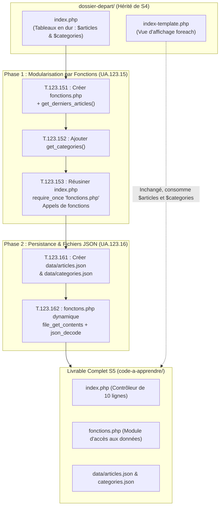

# Plan de Réalisation — Progression Développement Web Applicatif (Session S5)

**Voie de progression :** Développement Web Applicatif Fil Rouge (HTML, CSS, PHP, SQL, Architecture)  
**Session :** S5 — Fonctions PHP & Persistance Fichiers (Page d’accueil du Blog — V3)  
**Mini-code :** `fonctions-donnees-fichiers`  
**Niveau :** N1 (Débutant)  

---

## 1. Contexte & Objectif de la Progression

Dans cette session S5, l'apprenant franchit une double étape déterminante pour l'ingénierie logicielle : **la modularisation du code par les fonctions**, puis **l'externalisation des données dans des fichiers persistants au format JSON**.

* **Problème résolu :** En S4, toutes les données du Blog (`$articles` et `$categories`) étaient codées en dur directement au sein du fichier `index.php`. Le code devenait lourd, difficile à maintenir, et impossible à réutiliser sur d'autres pages.
* **Transition en 2 phases :**
  1. **Phase 1 (Fonctions) :** Isoler la logique de préparation des données dans un module dédié (`fonctions.php`). Le contrôleur `index.php` s'allège à moins de 10 lignes et orchestre le passage des données au template `index-template.php`.
  2. **Phase 2 (Persistance Fichiers) :** Découpler physiquement le code des données en créant des fichiers externes `data/articles.json` et `data/categories.json`. Les fonctions de `fonctions.php` chargent et décodent dynamiquement ces fichiers via `file_exists()`, `file_get_contents()` et `json_decode()`.
* **Objectif central :** Obtenir une page d'accueil modulaire, sécurisée et pilotée par des données externes persistées, préparant naturellement l'introduction des bases de données relationnelles MySQL et de PDO en session S6.
* **Stack technique :** Pure PHP procédural (sans framework), format de données JSON, serveur Web de développement local intégré (`php -S localhost:8000`).
* **Point de départ technique :** Dossier `dossier-depart/` hérité de la session S4 comprenant `index.php` (tableaux en dur), `index-template.php` (vue dynamique), les styles `css/` et les images `images/`.
* **Livrable complet attendu de la session :** Le `dossier-depart/` enrichi et transformé avec le `code-a-apprendre/` (`fonctions.php`, `index.php` allégé, `data/articles.json` et `data/categories.json`) formant une application Web dynamique opérationnelle, sans aucune rupture visuelle dans le navigateur.



---

## 2. Articulation Temporelle de la Progression

### ⏮️ Acquis Passés (Sessions S1 à S4)
- Intégration HTML5 sémantique et mise en page CSS moderne avec Flexbox (`UA.122.11` à `UA.122.23`).
- Structuration des dossiers du projet Web (`css/`, `images/`) en S2 et S3 (`UA.125.11`, `UA.125.12`).
- Création de pages Web dynamiques en PHP avec tableaux associatifs, boucles `foreach`, conditions `if/else` et template d'affichage en S4 (`UA.123.11`, `UA.123.12`).
- Pratique des fonctions avec paramètres et valeurs de retour en JavaScript dans le Sandbox Algorithmique (`UA.121.14`).

### 🎯 Unités d'Apprentissage & Tutoriels Mobilisés dans ce Sprint (Session S5)

#### Réaliser le traitement serveur (D.123.1, php)

* **UA.123.15 — Organiser un traitement avec des fonctions :**  
  Créer et utiliser des fonctions personnalisées avec `function`, `return` et `require_once` pour modulariser le code et alléger le contrôleur principal.
  - **T.123.151 — Déclarer une fonction avec l'instruction return**  
    *Objectif logique : Encapsuler la production de données dans une fonction réutilisable*  
    *Livrable :* Fichier `fonctions.php` avec `get_derniers_articles()` | *Fichier :* `fonctions.php`
  - **T.123.152 — Regrouper plusieurs fonctions dans un module**  
    *Objectif logique : Centraliser les différentes sources de données dans un module dédié*  
    *Livrable :* Fichier `fonctions.php` enrichi de `get_categories()` | *Fichier :* `fonctions.php`
  - **T.123.153 — Inclure un module externe avec require_once**  
    *Objectif logique : Alléger le fichier principal en séparant la logique métier de l'orchestration*  
    *Livrable :* Contrôleur `index.php` réusiné et allégé | *Fichier :* `index.php`

* **UA.123.16 — Lire des données depuis des fichiers en PHP :**  
  Séparer le code logique des données en persistant les informations dans des fichiers JSON externes et en les chargeant dynamiquement avec PHP.
  - **T.123.161 — Structurer une collection au format JSON**  
    *Objectif logique : Séparer physiquement les données du code dans un fichier externe*  
    *Livrable :* Fichiers structurés `data/articles.json` et `data/categories.json` | *Fichiers :* `data/*.json`
  - **T.123.162 — Lire et décoder un fichier avec file_get_contents et json_decode**  
    *Objectif logique : Charger dynamiquement des données persistées depuis le système de fichiers*  
    *Livrable :* Module `fonctions.php` finalisé lisant dynamiquement le JSON | *Fichier :* `fonctions.php`

### ⏭️ Perspectives Futures (Sessions S6 à S12)
- **S6 :** Remplacer la lecture des fichiers JSON par une connexion sécurisée PDO et des requêtes SQL sur une base de données MySQL réelle (`UA.124.11` à `UA.124.22`).
- **S7 :** Créer une fonction spécifique `get_article_by_id($id)` alimentée par `$_GET` pour la page de détail (`article.php`) (`UA.123.17`).

---

## 3. Fiches de Conception Détaillées des Tutoriels

<!-- 
CONTRAT D'INTERFACE AVEC TUTORIAL-WRITER :
Chaque fiche fournit la spécification technique et pédagogique complète du tutoriel.
Il ne reste à tutorial-writer qu'à rédiger le guide d'apprentissage à partir de ces informations.
-->

### T.123.151 — Déclarer une fonction avec l'instruction return
*Objectif logique : Encapsuler la production de données dans une fonction réutilisable*  
*Unité d'Apprentissage (UA) :* `UA.123.15` — Organiser un traitement avec des fonctions (`D.123.1.php`)

- **Progression pédagogique (Brique de code vers le Projet d'imitation) :**  
  Au lieu de laisser le tableau des articles au milieu de `index.php`, l'apprenant crée un nouveau fichier modulaire `fonctions.php` et y déclare sa toute première fonction PHP `get_derniers_articles()`. Cette brique isole la responsabilité de production de données.

- **1. Ce que l'apprenant doit apprendre :**
  - **Notions cibles :** Rôle d'une fonction, mot-clé `function`, convention de nommage `snake_case`, instruction de retour `return`, portée des variables.
  - **Syntaxe & Outils :** Structure d'une fonction PHP sans paramètre : `function nom_fonction() { return $valeur; }`.
  - **Règles & Bonnes pratiques :** Donner un nom de fonction explicite débutant par un verbe d'action (`get_...`), documenter brièvement le rôle de la fonction avec un bloc de commentaire.

- **2. Description technique de la réalisation (Développement du projet) :**
  - Créer un fichier neuf nommé `fonctions.php` à la racine du projet.
  - Ouvrir la balise PHP `<?php`.
  - Déclarer la fonction `get_derniers_articles()`.
  - Déplacer le tableau associatif des articles hérité de S4 à l'intérieur de la fonction, précédé du mot-clé `return`.
  - Enregistrer le fichier.

- **3. Fichiers impactés :**
  - `fonctions.php` (nouveau fichier créé à la racine).

- **4. État de départ ($E_{n-1}$) :**
  Le tableau des articles est codé en dur directement dans `index.php` :
  ```php
  // Dans index.php (état hérité de S4)
  $articles = [
      [
          'id' => 1,
          'titre' => 'Comment structurer ses composants UI avec Atomic Design ?',
          'contenu' => 'Découvrez les concepts fondamentaux...',
          'image' => 'article-example.png',
          'date_creation' => '2026-02-14',
          'categorie_libelle' => 'Développement',
          'categorie_couleur' => 'bleu'
      ],
      [
          'id' => 2,
          'titre' => 'Maîtriser les micro-interactions UX',
          'contenu' => 'Une interface belle n\'est pas suffisante...',
          'image' => 'article-example.png',
          'date_creation' => '2026-02-10',
          'categorie_libelle' => 'Design UI/UX',
          'categorie_couleur' => 'rose'
      ]
  ];
  ```

- **5. État d'arrivée ($E_n$) :**
  Création du fichier `fonctions.php` encapsulant la collection d'articles dans une fonction dédiée :
  ```php
  <?php
  // fonctions.php
  function get_derniers_articles() {
      return [
          [
              'id' => 1,
              'titre' => 'Comment structurer ses composants UI avec Atomic Design ?',
              'contenu' => 'Découvrez les concepts fondamentaux...',
              'image' => 'article-example.png',
              'date_creation' => '2026-02-14',
              'categorie_libelle' => 'Développement',
              'categorie_couleur' => 'bleu'
          ],
          [
              'id' => 2,
              'titre' => 'Maîtriser les micro-interactions UX',
              'contenu' => 'Une interface belle n\'est pas suffisante...',
              'image' => 'article-example.png',
              'date_creation' => '2026-02-10',
              'categorie_libelle' => 'Design UI/UX',
              'categorie_couleur' => 'rose'
          ]
      ];
  }
  ?>
  ```

- **6. Livrable physique tapé par l'apprenant :**
  - Fichier `fonctions.php` contenant la fonction `get_derniers_articles()`.
  - **Fichier cible dans le projet :** `fonctions.php`.

---

### T.123.152 — Regrouper plusieurs fonctions dans un module
*Objectif logique : Centraliser les différentes sources de données dans un module dédié*  
*Unité d'Apprentissage (UA) :* `UA.123.15` — Organiser un traitement avec des fonctions (`D.123.1.php`)

- **Progression pédagogique (Brique de code vers le Projet d'imitation) :**  
  Après avoir isolé la fonction des articles, l'apprenant applique la même démarche à la collection des catégories. Il apprend à structurer plusieurs fonctions indépendantes au sein d'un même fichier modulaire.

- **1. Ce que l'apprenant doit apprendre :**
  - **Notions cibles :** Cohabitation de multiples fonctions dans un fichier module, modularité, réutilisabilité.
  - **Syntaxe & Outils :** Déclaration séquentielle de fonctions dans un même script PHP.
  - **Règles & Bonnes pratiques :** Séparer chaque fonction par une ligne vide et un commentaire explicatif pour garantir la lisibilité du module.

- **2. Description technique de la réalisation (Développement du projet) :**
  - Ouvrir `fonctions.php`.
  - À la suite de `get_derniers_articles()`, déclarer la fonction `get_categories()`.
  - Déplacer le tableau des catégories issu de `index.php` dans le corps de `get_categories()`, précédé de `return`.
  - Enregistrer `fonctions.php`.

- **3. Fichiers impactés :**
  - `fonctions.php` (enrichissement du fichier existant).

- **4. État de départ ($E_{n-1}$) :**
  Fichier `fonctions.php` issu de T.123.151, ne contenant que `get_derniers_articles()`.

- **5. État d'arrivée ($E_n$) :**
  Fichier `fonctions.php` regroupant désormais les deux fonctions du site :
  ```php
  <?php
  // fonctions.php
  function get_derniers_articles() {
      return [
          [
              'id' => 1,
              'titre' => 'Comment structurer ses composants UI avec Atomic Design ?',
              'contenu' => 'Découvrez les concepts fondamentaux...',
              'image' => 'article-example.png',
              'date_creation' => '2026-02-14',
              'categorie_libelle' => 'Développement',
              'categorie_couleur' => 'bleu'
          ],
          [
              'id' => 2,
              'titre' => 'Maîtriser les micro-interactions UX',
              'contenu' => 'Une interface belle n\'est pas suffisante...',
              'image' => 'article-example.png',
              'date_creation' => '2026-02-10',
              'categorie_libelle' => 'Design UI/UX',
              'categorie_couleur' => 'rose'
          ]
      ];
  }

  function get_categories() {
      return [
          ['id' => 1, 'libelle' => 'Développement'],
          ['id' => 2, 'libelle' => 'Design UI/UX']
      ];
  }
  ?>
  ```

- **6. Livrable physique tapé par l'apprenant :**
  - Fichier `fonctions.php` contenant les fonctions `get_derniers_articles()` et `get_categories()`.
  - **Fichier cible dans le projet :** `fonctions.php`.

---

### T.123.153 — Inclure un module externe avec require_once
*Objectif logique : Alléger le fichier principal en séparant la logique métier de l'orchestration*  
*Unité d'Apprentissage (UA) :* `UA.123.15` — Organiser un traitement avec des fonctions (`D.123.1.php`)

- **Progression pédagogique (Brique de code vers le Projet d'imitation) :**  
  Les fonctions étant créées dans `fonctions.php`, l'apprenant nettoie le contrôleur `index.php`. Il supprime les gros tableaux statiques, inclut le module avec `require_once`, affecte les résultats des fonctions aux variables `$articles` et `$categories`, et vérifie que la page s'affiche sans aucune altération visuelle.

- **1. Ce que l'apprenant doit apprendre :**
  - **Notions cibles :** Directive d'inclusion sécurisée `require_once` (prévention des redéclarations fatales), appel de fonction `nom()`, affectation de la valeur retournée à une variable.
  - **Syntaxe & Outils :** `require_once 'fonctions.php';`, `$articles = get_derniers_articles();`, `$categories = get_categories();`.
  - **Règles & Bonnes pratiques :** Préférer `require_once` à `require` pour les fichiers de définitions de fonctions et classes afin d'éviter l'erreur fatale *Cannot redeclare function*.

- **2. Description technique de la réalisation (Développement du projet) :**
  - Ouvrir `index.php`.
  - Supprimer les deux gros blocs de tableaux `$articles = [...]` et `$categories = [...]`.
  - En haut du fichier, ajouter `require_once 'fonctions.php';`.
  - Appeler les deux fonctions pour renseigner les variables attendues par le template :
    ```php
    $articles = get_derniers_articles();
    $categories = get_categories();
    ```
  - Conserver la dernière ligne intacte : `require 'index-template.php';`.
  - Ouvrir le navigateur sur `http://localhost:8000/index.php` et vérifier que la page d'accueil affiche les articles et filtres de façon 100% identique à la session S4.

- **3. Fichiers impactés :**
  - `index.php` (refonte du fichier contrôleur).

- **4. État de départ ($E_{n-1}$) :**
  Le fichier `index.php` hérité de S4 comporte 30 lignes encombrées de données en dur :
  ```php
  <?php
  // S4 : Tableaux en dur
  $articles = [ ... ]; // 20 lignes
  $categories = [ ... ]; // 5 lignes
  require 'index-template.php';
  ?>
  ```

- **5. État d'arrivée ($E_n$) :**
  Le fichier `index.php` est désormais un contrôleur concis et lisible de moins de 10 lignes :
  ```php
  <?php
  // S5 : Utilisation de fonctions modulaires
  require_once 'fonctions.php';

  $articles = get_derniers_articles();

  $categories = get_categories();

  require 'index-template.php';
  ?>
  ```

- **6. Livrable physique tapé par l'apprenant :**
  - Fichier `index.php` réusiné et validé dans le navigateur.
  - **Fichier cible dans le projet :** `index.php`.

---

### T.123.161 — Structurer une collection au format JSON
*Objectif logique : Séparer physiquement les données du code dans un fichier externe*  
*Unité d'Apprentissage (UA) :* `UA.123.16` — Lire des données depuis des fichiers en PHP (`D.123.1.php`)

- **Progression pédagogique (Brique de code vers le Projet d'imitation) :**  
  Maintenant que le code est modulaire, l'apprenant franchit une nouvelle étape : sortir les données du code PHP pour les stocker dans des fichiers textes structurés indépendants. Il découvre la syntaxe JSON et crée les fichiers de persistance dans un sous-dossier dédié `data/`.

- **1. Ce que l'apprenant doit apprendre :**
  - **Notions cibles :** Format d'échange universel JSON (*JavaScript Object Notation*), différence entre code exécutable et données brutes persistées, règles syntaxiques strictes du JSON.
  - **Syntaxe & Outils :** Tableaux JSON entre crochets `[]`, objets entre accolades `{}`, paires `"clé": "valeur"` avec guillemets doubles stricts `""`, séparation par virgules `,` sans virgule finale orpheline.
  - **Règles & Bonnes pratiques :** Ne jamais utiliser de guillemets simples `''` en JSON, valider la syntaxe JSON avec un linter ou dans VS Code (mise en évidence de la syntaxe).

- **2. Description technique de la réalisation (Développement du projet) :**
  - Créer un sous-dossier `data/` à la racine du projet.
  - Créer le fichier `data/articles.json` et y transcrire la collection des deux articles au format JSON.
  - Créer le fichier `data/categories.json` et y transcrire la liste des deux catégories au format JSON.
  - Vérifier dans l'éditeur qu'aucune erreur de syntaxe JSON n'est signalée.

- **3. Fichiers impactés :**
  - `data/articles.json` (nouveau fichier).
  - `data/categories.json` (nouveau fichier).

- **4. État de départ ($E_{n-1}$) :**
  Les données résident encore sous forme de tableaux associatifs PHP codés dans `fonctions.php`. Aucun sous-dossier `data/` n'existe.

- **5. État d'arrivée ($E_n$) :**
  Dossier `data/` créé avec les deux fichiers JSON valides :
  ```json
  // data/articles.json
  [
    {
      "id": 1,
      "titre": "Comment structurer ses composants UI avec Atomic Design ?",
      "contenu": "Découvrez les concepts fondamentaux pour concevoir des composants d'interface modulaires, cohérents et réutilisables dans vos projets web.",
      "image": "article-example.png",
      "date_creation": "2026-02-14",
      "categorie_libelle": "Développement",
      "categorie_couleur": "bleu"
    },
    {
      "id": 2,
      "titre": "Maîtriser les micro-interactions UX",
      "contenu": "Une interface belle n'est pas suffisante : découvrez comment de subtiles animations CSS et retours visuels améliorent l'expérience utilisateur.",
      "image": "article-example.png",
      "date_creation": "2026-02-10",
      "categorie_libelle": "Design UI/UX",
      "categorie_couleur": "rose"
    }
  ]
  ```
  ```json
  // data/categories.json
  [
    {
      "id": 1,
      "libelle": "Développement"
    },
    {
      "id": 2,
      "libelle": "Design UI/UX"
    }
  ]
  ```

- **6. Livrable physique tapé par l'apprenant :**
  - Fichiers `data/articles.json` et `data/categories.json`.
  - **Fichiers cibles dans le projet :** `data/articles.json`, `data/categories.json`.

---

### T.123.162 — Lire et décoder un fichier avec file_get_contents et json_decode
*Objectif logique : Charger dynamiquement des données persistées depuis le système de fichiers*  
*Unité d'Apprentissage (UA) :* `UA.123.16` — Lire des données depuis des fichiers en PHP (`D.123.1.php`)

- **Progression pédagogique (Brique de code vers le Projet d'imitation) :**  
  Dans cette ultime étape de la session S5, l'apprenant connecte le module `fonctions.php` aux fichiers JSON créés à l'étape précédente. Il remplace le retour en dur par une lecture dynamique du fichier, sécurisée par la vérification d'existence et le décodage JSON en tableau PHP associatif.

- **1. Ce que l'apprenant doit apprendre :**
  - **Notions cibles :** Lecture de fichiers locaux, vérification d'existence (`file_exists`), lecture intégrale en chaîne de caractères (`file_get_contents`), décodage JSON (`json_decode`), constante magique `__DIR__`, gestion d'un repli par défaut (tableau vide `[]`).
  - **Syntaxe & Outils :**
    - `file_exists($chemin)` pour vérifier la présence du fichier.
    - `file_get_contents($chemin)` pour lire le contenu textuel.
    - `json_decode($json, true)` avec le second argument `true` obligatoire pour obtenir des tableaux associatifs (et non des objets stdClass).
    - `__DIR__ . '/data/articles.json'` pour construire un chemin absolu robuste.
  - **Règles & Bonnes pratiques :** Toujours vérifier si le fichier existe avant lecture pour éviter les avertissements d'exécution (*Warning: file_get_contents...*), et renvoyer un tableau vide `[]` si le fichier est manquant ou invalide.

- **2. Description technique de la réalisation (Développement du projet) :**
  - Ouvrir `fonctions.php`.
  - Dans la fonction `get_derniers_articles()` :
    1. Définir le chemin : `$fichier = __DIR__ . '/data/articles.json';`.
    2. Vérifier l'existence : `if (!file_exists($fichier)) { return []; }`.
    3. Lire le texte : `$contenu_json = file_get_contents($fichier);`.
    4. Décoder : `$articles = json_decode($contenu_json, true);`.
    5. Retourner le résultat : `return is_array($articles) ? $articles : [];`.
  - Appliquer la même transformation à la fonction `get_categories()` avec `data/categories.json`.
  - Enregistrer `fonctions.php`.
  - Actualiser la page dans le navigateur : l'affichage reste 100% identique.
  - **Expérimentation clé :** Modifier un titre dans `data/articles.json`, actualiser la page dans le navigateur et constater la mise à jour immédiate sans avoir touché au moindre fichier PHP.

- **3. Fichiers impactés :**
  - `fonctions.php` (modification du corps des fonctions).

- **4. État de départ ($E_{n-1}$) :**
  `fonctions.php` issu de T.123.152 retournant des tableaux statiques codés en dur dans le code PHP.

- **5. État d'arrivée ($E_n$) :**
  `fonctions.php` finalisé avec lecture dynamique et sécurisée des fichiers JSON :
  ```php
  <?php
  // S5 : Fonctions modulaires avec chargement de données depuis des fichiers JSON

  /**
   * Récupère la liste des derniers articles depuis le fichier JSON
   * @return array Liste des articles sous forme de tableaux associatifs
   */
  function get_derniers_articles() {
      $fichier = __DIR__ . '/data/articles.json';
      if (!file_exists($fichier)) {
          return [];
      }
      $contenu_json = file_get_contents($fichier);
      $articles = json_decode($contenu_json, true);
      return is_array($articles) ? $articles : [];
  }

  /**
   * Récupère la liste des catégories depuis le fichier JSON
   * @return array Liste des catégories sous forme de tableaux associatifs
   */
  function get_categories() {
      $fichier = __DIR__ . '/data/categories.json';
      if (!file_exists($fichier)) {
          return [];
      }
      $contenu_json = file_get_contents($fichier);
      $categories = json_decode($contenu_json, true);
      return is_array($categories) ? $categories : [];
  }
  ?>
  ```

- **6. Livrable physique tapé par l'apprenant :**
  - Fichier `fonctions.php` finalisé et opérationnel.
  - **Fichier cible dans le projet :** `fonctions.php`.

---

## 4. Articulation vers les Projets de l'Apprenant (Triade Active LMS)

1. **Tutoriels (Comprendre avec le minimum de code) :**  
   Les 5 tutoriels ci-dessus isolent chaque difficulté technique : déclaration de fonction avec `return` (T.123.151), regroupement modulaire (T.123.152), inclusion `require_once` (T.123.153), format JSON (T.123.161) et lecture dynamique `file_get_contents` / `json_decode` (T.123.162).
2. **Projet d'Imitation (Reproduire pour maîtriser le fil conducteur) :**  
   L'accumulation ordonnée des livrables de chaque tutoriel transforme le `dossier-depart/` hérité de S4 pour aboutir au **livrable complet de la session S5** : une architecture modulaire en 3 tiers (contrôleur `index.php`, module d'accès aux données `fonctions.php`, données persistées `data/*.json`, vue template `index-template.php`).
3. **Projet Prototype (Expérimenter en autonomie sur un cas similaire) :**  
   L'apprenant réinvestit immédiatement la même architecture sur son cas d'étude parallèle (ex: catalogue e-commerce) en créant `data/produits.json` et les fonctions d'accès associées sans guidage pas-à-pas.
4. **Projet Fil Rouge (Réutiliser & Développer la compétence métier) :**  
   L'apprenant transfère la séparation logique/données et l'utilisation de fonctions modulaires dans le cadre de son projet annuel professionnel.
