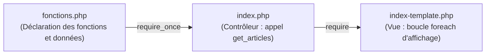

# Plan de Réalisation — Progression Développement Web (Session S5)

**Progression :** Développement Web Applicatif (PHP Modulaire & Fonctions)  
**Session :** S5 — Page d’accueil du Blog — V3  
**Niveau :** N1 (Débutant)  

---

## 1. Contexte & Objectif du Sprint S5

Dans cette cinquième session, l'apprenant franchit une étape décisive pour la qualité et la propreté de son code : **la modularisation par les fonctions**.

* **Problème résolu :** En S4, les données d'articles étaient écrites directement au milieu du fichier `index.php`. Si le fichier grossit, le code devient difficile à lire et impossible à réutiliser sur d'autres pages.
* **Solution pédagogique :** Extraire la logique de récupération des données dans des fonctions réutilisables regroupées dans un fichier dédié : [code-a-apprendre/fonctions.php](code-a-apprendre/fonctions.php).
* **Chef d'orchestre :** Le fichier [code-a-apprendre/index.php](code-a-apprendre/index.php) devient très court et lisible : il appelle les fonctions et passe les résultats au template d'affichage [dossier-depart/index-template.php](dossier-depart/index-template.php).

---

## 2. Articulation Temporelle de la Progression

### ⏮️ Acquis Passés (Sessions S1 à S4)
- Maîtrise des conditions et boucles dans la page d'accueil dynamique PHP (`UA.123.11` à `UA.123.14`).
- Séparation initiale entre contrôleur de données et template d'affichage (`UA.125.13`).
- Pratique du concept de fonction dans le Sandbox Algorithmique JavaScript (`UA.121.14`).

### 🎯 Unités d'Apprentissage & Tutoriels Mobilisés dans ce Sprint (Session S5)

#### Réaliser le traitement serveur (D.123.1, php)

* **UA.123.15 — Organiser un traitement avec des fonctions :**  
  Créer et utiliser des fonctions personnalisées avec `function` et `return` pour isoler la production de données et rendre le code réutilisable.
  - **T.123.15.1 — Créer le module fonctions.php et la fonction des articles**  
    *Livrable :* Fichier `fonctions.php` avec `get_derniers_articles()` | *Fichier :* `fonctions.php`
  - **T.123.15.2 — Déclarer la fonction des catégories avec return**  
    *Livrable :* Fonction `get_categories()` retournant les thèmes | *Fichier :* `fonctions.php`
  - **T.123.15.3 — Réusiner le contrôleur index.php avec require_once**  
    *Livrable :* `index.php` allégé appelant les fonctions modulaires | *Fichier :* `index.php`

* **UA.123.19 — Lecture des données depuis Fichiers avec PHP :**  
  Découvrir comment lire et charger des données stockées dans un fichier séparé pour préparer l'abandon progressif des tableaux codés en dur.
  - **T.123.19.1 — Charger des données depuis un fichier structuré séparé**  
    *Livrable :* Lecture et extraction de données externes en PHP | *Fichier :* `fonctions.php`

### ⏭️ Perspectives Futures (Sessions S6 à S12)
- **S6 :** Remplacer les tableaux de `fonctions.php` par une connexion sécurisée PDO et des requêtes SQL sur une base de données MySQL réelle (`UA.124.11` à `UA.124.22`).
- **S7 :** Créer une fonction spécifique `get_article_by_id($id)` pour alimenter dynamiquement la page de détail (`article.php`).

---

## 3. Fiches de Conception Détaillées des Tutoriels

### T.123.15.1 — Créer le module fonctions.php et la fonction des articles
- **Objectif :** Déplacer la définition des articles de `index.php` vers une fonction réutilisable.
- **Notions :** Déclaration de fonction PHP (`function nom() { ... }`), instruction `return`, tableau associatif retourné.
- **Consigne pour l'apprenant :**
  1. Créer un nouveau fichier `fonctions.php` à la racine.
  2. Ouvrir la balise `<?php`.
  3. Déclarer la fonction : `function get_derniers_articles()`.
  4. À l'intérieur, retourner avec `return` le tableau contenant la collection des articles du Blog.
- **Résultat attendu :** Une fonction autonome capable de fournir la liste des articles à n'importe quelle page du site.

---

### T.123.15.2 — Déclarer la fonction des catégories avec return
- **Objectif :** Isoler la liste des catégories thématiques dans sa propre fonction.
- **Notions :** Valeur de retour, factorisation, modularité.
- **Consigne pour l'apprenant :**
  1. Dans `fonctions.php`, ajouter une seconde fonction : `function get_categories()`.
  2. Retourner avec `return` la liste des catégories (`Développement`, `Design UI/UX`, etc.).
- **Résultat attendu :** Les deux sources de données sont centralisées dans `fonctions.php`.

---

### T.123.15.3 — Réusiner le contrôleur index.php avec require_once
- **Objectif :** Nettoyer le fichier `index.php` pour en faire un chef d'orchestre limpide de moins de 10 lignes.
- **Notions :** `require_once`, appel de fonction, affectation du résultat à une variable.
- **Consigne pour l'apprenant :**
  1. Ouvrir `index.php`.
  2. Supprimer les gros tableaux `$articles = [...]` et `$categories = [...]`.
  3. En haut du fichier, inclure le fichier de fonctions : `require_once 'fonctions.php';`.
  4. Récupérer les données par appel de fonction :  
     `$articles = get_derniers_articles();`  
     `$categories = get_categories();`
  5. Conserver la ligne finale : `require 'index-template.php';`.
  6. Tester dans le navigateur : l'affichage doit rester 100 % identique à la session S4.
- **Résultat attendu :** Un code professionnel, modulaire, sans aucune modification du rendu visuel pour l'utilisateur.

---

### T.123.19.1 — Charger des données depuis un fichier structuré séparé
- **Objectif :** Comprendre comment lire des données depuis un fichier externe pour préparer la transition vers une vraie base de données.
- **Notions :** `file_exists`, lecture de fichier, séparation physique données / code.
- **Consigne pour l'apprenant :**
  1. Observer comment PHP peut charger un tableau depuis un fichier dédié plutôt que de le coder en dur.
  2. Vérifier la présence du fichier avant d'exécuter la lecture pour éviter les erreurs d'exécution.
- **Résultat attendu :** L'apprenant comprend la différence fondamentale entre du code logique et des données stockées.
