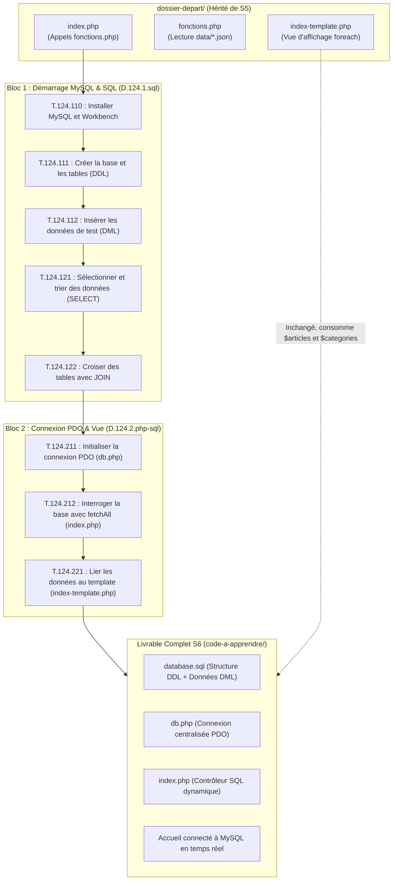

# Plan de Réalisation — Progression Développement Web Applicatif (Session S6)

**Voie de progression :** Développement Web Applicatif Fil Rouge (HTML, CSS, PHP, SQL, Architecture)  
**Session :** S6 — Connecter la page d’accueil à MySQL  
**Mini-code :** `connexion-bdd-mysql-pdo`  
**Niveau :** N1 (Débutant)  

---

## 1. Contexte & Objectif de la Progression

Dans cette sixième session, l'application du Blog franchit une étape historique : **l'abandon définitif des fichiers de données statiques au profit d'une base de données relationnelle MySQL réelle** pilotée par **PHP et PDO**.

* **Problème résolu :** En session S5, les données provenaient de fichiers JSON locaux (`data/*.json`) chargés via le module `fonctions.php`. Bien que les données fussent isolées du code applicatif, elles demeuraient des fichiers plats figés, dépourvus de moteur de requêtage relationnel, de gestion de clés étrangères et de traitement concurrent multi-utilisateurs.
* **Transition en 2 phases :**
  1. **Phase 1 (Démarrage MySQL & Modélisation SQL — D.124.1.sql) :** Valider l'environnement serveur MySQL et l'outil d'administration Workbench (Sas « Bien Démarrer »), écrire le script DDL de création de la base `blog_n1` et de ses tables relationnelles, insérer un jeu de données d'essai (DML), puis concevoir et tester la requête `SELECT ... JOIN` croisant les articles et leurs catégories.
  2. **Phase 2 (Accès aux Données & Intégration PDO — D.124.2.php-sql) :** Découpler la configuration de connexion dans un module dédié `db.php` avec gestion robuste des exceptions (`try / catch`), réusiner le contrôleur `index.php` pour exécuter les requêtes via PDO et extraire les données avec `fetchAll()`, puis alimenter la vue `index-template.php` pour un affichage dynamique temps réel dans le navigateur.
* **Objectif central :** Obtenir une page d'accueil d'application Web connectée en direct à MySQL, sécurisée, réactive à l'ajout de nouvelles données en base, sans aucune altération visuelle par rapport aux sessions précédentes.
* **Stack technique :** Serveur de base de données relationnelle MySQL, client graphique MySQL Workbench, PHP 8.x procédural avec extension native PDO, serveur Web local intégré (`php -S localhost:8000`).
* **Point de départ technique :** Dossier `dossier-depart/` hérité de la session S5 comprenant `index.php`, `fonctions.php`, `data/*.json`, `index-template.php`, les styles `css/` et les images `images/`.
* **Livrable complet attendu de la session :** Le `dossier-depart/` enrichi et transformé avec le `code-a-apprendre/` (`database.sql`, `db.php`, `index.php` réusiné) formant une application Web dynamique connectée à sa base relationnelle MySQL.



---

## 2. Articulation Temporelle de la Progression

### ⏮️ Acquis Passés (Sessions S1 à S5)
- Structuration sémantique HTML5 et mise en page CSS moderne (`UA.122.11` à `UA.122.25`).
- Programmation procédurale en PHP : variables, tableaux associatifs, conditions et boucles `foreach` (`UA.123.11`, `UA.123.12`).
- Modularisation par fonctions et séparation contrôleur / template en S5 (`UA.123.15`).
- Persistance élémentaire dans des fichiers structurés JSON en S5 (`UA.123.16`).
- Modélisation conceptuelle et logique de données (MCD / MLD relationnel) en S5 (`UA.112.15`).

### 🎯 Unités d'Apprentissage & Tutoriels Mobilisés dans ce Sprint (Session S6)

#### Exploiter les données (D.124.1, sql)

* **UA.124.11 — Création de la base de données et des tables :**  
  Installer le serveur MySQL et l'outil Workbench, créer la base `blog_n1` et ses tables relationnelles avec clés primaires et étrangères, puis insérer un jeu de données d'essai.
  - **T.124.110 — Installer MySQL et préparer l'environnement avec Workbench**  
    *Objectif logique : Valider l'installation du serveur MySQL, la connexion locale et l'outil Workbench*  
    *Livrable :* Journal de vérification de l'environnement MySQL | *Fichier :* `commandes.md`
  - **T.124.111 — Créer la base de données et les tables relationnelles**  
    *Objectif logique : Matérialiser physiquement le schéma relationnel avec clés primaires et étrangères*  
    *Livrable :* Script DDL créant la base `blog_n1` et ses 4 tables | *Fichier :* `database.sql`
  - **T.124.112 — Insérer des données de test avec l'instruction INSERT**  
    *Objectif logique : Peupler les tables de la base avec un jeu d'enregistrements d'essai réaliste*  
    *Livrable :* Requêtes DML peuplant les 4 tables du blog | *Fichier :* `database.sql`

* **UA.124.12 — Construire une requête SELECT simple :**  
  Interroger la base relationnelle : extraire, trier et limiter les données sur une seule table, puis croiser deux tables liées avec une jointure pour récupérer les informations nécessaires à l'affichage du blog.
  - **T.124.121 — Sélectionner et trier des données avec SELECT et ORDER BY**  
    *Objectif logique : Extraire des colonnes ciblées, ordonner chronologiquement et restreindre le nombre de résultats*  
    *Livrable :* Requêtes de sélection simple testées et validées | *Fichier :* `requetes.sql`
  - **T.124.122 — Croiser des tables associées avec la jointure JOIN**  
    *Objectif logique : Lier deux tables relationnelles, utiliser des alias et composer la requête d'affichage du blog*  
    *Livrable :* Requête SQL relationnelle complète avec jointure et alias | *Fichier :* `requetes.sql`

#### Développer l’accès aux données en PHP (D.124.2, php-sql)

* **UA.124.21 — Récupérer les résultats SQL dans PHP :**  
  Établir une connexion sécurisée à MySQL via PDO dans un module dédié, exécuter la requête SQL et extraire les données en mémoire avec `fetchAll()`.
  - **T.124.211 — Initialiser une connexion sécurisée avec PDO**  
    *Objectif logique : Centraliser l'accès à la base de données dans un module réutilisable*  
    *Livrable :* Module de connexion `db.php` avec bloc `try / catch` | *Fichier :* `db.php`
  - **T.124.212 — Interroger la base et récupérer les résultats avec fetchAll**  
    *Objectif logique : Exécuter la requête SQL depuis PHP et extraire les données en mémoire*  
    *Livrable :* Contrôleur `index.php` interrogeant MySQL via `$pdo->query()` | *Fichier :* `index.php`

* **UA.124.22 — Afficher des données SQL dans une interface :**  
  Injecter les enregistrements extraits de MySQL dans le gabarit d'affichage HTML/CSS pour rendre l'interface totalement dynamique.
  - **T.124.221 — Lier les résultats SQL au template d'affichage**  
    *Objectif logique : Injecter les données de la base dans l'interface et valider le rendu dynamique*  
    *Livrable :* Accueil du blog connecté à MySQL en temps réel | *Fichier :* `index.php`

### ⏭️ Perspectives Futures (Sessions S7 à S12)
- **S7 :** Sécuriser la lecture d'un article individuel via l'URL (`$_GET['id']`) avec des requêtes préparées PDO (`$pdo->prepare()`) pour la page de détail `article.php` (`UA.124.23`).
- **S8 :** Construire l'interface d'administration des catégories et enregistrer de nouvelles entrées via formulaire avec `INSERT INTO` en PDO (`UA.124.24`).
- **S9 :** Finaliser le cycle de vie complet des données (CRUD) avec modification (`UPDATE`) et suppression (`DELETE`) sécurisées des articles (`UA.124.24`).

---

## 3. Fiches de Conception Détaillées des Tutoriels

<!-- 
CONTRAT D'INTERFACE AVEC TUTORIAL-WRITER :
Chaque fiche fournit la spécification technique et pédagogique complète du tutoriel.
Il ne reste à tutorial-writer qu'à rédiger le guide d'apprentissage à partir de ces informations.
-->

### T.124.110 — Installer MySQL et préparer l'environnement avec Workbench
*Objectif logique : Valider l'installation du serveur MySQL, la connexion locale et l'outil Workbench*  
*Unité d'Apprentissage (UA) :* `UA.124.11` — Création de la base de données et des tables (`D.124.1.sql`)

- **Progression pédagogique (Brique de code vers le Projet d'imitation) :**  
  Sas « Bien Démarrer ». Avant de toucher au code de l'application, l'apprenant installe le serveur officiel MySQL Server comme service Windows natif et l'outil MySQL Workbench via l'utilitaire MySQL Installer (dev.mysql.com/downloads/installer/). Il configure le mot de passe du super-utilisateur root, configure le démarrage automatique du service Windows et valide son installation en exécutant une première requête de diagnostic.

- **1. Ce que l'apprenant doit apprendre :**
  - **Notions cibles :** Rôle d'un SGBDR, architecture client/serveur, port standard MySQL (`3306`), rôle de MySQL Workbench (interface graphique d'administration et d'exécution SQL), service Windows (`MySQL80`), mot de passe administrateur `root`.
  - **Syntaxe & Outils :** Téléchargement de MySQL Installer (`https://dev.mysql.com/downloads/installer/`), installation des composants MySQL Server et MySQL Workbench, configuration du mot de passe `root`, création d'une connexion locale dans Workbench (`Host: 127.0.0.1`, `Port: 3306`, `User: root`), commande de test `SELECT VERSION();`.
  - **Règles & Bonnes pratiques :** Noter précieusement le mot de passe `root` configuré lors de l'installation (il sera réutilisé dans Workbench et dans `db.php`), vérifier que le service Windows démarre automatiquement.

- **2. Description technique de la réalisation (Développement du projet) :**
  - Télécharger l'installateur officiel MySQL Installer pour Windows.
  - Installer MySQL Server et MySQL Workbench en mode personnalisé (*Custom*).
  - Définir le mot de passe administrateur `root` (ex: `admin`).
  - Configurer MySQL comme service Windows démarrant automatiquement au lancement du système.
  - Lancer MySQL Workbench et ouvrir la connexion locale `localhost:3306`.
  - Saisir le mot de passe `root`.
  - Ouvrir un onglet d'éditeur SQL (*Query Tab*).
  - Saisir et exécuter la requête `SELECT VERSION();`.
  - Vérifier l'affichage du numéro de version de MySQL dans la grille de résultats inférieure.

- **3. Fichiers impactés :**
  - Aucun fichier du projet applicatif n'est modifié à cette étape d'environnement.

- **4. État de départ ($E_0$) :**
  Environnement MySQL non vérifié, aucun outil d'administration connecté.

- **5. État d'arrivée ($E_1$) :**
  Serveur MySQL actif, connexion validée dans MySQL Workbench et exécution réussie de la requête de diagnostic.

- **6. Livrable physique tapé par l'apprenant :**
  - Fichier `commandes.md` consignant les vérifications de connexion et le résultat de la commande de diagnostic.
  - **Fichier cible dans le projet :** `commandes.md`.

---

### T.124.111 — Créer la base de données et les tables relationnelles
*Objectif logique : Matérialiser physiquement le schéma relationnel avec clés primaires et étrangères*  
*Unité d'Apprentissage (UA) :* `UA.124.11` — Création de la base de données et des tables (`D.124.1.sql`)

- **Progression pédagogique (Brique de code vers le Projet d'imitation) :**  
  L'environnement étant validé, l'apprenant traduit le MLD relationnel du blog en instructions SQL DDL. Il crée physiquement la base `blog_n1` et ses 4 tables (`utilisateurs`, `auteurs`, `categories`, `articles`) avec leurs clés primaires auto-incrémentées et leurs contraintes de clés étrangères.

- **1. Ce que l'apprenant doit apprendre :**
  - **Notions cibles :** Commandes DDL (*Data Definition Language*), encodage universel `utf8mb4`, clé primaire (`PRIMARY KEY`, `AUTO_INCREMENT`), contraintes d'intégrité référentielle (`FOREIGN KEY`, `REFERENCES`, `ON DELETE CASCADE`), types de colonnes SQL (`INT`, `VARCHAR`, `TEXT`, `DATETIME`).
  - **Syntaxe & Outils :**
    - `CREATE DATABASE IF NOT EXISTS blog_n1 DEFAULT CHARACTER SET utf8mb4 ...;`
    - `USE blog_n1;`
    - `CREATE TABLE IF NOT EXISTS categories (id INT AUTO_INCREMENT PRIMARY KEY, ...);`
    - `CREATE TABLE IF NOT EXISTS articles (... CONSTRAINT fk_article_categorie FOREIGN KEY ...);`
  - **Règles & Bonnes pratiques :** Créer impérativement les tables parentes (`categories`, `auteurs`) avant les tables dépendantes (`articles`) pour respecter l'ordre d'intégrité référentielle.

- **2. Description technique de la réalisation (Développement du projet) :**
  - Dans MySQL Workbench, ouvrir un éditeur SQL sur la connexion locale.
  - Saisir la commande de création et de sélection de la base `blog_n1`.
  - Rédiger les commandes `CREATE TABLE` pour les tables `utilisateurs`, `auteurs`, `categories`, puis `articles`.
  - Exécuter l'intégralité du script.
  - Actualiser le panneau *Schemas* de Workbench et vérifier que les 4 tables sont bien créées avec leurs colonnes et contraintes.
  - Sauvegarder ce script dans le fichier `database.sql` du projet.

- **3. Fichiers impactés :**
  - `database.sql` (création du fichier de structure DDL à la racine du projet).

- **4. État de départ ($E_1$) :**
  Serveur MySQL vierge de toute base de données applicative pour le blog.

- **5. État d'arrivée ($E_2$) :**
  Base `blog_n1` matérialisée sous MySQL avec les 4 tables relationnelles créées et prêtes à recevoir des données.

- **6. Livrable physique tapé par l'apprenant :**
  - Fichier `database.sql` contenant les commandes DDL exécutées.
  - **Fichier cible dans le projet :** `database.sql`.

---

### T.124.112 — Insérer des données de test avec l'instruction INSERT
*Objectif logique : Peupler les tables de la base avec un jeu d'enregistrements d'essai réaliste*  
*Unité d'Apprentissage (UA) :* `UA.124.11` — Création de la base de données et des tables (`D.124.1.sql`)

- **Progression pédagogique (Brique de code vers le Projet d'imitation) :**  
  Les tables étant créées mais vides, l'apprenant rédige les requêtes DML (`INSERT INTO`) pour insérer le jeu de données d'essai du blog hérité de S5 : 1 administrateur, 3 catégories, 1 auteur et 2 articles. Il respecte rigoureusement l'ordre d'insertion imposé par les relations.

- **1. Ce que l'apprenant doit apprendre :**
  - **Notions cibles :** Commandes DML (*Data Manipulation Language*), syntaxe de `INSERT INTO`, correspondance des types (textes entre apostrophes, nombres sans apostrophes, dates au format SQL `YYYY-MM-DD HH:MM:SS`), cohérence des clés étrangères (`categorie_id`, `auteur_id`).
  - **Syntaxe & Outils :**
    - `INSERT INTO categories (libelle, couleur) VALUES ('Développement', 'bleu');`
    - `INSERT INTO articles (titre, contenu, image, date_creation, categorie_id, auteur_id) VALUES (...);`
  - **Règles & Bonnes pratiques :** Insérer d'abord les enregistrements des tables parentes (`categories` et `auteurs`) afin de pouvoir référencer leurs identifiants dans la table `articles`.

- **2. Description technique de la réalisation (Développement du projet) :**
  - Ouvrir `database.sql` dans Workbench.
  - Ajouter les blocs d'insertion `INSERT INTO` pour `utilisateurs`, `categories`, `auteurs`, puis `articles`.
  - Exécuter les commandes d'insertion.
  - Exécuter des requêtes de vérification rapide : `SELECT * FROM categories;` et `SELECT * FROM articles;`.
  - Constater l'apparition des 3 catégories et des 2 articles dans la grille de résultats.

- **3. Fichiers impactés :**
  - `database.sql` (complété avec les requêtes d'insertion DML).

- **4. État de départ ($E_2$) :**
  La base `blog_n1` existe mais ses tables sont totalement vides.

- **5. État d'arrivée ($E_3$) :**
  La base `blog_n1` contient 1 administrateur, 3 catégories, 1 auteur et 2 articles complets.

- **6. Livrable physique tapé par l'apprenant :**
  - Fichier `database.sql` complet (DDL + DML).
  - **Fichier cible dans le projet :** `database.sql`.

---

### T.124.121 — Sélectionner et trier des données avec SELECT et ORDER BY
*Objectif logique : Extraire des colonnes ciblées, ordonner chronologiquement et restreindre le nombre de résultats*  
*Unité d'Apprentissage (UA) :* `UA.124.12` — Construire une requête SELECT simple (`D.124.1.sql`)

- **Progression pédagogique (Brique de code vers le Projet d'imitation) :**  
  Les données de test étant insérées dans la base `blog_n1`, l'apprenant découvre l'ordre SQL fondamental `SELECT`. Avant d'aborder les relations entre plusieurs tables, il apprend à interroger la table `articles` de manière isolée : sélection globale (`*`), projection de colonnes ciblées (`id`, `titre`, `date_creation`), tri chronologique décroissant (`ORDER BY ... DESC`) et limitation de volume (`LIMIT 6`).

- **1. Ce que l'apprenant doit apprendre :**
  - **Notions cibles :** Clause `SELECT`, clause `FROM`, sélection globale (`*`), projection de colonnes, tri `ORDER BY` (`ASC` / `DESC`), restriction de quantité `LIMIT`.
  - **Syntaxe & Outils :**
    ```sql
    SELECT id, titre, date_creation, image, categorie_id
    FROM articles
    ORDER BY date_creation DESC
    LIMIT 6;
    ```
  - **Règles & Bonnes pratiques :** Privilégier la projection explicite de colonnes plutôt que `SELECT *` pour économiser la bande passante et la mémoire serveur.

- **2. Description technique de la réalisation (Développement du projet) :**
  - Dans MySQL Workbench, ouvrir un nouvel onglet de requête sur `blog_n1`.
  - Exécuter la sélection globale `SELECT * FROM articles;`.
  - Rédiger la projection de colonnes : `SELECT id, titre, date_creation, image, categorie_id FROM articles;`.
  - Ajouter le tri chronologique `ORDER BY date_creation DESC` pour placer les publications les plus récentes en tête.
  - Ajouter la clause `LIMIT 6`.
  - Exécuter la requête et valider l'affichage ordonné dans la grille de résultats.
  - Sauvegarder la requête dans `requetes.sql`.

- **3. Fichiers impactés :**
  - `requetes.sql` (création du fichier de requêtes).

- **4. État de départ ($E_3$) :**
  Tables peuplées de données de test, sans requêtes de sélection formalisées.

- **5. État d'arrivée ($E_4$) :**
  Requête de sélection simple avec projection, tri et limite validée dans Workbench.

- **6. Livrable physique tapé par l'apprenant :**
  - Fichier `requetes.sql` contenant les requêtes de sélection simple.
  - **Fichier cible dans le projet :** `requetes.sql`.

---

### T.124.122 — Croiser des tables associées avec la jointure JOIN
*Objectif logique : Lier deux tables relationnelles, utiliser des alias et composer la requête d'affichage du blog*  
*Unité d'Apprentissage (UA) :* `UA.124.12` — Construire une requête SELECT simple (`D.124.1.sql`)

- **Progression pédagogique (Brique de code vers le Projet d'imitation) :**  
  Dans `articles`, la catégorie n'est représentée que par son identifiant numérique `categorie_id`. Or, la carte d'article du blog a besoin du nom (`libelle`) et de la couleur (`couleur`) de la catégorie. L'apprenant franchit le cap du relationnel en reliant les deux tables avec une jointure interne `JOIN ... ON` et en renommant les colonnes avec `AS` pour correspondre au template.

- **1. Ce que l'apprenant doit apprendre :**
  - **Notions cibles :** Clause `JOIN` (ou `INNER JOIN`), condition de liaison `ON`, alias de table (`articles a`, `categories c`), alias de colonnes (`AS categorie_libelle`, `AS categorie_couleur`), requête SQL relationnelle consolidée.
  - **Syntaxe & Outils :**
    ```sql
    SELECT a.*, c.libelle AS categorie_libelle, c.couleur AS categorie_couleur
    FROM articles a
    JOIN categories c ON a.categorie_id = c.id
    ORDER BY a.date_creation DESC
    LIMIT 6;
    ```
  - **Règles & Bonnes pratiques :** Tester et valider toute requête complexe directement dans MySQL Workbench avant de l'intégrer dans le code PHP.

- **2. Description technique de la réalisation (Développement du projet) :**
  - Dans MySQL Workbench, ouvrir l'onglet de travail sur `blog_n1`.
  - Rédiger la requête de sélection avec jointure : `JOIN categories c ON a.categorie_id = c.id`.
  - Définir les alias de projection `AS categorie_libelle` et `AS categorie_couleur`.
  - Combiner avec le tri chronologique `ORDER BY a.date_creation DESC` et `LIMIT 6`.
  - Exécuter la requête et vérifier que chaque ligne contient à la fois les colonnes de l'article et les libellés/couleurs de sa catégorie.
  - Consigner la requête finale dans `requetes.sql`.

- **3. Fichiers impactés :**
  - `requetes.sql` (enrichi avec la requête relationnelle finale).

- **4. État de départ ($E_4$) :**
  Sélection simple maîtrisée, mais données de catégorie non associées aux articles.

- **5. État d'arrivée ($E_5$) :**
  Requête relationnelle complète optimisée, validée dans Workbench et prête à être injectée dans le code PHP.

- **6. Livrable physique tapé par l'apprenant :**
  - Fichier `requetes.sql` contenant la requête relationnelle validée.
  - **Fichier cible dans le projet :** `requetes.sql`.

---

### T.124.211 — Initialiser une connexion sécurisée avec PDO
*Objectif logique : Centraliser l'accès à la base de données dans un module réutilisable*  
*Unité d'Apprentissage (UA) :* `UA.124.21` — Récupérer les résultats SQL dans PHP (`D.124.2.php-sql`)

- **Progression pédagogique (Brique de code vers le Projet d'imitation) :**  
  L'apprenant bascule côté PHP. Avant d'initialiser la connexion, il active le pilote officiel `pdo_mysql` et le répertoire d'extensions dans son fichier `C:\php\php.ini`, puis vérifie l'activation avec `php -m`. Il crée ensuite un module dédié `db.php` qui instancie l'objet PDO, applique le charset `utf8mb4`, active le mode d'exceptions et sécurise l'exécution avec `try / catch`.

- **1. Ce que l'apprenant doit apprendre :**
  - **Notions cibles :** Extension PDO (*PHP Data Objects*), pilote `pdo_mysql`, fichier de configuration `php.ini`, commande de vérification des modules `php -m`, chaîne DSN (`mysql:host=...;dbname=...;charset=utf8mb4`), instanciation `new PDO()`, gestion des erreurs par exceptions (`try / catch`, `PDOException`), configuration des attributs PDO (`ATTR_ERRMODE`, `ATTR_DEFAULT_FETCH_MODE`).
  - **Syntaxe & Outils :**
    - Dans `php.ini` : décommenter `extension_dir = "ext"` et `extension=pdo_mysql`.
    - Dans le terminal : `php -m` pour vérifier la présence de `PDO` et `pdo_mysql`.
    - Dans `db.php` :
    ```php
    try {
        $pdo = new PDO("mysql:host=$host;dbname=$dbname;charset=utf8mb4", $username, $password);
        $pdo->setAttribute(PDO::ATTR_ERRMODE, PDO::ERRMODE_EXCEPTION);
        $pdo->setAttribute(PDO::ATTR_DEFAULT_FETCH_MODE, PDO::FETCH_ASSOC);
    } catch (PDOException $e) {
        die("Erreur de connexion : " . $e->getMessage());
    }
    ```
  - **Règles & Bonnes pratiques :** Toujours activer `pdo_mysql` dans `php.ini` pour éviter l'erreur fatale *could not find driver*, spécifier `charset=utf8mb4` dans le DSN et configurer `PDO::FETCH_ASSOC` par défaut.

- **2. Description technique de la réalisation (Développement du projet) :**
  - Ouvrir `C:\php\php.ini` et décommenter `extension_dir = "ext"` et `extension=pdo_mysql`.
  - Vérifier dans le terminal avec `php -m` que le module `pdo_mysql` est actif.
  - Créer un fichier `db.php` à la racine du projet.
  - Déclarer les variables de configuration (`$host = '127.0.0.1'`, `$dbname = 'blog_n1'`, `$username = 'root'`, `$password`).
  - Instancier l'objet PDO dans un bloc `try / catch`.
  - Configurer les deux attributs essentiels avec `setAttribute()`.
  - Enregistrer et tester l'absence d'erreur avec `php db.php`.

- **3. Fichiers impactés :**
  - `db.php` (nouveau fichier créé à la racine).

- **4. État de départ ($E_5$) :**
  Le projet PHP ne dispose d'aucun moyen de communication avec le serveur MySQL.

- **5. État d'arrivée ($E_6$) :**
  Module `db.php` opérationnel, instanciant une connexion PDO sécurisée et réutilisable.

- **6. Livrable physique tapé par l'apprenant :**
  - Fichier `db.php`.
  - **Fichier cible dans le projet :** `db.php`.

---

### T.124.212 — Interroger la base et récupérer les résultats avec fetchAll
*Objectif logique : Exécuter la requête SQL depuis PHP et extraire les données en mémoire*  
*Unité d'Apprentissage (UA) :* `UA.124.21` — Récupérer les résultats SQL dans PHP (`D.124.2.php-sql`)

- **Progression pédagogique (Brique de code vers le Projet d'imitation) :**  
  Dans le contrôleur `index.php`, l'apprenant remplace l'inclusion de `fonctions.php` par `require_once 'db.php'`. Il injecte la requête SQL conçue en T.124.122 dans `$pdo->query()` et extrait la collection d'articles avec `$stmt->fetchAll()`. Il extrait également les catégories avec une seconde requête.

- **1. Ce que l'apprenant doit apprendre :**
  - **Notions cibles :** Méthode `$pdo->query($sql)`, objet résultant `PDOStatement`, extraction complète avec `$stmt->fetchAll()`, stockage des résultats dans des variables PHP.
  - **Syntaxe & Outils :**
    ```php
    $stmt = $pdo->query($sql);
    $articles = $stmt->fetchAll();

    $stmtCategories = $pdo->query("SELECT * FROM categories ORDER BY libelle ASC");
    $categories = $stmtCategories->fetchAll();
    ```
  - **Règles & Bonnes pratiques :** Conserver les noms de variables `$articles` et `$categories` pour garantir la compatibilité ascendante avec le template d'affichage existant.

- **2. Description technique de la réalisation (Développement du projet) :**
  - Ouvrir `index.php`.
  - Remplacer `require_once 'fonctions.php';` par `require_once 'db.php';`.
  - Définir la variable `$sql` contenant la requête de sélection relationnelle.
  - Exécuter la requête des articles et stocker le retour dans `$articles`.
  - Exécuter la requête de sélection des catégories et stocker le retour dans `$categories`.
  - Tester temporairement avec `var_dump($articles);` pour vérifier que les enregistrements de la base sont bien en mémoire.

- **3. Fichiers impactés :**
  - `index.php` (refonte du contrôleur).

- **4. État de départ ($E_6$) :**
  `index.php` fait encore appel aux anciennes fonctions lisant les fichiers JSON de S5.

- **5. État d'arrivée ($E_7$) :**
  `index.php` exécute les requêtes sur MySQL via PDO et extrait dynamiquement les collections en mémoire.

- **6. Livrable physique tapé par l'apprenant :**
  - Fichier `index.php` réusiné.
  - **Fichier cible dans le projet :** `index.php`.

---

### T.124.221 — Lier les résultats SQL au template d'affichage
*Objectif logique : Injecter les données de la base dans l'interface et valider le rendu dynamique*  
*Unité d'Apprentissage (UA) :* `UA.124.22` — Afficher des données SQL dans une interface (`D.124.2.php-sql`)

- **Progression pédagogique (Brique de code vers le Projet d'imitation) :**  
  Aboutissement du sprint S6 : l'apprenant finalise le contrôleur `index.php` en maintenant la délégation `require 'index-template.php';`. La vue consomme directement les données SQL transmises. L'apprenant vérifie dans le navigateur que le site fonctionne sans rupture, puis teste l'immédiateté de la persistance en insérant un nouvel enregistrement dans MySQL.

- **1. Ce que l'apprenant doit apprendre :**
  - **Notions cibles :** Architecture en 3 tiers découplée (Connexion BDD ➔ Contrôleur ➔ Vue template), adéquation entre alias SQL et clés affichées dans la boucle `foreach`, protection contre les failles XSS avec `htmlspecialchars()`.
  - **Syntaxe & Outils :**
    - `require 'index-template.php';` en dernière ligne de `index.php`.
    - Démarrage du serveur PHP local : `php -S localhost:8000`.
  - **Règles & Bonnes pratiques :** Nettoyer tout résidu de débogage (`var_dump`, `print_r`) pour livrer un code propre et prêt pour la production.

- **2. Description technique de la réalisation (Développement du projet) :**
  - Nettoyer `index.php` de tout affichage de test.
  - S'assurer que la ligne `require 'index-template.php';` est présente à la fin du fichier.
  - Ouvrir le navigateur Web à l'adresse `http://localhost:8000/index.php`.
  - Vérifier l'affichage des cartes d'articles avec leurs titres, images, dates formatées et badges de catégorie.
  - **Test ultime de persistance temps réel :**
    1. Ouvrir Workbench.
    2. Insérer un nouvel article avec une requête `INSERT INTO articles ...`.
    3. Actualiser la page dans le navigateur (`F5`).
    4. Constatez l'apparition immédiate du nouvel article sans avoir touché au code PHP.

- **3. Fichiers impactés :**
  - `index.php` (finalisation du contrôleur).
  - `index-template.php` (consommation vérifiée).

- **4. État de départ ($E_7$) :**
  Données SQL extraites en mémoire dans `index.php`, mais affichage Web final non validé.

- **5. État d'arrivée ($E_8$) :**
  Page d'accueil du blog entièrement dynamique, connectée à MySQL et validée en direct dans le navigateur.

- **6. Livrable physique tapé par l'apprenant :**
  - Projet complet opérationnel (`database.sql`, `db.php`, `index.php`, `index-template.php`).
  - **Fichier cible dans le projet :** `index.php`.

---

## 4. Articulation vers les Projets de l'Apprenant (Triade Active LMS)

1. **Tutoriels (Comprendre avec le minimum de code) :**  
   Les 8 tutoriels ci-dessus isolent chaque palier technique : vérification de l'environnement MySQL (T.124.110), création des tables (T.124.111), insertion des données (T.124.112), sélection simple et tri (T.124.121), jointure relationnelle (T.124.122), connexion PDO (T.124.211), extraction avec fetchAll (T.124.212), et affichage dans la vue (T.124.221).
2. **Projet d'Imitation (Reproduire pour maîtriser le fil conducteur) :**  
   L'accumulation ordonnée des livrables de chaque tutoriel transforme le `dossier-depart/` hérité de S5 pour aboutir au **livrable complet de la session S6** : un blog connecté à sa base de données relationnelle MySQL réelle via PDO.
3. **Projet Prototype (Expérimenter en autonomie sur un cas similaire) :**  
   L'apprenant réinvestit immédiatement la même architecture sur son cas d'étude parallèle (ex: catalogue e-commerce) en créant la base `boutique_n1`, les tables `produits` et `categories`, le fichier `db.php` et la page d'accueil connectée sans assistance pas-à-pas.
4. **Projet Fil Rouge (Réutiliser & Développer la compétence métier) :**  
   L'apprenant transfère la modélisation de tables relationnelles et l'utilisation de PDO dans le cadre de son projet annuel professionnel.
