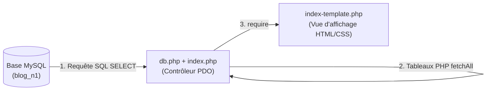

# Plan de Réalisation — Progression Développement Web (Session S6)

**Progression :** Développement Web Applicatif (MySQL, PDO & Connexion BDD)  
**Session :** S6 — Connecter la page d’accueil à MySQL  
**Niveau :** N1 (Débutant)  

---

## 1. Contexte & Objectif du Sprint S6

Dans cette sixième session, l'application franchit une étape historique : **l'abandon définitif des données en dur au profit d'une base de données relationnelle MySQL réelle**.

* **Problème résolu :** En S5, les données provenaient de fichiers JSON locaux (`data/*.json`) chargés via `fonctions.php`. Même si les données étaient séparées du code, elles restaient des fichiers statiques sans moteur de requêtage relationnel ni gestion d'administration concurrente.
* **Solution pédagogique :**
  1. Créer la base de données `blog_n1` et ses tables grâce au script SQL [code-a-apprendre/database.sql](code-a-apprendre/database.sql).
  2. Centraliser la connexion à MySQL dans un module dédié [code-a-apprendre/db.php](code-a-apprendre/db.php) utilisant l'extension PHP **PDO**.
  3. Mettre à jour le contrôleur [code-a-apprendre/index.php](code-a-apprendre/index.php) pour interroger MySQL, récupérer les articles récents et les transmettre à la vue `index-template.php`.



---

## 2. Articulation Temporelle de la Progression

### ⏮️ Acquis Passés (Sessions S1 à S5)
- Construction du Modèle Logique de Données (MLD relationnel) en S5 (`UA.112.15`).
- Structuration de l'architecture serveur séparant logique et affichage (`UA.125.13`).
- Utilisation des boucles et conditions d'affichage dans `index-template.php` (`UA.123.11` à `UA.123.14`).

### 🎯 Unités d'Apprentissage & Tutoriels Mobilisés dans ce Sprint (Session S6)

#### Exploiter les données (D.124.1, sql)

* **UA.124.11 — Création de la base de données et Tables :**  
  Exécuter le script SQL pour matérialiser physiquement la base de données, les tables `articles`, `categories`, `auteurs`, `utilisateurs`, ainsi que les contraintes relationnelles.
  - **T.124.11.1 — Importer et exécuter le script SQL de la base**  
    *Livrable :* Base `blog_n1` créée avec 4 tables remplies | *Fichier :* `database.sql`

* **UA.124.12 — Construire une requête SELECT simple :**  
  Rédiger des requêtes SQL pour sélectionner les enregistrements nécessaires à l'affichage.
  - **T.124.12.1 — Écrire la requête SELECT des articles récents**  
    *Livrable :* Requête SQL testée et validée dans PhpMyAdmin | *Fichier :* PhpMyAdmin / SQL

* **UA.124.21 — Récupérer les résultats SQL dans PHP :**  
  Établir la connexion via PDO dans `db.php`, exécuter la requête avec `$pdo->query()` et extraire les données avec `$stmt->fetchAll()`.
  - **T.124.21.1 — Créer la connexion centralisée avec PDO**  
    *Livrable :* Fichier `db.php` avec objet `$pdo` configuré | *Fichier :* `db.php`
  - **T.124.21.2 — Exécuter la requête et récupérer avec fetchAll**  
    *Livrable :* `index.php` interrogeant MySQL via `$pdo->query()` | *Fichier :* `index.php`

* **UA.124.22 — Afficher des données SQL dans une interface :**  
  Transmettre les collections issues de MySQL au template pour alimenter dynamiquement la grille des cartes et la barre latérale des catégories.
  - **T.124.22.1 — Connecter les données réelles au template d'accueil**  
    *Livrable :* Accueil du Blog alimenté à 100 % par MySQL | *Fichier :* `index.php`

#### Structurer et déboguer une solution (D.125.1, architecture)

* **UA.125.14 — Structurer une page avec accès aux données :**  
  Organiser le flux applicatif selon une séparation nette : configuration et connexion (`db.php`) ➔ sélection et extraction (`index.php`) ➔ présentation (`index-template.php`).
  - **T.124.21.1 / T.124.21.2 — Architecture de séparation d'accès aux données**  
    *Livrable :* Flux `db.php` ➔ `index.php` ➔ `index-template.php` opérationnel | *Fichiers :* `db.php`, `index.php`

### ⏭️ Perspectives Futures (Sessions S7 à S12)
- **S7 :** Sécuriser la lecture d'un article par son identifiant avec des requêtes préparées (`$pdo->prepare()`) pour la page `article.php` (`UA.124.13`, `UA.124.23`).
- **S8 :** Créer l'interface d'administration des catégories et insérer des enregistrements avec `INSERT INTO` (`UA.124.14`, `UA.124.24`).

---

## 3. Fiches de Conception Détaillées des Tutoriels

### T.124.11.1 — Importer et exécuter le script SQL de la base
- **Objectif :** Créer la structure de la base de données relationnelle sur le serveur local MySQL.
- **Notions :** `CREATE DATABASE`, `USE`, `CREATE TABLE`, `PRIMARY KEY`, `FOREIGN KEY`, `INSERT INTO`.
- **Consigne pour l'apprenant :**
  1. Démarrer le serveur MySQL (via Laragon, XAMPP ou le service MySQL).
  2. Ouvrir PhpMyAdmin dans le navigateur (`http://localhost/phpmyadmin`).
  3. Cliquer sur l'onglet **Importer**, choisir le fichier `database.sql` situé à la racine et cliquer sur **Exécuter**.
  4. Vérifier l'apparition de la base `blog_n1` et parcourir les tables `categories` et `articles`.
- **Résultat attendu :** La base `blog_n1` est créée et contient des jeux d'enregistrements de test.

---

### T.124.21.1 — Créer la connexion centralisée avec PDO
- **Objectif :** Écrire le script `db.php` qui initialise la connexion à la base de données avec l'extension PDO.
- **Notions :** `new PDO()`, DSN (`mysql:host=...;dbname=...;charset=utf8mb4`), bloc `try / catch`, `PDOException`.
- **Consigne pour l'apprenant :**
  1. Créer le fichier `db.php`.
  2. Configurer les variables de connexion :
     ```php
     $host = '127.0.0.1';
     $dbname = 'blog_n1';
     $username = 'root';
     $password = 'admin'; // ou vide selon la configuration locale
     ```
  3. Instancier l'objet PDO dans un bloc `try / catch` :
     ```php
     try {
         $pdo = new PDO("mysql:host=$host;dbname=$dbname;charset=utf8mb4", $username, $password);
         $pdo->setAttribute(PDO::ATTR_ERRMODE, PDO::ERRMODE_EXCEPTION);
         $pdo->setAttribute(PDO::ATTR_DEFAULT_FETCH_MODE, PDO::FETCH_ASSOC);
     } catch (PDOException $e) {
         die("Erreur de connexion : " . $e->getMessage());
     }
     ```
- **Résultat attendu :** Un module de connexion réutilisable par toutes les pages de l'application.

---

### T.124.12.1 — Écrire la requête SELECT des articles récents
- **Objectif :** Concevoir la requête SQL permettant de sélectionner les articles ainsi que les informations de leur catégorie associée.
- **Notions :** `SELECT`, `FROM articles a`, `JOIN categories c ON a.categorie_id = c.id`, `ORDER BY a.date_creation DESC`, `LIMIT 6`.
- **Consigne pour l'apprenant :**
  1. Dans PhpMyAdmin, ouvrir l'onglet **SQL** de la base `blog_n1`.
  2. Tester la requête :
     ```sql
     SELECT a.*, c.libelle AS categorie_libelle, c.couleur AS categorie_couleur
     FROM articles a
     JOIN categories c ON a.categorie_id = c.id
     ORDER BY a.date_creation DESC
     LIMIT 6;
     ```
  3. Vérifier que chaque ligne retournée contient à la fois le titre de l'article, son image et le libellé de sa catégorie.
- **Résultat attendu :** Une requête SQL optimisée et prête à être injectée dans le code PHP.

---

### T.124.21.2 — Exécuter la requête et récupérer avec fetchAll
- **Objectif :** Adapter le contrôleur `index.php` pour remplacer les fonctions en dur par les appels PDO.
- **Notions :** `require_once 'db.php'`, `$pdo->query($sql)`, `$stmt->fetchAll()`.
- **Consigne pour l'apprenant :**
  1. Ouvrir `index.php`.
  2. Remplacer `require_once 'fonctions.php';` par `require_once 'db.php';`.
  3. Exécuter la requête des articles et récupérer le tableau associatif :
     ```php
     $stmt = $pdo->query($sql);
     $articles = $stmt->fetchAll();
     ```
  4. Récupérer également la liste des catégories pour la navigation :
     ```php
     $stmtCategories = $pdo->query("SELECT * FROM categories ORDER BY libelle ASC");
     $categories = $stmtCategories->fetchAll();
     ```
- **Résultat attendu :** Les variables `$articles` et `$categories` sont maintenant alimentées par MySQL en temps réel.

---

### T.124.22.1 — Connecter les données réelles au template d'accueil
- **Objectif :** Transmettre les résultats SQL au template et vérifier le bon fonctionnement de la page dans le navigateur.
- **Notions :** `require 'index-template.php'`, vérification des clés du tableau SQL.
- **Consigne pour l'apprenant :**
  1. Conserver la ligne `require 'index-template.php';` à la fin de `index.php`.
  2. Ouvrir la page d'accueil dans le navigateur (`http://localhost/.../index.php`).
  3. Vérifier que les articles issus de `database.sql` s'affichent avec leurs titres, images, dates et badges de catégorie.
  4. Ajouter un nouvel article directement dans PhpMyAdmin et actualiser la page : le nouvel article apparaît immédiatement sans modifier le code PHP.
- **Résultat attendu :** Le Blog est totalement dynamique et connecté à sa base de données relationnelle.
