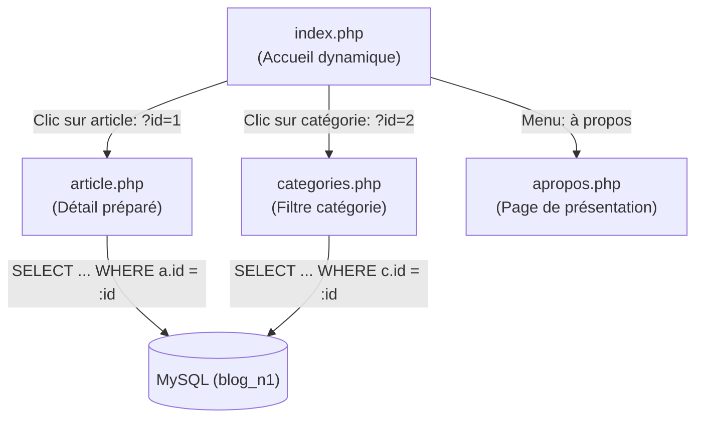

# Plan de Réalisation — Progression Développement Web (Session S7)

**Progression :** Développement Web Applicatif (Pages publiques dynamiques, paramètres d'URL et requêtes préparées)  
**Session :** S7 — Finaliser la partie Public du Blog  
**Niveau :** N1 (Débutant)  

---

## 1. Contexte & Objectif du Sprint S7

Dans cette septième session, l'apprenant finalise **l'intégralité de l'espace public du Blog**. L'application ne se limite plus à une simple page d'accueil : elle devient un véritable site Web dynamique multi-pages navigable et interactif.

* **Problème résolu :** En S6, la page d'accueil affichait des articles récents issus de MySQL, mais cliquer sur un article ou une catégorie ne menait nulle part ou vers des pages statiques figées.
* **Solution pédagogique :**
  1. Récupérer les paramètres transmis dans l'URL grâce au tableau superglobal PHP `$_GET['id']`.
  2. Sécuriser les requêtes SQL avec des **requêtes préparées PDO** (`prepare()` et `execute()`) pour empêcher toute injection SQL.
  3. Transformer `public-article.html` en couple dynamique [code-a-apprendre/article.php](code-a-apprendre/article.php) et [code-a-apprendre/article-template.php](code-a-apprendre/article-template.php).
  4. Créer la page des catégories avec filtrage dynamique [code-a-apprendre/categories.php](code-a-apprendre/categories.php).
  5. Raccorder les liens hypertextes dynamiques entre toutes les pages publiques et ajouter un premier script d'interactivité [code-a-apprendre/js/script.js](code-a-apprendre/js/script.js).



---

## 2. Articulation Temporelle de la Progression

### ⏮️ Acquis Passés (Sessions S1 à S6)
- Connexion sécurisée à MySQL via l'objet `$pdo` dans `db.php` (`UA.124.21`).
- Exécution de requêtes de lecture globale `SELECT` avec jointure en S6 (`UA.124.12`).
- Séparation stricte du contrôleur logique et du template d'affichage (`UA.125.13`, `UA.125.14`).
- Structure HTML5 et règles de mise en forme CSS de la page article créées en S2 (`UA.122.11`, `UA.122.21`).

### 🎯 Unités d'Apprentissage & Tutoriels Mobilisés dans ce Sprint (Session S7)

#### Construire l’interface (D.122.1, html & css)

* **UA.122.24 — Harmoniser la présentation d’une interface :**  
  Centraliser la charte graphique avec les variables CSS natives (`:root`, `var(--...)`) et uniformiser les composants (en-têtes, boutons, cartes, badges) sur toutes les pages publiques pour garantir une identité visuelle cohérente.
  - **T.122.24.1 — Centraliser la charte graphique avec les variables CSS (:root et var())**  
    *Livrable :* Fichier `css/global.css` déclarant et exploitant les variables de couleurs | *Fichier :* `css/global.css`
  - **T.122.24.2 — Harmoniser les composants et styles des pages publiques**  
    *Livrable :* Feuilles CSS communes appliquées à toutes les vues | *Fichier :* `article-template.php`, `categories-template.php`

* **UA.122.31 — Écrire un script JavaScript simple :**  
  Créer et lier un fichier JavaScript client (`js/script.js`) pour déclencher une action visuelle simple dans le navigateur.
  - **T.122.31.1 — Écrire et exécuter un script JavaScript client**  
    *Livrable :* Fichier `js/script.js` lié et opérationnel | *Fichier :* `js/script.js`

#### Réaliser le traitement serveur (D.123.1, php)

* **UA.123.16 — Recevoir des données d’une requête Web :**  
  Intercepter, vérifier (`isset`, `empty`) et convertir en entier sécurisé (`(int)`) les identifiants transmis via l'URL (`$_GET['id']`).
  - **T.123.16.1 — Recevoir et valider un paramètre d'URL avec $_GET**  
    *Livrable :* Contrôle et validation stricte de `$_GET['id']` | *Fichier :* `article.php`

#### Exploiter les données (D.124.1, sql)

* **UA.124.13 — Filtrer les données avec SQL :**  
  Construire des requêtes SQL ciblées avec la clause `WHERE`, et utiliser les requêtes préparées PDO (`$pdo->prepare()`) avec paramètres nommés (`:id`) pour sécuriser la consultation.
  - **T.124.13.1 — Sécuriser la lecture d'un article avec prepare et WHERE**  
    *Livrable :* Requête préparée avec paramètre `:id` | *Fichier :* `article.php`
  - **T.124.13.2 — Filtrer les articles par catégorie avec $_GET['id']**  
    *Livrable :* Page `categories.php` affichant les articles ciblés | *Fichier :* `categories.php`

#### Structurer et déboguer une solution (D.125.1, architecture)

* **UA.125.15 — Structurer un site Web dynamique :**  
  Organiser l'application en un ensemble cohérent de pages dynamiques (`index.php`, `article.php`, `categories.php`, `apropos.php`) partageant la même connexion `db.php` et les mêmes feuilles de style.
  - **T.125.15.1 — Connecter le contrôleur article.php au template**  
    *Livrable :* Page de détail d'un article 100 % dynamique | *Fichier :* `article-template.php`
  - **T.125.15.2 — Raccorder les liens hypertextes dynamiques du site**  
    *Livrable :* Navigation fluide entre toutes les pages publiques | *Fichier :* `index-template.php`

### ⏭️ Perspectives Futures (Sessions S8 à S12)
- **S8 :** Créer l'espace d'administration du Blog (`admin/`) et traiter les soumissions de formulaires sécurisés avec la méthode HTTP POST (`UA.123.17`, `UA.124.24`).
- **S9 :** Mettre en œuvre le CRUD complet des articles en base de données (`INSERT`, `UPDATE`, `DELETE`).

---

## 3. Fiches de Conception Détaillées des Tutoriels

### T.122.24.1 — Centraliser la charte graphique avec les variables CSS (:root et var())
- **Objectif :** Centraliser la palette de couleurs du site en un endroit unique pour faciliter la maintenance et garantir la cohérence visuelle.
- **Notions :** Pseudo-classe `:root`, déclaration de variables CSS (`--couleur-primaire: #2673e8;`), appel avec la fonction `var(--couleur-primaire)`.
- **Consigne pour l'apprenant :**
  1. Dans [code-a-apprendre/css/global.css](code-a-apprendre/css/global.css), ouvrir la règle `:root`.
  2. Définir les variables de la charte graphique : `--couleur-texte`, `--couleur-fond`, `--couleur-primaire`, `--couleur-primaire-hover`, `--couleur-titre`, `--couleur-bordure`.
  3. Remplacer les codes hexadécimaux en dur par les appels `var(...)` dans les propriétés `color`, `background-color` et `border`.
  4. Tester la modification : changer la valeur de `--couleur-primaire` dans `:root` et constater que tous les boutons et liens changent de couleur d'un seul coup.
- **Résultat attendu :** Une charte graphique centralisée, propre et facilement modifiable via les variables CSS natives.

---

### T.122.24.2 — Harmoniser les composants et styles des pages publiques
- **Objectif :** Garantir que les pages d'article, de catégories et d'accueil partagent les mêmes codes visuels et feuilles CSS.
- **Notions :** Liens CSS multiples (`global.css`, `layout.css`, `components.css`), classes réutilisables pour les boutons et badges.
- **Consigne pour l'apprenant :**
  1. Vérifier que `<link rel="stylesheet">` pointe vers les 4 fichiers CSS partagés dans chaque template.
  2. Harmoniser les classes des cartes d'articles entre l'accueil et les catégories.
- **Résultat attendu :** Une cohérence graphique parfaite sur tout le site.

---

### T.122.31.1 — Écrire et exécuter un script JavaScript client
- **Objectif :** Ajouter un premier comportement dynamique côté client dans la page Web.
- **Notions :** Fichier externe `.js`, balise `<script src="js/script.js">`, objet `console`, manipulation simple du DOM.
- **Consigne pour l'apprenant :**
  1. Créer le dossier `js/` et le fichier `script.js`.
  2. Écrire une instruction de contrôle : `console.log('Script Blog chargé');`.
  3. Lier le script à la fin du template avant la fermeture de `</body>`.
  4. Ouvrir la console du navigateur (F12) pour vérifier l'exécution sans erreur.
- **Résultat attendu :** La liaison JavaScript client est validée et opérationnelle.

---

### T.123.16.1 — Recevoir et valider un paramètre d'URL avec $_GET
- **Objectif :** Récupérer l'identifiant de l'article cliqué par le visiteur et valider sa présence.
- **Notions :** Tableau superglobal `$_GET`, fonction `isset()`, fonction `empty()`, transtypage `(int)`.
- **Consigne pour l'apprenant :**
  1. Créer le fichier `article.php` à la racine.
  2. Inclure la connexion `require_once 'db.php';`.
  3. Vérifier que le paramètre `id` existe dans l'URL :
     ```php
     if (!isset($_GET['id']) || empty($_GET['id'])) {
         die("Erreur : Aucun article spécifié.");
     }
     $articleId = (int)$_GET['id'];
     ```
- **Résultat attendu :** Une variable `$articleId` propre, validée et protégée contre les valeurs invalides.

---

### T.124.13.1 — Sécuriser la lecture d'un article avec prepare et WHERE
- **Objectif :** Interroger la base de données pour récupérer l'article unique correspondant à l'identifiant demandé.
- **Notions :** Clause `WHERE a.id = :id`, méthode `$pdo->prepare()`, tableau de paramètres, méthode `$stmt->execute()`, méthode `$stmt->fetch()`.
- **Consigne pour l'apprenant :**
  1. Dans `article.php`, rédiger la requête SQL avec jointures pour récupérer le titre, le contenu, l'image, la catégorie et les informations de l'auteur.
  2. Préparer la requête avec un marqueur nommé `:id`.
  3. Exécuter la requête en passant le paramètre `$articleId`.
  4. Récupérer l'enregistrement unique avec `fetch()`.
  5. Vérifier que l'article existe bien en base ; si ce n'est pas le cas, afficher un message d'erreur clair.
- **Résultat attendu :** Les données complètes de l'article sélectionné sont stockées dans `$article`.

---

### T.124.13.2 — Filtrer les articles par catégorie avec $_GET['id']
- **Objectif :** Afficher la liste des articles appartenant à une catégorie précise, ou lister toutes les catégories si aucun filtre n'est demandé.
- **Notions :** Condition alternative sur `$_GET['id']`, clause `WHERE a.categorie_id = :id`, clause de tri `ORDER BY a.date_creation DESC`, méthode `$stmt->fetchAll()` pour récupérer une liste de plusieurs résultats (contrairement à `fetch()` pour un résultat unique).
- **Consigne pour l'apprenant :**
  1. Créer le contrôleur `categories.php`.
  2. Si `$_GET['id']` est présent, préparer et exécuter la requête avec `WHERE a.categorie_id = :id ORDER BY a.date_creation DESC` et récupérer tous les articles avec `$stmt->fetchAll()`.
  3. Si aucun ID n'est fourni, exécuter une requête avec `$pdo->query()` pour récupérer l'ensemble des catégories pour un affichage thématique global.
  4. Raccorder au template `categories-template.php`.
- **Résultat attendu :** Naviguer sur `categories.php?id=1` affiche tous les articles de la catégorie 1, ordonnés du plus récent au plus ancien.

---

### T.125.15.1 — Connecter le contrôleur article.php au template
- **Objectif :** Transformer le fichier statique `public-article.html` en vue dynamique `article-template.php`.
- **Notions :** Balises d'échappement PHP (`<?= ... ?>`), affichage sécurisé, inclusion finale `require 'article-template.php';`.
- **Consigne pour l'apprenant :**
  1. Copier le contenu de `public-article.html` dans `article-template.php`.
  2. Remplacer les textes figés par les variables dynamiques :
     - Titre : `<?= htmlspecialchars($article['titre']) ?>`
     - Catégorie : `<?= htmlspecialchars($article['categorie_libelle']) ?>`
     - Date : `<?= htmlspecialchars($article['date_creation']) ?>`
     - Auteur : `<?= htmlspecialchars($article['auteur_prenom'] . ' ' . $article['auteur_nom']) ?>`
     - Contenu : `<?= nl2br(htmlspecialchars($article['contenu'])) ?>`
  3. Relier le contrôleur au template à la fin de `article.php`.
  4. Tester dans le navigateur en saisissant manuellement `article.php?id=1`.
- **Résultat attendu :** La page détail affiche les données réelles de l'article 1.

---

### T.125.15.2 — Raccorder les liens hypertextes dynamiques du site
- **Objectif :** Remplacer les faux liens `href="#"` ou `href="public-article.html"` par des URL dynamiques avec paramètres.
- **Notions :** Paramètres d'URL `page.php?param=valeur`, attribut `href` dynamique.
- **Consigne pour l'apprenant :**
  1. Dans `index-template.php`, remplacer les liens des cartes d'articles par :  
     `href="article.php?id=<?= $article['id'] ?>"`
  2. Remplacer les liens des badges de catégorie par :  
     `href="categories.php?id=<?= $article['categorie_id'] ?>"`
  3. Vérifier les liens de la barre de navigation : Accueil (`index.php`), Catégories (`categories.php`), À propos (`apropos.php`).
- **Résultat attendu :** Un parcours utilisateur complet et fluide d'une page à l'autre.
