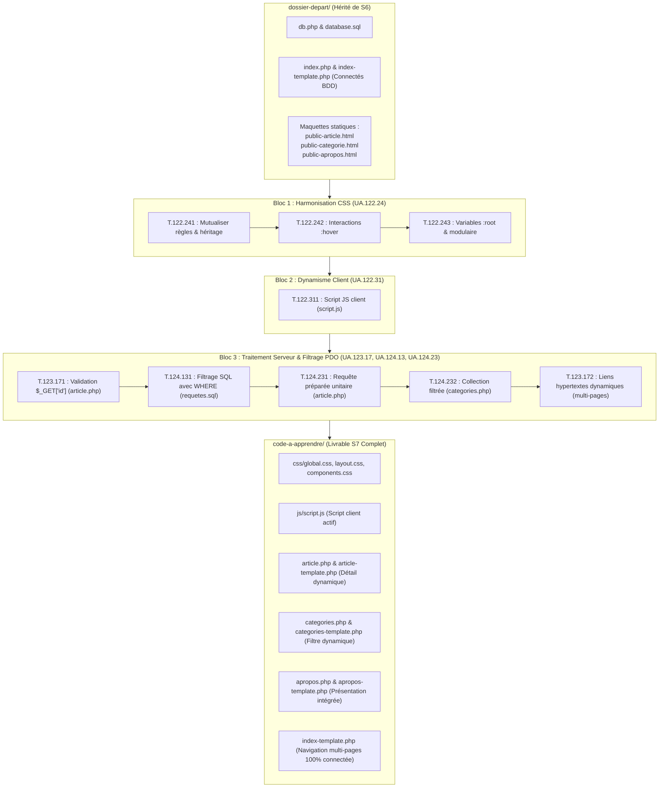

# Plan de Réalisation — Progression Développement Web (Session S7)

**Progression :** Développement Web Applicatif (Harmonisation CSS, dynamisme client JS, paramètres d'URL et requêtes préparées PDO)  
**Session :** S7 — Finaliser la partie Public du Blog  
**Niveau :** N1 (Débutant)  

---

## 1. Contexte & Objectif du Sprint S7

Dans cette septième session, l'apprenant franchit une étape majeure dans la maturité de son application Web : **l'achèvement de l'intégralité de l'espace public du Blog**.  
L'application ne se résume plus à une simple page d'accueil isolée : elle devient un site Web dynamique multi-pages, interactif, sécurisé et visuellement harmonisé.

* **Problème résolu :** À la fin de la session S6, la page d'accueil affichait des articles extraits de MySQL. Cependant, cliquer sur une carte ou un badge de catégorie ne menait nulle part (`href="#"`). De plus, les pages secondaires (`public-article.html`, `public-categorie.html`, `public-apropos.html`) étaient des maquettes HTML statiques figées, les couleurs étaient répétées en dur dans le CSS et aucun script client n'animait l'interface.
* **Solution pédagogique apportée :**
  1. **Harmoniser le style CSS** du site multi-pages en mutualisant les règles avec l'héritage, en dynamisant les interactions au survol (`:hover`) et en centralisant la charte graphique avec les variables natives `:root`.
  2. **Intégrer le premier script JavaScript client** pour amorcer l'interactivité dans le navigateur.
  3. **Intercepter et valider les paramètres d'URL** avec la superglobale PHP `$_GET['id']`.
  4. **Filtrer les données sous MySQL** avec la clause SQL `WHERE`.
  5. **Sécuriser les requêtes contre les injections SQL** en utilisant les requêtes préparées PDO (`prepare()` et `execute()`) pour extraire un article unique (`fetch()`) et une collection filtrée par catégorie (`fetchAll()`).
  6. **Raccorder tous les liens hypertextes dynamiques** (`article.php?id=...`, `categories.php?id=...`) et intégrer la page de présentation (`apropos.php`).



---

## 2. Articulation Temporelle de la Progression

### ⏮️ Acquis Passés (Sessions S1 à S6)
- Structuration sémantique HTML5 et règles CSS élémentaires (`UA.122.11` à `UA.122.23`).
- Programmation procédurale en PHP, tableaux associatifs, modularisation par fonctions (`UA.123.11` à `UA.123.15`).
- Persistance élémentaire JSON en S5 (`UA.123.16`).
- Modélisation relationnelle, création de base de données, tables et requêtes `INSERT` / `SELECT` avec jointure en S6 (`UA.124.11`, `UA.124.12`).
- Connexion sécurisée PDO et affichage direct des articles récents sur la page d'accueil en S6 (`UA.124.21`, `UA.124.22`).

### 🎯 Unités d'Apprentissage Développées dans ce Sprint (Session S7)
1. **UA.122.24 — Harmoniser la présentation d’une interface (`D.122.2.css`) :**  
   Mutualiser les déclarations avec sélecteurs groupés et héritage, ajouter l'interaction au survol (`:hover`), centraliser les couleurs avec les variables natives `:root` et organiser le CSS en fichiers modulaires.
2. **UA.122.31 — Écrire un script JavaScript simple (`D.122.3.js`) :**  
   Lier un fichier JavaScript externe (`js/script.js`) et exécuter un premier traitement vérifiable dans la console.
3. **UA.123.17 — Recevoir des données d’une requête Web (`D.123.1.php`) :**  
   Intercepter et valider les paramètres transmis dans l'URL (`$_GET['id']`) et construire des liens hypertextes dynamiques paramétrés.
4. **UA.124.13 — Filtrer les données avec SQL (`D.124.1.sql`) :**  
   Restreindre les résultats d'une requête SQL avec la clause `WHERE`.
5. **UA.124.23 — Exploiter les critères de recherche dans PHP (`D.124.2.php-sql`) :**  
   Sécuriser les requêtes PDO avec des requêtes préparées (`prepare()` et `execute()`), extraire un enregistrement unique (`fetch()`) et une collection filtrée (`fetchAll()`).

### ⏭️ Perspectives Futures (Sessions S8 à S12)
- **S8 :** Créer l'espace d'administration du Blog (`admin/`) et traiter les soumissions de formulaires sécurisés avec la méthode HTTP POST (`UA.123.18`, `UA.124.24`).
- **S9 :** Mettre en œuvre le cycle complet du CRUD en base de données (`INSERT`, `UPDATE`, `DELETE`).

---

## 3. Fiches de Spécification Technique des 9 Tutoriels

---

### T.122.241 — Mutualiser les règles avec les sélecteurs groupés et l'héritage
*Objectif logique : Réduire les répétitions dans la feuille CSS et exploiter la transmission naturelle des styles de texte*  
*Unité d'Apprentissage (UA) :* `UA.122.24` — Harmoniser la présentation d'une interface (`D.122.2.css`)

- **Progression pédagogique (Brique de code vers le Projet d'imitation) :**  
  L'apprenant hérite des feuilles CSS de S6 où plusieurs règles répètent les mêmes déclarations (polices, couleurs, marges). Il apprend à factoriser son code en regroupant les sélecteurs avec la virgule (`,`) et en confiant la typographie globale à l'élément parent (`body`) pour que tous les blocs enfants en héritent sans duplication.

- **1. Ce que l'apprenant doit apprendre :**
  - **Notions cibles :** Sélecteurs groupés (séparés par une virgule `,`), cascade CSS simple (ordre d'application des règles), héritage CSS des propriétés de texte (`font-family`, `color`, `line-height`) vs propriétés non héritées (`padding`, `margin`, `border`).
  - **Syntaxe & Outils :**
    ```css
    body {
        font-family: Arial, sans-serif;
        color: #1f2937;
        line-height: 1.5;
    }

    h1, h2, h3 {
        color: #111827;
        margin-top: 0;
    }
    ```
  - **Règles & Bonnes pratiques :** Ne jamais répéter `font-family` sur chaque titre ou paragraphe si la règle peut être définie une seule fois sur le conteneur global.

- **2. Description technique de la réalisation (Développement du projet) :**
  - Ouvrir `css/style.css`.
  - Identifier les déclarations redondantes sur les titres et les paragraphes.
  - Déplacer la police et la couleur générale dans la règle `body`.
  - Regrouper les sélecteurs de titres `.titre-section, .titre-carte`.
  - Vérifier dans le navigateur que le texte conserve son apparence sans aucune dégradation visuelle.

- **3. Fichiers impactés :**
  - `css/components.css` / `css/style.css`.

- **4. État de départ ($E_0$) :**
  Règles CSS redondantes et déclarations typographiques répétées sur de multiples sélecteurs.

- **5. État d'arrivée ($E_1$) :**
  Feuille CSS factorisée, exploitant l'héritage sur `body` et les sélecteurs groupés.

- **6. Livrable physique tapé par l'apprenant :**
  - Fichier CSS factorisé.
  - **Fichier cible dans le projet :** `css/components.css`.

---

### T.122.242 — Dynamiser les interactions avec la pseudo-classe :hover
*Objectif logique : Offrir un retour visuel interactif au survol des liens, boutons et cartes*  
*Unité d'Apprentissage (UA) :* `UA.122.24` — Harmoniser la présentation d'une interface (`D.122.2.css`)

- **Progression pédagogique (Brique de code vers le Projet d'imitation) :**  
  Les composants du blog (boutons de navigation, cartes d'articles, filtres de catégories) sont figés. L'apprenant ajoute des styles d'interaction d'état grâce à la pseudo-classe `:hover` pour guider le regard de l'utilisateur et confirmer le caractère cliquable de chaque élément.

- **1. Ce que l'apprenant doit apprendre :**
  - **Notions cibles :** Pseudo-classe d'état `:hover`, retour visuel au survol, changement de couleur d'arrière-plan, modification de l'ombre (`box-shadow`), propriété `cursor: pointer`.
  - **Syntaxe & Outils :**
    ```css
    .bouton-principal:hover {
        background-color: #1c5bba;
        cursor: pointer;
    }

    .carte-article:hover {
        transform: translateY(-2px);
        box-shadow: 0 4px 12px rgba(0, 0, 0, 0.1);
    }
    ```
  - **Règles & Bonnes pratiques :** Maintenir un contraste de couleur suffisant au survol et ne pas masquer l'information textuelle.

- **2. Description technique de la réalisation (Développement du projet) :**
  - Dans `css/components.css`, localiser les classes `.bouton-principal`, `.lien-article` et `.carte-article`.
  - Ajouter les règles avec la pseudo-classe `:hover`.
  - Tester dans le navigateur : passer la souris sur les boutons et cartes pour constater l'apparition instantanée du retour visuel.

- **3. Fichiers impactés :**
  - `css/components.css`.

- **4. État de départ ($E_1$) :**
  Composants d'interface statiques sans réaction visuelle au passage de la souris.

- **5. État d'arrivée ($E_2$) :**
  Composants interactifs réagissant visuellement au survol du curseur.

- **6. Livrable physique tapé par l'apprenant :**
  - Fichier `css/components.css` enrichi des règles `:hover`.
  - **Fichier cible dans le projet :** `css/components.css`.

---

### T.122.243 — Centraliser la charte graphique avec les variables CSS
*Objectif logique : Piloter la palette de couleurs depuis :root et structurer les feuilles de style partagées*  
*Unité d'Apprentissage (UA) :* `UA.122.24` — Harmoniser la présentation d'une interface (`D.122.2.css`)

- **Progression pédagogique (Brique de code vers le Projet d'imitation) :**  
  Pour préparer le site multi-pages, l'apprenant remplace tous les codes hexadécimaux éparpillés par des variables CSS natives déclarées sur le pseudo-élément `:root`. Il organise ensuite physiquement ses styles en 3 fichiers partagés (`global.css`, `layout.css`, `components.css`) et vérifie que modifier une seule variable change instantanément le thème sur tout le blog.

- **1. Ce que l'apprenant doit apprendre :**
  - **Notions cibles :** Pseudo-classe globale `:root`, déclaration de variable CSS `--nom: valeur;`, fonction de rappel `var(--nom)`, architecture modulaire de fichiers CSS (`global.css`, `layout.css`, `components.css`), liaisons multiples `<link rel="stylesheet">`.
  - **Syntaxe & Outils :**
    ```css
    :root {
        --couleur-texte: #1f2937;
        --couleur-fond: #f9fafb;
        --couleur-primaire: #2673e8;
        --couleur-primaire-hover: #1c5bba;
        --couleur-bordure: #e5e7eb;
    }

    body {
        color: var(--couleur-texte);
        background-color: var(--couleur-fond);
    }
    ```
  - **Règles & Bonnes pratiques :** Ne plus jamais écrire de code hexadécimal directement dans les composants ; toujours passer par `var(...)`.

- **2. Description technique de la réalisation (Développement du projet) :**
  - Ouvrir `css/global.css` et insérer la déclaration `:root` avec la palette complète.
  - Remplacer les couleurs en dur par `var(--couleur-primaire)` dans `components.css`.
  - Vérifier dans les templates (`index-template.php`, `public-article.html`) que les 3 balises `<link>` chargent `global.css`, `layout.css` et `components.css`.
  - Modifier temporairement `--couleur-primaire: #e82646;` (rouge) pour constater le rethémage instantané du blog, puis remettre la valeur d'origine.

- **3. Fichiers impactés :**
  - `css/global.css`, `css/components.css`, `index-template.php`.

- **4. État de départ ($E_2$) :**
  Couleurs codées en dur dans chaque classe, rendant toute modification de charte graphique fastidieuse.

- **5. État d'arrivée ($E_3$) :**
  Charte graphique pilotée depuis `:root` dans `css/global.css` et architecture CSS modulaire prête pour le multi-pages.

- **6. Livrable physique tapé par l'apprenant :**
  - Fichier `css/global.css` déclarant les variables du thème.
  - **Fichier cible dans le projet :** `css/global.css`.

---

### T.122.311 — Écrire et exécuter un script JavaScript client
*Objectif logique : Lier un fichier JavaScript externe et valider son exécution dans la console*  
*Unité d'Apprentissage (UA) :* `UA.122.31` — Écrire un script JavaScript simple (`D.122.3.js`)

- **Progression pédagogique (Brique de code vers le Projet d'imitation) :**  
  L'apprenant découvre l'exécution de code côté client (dans le navigateur de l'utilisateur). Il crée son premier fichier de script `js/script.js`, l'intègre au pied de page de ses templates et vérifie son bon déclenchement via la console des outils de développement.

- **1. Ce que l'apprenant doit apprendre :**
  - **Notions cibles :** Balise `<script src="js/script.js">`, positionnement optimal avant la balise fermante `</body>`, environnement d'exécution navigateur, objet `console`, méthode `console.log()`, outils de développement du navigateur (F12 / Console).
  - **Syntaxe & Outils :**
    ```javascript
    // js/script.js : Script client du Blog
    console.log("Blog initialisé avec succès côté client.");
    ```
    ```html
    <script src="js/script.js"></script>
    </body>
    ```
  - **Règles & Bonnes pratiques :** Toujours charger les scripts non bloquants en fin de document pour ne pas retarder le rendu visuel de la page HTML.

- **2. Description technique de la réalisation (Développement du projet) :**
  - Créer le dossier `js/` à la racine du projet.
  - Créer le fichier `js/script.js` et saisir le message de contrôle.
  - Ouvrir `index-template.php` et ajouter la balise `<script src="js/script.js"></script>` juste avant `</body>`.
  - Ouvrir le site dans le navigateur (`http://localhost:8000`), ouvrir la console (F12) et constater l'affichage du message.

- **3. Fichiers impactés :**
  - `js/script.js` (nouveau fichier), `index-template.php`.

- **4. État de départ ($E_3$) :**
  Application purement statique côté navigateur, dépourvue de tout script JavaScript client.

- **5. État d'arrivée ($E_4$) :**
  Script client `js/script.js` lié et exécuté sans erreur dans la console du navigateur.

- **6. Livrable physique tapé par l'apprenant :**
  - Fichier `js/script.js`.
  - **Fichier cible dans le projet :** `js/script.js`.

---

### T.123.171 — Recevoir et valider un paramètre d'URL avec $_GET
*Objectif logique : Intercepter, vérifier l'existence et transtyper un identifiant transmis dans l'URL*  
*Unité d'Apprentissage (UA) :* `UA.123.17` — Recevoir des données d’une requête Web (`D.123.1.php`)

- **Progression pédagogique (Brique de code vers le Projet d'imitation) :**  
  Pour permettre à un visiteur de consulter un article précis, l'apprenant crée le contrôleur `article.php`. Il découvre la transmission de données par l'URL (*query string*) et apprend à intercepter `$_GET['id']`, à vérifier sa présence et à convertir sa valeur en entier sécurisé.

- **1. Ce que l'apprenant doit apprendre :**
  - **Notions cibles :** Paramètre d'URL (`article.php?id=1`), superglobale PHP `$_GET`, fonction de test `isset()`, fonction `empty()`, transtypage d'entier `(int)`, gestion d'erreur avec `die()` ou message explicite.
  - **Syntaxe & Outils :**
    ```php
    <?php
    require_once 'db.php';

    if (!isset($_GET['id']) || empty($_GET['id'])) {
        die("Erreur : Aucun article spécifié.");
    }

    $articleId = (int)$_GET['id'];
    echo "Identifiant de l'article validé : " . $articleId;
    ?>
    ```
  - **Règles & Bonnes pratiques :** Ne jamais faire confiance aux données d'URL ; toujours transtyper en entier `(int)` les identifiants numériques pour bloquer les valeurs inattendues.

- **2. Description technique de la réalisation (Développement du projet) :**
  - Créer le fichier `article.php` à la racine du projet de blog.
  - Inclure la connexion `require_once 'db.php';`.
  - Écrire la condition de vérification avec `isset()` et `empty()`.
  - Transtyper `$_GET['id']` dans `$articleId`.
  - Tester dans le terminal : `php -r "$_GET['id'] = '3'; require 'article.php';"` pour valider la logique de contrôle.

- **3. Fichiers impactés :**
  - `article.php` (création du contrôleur de détail).

- **4. État de départ ($E_4$) :**
  L'application ne sait pas encore récupérer de paramètres d'URL pour afficher des contenus spécifiques.

- **5. État d'arrivée ($E_5$) :**
  Contrôleur `article.php` capable d'intercepter, de valider et de sécuriser un identifiant transmis par l'URL.

- **6. Livrable physique tapé par l'apprenant :**
  - Fichier `article.php` avec validation de `$_GET['id']`.
  - **Fichier cible dans le projet :** `article.php`.

---

### T.124.131 — Filtrer les enregistrements avec la clause WHERE
*Objectif logique : Restreindre une sélection SQL à un enregistrement ou un groupe d'enregistrements ciblés*  
*Unité d'Apprentissage (UA) :* `UA.124.13` — Filtrer les données avec SQL (`D.124.1.sql`)

- **Progression pédagogique (Brique de code vers le Projet d'imitation) :**  
  Avant d'automatiser l'affichage dans PHP, l'apprenant s'assure de maîtriser la syntaxe SQL de filtrage. Dans MySQL Workbench, il rédige et exécute les requêtes `SELECT` accompagnées de la clause `WHERE` pour cibler un article précis par son `id` et filtrer les articles d'une catégorie par son `categorie_id`.

- **1. Ce que l'apprenant doit apprendre :**
  - **Notions cibles :** Clause SQL `WHERE`, opérateur d'égalité `=`, filtrage sur clé primaire (`id = 1`), filtrage sur clé étrangère (`categorie_id = 2`), combinaison de `WHERE` avec `JOIN` et `ORDER BY`.
  - **Syntaxe & Outils :**
    ```sql
    -- Filtrer un article précis
    SELECT a.*, c.libelle AS categorie_libelle
    FROM articles a
    JOIN categories c ON a.categorie_id = c.id
    WHERE a.id = 1;

    -- Filtrer les articles d'une catégorie
    SELECT a.*, c.libelle AS categorie_libelle
    FROM articles a
    JOIN categories c ON a.categorie_id = c.id
    WHERE a.categorie_id = 2
    ORDER BY a.date_creation DESC;
    ```
  - **Règles & Bonnes pratiques :** Toujours vérifier les types : un identifiant numérique se compare sans guillemets (`WHERE a.id = 1`).

- **2. Description technique de la réalisation (Développement du projet) :**
  - Dans MySQL Workbench, ouvrir un éditeur SQL sur la base `blog_n1`.
  - Rédiger la requête de sélection d'un article par son identifiant unique.
  - Rédiger la requête de sélection des articles filtrés par leur catégorie.
  - Exécuter chaque requête et vérifier que la grille de résultats ne renvoie exactement que les lignes ciblées.
  - Consigner ces deux requêtes dans `requetes.sql`.

- **3. Fichiers impactés :**
  - `requetes.sql`.

- **4. État de départ ($E_5$) :**
  Requêtes SQL maîtrisées pour une lecture globale, mais sans critères de restriction ciblés.

- **5. État d'arrivée ($E_6$) :**
  Requêtes de filtrage par `id` et `categorie_id` validées et documentées dans `requetes.sql`.

- **6. Livrable physique tapé par l'apprenant :**
  - Fichier `requetes.sql` enrichi des requêtes avec clause `WHERE`.
  - **Fichier cible dans le projet :** `requetes.sql`.

---

### T.124.231 — Sécuriser une requête SQL avec prepare et execute
*Objectif logique : Neutraliser les injections SQL et extraire un enregistrement unique en mémoire*  
*Unité d'Apprentissage (UA) :* `UA.124.23` — Exploiter les critères de recherche dans PHP (`D.124.2.php-sql`)

- **Progression pédagogique (Brique de code vers le Projet d'imitation) :**  
  L'apprenant franchit une étape fondamentale de sécurité : il apprend qu'injecter directement une variable dans une requête SQL (`WHERE id = " . $_GET['id']`) expose l'application à des attaques destructrices (injections SQL). Il met en œuvre la méthode recommandée de PDO : préparer la requête avec un marqueur nommé (`:id`), exécuter avec `$stmt->execute()`, extraire l'article unique avec `$stmt->fetch()` et transmettre les données à `article-template.php`.

- **1. Ce que l'apprenant doit apprendre :**
  - **Notions cibles :** Faille d'injection SQL, requêtes préparées PDO, méthode `$pdo->prepare()`, marqueur nommé `:id`, méthode `$stmt->execute(['id' => $articleId])`, méthode `$stmt->fetch()`, détection d'article inexistant, inclusion du template de présentation.
  - **Syntaxe & Outils :**
    ```php
    $sql = "
        SELECT a.*, c.libelle AS categorie_libelle, c.couleur AS categorie_couleur,
               aut.nom AS auteur_nom, aut.prenom AS auteur_prenom, aut.image_profil AS auteur_image
        FROM articles a
        JOIN categories c ON a.categorie_id = c.id
        JOIN auteurs aut ON a.auteur_id = aut.id
        WHERE a.id = :id
    ";
    $stmt = $pdo->prepare($sql);
    $stmt->execute(['id' => $articleId]);
    $article = $stmt->fetch();

    if (!$article) {
        die("Erreur : Article introuvable.");
    }

    require 'article-template.php';
    ```
  - **Règles & Bonnes pratiques :** Ne jamais concaténer de variable issue de l'utilisateur dans une chaîne SQL ; toujours utiliser des requêtes préparées avec paramètres liés.

- **2. Description technique de la réalisation (Développement du projet) :**
  - Dans `article.php`, rédiger la requête relationnelle complète avec le filtre `WHERE a.id = :id`.
  - Préparer la requête avec `$pdo->prepare($sql)` et l'exécuter en lui passant le tableau associatif de paramètres `['id' => $articleId]`.
  - Récupérer l'enregistrement unique avec `$stmt->fetch()`.
  - Transformer `public-article.html` en `article-template.php` en remplaçant les textes figés par les balises `<?= htmlspecialchars($article['titre']) ?>`, date, contenu et auteur.
  - Ajouter `require 'article-template.php';` à la fin de `article.php`.
  - Tester dans le navigateur à l'adresse `http://localhost:8000/article.php?id=1`.

- **3. Fichiers impactés :**
  - `article.php`, `article-template.php`.

- **4. État de départ ($E_6$) :**
  Paramètre d'URL validé mais sans interaction avec la base de données via requête préparée.

- **5. État d'arrivée ($E_7$) :**
  Page de détail d'un article 100% dynamique, alimentée par MySQL et totalement immunisée contre les injections SQL.

- **6. Livrable physique tapé par l'apprenant :**
  - Fichiers `article.php` et `article-template.php` opérationnels.
  - **Fichier cible dans le projet :** `article.php`.

---

### T.124.232 — Extraire une collection filtrée avec prepare et fetchAll
*Objectif logique : Conditionner l'extraction de plusieurs enregistrements selon un critère dynamique*  
*Unité d'Apprentissage (UA) :* `UA.124.23` — Exploiter les critères de recherche dans PHP (`D.124.2.php-sql`)

- **Progression pédagogique (Brique de code vers le Projet d'imitation) :**  
  L'apprenant développe la page `categories.php`. Il applique une logique conditionnelle : si un paramètre `id` de catégorie est présent dans l'URL (`categories.php?id=2`), la page prépare et exécute la requête filtrée pour extraire la liste des articles correspondants avec `fetchAll()`. Si aucun identifiant n'est fourni, elle extrait l'ensemble des catégories pour un affichage thématique global.

- **1. Ce que l'apprenant doit apprendre :**
  - **Notions cibles :** Condition alternative sur paramètre de requête, méthode `$pdo->prepare()` combinée à `$stmt->fetchAll()`, extraction d'une collection filtrée, requête globale avec `$pdo->query()` en l'absence de filtre, liaison avec `categories-template.php`.
  - **Syntaxe & Outils :**
    ```php
    $categoryId = isset($_GET['id']) ? (int)$_GET['id'] : null;

    if ($categoryId) {
        $stmtCat = $pdo->prepare("SELECT * FROM categories WHERE id = :id");
        $stmtCat->execute(['id' => $categoryId]);
        $categorieActuelle = $stmtCat->fetch();

        $stmtArt = $pdo->prepare("
            SELECT a.*, c.libelle AS categorie_libelle, c.couleur AS categorie_couleur
            FROM articles a
            JOIN categories c ON a.categorie_id = c.id
            WHERE a.categorie_id = :id
            ORDER BY a.date_creation DESC
        ");
        $stmtArt->execute(['id' => $categoryId]);
        $articles = $stmtArt->fetchAll();
    } else {
        $stmtCat = $pdo->query("SELECT * FROM categories ORDER BY libelle ASC");
        $toutesLesCategories = $stmtCat->fetchAll();
    }

    require 'categories-template.php';
    ```
  - **Règles & Bonnes pratiques :** Toujours vérifier que l'identifiant demandé existe bien en base avant d'exécuter la requête secondaire sur les articles.

- **2. Description technique de la réalisation (Développement du projet) :**
  - Créer le fichier `categories.php` à la racine.
  - Écrire la logique conditionnelle sur `$categoryId`.
  - Transformer `public-categorie.html` en `categories-template.php` en intégrant les boucles `foreach` d'affichage des articles de la catégorie sélectionnée ou de toutes les catégories.
  - Tester dans le navigateur : `http://localhost:8000/categories.php?id=1` puis `http://localhost:8000/categories.php`.

- **3. Fichiers impactés :**
  - `categories.php`, `categories-template.php`.

- **4. État de départ ($E_7$) :**
  Page de détail unitaire fonctionnelle, mais absence de page de filtrage par thématique.

- **5. État d'arrivée ($E_8$) :**
  Page `categories.php` dynamique, permettant à la fois l'affichage des articles d'une catégorie et la consultation globale des thèmes.

- **6. Livrable physique tapé par l'apprenant :**
  - Fichiers `categories.php` et `categories-template.php`.
  - **Fichier cible dans le projet :** `categories.php`.

---

### T.123.172 — Construire des liens hypertextes dynamiques avec paramètres
*Objectif logique : Raccorder la navigation entre toutes les pages publiques via des URL paramétrées*  
*Unité d'Apprentissage (UA) :* `UA.123.17` — Recevoir des données d’une requête Web (`D.123.1.php`)

- **Progression pédagogique (Brique de code vers le Projet d'imitation) :**  
  Aboutissement complet de la session S7 : l'apprenant relie l'ensemble de ses pages publiques. Dans `index-template.php` et `categories-template.php`, il remplace les faux liens statiques (`href="#"`) par des liens hypertextes dynamiques pointant vers `article.php?id=...` et `categories.php?id=...`. Il finalise également le couple `apropos.php` / `apropos-template.php` pour achever le périmètre public du blog.

- **1. Ce que l'apprenant doit apprendre :**
  - **Notions cibles :** Liens hypertextes dynamiques, injection de variables PHP dans l'attribut `href`, navigation multi-pages cohérente, raccordement du menu principal (Accueil, Catégories, À propos), validation du parcours utilisateur complet sans aucun lien mort.
  - **Syntaxe & Outils :**
    ```html
    <!-- Lien vers la vue détaillée d'un article -->
    <a href="article.php?id=<?= $article['id'] ?>" class="bouton-principal">
        Lire l'article
    </a>

    <!-- Lien vers le filtre d'une catégorie -->
    <a href="categories.php?id=<?= $article['categorie_id'] ?>" class="badge">
        <?= htmlspecialchars($article['categorie_libelle']) ?>
    </a>
    ```
  - **Règles & Bonnes pratiques :** Toujours vérifier chaque lien dans le navigateur pour garantir qu'aucun clic ne conduit à une erreur 404 ou une page vierge.

- **2. Description technique de la réalisation (Développement du projet) :**
  - Dans `index-template.php`, modifier les liens des cartes d'articles pour pointer vers `article.php?id=<?= $article['id'] ?>`.
  - Modifier les badges de catégories pour pointer vers `categories.php?id=<?= $article['categorie_id'] ?>`.
  - Créer `apropos.php` et `apropos-template.php` à partir de `public-apropos.html`.
  - Vérifier que la barre de navigation haute (`<nav>`) relie parfaitement `index.php`, `categories.php` et `apropos.php` sur tous les templates.
  - Réaliser un test de navigation complet depuis le navigateur.

- **3. Fichiers impactés :**
  - `index-template.php`, `categories-template.php`, `apropos.php`, `apropos-template.php`.

- **4. État de départ ($E_8$) :**
  Pages dynamiques existantes mais isolées, reliées par des liens statiques `href="#"`.

- **5. État d'arrivée ($E_9$) :**
  Site public du blog 100% interactif, raccordé dynamiquement, sécurisé et navigable de bout en bout.

- **6. Livrable physique tapé par l'apprenant :**
  - Ensemble des fichiers du blog public raccordés (`index-template.php`, `categories-template.php`, `apropos.php`, `apropos-template.php`).
  - **Fichier cible dans le projet :** `index-template.php`.

---

## 4. Articulation vers les Projets de l'Apprenant (Triade Active LMS)

1. **Tutoriels (Comprendre avec le minimum de code) :**  
   Les 9 tutoriels ci-dessus isolent chaque palier technique : mutualisation CSS ($T_1$), interaction `:hover` ($T_2$), variables `:root` ($T_3$), script JS client ($T_4$), paramètre `$_GET['id']` ($T_5$), filtrage SQL `WHERE` ($T_6$), requête préparée unitaire ($T_7$), collection filtrée ($T_8$) et raccordement des liens dynamiques ($T_9$).
2. **Projet d'Imitation (Reproduire pour maîtriser le fil conducteur) :**  
   L'accumulation ordonnée des livrables de chaque étape transforme les maquettes statiques de `dossier-depart/` pour livrer le **site public complet du blog** (`code-a-apprendre/`).
3. **Projet Prototype (Expérimenter en autonomie sur un cas similaire — Portfolio) :**  
   L'apprenant applique les mêmes notions sur son Portfolio : il dynamise la consultation de chaque projet individuel (`projet.php?id=...`), filtre les projets par technologie/compétence et harmonise son CSS avec les variables `:root`.
4. **Projet Fil Rouge (Réutiliser & Développer la compétence métier) :**  
   Dans le cadre du travail en équipe sur le projet annuel, les apprenants implémentent la consultation multi-pages sécurisée et la navigation dynamique avec des requêtes préparées systématiques.
