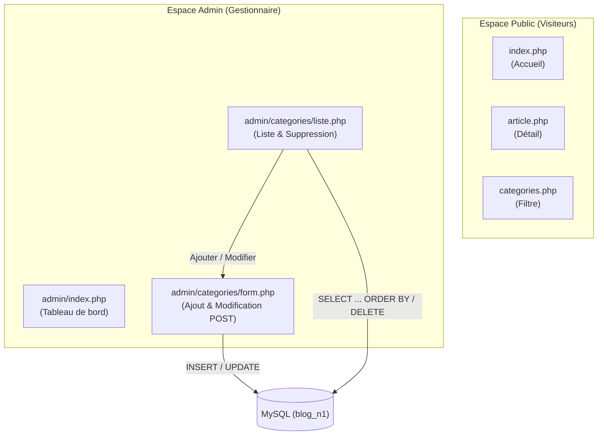

# Plan de Réalisation — Progression Développement Web (Session S8)

**Progression :** Développement Web Applicatif (Espace d'administration et CRUD Catégories)  
**Session :** S8 — Gérer les catégories dans l’Admin  
**Niveau :** N1 (Débutant)  

---

## 1. Contexte & Objectif du Sprint S8

Dans cette huitième session, l'apprenant commence la construction de **l'espace d'administration du Blog (Back-Office)**. Il met en place la gestion complète (CRUD) des catégories d'articles.

* **Problème résolu :** Jusqu'à présent, toutes les catégories étaient insérées manuellement en base de données. Il n'existait aucune interface pour en créer de nouvelles, les modifier ou les supprimer.
* **Solution pédagogique :**
  1. Structurer l'arborescence en séparant l'espace Public et l'espace Admin (`admin/`, `admin/categories/`, `admin/css/`).
  2. Créer un tableau de bord d'administration (`admin/index.php`).
  3. Développer le formulaire de saisie HTML avec méthode HTTP `POST` (`form.php`, `form-template.php`).
  4. Contrôler les données reçues côté serveur avant insertion ou mise à jour (`INSERT` et `UPDATE`).
  5. Afficher la liste ordonnée des catégories avec `ORDER BY` (`liste.php`, `liste-template.php`) et permettre la suppression (`DELETE`).
  6. Manipuler le DOM avec JavaScript (`js/admin.js`) pour sécuriser les actions utilisateur (confirmation de suppression).

---

## 2. Articulation Temporelle de la Progression

### ⏮️ Acquis Passés (Sessions S1 à S7)
- Exécution de requêtes de lecture et requêtes préparées avec PDO (`UA.124.12`, `UA.124.13`).
- Réception et contrôle de paramètres d'URL avec `$_GET` (`UA.123.16`).
- Séparation stricte du contrôleur logique et du template d'affichage (`UA.125.13`, `UA.125.14`, `UA.125.15`).
- Intégration d'un premier script client JavaScript (`UA.122.31`).

### 🎯 Unités d'Apprentissage & Tutoriels Mobilisés dans ce Sprint (Session S8)

#### Construire l’interface (D.122.1, html & js)

* **UA.122.15 — Construire un formulaire HTML :**  
  Construire un formulaire permettant à l'utilisateur de saisir des données structurées pour une catégorie (`nom_categorie`, `couleur_categorie`) en utilisant les balises `<form>`, `<input>` et un bouton de soumission.
  - **T.122.15.1 — Créer le formulaire de gestion d'une catégorie**  
    *Livrable :* Formulaire HTML avec champs de saisie et méthode POST | *Fichier :* `admin/categories/form-template.php`

* **UA.122.32 — Sélectionner et manipuler le DOM :**  
  Sélectionner des éléments du DOM avec `document.querySelectorAll()` et intercepter l'événement de clic pour afficher une boîte de confirmation avant suppression.
  - **T.122.32.1 — Interagir avec le DOM pour confirmer une suppression**  
    *Livrable :* Script client interceptant les clics sur les liens de suppression | *Fichier :* `js/admin.js`

#### Réaliser le traitement serveur (D.123.1, php)

* **UA.123.17 — Contrôler les données reçues :**  
  Vérifier les données transmises par la méthode `POST` (`$_POST`), nettoyer les valeurs avec `trim()`, vérifier qu'aucun champ obligatoire n'est vide et gérer les messages d'erreur.
  - **T.123.17.1 — Valider les données du formulaire de catégorie en PHP**  
    *Livrable :* Contrôle complet des champs POST avec message d'erreur si invalide | *Fichier :* `admin/categories/form.php`

#### Exploiter les données (D.124.1, sql)

* **UA.124.14 — Trier les résultats SQL :**  
  Construire une requête SQL utilisant la clause `ORDER BY` pour afficher les catégories triées par ordre alphabétique (`ORDER BY libelle ASC`).
  - **T.124.14.1 — Afficher et trier la liste des catégories en SQL**  
    *Livrable :* Requête de sélection avec tri alphabétique et comptage d'articles | *Fichier :* `admin/categories/liste.php`

* **UA.124.23 — Exploiter les critères de recherche dans PHP :**  
  Construire et exécuter des requêtes préparées PDO d'insertion (`INSERT INTO`), de modification (`UPDATE`) et de suppression (`DELETE`) à partir des données transmises par l'application.
  - **T.124.23.1 — Insérer et modifier une catégorie avec des requêtes préparées**  
    *Livrable :* Insertion (INSERT) ou mise à jour (UPDATE) sécurisée en base de données | *Fichier :* `admin/categories/form.php`
  - **T.124.23.2 — Supprimer une catégorie en base de données**  
    *Livrable :* Suppression sécurisée d'une catégorie ciblée par son identifiant | *Fichier :* `admin/categories/liste.php`

#### Structurer et déboguer une solution (D.125.1, architecture)

* **UA.125.16 — Structurer la partie Public et Admin :**  
  Structurer l'application Web dynamique en isolant la partie administration dans un dossier dédié `admin/`, avec son propre tableau de bord `admin/index.php`, ses sous-dossiers par entité et ses feuilles de style spécifiques.
  - **T.125.16.1 — Mettre en place l'architecture du dossier admin et son tableau de bord**  
    *Livrable :* Arborescence `admin/` créée et page d'accueil d'administration fonctionnelle | *Fichier :* `admin/index.php`

### ⏭️ Perspectives Futures (Sessions S9 à S12)
- **S9 :** Étendre l'espace d'administration à la gestion complète des articles du Blog (`admin/articles/`) avec gestion des jointures, limitation du nombre de résultats (`LIMIT`) et écriture du premier plan de test manuel (`plan-test.md`).
- **S10 :** Sécuriser l'accès à l'administration par un formulaire d'authentification (`admin/auth/login.php`) et des variables de session PHP (`$_SESSION`).

---

## 3. Fiches de Conception Détaillées des Tutoriels

### T.125.16.1 — Mettre en place l'architecture du dossier admin et son tableau de bord
- **Objectif :** Créer l'architecture de fichiers pour séparer nettement la consultation publique et l'espace de gestion.
- **Notions :** Séparation des espaces Web, liens relatifs inter-dossiers (`../../db.php`), page d'accueil d'administration.
- **Consigne pour l'apprenant :**
  1. Créer le dossier `admin/` à la racine du projet.
  2. Créer le fichier [code-a-apprendre/admin/index.php](code-a-apprendre/admin/index.php) affichant un tableau de bord simple avec les liens vers la gestion des catégories et des articles.
  3. Lier la feuille de style d'administration fournie [dossier-depart/admin/css/admin-style.css](dossier-depart/admin/css/admin-style.css).
- **Résultat attendu :** Un espace d'administration accessible via `http://localhost/admin/` avec un tableau de bord clair.

---

### T.124.14.1 — Afficher et trier la liste des catégories en SQL
- **Objectif :** Lister toutes les catégories enregistrées en base de données, ordonnées par ordre alphabétique avec le nombre d'articles rattachés.
- **Notions :** Clause SQL `ORDER BY nom_colonne ASC`, fonction d'agrégation `COUNT(a.id)`, jointure `LEFT JOIN articles a ON ...`, regroupement avec `GROUP BY c.id`.
- **Consigne pour l'apprenant :**
  1. Dans [code-a-apprendre/admin/categories/liste.php](code-a-apprendre/admin/categories/liste.php), inclure la connexion `../../db.php`.
  2. Écrire la requête SQL avec `LEFT JOIN` et `GROUP BY c.id` pour compter les articles même si une catégorie n'en a aucun.
  3. Exécuter la requête via `$pdo->query()` et récupérer la collection avec `$stmt->fetchAll()`.
  4. Transmettre les données à la vue [code-a-apprendre/admin/categories/liste-template.php](code-a-apprendre/admin/categories/liste-template.php) pour afficher le tableau HTML.
- **Résultat attendu :** La liste complète des catégories s'affiche dans un tableau avec leur couleur et le nombre d'articles.

---

### T.122.15.1 — Créer le formulaire de gestion d'une catégorie
- **Objectif :** Construire l'interface de saisie pour ajouter ou éditer une catégorie.
- **Notions :** Balises HTML `<form method="POST">`, `<label>`, `<input type="text">`, `<input type="color">`, bouton de soumission, protection de l'affichage avec `htmlspecialchars()`.
- **Consigne pour l'apprenant :**
  1. Dans [code-a-apprendre/admin/categories/form-template.php](code-a-apprendre/admin/categories/form-template.php), créer le formulaire pointant vers le contrôleur PHP en méthode `POST`.
  2. Ajouter les champs obligatoires : nom de la catégorie et pastille de couleur.
  3. Pré-remplir les champs avec les variables `$libelle` et `$couleur` pour permettre la modification d'une catégorie existante.
- **Résultat attendu :** Un formulaire propre et réutilisable aussi bien pour l'ajout que pour l'édition.

---

### T.123.17.1 — Valider les données du formulaire de catégorie en PHP
- **Objectif :** Vérifier que les informations transmises par l'utilisateur sont conformes avant tout enregistrement.
- **Notions :** Détection de la méthode HTTP avec `$_SERVER['REQUEST_METHOD'] === 'POST'`, superglobale `$_POST`, nettoyage avec `trim()`, vérification avec `empty()`, gestion d'une variable `$erreur`, arrêt d'urgence avec `die()`.
- **Consigne pour l'apprenant :**
  1. Dans [code-a-apprendre/admin/categories/form.php](code-a-apprendre/admin/categories/form.php), vérifier si la requête HTTP est de type `POST` grâce à `$_SERVER['REQUEST_METHOD']`.
  2. Récupérer les valeurs saisies et supprimer les espaces superflus avec `trim()`.
  3. Si un champ est vide, renseigner la variable `$erreur = "Veuillez remplir tous les champs obligatoires."`.
  4. Si une catégorie demandée en GET par son `id` n'existe pas en BDD, interrompre l'exécution proprement avec `die("Erreur : Catégorie introuvable.")`.
- **Résultat attendu :** Les saisies invalides sont bloquées et un message explicatif s'affiche à l'écran.

---

### T.124.23.1 — Insérer et modifier une catégorie avec des requêtes préparées
- **Objectif :** Enregistrer les données validées en base de données en mode création ou en mode mise à jour.
- **Notions :** Requêtes préparées `INSERT INTO`, `UPDATE ... WHERE`, redirection HTTP `header('Location: liste.php')` suivie de `exit()`.
- **Consigne pour l'apprenant :**
  1. Si un identifiant `id` est présent en paramètre, préparer une requête `UPDATE` pour modifier la catégorie ciblée.
  2. Si aucun identifiant n'est présent, préparer une requête `INSERT INTO` pour créer une nouvelle catégorie.
  3. Exécuter la requête avec les paramètres nettoyés.
  4. Rediriger immédiatement vers la liste avec `header("Location: liste.php"); exit();` pour éviter qu'un rafraîchissement ne ressoumette le formulaire.
- **Résultat attendu :** Les catégories ajoutées ou modifiées sont immédiatement enregistrées dans la base MySQL.

---

### T.124.23.2 — Supprimer une catégorie en base de données
- **Objectif :** Supprimer une catégorie sélectionnée depuis le tableau de bord d'administration.
- **Notions :** Requête préparée `DELETE FROM ... WHERE id = :id`, sécurité des clés étrangères.
- **Consigne pour l'apprenant :**
  1. Dans [code-a-apprendre/admin/categories/liste.php](code-a-apprendre/admin/categories/liste.php), détecter la présence du paramètre `$_GET['supprimer']`.
  2. Préparer et exécuter la requête `DELETE` avec l'identifiant converti en entier `(int)`.
  3. Rediriger l'utilisateur vers `liste.php` pour rafraîchir l'affichage sans risque de double suppression.
- **Résultat attendu :** La catégorie ciblée est définitivement supprimée de la table MySQL.

---

### T.122.32.1 — Interagir avec le DOM pour confirmer une suppression
- **Objectif :** Éviter les suppressions accidentelles grâce à une invite de confirmation JavaScript côté client.
- **Notions :** Méthodes de sélection DOM `document.querySelector()` (élément unique) et `document.querySelectorAll()` (collection d'éléments), écouteur d'événement `addEventListener('click')`, fonction `confirm()`, méthode `preventDefault()`.
- **Consigne pour l'apprenant :**
  1. Dans [code-a-apprendre/js/admin.js](code-a-apprendre/js/admin.js), sélectionner tous les liens de suppression contenant `supprimer=`.
  2. Attacher un écouteur d'événement au clic demandant une confirmation avec `confirm()`.
  3. Si l'utilisateur clique sur "Annuler", stopper la navigation avec `e.preventDefault()`.
- **Résultat attendu :** Une boîte de dialogue apparaît avant chaque suppression pour demander la validation de l'utilisateur.
