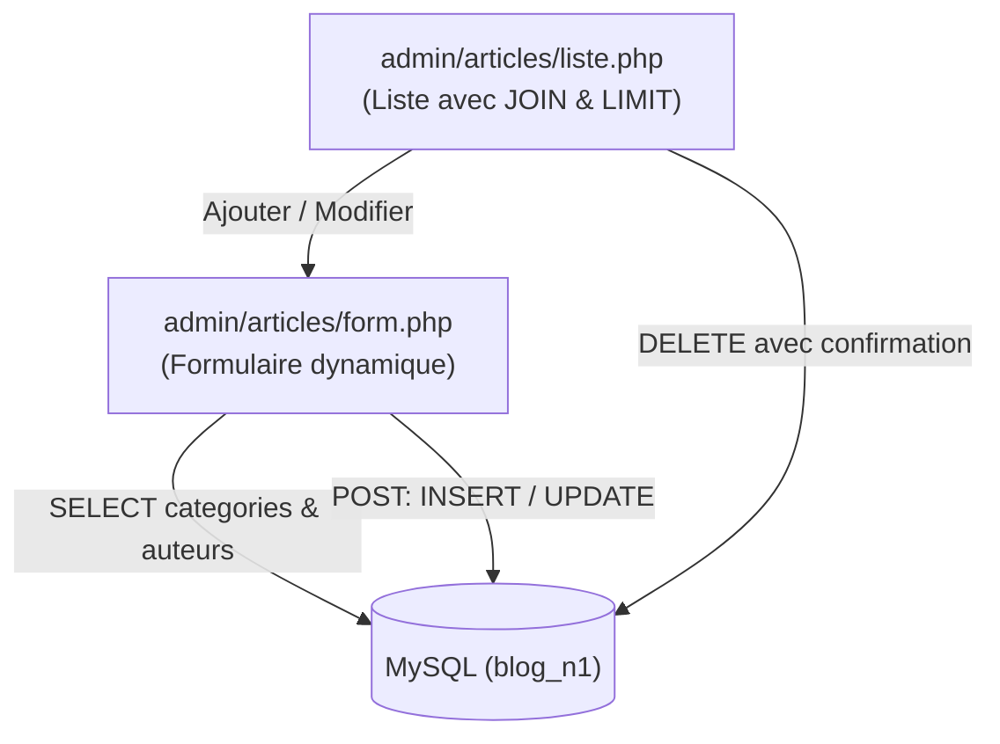

# Plan de Réalisation — Progression Développement Web (Session S9)

**Progression :** Développement Web Applicatif (Gestion complète des Articles & Jointures SQL)  
**Session :** S9 — Gérer les articles dans l’Admin  
**Niveau :** N1 (Débutant)  

---

## 1. Contexte & Objectif du Sprint S9

Dans cette neuvième session, l'apprenant étend le Back-Office en réalisant **le cycle complet (CRUD) des articles du Blog**. Les articles constituent le cœur de contenu de l'application et font intervenir des relations entre plusieurs tables (`articles`, `categories`, `auteurs`).

* **Problème résolu :** Les articles devaient être ajoutés à la main en SQL. De plus, un article dépend obligatoirement d'une catégorie et d'un auteur existants.
* **Solution pédagogique :**
  1. Afficher la liste des articles avec leurs libellés de catégories et noms d'auteurs grâce à des **jointures SQL (`JOIN`)** (`admin/articles/liste.php`).
  2. Limiter le nombre de résultats retournés à l'aide de la clause `LIMIT` (`UA.124.15`).
  3. Construire le formulaire d'ajout et d'édition d'un article avec des listes déroulantes dynamiques `<select>` alimentées depuis la base de données.
  4. Organiser un traitement PHP complet gérant la validation des données, l'upload simple d'image et l'insertion/mise à jour sécurisée (`INSERT` / `UPDATE`).
  5. Gérer les événements utilisateur avec JavaScript (`UA.122.33`) pour dynamiser l'interface de saisie.

---

## 2. Articulation Temporelle de la Progression

### ⏮️ Acquis Passés (Sessions S1 à S8)
- Architecture séparée Public / Admin initiée en S8 (`UA.125.16`).
- Contrôle des données soumises en méthode POST (`UA.123.17`).
- Requêtes préparées d'insertion, mise à jour et suppression (`UA.124.23`).
- Jointures SQL simples introduites en S6 (`UA.124.12`).

### 🎯 Unités d'Apprentissage & Tutoriels Mobilisés dans ce Sprint (Session S9)

#### Construire l’interface (D.122.1, html & js)

* **UA.122.33 — Gérer les événements utilisateur :**  
  Associer des traitements JavaScript aux actions de l'utilisateur (écouteur `change` sur la sélection de fichier pour prévisualiser le nom ou confirmation `click` avant suppression).
  - **T.122.33.1 — Gérer les événements utilisateur dans le formulaire d'article**  
    *Livrable :* Script JavaScript interactif réagissant aux saisies et clics | *Fichier :* `js/admin.js`

#### Réaliser le traitement serveur (D.123.1, php)

* **UA.123.18 — Organiser un traitement PHP complet :**  
  Combiner variables, conditions, boucles, listes déroulantes de catégories et d'auteurs, réception de fichiers avec `$_FILES`, et redirection après enregistrement pour construire un flux serveur complet.
  - **T.123.18.1 — Traiter l'enregistrement complet d'un article en PHP**  
    *Livrable :* Contrôleur `form.php` gérant l'ensemble du cycle de saisie et de validation | *Fichier :* `admin/articles/form.php`

#### Exploiter les données (D.124.1, sql)

* **UA.124.15 — Limiter les résultats SQL :**  
  Construire une requête SQL utilisant la clause `LIMIT` pour restreindre la quantité d'articles affichés et éviter les surcharges.
  - **T.124.15.1 — Restreindre le nombre d'articles affichés avec LIMIT**  
    *Livrable :* Requête de consultation bornée avec la clause LIMIT | *Fichier :* `admin/articles/liste.php`

* **UA.124.24 — Exploiter des données issues de plusieurs tables :**  
  Construire une requête SQL combinant plusieurs jointures (`JOIN categories` et `JOIN auteurs`) afin d'afficher des données explicites dans la liste d'administration.
  - **T.124.24.1 — Récupérer les articles avec leurs catégories et auteurs liés**  
    *Livrable :* Requête multi-tables retournant les articles avec leurs libellés associés | *Fichier :* `admin/articles/liste.php`

### ⏭️ Perspectives Futures (Sessions S10 à S12)
- **S10 :** Sécuriser l'accès à l'administration par un mécanisme d'authentification (`admin/auth/login.php`) et la gestion des sessions PHP (`$_SESSION`).
- **S11 :** Développer le moteur de recherche multicritère et de filtrage d'articles dans l'espace d'administration.

---

## 3. Fiches de Conception Détaillées des Tutoriels

### T.124.24.1 — Récupérer les articles avec leurs catégories et auteurs liés
- **Objectif :** Afficher un tableau d'articles lisible comprenant le nom de la catégorie et le nom de l'auteur au lieu de simples clés étrangères numériques.
- **Notions :** Jointure SQL interne `JOIN ... ON ...`, alias de tables (`a`, `c`, `aut`), sélection de champs spécifiques.
- **Consigne pour l'apprenant :**
  1. Dans [code-a-apprendre/admin/articles/liste.php](code-a-apprendre/admin/articles/liste.php), rédiger la requête SQL reliant la table `articles` aux tables `categories` et `auteurs`.
  2. Exécuter la requête via `$pdo->query()` et transmettre les résultats à [code-a-apprendre/admin/articles/liste-template.php](code-a-apprendre/admin/articles/liste-template.php).
  3. Afficher les colonnes : Titre, Catégorie, Auteur, Date de création, et actions (Modifier, Supprimer).
- **Résultat attendu :** La liste des articles d'administration affiche clairement chaque information contextuelle.

---

### T.124.15.1 — Restreindre le nombre d'articles affichés avec LIMIT
- **Objectif :** Contrôler la volumétrie des résultats retournés par le serveur de base de données.
- **Notions :** Mot-clé SQL `LIMIT [nombre]`, performance des requêtes, tri préalable avec `ORDER BY`.
- **Consigne pour l'apprenant :**
  1. Ajouter la clause `LIMIT 20` à la fin de la requête SQL de sélection des articles.
  2. Vérifier que la requête retourne au maximum le nombre d'articles demandé, classés du plus récent au plus ancien.
- **Résultat attendu :** L'affichage reste rapide et stable même en cas de volumétrie importante.

---

### T.123.18.1 — Traiter l'enregistrement complet d'un article en PHP
- **Objectif :** Construire le contrôleur PHP gérant l'affichage du formulaire, le chargement des dépendances, l'upload de photo et l'enregistrement des données soumises.
- **Notions :**
  - Requêtes préparées `INSERT INTO` et `UPDATE`.
  - Alimentation dynamique des listes déroulantes `<select>` avec `$pdo->query()` et `fetchAll()`.
  - Traitement de fichiers téléversés avec la superglobale `$_FILES['image_article']`.
  - Déplacement sécurisé du fichier temporaire avec `basename()` et `move_uploaded_file()`.
  - Suppression d'un article avec requête préparée `DELETE FROM` et redirection `header('Location: liste.php'); exit();`.
- **Consigne pour l'apprenant :**
  1. Dans [code-a-apprendre/admin/articles/form.php](code-a-apprendre/admin/articles/form.php), charger les listes de catégories et d'auteurs pour alimenter les balises `<select>`.
  2. En cas de soumission `POST`, vérifier la complétude des champs requis (`titre`, `contenu`, `categorie_id`, `auteur_id`).
  3. Gérer l'image : si une nouvelle image est téléversée dans `$_FILES`, vérifier `UPLOAD_ERR_OK` et la déplacer vers `../../images/` avec `move_uploaded_file()`.
  4. Exécuter la requête préparée adaptée (`INSERT` si nouvel article, `UPDATE` si article existant) et rediriger vers la liste avec `exit()`.
  5. Dans `liste.php`, intercepter `$_GET['supprimer']`, exécuter `DELETE FROM` et rediriger.
- **Résultat attendu :** Un article peut être créé, édité ou supprimé sans perte de données, avec upload d'image fonctionnel.

---

### T.122.33.1 — Gérer les événements utilisateur dans le formulaire d'article
- **Objectif :** Enrichir le confort utilisateur en réagissant aux actions sur le formulaire.
- **Notions :** Écouteurs d'événements `addEventListener('change')`, mise à jour d'un texte d'aide dans le DOM.
- **Consigne pour l'apprenant :**
  1. Dans `js/admin.js`, attacher un écouteur sur le champ d'upload de fichier d'image.
  2. Afficher dynamiquement le nom du fichier sélectionné à côté du champ pour confirmer le choix de l'utilisateur.
  3. Maintenir l'interception du clic sur les liens de suppression pour sécuriser la suppression d'un article.
- **Résultat attendu :** L'interface réagit immédiatement aux actions de l'utilisateur sans rechargement de page.
