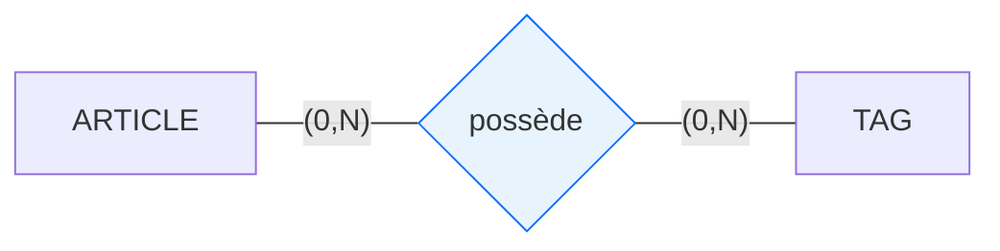

## Objectif

Relier les entités du Blog entre elles à l'aide de **relations** et de **cardinalités** pour modéliser la structure de la base de données.

## Prérequis

- Savoir construire les entités à partir des données (T.112.133).

## Données de départ

Vos 4 entités créées précédemment : `ARTICLE`, `AUTEUR`, `VILLE`, `CATEGORIE`.

👉 [Ouvrir la maquette du Blog](https://solicode-web-mobile.github.io/maquette-blog/index.html)

Sur la **Page Détail d'un article** et la **Page d'accueil**, observez comment ces données sont liées (un article est écrit par un auteur et classé dans une catégorie).

---

## Partie 1 — Théorie

### 1.1. La règle de gestion et la relation

Une **règle de gestion** est une phrase simple qui décrit le lien métier entre deux entités. Elle utilise toujours un **verbe d'action**.

Une **relation** représente ce lien sur le schéma.

*Exemple :* « Un auteur habite dans une ville. »


### 1.2. Calculer les cardinalités (min, max)

Une **cardinalité** indique combien de fois une entité participe à une relation. Elle s'écrit toujours : `(minimum, maximum)`.

Pour trouver les valeurs de chaque côté, posez deux questions simples :

| Question | Réponse possible | Valeur retenue |
| :--- | :--- | :---: |
| **1. Est-ce obligatoire ?** (Minimum) | Non $\rightarrow$ `0`<br>Oui $\rightarrow$ `1` | `0` ou `1` |
| **2. Peut-il y en avoir plusieurs ?** (Maximum) | Une seule $\rightarrow$ `1`<br>Plusieurs $\rightarrow$ `N` | `1` ou `N` |

Les 4 couples de cardinalités possibles sont : `(0,1)`, `(1,1)`, `(0,N)`, `(1,N)`.

### 1.3. Les deux types de relations (1–N et N–N)

* **La relation 1–N (un à plusieurs) :**
  C'est le cas le plus courant. Une occurrence d'un côté est liée à plusieurs occurrences en face.
  *Exemple :* Un auteur rédige un ou plusieurs articles. Un article est rédigé par un seul auteur.


* **La relation N–N (plusieurs à plusieurs) :**
  Les occurrences peuvent être multiples des deux côtés.
  *Exemple :* Un article possède zéro ou plusieurs tags. Un tag peut être associé à zéro ou plusieurs articles.



---

## Partie 2 — Pratique

### 2.1. Exemple guidé : VILLE et AUTEUR

Appliquez la méthode des deux questions pour relier `VILLE` et `AUTEUR` avec le verbe **habite** :

1. **Sens VILLE $\rightarrow$ AUTEUR :**
   - Une ville accueille-t-elle obligatoirement des auteurs ? Oui $\rightarrow$ `min = 1`.
   - Peut-elle accueillir plusieurs auteurs ? Oui $\rightarrow$ `max = N`.
   - **Cardinalité côté VILLE = `(1,N)`**.
2. **Sens AUTEUR $\rightarrow$ VILLE :**
   - Un auteur a-t-il obligatoirement une ville ? Oui $\rightarrow$ `min = 1`.
   - Peut-il habiter dans plusieurs villes ? Non $\rightarrow$ `max = 1`.
   - **Cardinalité côté AUTEUR = `(1,1)`**.

```text
VILLE (1,N) ─── habite ─── (1,1) AUTEUR
```

### 2.2. Travail à faire

Déterminez les règles de gestion et les cardinalités des 3 relations restantes de l'application Blog.

Complétez le tableau suivant :

| Entité A | Cardinalité A | Verbe métier | Cardinalité B | Entité B | Règle de gestion |
| :--- | :---: | :---: | :---: | :--- | :--- |
| **VILLE** | `1,N` | habite | `1,1` | **AUTEUR** | Une ville accueille un ou plusieurs auteurs. Un auteur habite dans une seule ville. |
| **AUTEUR** | | rédige | | **ARTICLE** | |
| **CATEGORIE** | | regroupe | | **ARTICLE** | |
| **ARTICLE** | | possède | | **TAG** | |

### Livrable attendu

Créez un fichier Markdown nommé `relations-cardinalites.md` contenant votre tableau complété, et commitez-le dans votre dépôt GitHub.

### Résultat attendu

<button class="btn btn-primary btn-toggle-resultat">Afficher le résultat</button>
<iframe
    class="auto-wrapper tuto-resultat"
    src="{{ '/code/conception/T.112.141/' | relative_url }}"
    height="350"
    title="Résultat attendu — Relations et cardinalités">
</iframe>

### Critères de réussite

- Chaque relation utilise un verbe d'action clair.
- Les cardinalités `(min, max)` répondent précisément aux deux questions méthodologiques.
- Le fichier `relations-cardinalites.md` est rédigé et commité sur GitHub.

---

## Bilan

**Vous savez maintenant :**
- Formuler une règle de gestion avec un verbe d'action.
- Déterminer les cardinalités minimum et maximum d'une relation.
- Distinguer une relation 1–N d'une relation N–N.

Dans le prochain tutoriel, vous assemblerez vos entités et vos relations pour créer votre premier **Modèle Conceptuel de Données (MCD)** complet.

## Glossaire

- **Règle de gestion** : Phrase décrivant un fonctionnement métier entre deux entités.
- **Relation** : Lien logique entre deux entités, représenté par un verbe d'action.
- **Cardinalité** : Couple `(minimum, maximum)` indiquant le nombre de participations d'une entité à une relation.
