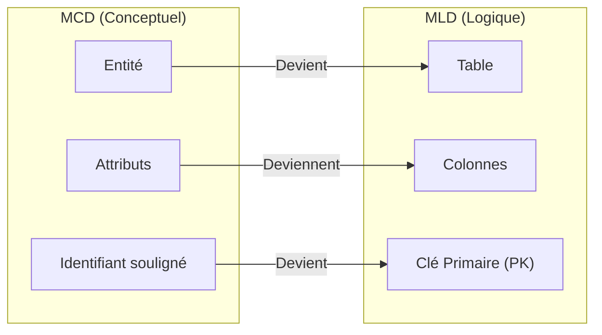

## 1. Objectif

Dans ce tutoriel, vous allez appliquer la première règle de passage du Modèle Conceptuel de Données (MCD) vers le **Modèle Logique de Données (MLD)** : transformer chaque entité conceptuelle en **table relationnelle**.

Vous allez apprendre à :
* convertir une entité en table de base de données ;
* convertir les attributs d'une entité en colonnes de table ;
* désigner l'identifiant unique comme Clé Primaire (`PK`) ;
* formaliser la structure de vos tables sans vous préoccuper des relations pour l'instant.

## 2. Prérequis

* Avoir modélisé le MCD complet du Blog (T.112.142).
* Savoir identifier les entités, leurs attributs et leur identifiant unique.

## Données de départ

Vos 4 entités issues du MCD validé du Blog :
* **VILLE** (`id_ville`, `nom_ville`)
* **AUTEUR** (`id_auteur`, `nom_auteur`, `prenom_auteur`, `email_auteur`)
* **ARTICLE** (`id_article`, `titre_article`, `contenu_article`, `date_publication`, `statut_article`, `image_article`)
* **CATEGORIE** (`id_categorie`, `nom_categorie`)

---

## Partie 1 — Théorie

### 1.1. Du modèle conceptuel au modèle logique

Le **MCD** décrit la réalité métier de manière abstraite. Le **MLD** prépare l'implémentation concrète dans un système de gestion de base de données relationnelle (SGBDR) :



### 1.2. La règle de transformation d'une entité

La règle de base est une équivalence directe :
1. **L'entité devient une table :** elle porte le même nom en majuscules (ex: `VILLE`).
2. **Les attributs deviennent des colonnes :** chaque propriété devient un champ de la table.
3. **L'identifiant devient la Clé Primaire :** on ajoute le suffixe `(PK)` pour *Primary Key*.

### 1.3. La Clé Primaire (PK)

La Clé Primaire est la colonne qui identifie chaque enregistrement de manière unique et certaine :
* Deux lignes d'une même table ne peuvent jamais avoir la même clé primaire.
* À cette étape, nous ne traçons **aucun lien** entre les tables. Les relations feront l'objet de la règle suivante.

**Exemple de notation textuelle pour l'entité VILLE :**

```text
Table : VILLE
-------------
id_ville (PK)
nom_ville
```

---

## Partie 2 — Pratique

### 2.1. Exercice d'application : Définir les 4 tables simples du Blog

Dans cet exercice, vous allez traduire les 4 entités conceptuelles du Blog en tables relationnelles indépendantes.

**Consignes :**
1. Reprenez les entités `VILLE`, `AUTEUR`, `ARTICLE` et `CATEGORIE`.
2. Convertissez chaque entité en une table avec son nom en majuscules.
3. Listez toutes les colonnes issues des attributs.
4. Marquez clairement l'identifiant unique avec la mention `(PK)`.
5. Ne créez aucune clé étrangère à ce stade.

**Format attendu pour vos tables :**

```text
Table : VILLE
-------------
id_ville (PK)
nom_ville

Table : AUTEUR
--------------
id_auteur (PK)
nom_auteur
prenom_auteur
email_auteur

Table : CATEGORIE
-----------------
id_categorie (PK)
nom_categorie

Table : ARTICLE
---------------
id_article (PK)
titre_article
contenu_article
date_publication
statut_article
image_article
```

### 2.2. Livrable attendu

Créez le fichier de documentation dans votre dépôt d'autoformation :

```text
conception/mld/transformer-entites-tables/tables-simples.md
```

Commitez votre fichier sur votre dépôt GitHub.

### Résultat attendu

<button class="btn btn-primary btn-toggle-resultat">Afficher le résultat</button>
<iframe
    class="auto-wrapper tuto-resultat"
    src="{{ '/code/conception/T.112.151/tables-simples.html' | relative_url }}"
    height="450"
    title="Résultat attendu — Tables simples">
</iframe>

### Critères de réussite

* Les 4 entités sont converties en 4 tables distinctes.
* Chaque table conserve l'intégralité de ses colonnes d'origine.
* Chaque identifiant est annoté avec la mention `(PK)`.
* Aucune clé étrangère ni liaison n'a été ajoutée prématurément.

---

## Bilan

* Chaque entité du MCD se traduit directement en une table dans le MLD.
* L'identifiant de l'entité devient la Clé Primaire (`PK`) garantissant l'unicité des lignes.
* Dans le tutoriel suivant, vous relierez ces tables entre elles grâce aux **clés étrangères (`FK`)**.

## Glossaire

* **MLD (Modèle Logique de Données)** : Représentation des données sous forme de tables relationnelles.
* **Table** : Structure de stockage relationnelle composée de colonnes et de lignes.
* **Colonne** : Champ de donnée individuel appartenant à une table.
* **PK (Primary Key / Clé Primaire)** : Colonne obligatoire identifiant de manière unique chaque enregistrement d'une table.