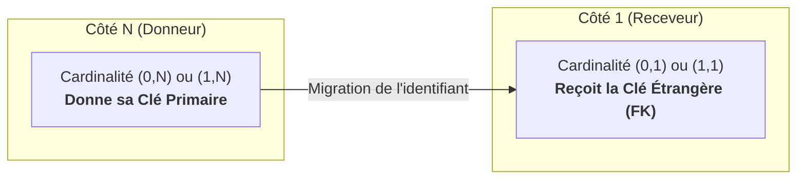

## 1. Objectif

Dans ce tutoriel, vous allez apprendre à traduire les **relations 1–N (Un-à-Plusieurs)** de votre Modèle Conceptuel de Données en **clés étrangères (`FK`)** dans vos tables relationnelles.

Vous allez apprendre à :
* identifier le côté donneur ("N") et le côté receveur ("1") d'une relation ;
* appliquer la règle de migration des identifiants ;
* placer la clé étrangère dans la bonne table ;
* annoter précisément la colonne avec la mention `(FK)`.

## 2. Prérequis

* Avoir transformé les entités en tables simples avec leur `(PK)` ([T.112.151](/tutos/transformer-entites-tables/normal)).
* Savoir lire les cardinalités d'un MCD ([T.112.141](/tutos/determiner-relations-cardinalites/normal)).

## Données de départ

Vos 4 tables relationnelles de base : `VILLE`, `AUTEUR`, `CATEGORIE`, `ARTICLE`.

Les 3 relations 1–N validées sur le MCD du Blog :
* `VILLE (0,N) ─── habite ─── (1,1) AUTEUR`
* `AUTEUR (0,N) ─── rédige ─── (1,1) ARTICLE`
* `CATEGORIE (0,N) ─── regroupe ─── (1,1) ARTICLE`

---

## Partie 1 — Théorie

### 1.1. La règle d'or de migration des identifiants (1–N)

Dans une base de données relationnelle, le lien entre deux tables se matérialise en copiant la Clé Primaire (`PK`) d'une table pour l'insérer dans l'autre :



> **Règle d'or :** Le côté **« 1 »** reçoit toujours la clé du côté **« N »**.

### 1.2. La Clé Étrangère (Foreign Key - FK)

La clé copiée dans la table receveuse s'appelle une **Clé Étrangère** (`FK`) :
* Elle établit une passerelle fiable vers l'enregistrement correspondant dans la table parente.
* **Notation standard :** On ajoute l'annotation `(FK)` à droite du nom de la colonne migrée (ex: `id_ville (FK)`).

### 1.3. Exemple guidé : la relation « habite »

Examinons la relation entre `VILLE` et `AUTEUR` :
* `AUTEUR` a la cardinalité `(1,1)` : c'est le **côté 1**, donc la table receveuse.
* `VILLE` a la cardinalité `(0,N)` : c'est le **côté N**, donc la table donneuse.
* **Résultat :** La table `AUTEUR` reçoit une nouvelle colonne `id_ville (FK)`.

```text
Table : AUTEUR
--------------
id_auteur (PK)
nom_auteur
prenom_auteur
email_auteur
id_ville (FK)
```

---

## Partie 2 — Pratique

### 2.1. Exercice d'application : Intégrer les clés étrangères du Blog

Dans cet exercice, vous allez appliquer la règle de migration aux 3 relations 1–N du Blog afin de relier vos tables entre elles.

**Consignes :**
1. Pour la relation `habite` : ajoutez la clé étrangère de `VILLE` dans la table `AUTEUR`.
2. Pour la relation `rédige` : ajoutez la clé étrangère de `AUTEUR` dans la table `ARTICLE`.
3. Pour la relation `regroupe` : ajoutez la clé étrangère de `CATEGORIE` dans la table `ARTICLE`.
4. Vérifiez que `VILLE` et `CATEGORIE` ne reçoivent aucune clé étrangère.

**Structure attendue de vos tables :**

```text
Table : VILLE
-------------
id_ville (PK)
nom_ville

Table : AUTEUR
--------------
id_auteur (PK)
nom_auteur
prenom_auteur
email_auteur
id_ville (FK)

Table : CATEGORIE
-----------------
id_categorie (PK)
nom_categorie

Table : ARTICLE
---------------
id_article (PK)
titre_article
contenu_article
date_publication
statut_article
image_article
id_auteur (FK)
id_categorie (FK)
```

### 2.2. Livrable attendu

Mettez à jour votre fichier de documentation dans votre dépôt d'autoformation :

```text
conception/mld/transformer-relations-cles-etrangeres/tables-fk.md
```

Commitez votre fichier sur votre dépôt GitHub.

### Résultat attendu

<button class="btn btn-primary btn-toggle-resultat">Afficher le résultat</button>
<iframe
    class="auto-wrapper tuto-resultat"
    src="{{ '/code/conception/T.112.152/tables-fk.html' | relative_url }}"
    height="650"
    title="Résultat attendu — Tables avec clés étrangères">
</iframe>

### Critères de réussite

* La table `AUTEUR` possède la clé étrangère `id_ville (FK)`.
* La table `ARTICLE` possède les deux clés étrangères `id_auteur (FK)` et `id_categorie (FK)`.
* Les tables `VILLE` et `CATEGORIE` ne contiennent aucune clé étrangère.
* Toutes les colonnes portent des annotations claires (`PK` ou `FK`).

---

## Bilan

* Les relations 1–N se traduisent par la migration d'un identifiant vers la table située du côté de la cardinalité maximale « 1 ».
* La Clé Étrangère (`FK`) matérialise informatiquement le lien entre deux tables sans dupliquer les informations.
* Dans le prochain tutoriel, vous traiterez le dernier type de relation : les relations **N–N**.

## Glossaire

* **FK (Foreign Key / Clé Étrangère)** : Colonne contenant la clé primaire d'une autre table afin de créer un lien relationnel entre les enregistrements.
* **Relation 1–N** : Relation où une entité participe au maximum 1 fois et l'autre au maximum N fois.
* **Migration d'identifiant** : Mécanisme consistant à dupliquer une clé primaire sous forme de clé étrangère dans une autre table.