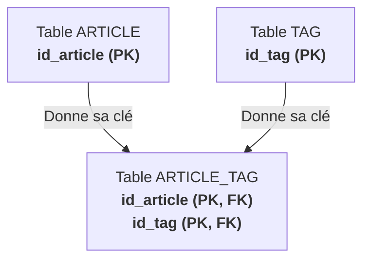

## 1. Objectif

Dans ce tutoriel de clôture de la conception, vous allez traiter le dernier cas de modélisation relationnelle : la **relation N–N (Plusieurs-à-Plusieurs)**, afin d'assembler le **Modèle Logique de Données (MLD) complet** de l'application Blog.

Vous allez apprendre à :
* repérer une relation N–N sur un MCD ;
* résoudre l'impossibilité de migration directe par la création d'une **table de liaison** ;
* définir une **clé primaire composée** `(PK, FK)` ;
* assembler et valider la structure complète des 6 tables de la base de données.

## 2. Prérequis

* Avoir transformé les entités en tables simples ([T.112.151](/tutos/transformer-entites-tables/normal)).
* Maîtriser le mécanisme des clés étrangères pour les relations 1–N ([T.112.152](/tutos/transformer-relations-cles-etrangeres/normal)).

## Données de départ

* Votre MLD actuel composé de 4 tables avec leurs clés (`VILLE`, `AUTEUR`, `CATEGORIE`, `ARTICLE`).
* **Nouveau besoin métier (Les Tags) :**
  * Entité : `TAG` (`id_tag`, `nom_tag`).
  * Règle de gestion : Un article peut avoir plusieurs tags, et un tag peut caractériser plusieurs articles.
  * Relation MCD associée : `ARTICLE (0,N) ─── possède ─── (0,N) TAG`.

---

## Partie 1 — Théorie

### 1.1. L'impasse du « N vers N »

Dans une relation N–N, aucun des deux côtés ne possède une cardinalité maximale égale à 1 :
* Placer `id_tag (FK)` dans `ARTICLE` limiterait un article à un seul tag.
* Placer `id_article (FK)` dans `TAG` limiterait un tag à un seul article.

Pour respecter le modèle relationnel sans perdre de données, aucune des deux tables ne peut recevoir la clé de l'autre.

### 1.2. La solution : la table de liaison

La règle de transformation Merise pour une relation N–N est universelle :
1. **La relation devient une table intermédiaire :** on l'appelle table de liaison ou table associative (nommée généralement en combinant les deux tables : `ARTICLE_TAG`).
2. **Elle récupère les clés primaires des deux tables reliées.**
3. **Ces deux clés deviennent des clés étrangères (`FK`).**



### 1.3. La clé primaire composée

Dans la table de liaison `ARTICLE_TAG`, l'association des deux clés étrangères forme la **Clé Primaire composée** :
* Elle garantit qu'on ne peut pas associer deux fois le même tag au même article.
* On note chaque colonne : `(PK, FK)`.

```text
Table : ARTICLE_TAG
-------------------
id_article (PK, FK)
id_tag (PK, FK)
```

---

## Partie 2 — Pratique

### 2.1. Exercice d'application : Assembler le MLD complet du Blog

Dans cet exercice, vous allez transformer la nouvelle entité `TAG`, créer la table de liaison `ARTICLE_TAG` et assembler le MLD complet du Blog comprenant **6 tables au total**.

**Consignes :**
1. Transformez l'entité `TAG` en table simple avec sa clé `id_tag (PK)`.
2. Créez la table associative `ARTICLE_TAG` avec sa clé primaire composée.
3. Rassemblez l'ensemble des 6 tables du Blog dans un document unique.
4. Vérifiez que chaque table et chaque colonne porte son annotation (`PK`, `FK` ou `PK, FK`).

**Structure complète du MLD final du Blog :**

```text
Table : VILLE
-------------
id_ville (PK)
nom_ville

Table : AUTEUR
--------------
id_auteur (PK)
nom_auteur
prenom_auteur
email_auteur
id_ville (FK)

Table : CATEGORIE
-----------------
id_categorie (PK)
nom_categorie

Table : TAG
-----------
id_tag (PK)
nom_tag

Table : ARTICLE
---------------
id_article (PK)
titre_article
contenu_article
date_publication
statut_article
image_article
id_auteur (FK)
id_categorie (FK)

Table : ARTICLE_TAG
-------------------
id_article (PK, FK)
id_tag (PK, FK)
```

### 2.2. Livrable attendu

Mettez à jour le fichier de documentation final dans votre dépôt d'autoformation :

```text
conception/mld/transformer-mcd-complet-mld/mld-complet.md
```

Commitez votre travail sur votre dépôt GitHub.

### Résultat attendu

<button class="btn btn-primary btn-toggle-resultat">Afficher le résultat</button>
<iframe
    class="auto-wrapper tuto-resultat"
    src="{{ '/code/conception/T.112.153/mld-complet.html' | relative_url }}"
    height="650"
    title="Résultat attendu — MLD Complet">
</iframe>

### Critères de réussite

* Le MLD complet comporte exactement 6 tables relationnelles.
* La table classique `TAG` possède sa clé primaire simple `id_tag (PK)`.
* La table de liaison `ARTICLE_TAG` est présente et contient les deux clés avec la mention `(PK, FK)`.
* Les 4 tables d'origine conservent l'intégralité de leurs attributs et clés.

---

## Bilan

* Vous avez complété avec succès les trois règles de transformation du MCD vers le MLD :
  1. Entité → Table avec Clé Primaire (`PK`).
  2. Relation 1–N → Clé Étrangère (`FK`) du côté 1.
  3. Relation N–N → Table de liaison avec Clé Primaire composée (`PK, FK`).
* Votre modélisation de données est désormais prête pour la création physique des tables avec le langage SQL.

## Glossaire

* **Relation N–N** : Relation où les deux entités associées peuvent participer plusieurs fois.
* **Table de liaison (ou associative)** : Table intermédiaire créée pour matérialiser une relation N–N.
* **Clé primaire composée** : Clé primaire constituée de la combinaison de deux ou plusieurs colonnes pour garantir l'unicité globale de la ligne.