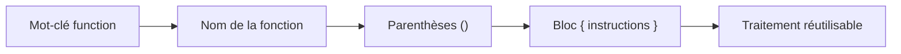
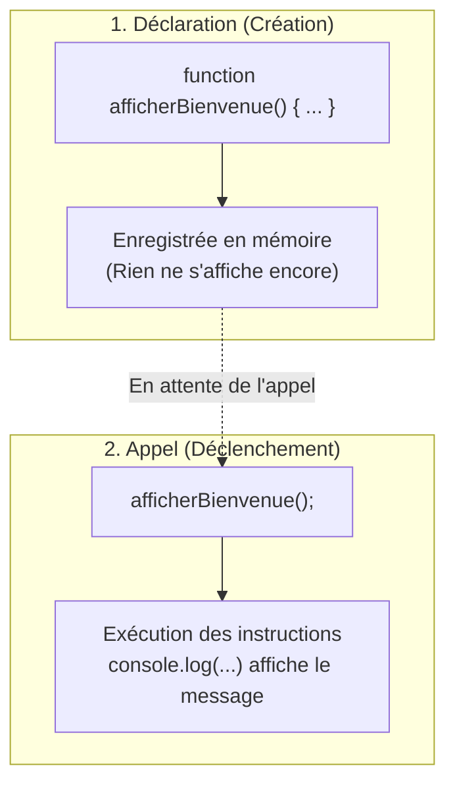
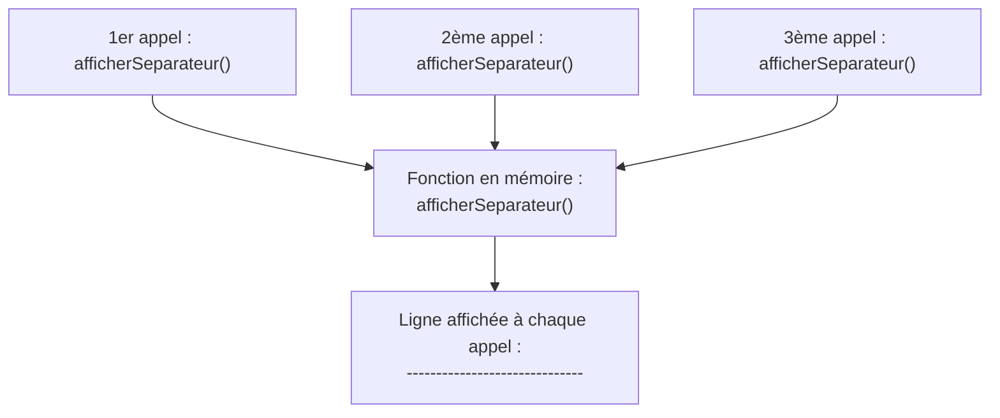
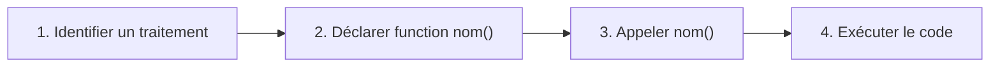

## 1. Objectif

Dans ce tutoriel, vous allez découvrir les **fonctions JavaScript**.

Vous allez apprendre à :
* comprendre le rôle d'une fonction (regrouper des instructions sous un nom) ;
* déclarer une fonction avec le mot-clé `function` ;
* appeler une fonction pour exécuter son traitement ;
* réutiliser un traitement plusieurs fois sans dupliquer de code.

*(Note : Les paramètres et la valeur de retour avec `return` seront étudiés dans les prochains tutoriels.)*

## 2. Prérequis

Vous devez savoir :
* créer et exécuter un fichier JavaScript avec Node.js ;
* déclarer des variables avec `let` ou `const` ;
* utiliser `console.log()` pour afficher un résultat ;
* utiliser une condition (`if / else`) et une boucle (`for`).

*(Note : Ce tutoriel ne nécessite aucune donnée de départ pré-codée, vous écrirez tout vous-même !)*

## Partie 1 — Théorie

### 1.1. Qu'est-ce qu'une fonction ?

Dans un programme, un **traitement** est une série d'actions réalisées pour accomplir une tâche.
Sans fonction, répéter un traitement oblige à copier-coller les mêmes lignes de code. C'est lourd et source d'erreurs.

Une **fonction** permet d'isoler un traitement et de lui donner un **nom** clair.



Pour créer une fonction, on utilise le mot-clé `function` suivi d'un nom explicite (en minuscules avec majuscules intermédiaires, comme `afficherBienvenue`) :

```javascript
function afficherBienvenue() {
    console.log("=== Bienvenue sur le système ===");
    console.log("Statut : Utilisateur connecté");
}

afficherBienvenue();
```

Résultat affiché dans la console :

```text
=== Bienvenue sur le système ===
Statut : Utilisateur connecté
```

### 1.2. Déclarer vs Appeler une fonction

Il ne faut pas confondre **créer** une fonction et **l'exécuter** :
* **Déclarer** une fonction enregistre son code en mémoire. Elle n'exécute rien immédiatement.
* **Appeler** une fonction ordonne à l'ordinateur d'exécuter ses instructions. Pour cela, on écrit son nom suivi de parenthèses `()`.



Exemple complet et exécutable :

```javascript
// 1. Déclaration de la fonction
function afficherBienvenue() {
    console.log("=== Bienvenue sur le système ===");
    console.log("Statut : Utilisateur connecté");
}

// 2. Appel de la fonction
afficherBienvenue();
```

Résultat affiché dans la console :

```text
=== Bienvenue sur le système ===
Statut : Utilisateur connecté
```

Si vous supprimez la ligne `afficherBienvenue();`, la console reste totalement vide car la fonction n'a jamais été appelée.

### 1.3. Réutiliser un traitement et organiser son code

Le grand intérêt d'une fonction est sa **réutilisation**. On écrit le traitement une seule fois, puis on l'appelle autant de fois que nécessaire :



```javascript
function afficherSeparateur() {
    console.log("------------------------------");
}

afficherSeparateur();
console.log("Module 1 : Algorithmes");
afficherSeparateur();
console.log("Module 2 : Fonctions");
afficherSeparateur();
```

On peut également appeler une fonction à l'intérieur d'une boucle :

```javascript
function sonnerAlarme() {
    console.log("Bip !");
}

for (let i = 1; i <= 3; i++) {
    sonnerAlarme();
}
```

Une fonction peut regrouper n'importe quel traitement (calculs, conditions, boucles). Elle permet de découper un programme long en petites étapes faciles à lire et à maintenir.

## Partie 2 — Pratique guidée

Le but de cette pratique est de valider votre compréhension avec le **strict minimum de code**.

### 2.1. Déclarer et appeler une fonction

Vous allez créer une fonction simple, l'appeler pour exécuter son code, puis la réutiliser :

1. Déclarez une fonction `afficherBienvenue()` qui affiche deux messages :
   - `"=== Bienvenue sur le système ==="`
   - `"Statut : Utilisateur connecté"`
2. Appelez la fonction une première fois.
3. Appelez-la une seconde fois pour constater que le traitement est réutilisé sans dupliquer de code.

**Code à écrire dans `fonctions.js` :**

```javascript
// ==============================================================
// Livrable : Comprendre les fonctions
// Emplacement : algo/fonctions/comprendre-fonctions/fonctions.js
// ==============================================================

// Déclaration de la fonction
function afficherBienvenue() {
    console.log("=== Bienvenue sur le système ===");
    console.log("Statut : Utilisateur connecté");
}

// Appels de la fonction
afficherBienvenue();
afficherBienvenue();

// --- Bilan personnel ---
// La déclaration crée la fonction en mémoire avec son nom et son bloc d'instructions.
// L'appel déclenche l'exécution du code de la fonction.
```

**Résultat attendu dans la console :**
```text
=== Bienvenue sur le système ===
Statut : Utilisateur connecté
=== Bienvenue sur le système ===
Statut : Utilisateur connecté
```

### 2.2. Livrable & Critères de réussite

#### Emplacement obligatoire dans votre dépôt

Déposez votre fichier dans votre dépôt annuel de tutoriels au chemin suivant :

```text
algo/fonctions/comprendre-fonctions/fonctions.js
```

> **Rappel :** N'utilisez pas de codes de modules (`UA.121.14` ou `T.121.141`) dans vos noms de dossiers, utilisez uniquement des noms de dossiers clairs et lisibles.

#### Critères d'auto-évaluation

Avant de valider et de commiter votre travail sur GitHub :
* [ ] La fonction est correctement déclarée avec le mot-clé `function` et des accolades `{}`.
* [ ] La fonction est exécutée grâce à ses parenthèses d'appel `()`.
* [ ] Le traitement s'affiche deux fois à l'écran grâce aux deux appels successifs.
* [ ] Tout le fichier s'exécute avec la commande `node fonctions.js` sans aucune erreur.
* [ ] Le fichier est commité dans votre dépôt à l'emplacement `algo/fonctions/comprendre-fonctions/fonctions.js`. 

## Bilan



**Vous avez appris :**
* qu'une **fonction** regroupe plusieurs instructions sous un nom pour réaliser un traitement ;
* à **déclarer** une fonction avec le mot-clé `function` ;
* à **appeler** une fonction avec `nomFonction()` pour déclencher son exécution ;
* à **réutiliser** un traitement plusieurs fois sans dupliquer de code.

## Glossaire

* **Fonction** : bloc d'instructions réutilisable identifié par un nom unique.
* **Déclaration** : création d'une fonction avec `function` et son bloc de code `{}`.
* **Appel** : instruction qui ordonne l'exécution de la fonction en utilisant son nom suivi de `()`.
* **Traitement** : ensemble d'actions logiques coordonnées pour réaliser une tâche.
* **Bloc** : instructions regroupées entre des accolades `{` et `}`.
