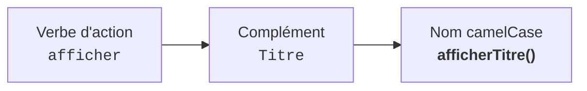
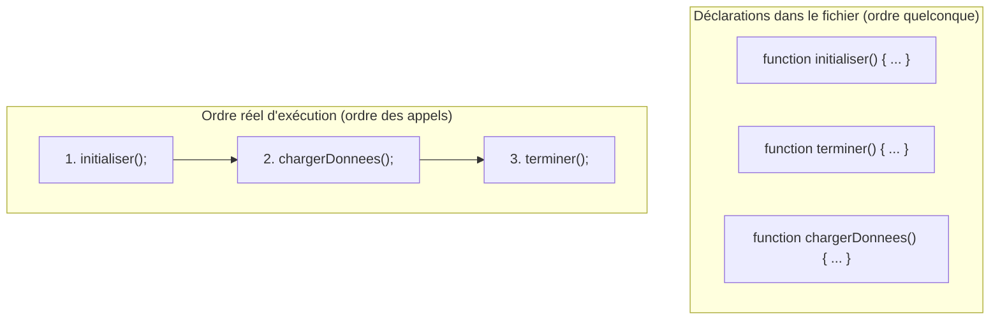
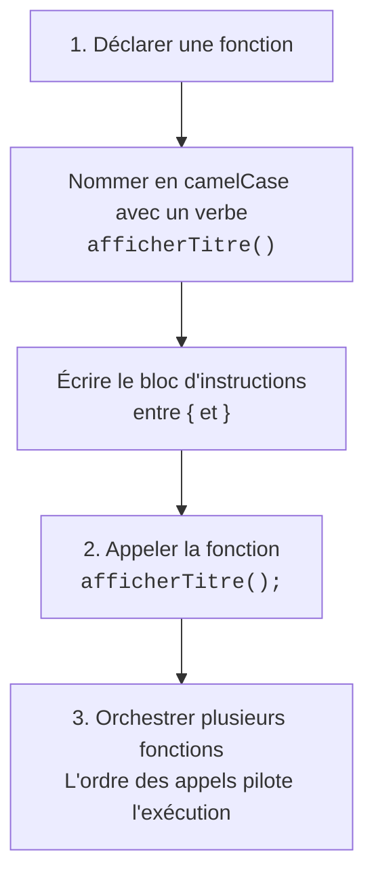

## 1. Objectif

Dans ce tutoriel, vous allez apprendre à **créer et orchestrer plusieurs fonctions JavaScript**.

Vous allez apprendre à :
* nommer une fonction avec un verbe d'action en notation `camelCase` ;
* regrouper plusieurs instructions dans le corps d'une fonction ;
* comprendre la différence entre l'ordre d'écriture et l'ordre d'appel des fonctions ;
* composer un programme complet en articulant plusieurs fonctions.

## 2. Prérequis

* Avoir suivi le tutoriel [Comprendre les fonctions](/tutos/comprendre-fonctions/).
* Savoir déclarer des variables (`let`) et afficher des messages avec `console.log()`.
* Savoir utiliser une boucle `for` simple.

---

## Partie 1 — Théorie

### 1.1. Conventions de nommage : des noms clairs en camelCase

Le nom d'une fonction doit décrire clairement ce qu'elle fait.

**Règles essentielles :**
1. Utilisez un **verbe d'action** (ex. `afficher`, `calculer`, `initialiser`).
2. Utilisez la convention **camelCase** : première lettre en minuscule, puis majuscule à chaque nouveau mot.
3. Pas d'espaces, pas d'accents, pas de caractères spéciaux.



| Mauvais nom | Nom recommandé | Pourquoi ? |
| :--- | :--- | :--- |
| `f1()` | `afficherTitre()` | On comprend immédiatement l'action réalisée. |
| `titre()` | `afficherTitre()` | Un nom doit commencer par un verbe d'action. |
| `afficher_titre()` | `afficherTitre()` | JavaScript utilise la convention standard camelCase. |

**Exemple exécutable :**

```javascript
function afficherTitre() {
    console.log("=== GESTION DES COMMANDES ===");
}

afficherTitre();
```

**Résultat attendu dans la console :**
```text
=== GESTION DES COMMANDES ===
```

### 1.2. Regrouper plusieurs instructions dans une fonction

Une fonction ne sert pas seulement à afficher un seul message. Elle permet de regrouper un bloc d'actions complètes : déclarations de variables, calculs et affichages.

Toutes les instructions placées entre les accolades `{` et `}` s'exécutent les unes après les autres.

```javascript
function afficherProfil() {
    let nom = "Sara";
    let role = "Développeuse";
    let taches = 3;

    console.log("Nom : " + nom);
    console.log("Rôle : " + role);
    console.log("Tâches en cours : " + taches);
}

afficherProfil();
```

**Résultat attendu dans la console :**
```text
Nom : Sara
Rôle : Développeuse
Tâches en cours : 3
```

### 1.3. Ordre de déclaration vs Ordre des appels

Une règle fondamentale : **une fonction ne s'exécute que lorsque vous l'appelez**.

L'ordre dans lequel vous déclarez vos fonctions dans le fichier n'a pas d'importance. C'est l'**ordre des appels** qui détermine l'ordre réel d'exécution de votre programme.



**Exemple exécutable :**

```javascript
// Déclaration dans le désordre
function afficherEtapeTrois() {
    console.log("3. Fin du processus");
}

function afficherEtapeUne() {
    console.log("1. Démarrage du système");
}

function afficherEtapeDeux() {
    console.log("2. Chargement des données");
}

// Les appels définissent l'ordre d'affichage
afficherEtapeUne();
afficherEtapeDeux();
afficherEtapeTrois();
```

**Résultat attendu dans la console :**
```text
1. Démarrage du système
2. Chargement des données
3. Fin du processus
```

---

## Partie 2 — Pratique guidée

Le but de cette pratique est de valider votre compréhension avec le **strict minimum de code**.

### 2.1. Nommer et orchestrer deux fonctions

Vous allez créer deux fonctions respectant la convention `camelCase` avec plusieurs instructions, puis les appeler dans l'ordre voulu :

1. Déclarez une fonction `afficherFin()` qui affiche :
   - `"=== Session terminée ==="`
2. Déclarez une fonction `afficherDemarrage()` qui affiche :
   - `"=== Démarrage du système ==="`
   - `"Statut : Opérationnel"`
3. Appelez d'abord `afficherDemarrage()`, puis `afficherFin()`.
4. Constatez que l'ordre des affichages correspond à l'ordre des **appels** et non à l'ordre d'écriture des déclarations.

**Code à écrire dans `fonctions.js` :**

```javascript
// ==============================================================
// Livrable : Créer et appeler des fonctions
// Emplacement : algo/fonctions/creer-appeler-fonction/fonctions.js
// ==============================================================

// Déclaration des fonctions en camelCase
function afficherFin() {
    console.log("=== Session terminée ===");
}

function afficherDemarrage() {
    console.log("=== Démarrage du système ===");
    console.log("Statut : Opérationnel");
}

// Les appels pilotent l'ordre réel d'exécution
afficherDemarrage();
afficherFin();

// --- Bilan personnel ---
// L'ordre d'écriture dans le fichier ne change rien :
// c'est uniquement l'ordre des appels qui dicte l'ordre d'exécution du programme.
```

**Résultat attendu dans la console :**
```text
=== Démarrage du système ===
Statut : Opérationnel
=== Session terminée ===
```

### 2.2. Livrable & Critères de réussite

#### Emplacement obligatoire dans votre dépôt

Déposez votre fichier dans votre dépôt annuel de tutoriels au chemin suivant :

```text
algo/fonctions/creer-appeler-fonction/fonctions.js
```

> **Rappel :** N'utilisez pas de codes de modules (`UA.121.14` ou `T.121.142`) dans vos noms de dossiers, utilisez uniquement des noms de dossiers clairs et lisibles.

#### Critères d'auto-évaluation

Avant de valider et de commiter votre travail sur GitHub :
* [ ] Les noms de fonctions respectent la convention `camelCase` et commencent par un verbe d'action.
* [ ] Une fonction regroupe plusieurs instructions entre ses accolades `{}`.
* [ ] L'affichage en console suit l'ordre des appels et non l'ordre de déclaration.
* [ ] Tout le fichier s'exécute avec la commande `node fonctions.js` sans aucune erreur.
* [ ] Le fichier est commité dans votre dépôt à l'emplacement `algo/fonctions/creer-appeler-fonction/fonctions.js`.

---

## 3. Bilan



## 4. Glossaire

* **camelCase :** convention d'écriture où les mots sont collés, le premier commençant par une minuscule et les suivants par une majuscule.
* **Corps de fonction :** ensemble des instructions regroupées entre les accolades `{` et `}` d'une fonction.
* **Orchestration :** organisation et enchaînement des appels de fonctions pour exécuter un programme complet.
