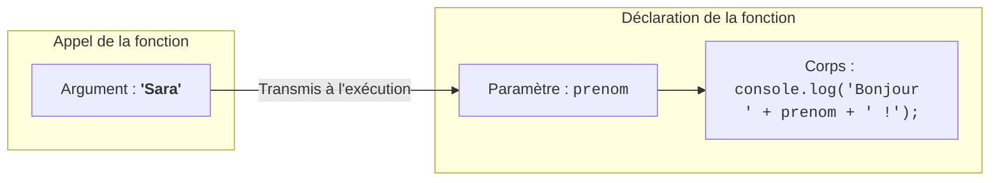
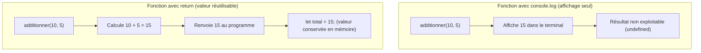
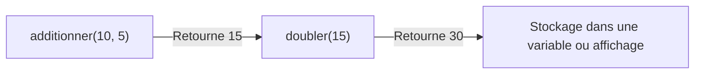
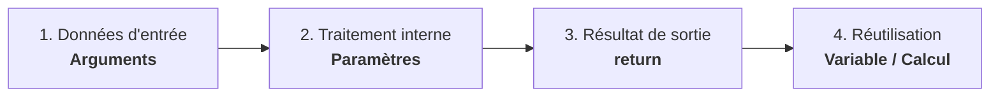

## 1. Objectif

Dans ce tutoriel, vous allez apprendre à rendre vos fonctions dynamiques en leur transmettant des **données d'entrée** et en récupérant leur **résultat de sortie**.

Vous allez apprendre à :
* transmettre des données à une fonction à l'aide de **paramètres** et d'**arguments** ;
* renvoyer une valeur calculée grâce au mot-clé `return` ;
* faire la différence essentielle entre afficher un résultat (`console.log`) et renvoyer une valeur (`return`) ;
* stocker et réutiliser le résultat d'une fonction dans une variable ou dans une autre fonction.

## 2. Prérequis

* Avoir suivi le tutoriel [Créer et appeler une fonction](/tutos/creer-appeler-fonction/).
* Savoir déclarer des variables (`let`) et utiliser les opérateurs arithmétiques (`+`, `*`, `/`).
* Savoir manipuler des conditions simples (`if` ou comparaison `>=`).

---

## Partie 1 — Théorie

### 1.1. Paramètres et arguments : faire varier les données d'entrée

Une fonction sans paramètre exécute toujours le même traitement avec les mêmes données fixes. Pour la rendre réutilisable, on lui transmet des données d'entrée.

* Le **paramètre** est la variable temporaire déclarée entre les parenthèses de la fonction.
* L'**argument** est la valeur réelle transmise lors de l'appel.



| Notion | Définition simple | Exemple |
| :--- | :--- | :--- |
| **Paramètre** | La variable réservée lors de la définition de la fonction. | `function saluer(prenom) { ... }` |
| **Argument** | La valeur concrète fournie lors de l'appel de la fonction. | `saluer("Sara");` |

**Exemple exécutable :**

```javascript
function saluer(prenom) {
    console.log("Bonjour " + prenom + " !");
}

saluer("Madani");
saluer("Sara");
```

**Résultat attendu dans la console :**
```text
Bonjour Madani !
Bonjour Sara !
```

### 1.2. Retourner un résultat avec `return` : calcul vs affichage

`console.log()` affiche un texte à l'écran, mais **ne conserve pas** le résultat pour la suite du programme. La donnée est perdue pour le reste de votre code.

Pour qu'une fonction produise une valeur exploitable par d'autres instructions, on utilise l'instruction `return`.



**Exemple exécutable :**

```javascript
function additionner(a, b) {
    return a + b;
}

// On stocke le résultat renvoyé par return dans une variable
let somme = additionner(10, 5);

console.log("Somme calculée : " + somme);
```

**Résultat attendu dans la console :**
```text
Somme calculée : 15
```

### 1.3. Enchaîner et combiner les fonctions

Grâce à `return`, la valeur produite par une fonction peut immédiatement servir d'entrée pour un autre calcul ou pour une autre fonction.



**Exemple exécutable :**

```javascript
function additionner(a, b) {
    return a + b;
}

function doubler(nombre) {
    return nombre * 2;
}

let total = additionner(10, 5);
let resultatFinal = doubler(total);

console.log("Résultat final : " + resultatFinal);
```

**Résultat attendu dans la console :**
```text
Résultat final : 30
```

---

## Partie 2 — Pratique guidée

Le but de cette pratique est de valider votre compréhension avec le **strict minimum de code**.

### 2.1. Créer une fonction avec paramètres et retour

Vous allez créer une fonction de calcul, récupérer sa valeur retournée avec `return`, puis l'afficher.

1. Déclarez une fonction `calculerTotal(prixUnitaire, quantite)` :
   - elle prend deux paramètres : `prixUnitaire` et `quantite` ;
   - elle renvoie le résultat de la multiplication avec `return`.
2. Appelez la fonction avec les arguments `25` et `4`.
3. Stockez le résultat dans la variable `total`.
4. Affichez le montant final avec `console.log()`.

**Code à écrire dans `fonctions.js` :**

```javascript
// ==============================================================
// Livrable : Utiliser les paramètres et le retour
// Emplacement : algo/fonctions/utiliser-parametres-retour/fonctions.js
// ==============================================================

// Déclaration de la fonction avec paramètres et retour
function calculerTotal(prixUnitaire, quantite) {
    return prixUnitaire * quantite;
}

// Appel avec arguments et récupération de la valeur retournée
let total = calculerTotal(25, 4);

console.log("Total calculé : " + total + " DH");

// --- Bilan personnel ---
// console.log() affiche une information dans le terminal mais ne renvoie rien.
// return renvoie une valeur que le programme peut stocker dans une variable et réutiliser.
```

**Résultat attendu dans la console :**
```text
Total calculé : 100 DH
```

### 2.2. Livrable & Critères de réussite

#### Emplacement obligatoire dans votre dépôt

Déposez votre fichier dans votre dépôt annuel de tutoriels au chemin suivant :

```text
algo/fonctions/utiliser-parametres-retour/fonctions.js
```

> **Rappel :** N'utilisez pas de codes de modules (`UA.121.14` ou `T.121.143`) dans vos noms de dossiers, utilisez uniquement des noms de dossiers clairs et lisibles.

#### Critères d'auto-évaluation

Avant de valider et de commiter votre travail sur GitHub :
* [ ] La fonction reçoit des paramètres pour rendre le calcul dynamique.
* [ ] La fonction renvoie le résultat avec `return` (sans faire de `console.log` à l'intérieur).
* [ ] La valeur retournée est stockée dans la variable `total` puis affichée.
* [ ] Le fichier s'exécute sans erreur avec `node fonctions.js`.
* [ ] Le fichier est commité dans votre dépôt à l'emplacement `algo/fonctions/utiliser-parametres-retour/fonctions.js`.

---

## 3. Bilan



## 4. Glossaire

* **Paramètre :** variable déclarée entre les parenthèses d'une fonction pour recevoir des données de l'extérieur.
* **Argument :** valeur réelle transmise à un paramètre lors de l'appel d'une fonction.
* **`return` :** mot-clé qui interrompt la fonction et renvoie une valeur au programme appelant.
* **Chaînage :** utilisation du résultat retourné par une première fonction comme argument d'une seconde.
