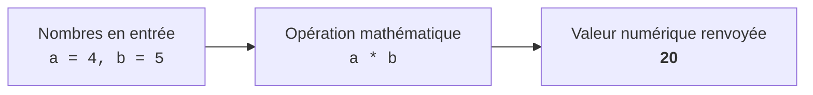
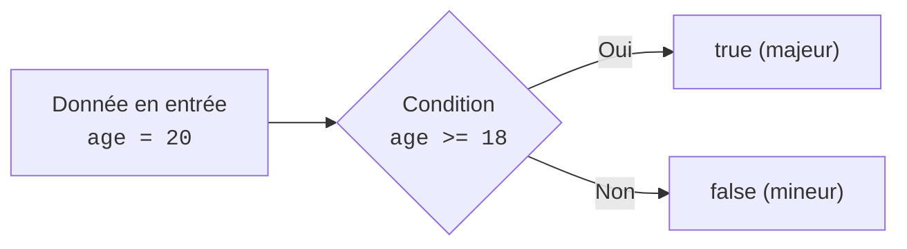
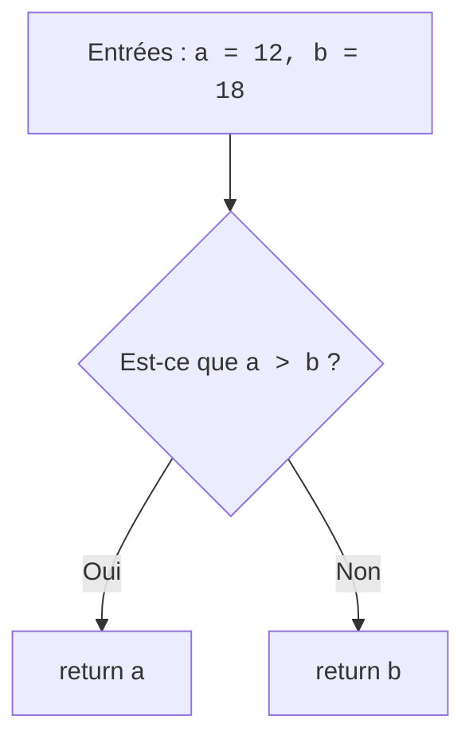
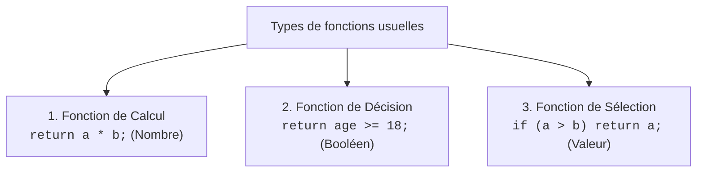

## 1. Objectif

Dans ce tutoriel, vous allez consolider votre compréhension des fonctions en découvrant les **trois familles de fonctions réutilisables**.

Vous allez apprendre à :
* construire une fonction de **calcul** qui produit un résultat numérique ;
* construire une fonction de **décision** (ou prédicat) qui renvoie un booléen (`true` ou `false`) ;
* construire une fonction de **sélection** qui compare deux valeurs et renvoie la valeur retenue ;
* combiner ces fonctions dans un mini-traitement cohérent.

## 2. Prérequis

* Avoir suivi le tutoriel [Utiliser les paramètres et le retour](/tutos/utiliser-parametres-retour/).
* Savoir transmettre des arguments et utiliser le mot-clé `return`.
* Savoir utiliser une condition simple (`if ... else` ou opérateur de comparaison).

---

## Partie 1 — Théorie

### 1.1. Les fonctions de calcul : transformer des nombres

Une fonction de calcul reçoit des données chiffrées en entrée, effectue une opération mathématique, et renvoie le résultat avec `return`.



**Exemple exécutable :**

```javascript
function multiplier(a, b) {
    return a * b;
}

let resultat = multiplier(4, 5);
console.log("Résultat : " + resultat);
```

**Résultat attendu dans la console :**
```text
Résultat : 20
```

### 1.2. Les fonctions de décision : renvoyer un booléen

Une fonction de décision (ou prédicat) vérifie si une règle ou une condition est respectée. Son nom commence souvent par `est` ou `verifier`, et elle renvoie directement un booléen (`true` ou `false`).



**Exemple exécutable :**

```javascript
function estMajeur(age) {
    return age >= 18;
}

console.log("Âge 20 ans : " + estMajeur(20));
console.log("Âge 15 ans : " + estMajeur(15));
```

**Résultat attendu dans la console :**
```text
Âge 20 ans : true
Âge 15 ans : false
```

### 1.3. Les fonctions de sélection : choisir entre deux valeurs

Une fonction de sélection compare plusieurs entrées à l'aide d'une condition `if ... else` pour renvoyer la valeur qui répond à un critère (par exemple le maximum).



**Exemple exécutable :**

```javascript
function trouverMaximum(a, b) {
    if (a > b) {
        return a;
    }
    return b;
}

let plusGrand = trouverMaximum(12, 18);
console.log("Le plus grand nombre est : " + plusGrand);
```

**Résultat attendu dans la console :**
```text
Le plus grand nombre est : 18
```

---

## Partie 2 — Pratique guidée

Le but de cette pratique est de valider votre compréhension avec le **strict minimum de code**.

### 2.1. Construire une fonction de calcul et une fonction de décision

Vous allez créer deux fonctions complémentaires pour traiter la dimension d'une pièce :

1. Déclarez une fonction de calcul `calculerSurface(longueur, largeur)` qui renvoie la surface (`longueur * largeur`).
2. Déclarez une fonction de décision `estGrand(surface)` qui renvoie `true` si la surface est supérieure ou égale à 100, sinon `false`.
3. Calculez la surface d'une pièce de 12 mètres sur 10 mètres.
4. Utilisez la fonction de décision sur cette surface et affichez les deux résultats.

**Code à écrire dans `fonctions.js` :**

```javascript
// ==============================================================
// Livrable : Exercices sur les fonctions
// Emplacement : algo/fonctions/exercices-fonctions/fonctions.js
// ==============================================================

// 1. Fonction de calcul (retourne un nombre)
function calculerSurface(longueur, largeur) {
    return longueur * largeur;
}

// 2. Fonction de décision (retourne un booléen)
function estGrand(surface) {
    return surface >= 100;
}

// 3. Exécution et exploitation des résultats
let surfacePiece = calculerSurface(12, 10);
let grandePiece = estGrand(surfacePiece);

console.log("Surface calculée : " + surfacePiece + " m²");
console.log("Grande pièce : " + grandePiece);

// --- Bilan personnel ---
// Une fonction de calcul renvoie une valeur numérique transformée.
// Une fonction de décision teste une règle et renvoie true ou false.
```

**Résultat attendu dans la console :**
```text
Surface calculée : 120 m²
Grande pièce : true
```

### 2.2. Livrable & Critères de réussite

#### Emplacement obligatoire dans votre dépôt

Déposez votre fichier dans votre dépôt annuel de tutoriels au chemin suivant :

```text
algo/fonctions/exercices-fonctions/fonctions.js
```

> **Rappel :** N'utilisez pas de codes de modules (`UA.121.14` ou `T.121.144`) dans vos noms de dossiers, utilisez uniquement des noms de dossiers clairs et lisibles.

#### Critères d'auto-évaluation

Avant de valider et de commiter votre travail sur GitHub :
* [ ] La fonction `calculerSurface` renvoie un nombre calculé avec `return`.
* [ ] La fonction `estGrand` teste une condition et renvoie un booléen (`true`/`false`).
* [ ] La valeur renvoyée par la première fonction est transmise en argument à la seconde.
* [ ] Tout le fichier s'exécute avec la commande `node fonctions.js` sans aucune erreur.
* [ ] Le fichier est commité dans votre dépôt à l'emplacement `algo/fonctions/exercices-fonctions/fonctions.js`.

---

## 3. Bilan



## 4. Glossaire

* **Fonction de calcul :** fonction qui applique une opération arithmétique sur ses entrées pour renvoyer un nombre.
* **Fonction de décision (ou prédicat) :** fonction qui vérifie une condition et renvoie `true` ou `false`.
* **Fonction de sélection :** fonction qui compare plusieurs données pour renvoyer celle qui respecte un critère.
