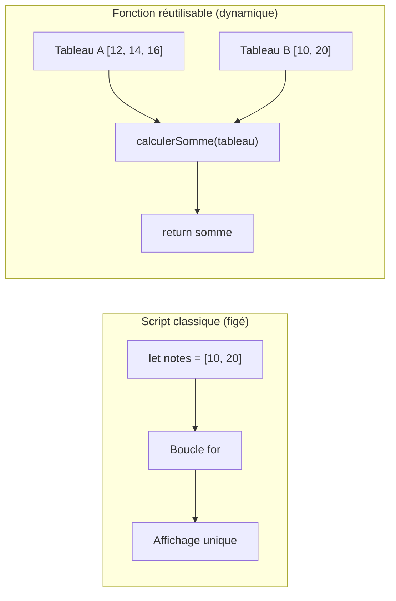
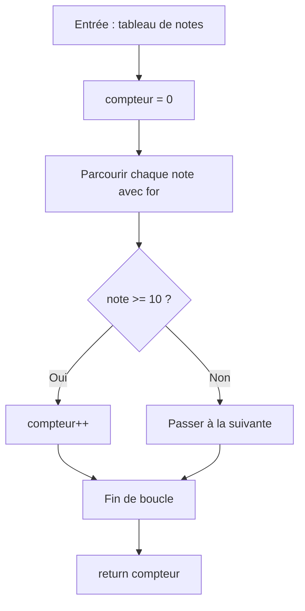
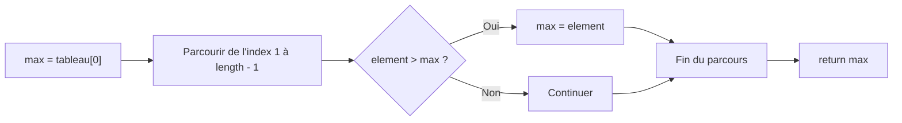
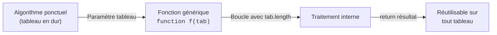

## 1. Objectif

Dans ce tutoriel, vous allez apprendre à transformer vos algorithmes sur les tableaux en **fonctions réutilisables**.

Vous allez apprendre à :
* transmettre un tableau en paramètre à une fonction ;
* encapsuler un algorithme de parcours (`for`) à l'intérieur d'une fonction ;
* renvoyer le résultat calculé avec `return` ;
* réutiliser la même fonction sur plusieurs tableaux sans réécrire la boucle.

## 2. Prérequis

* Avoir suivi le tutoriel [Parcourir un tableau](/tutos/parcourir-tableau/).
* Avoir suivi le tutoriel [Utiliser les paramètres et le retour](/tutos/utiliser-parametres-retour/).
* Savoir utiliser un accumulateur ou un compteur dans une boucle `for`.

---

## Partie 1 — Théorie

### 1.1. Du script figé à la fonction réutilisable

Un algorithme écrit dans un script classique ne fonctionne que pour un seul tableau déterminé : si les données changent, il faut copier-coller tout le code.

En transformant l'algorithme en **fonction**, on déclare un paramètre générique (ex: `tableau`) pour recevoir n'importe quel tableau transmis lors de l'appel.



**Exemple exécutable :**

```javascript
function calculerSomme(tableau) {
    let somme = 0;
    for (let i = 0; i < tableau.length; i++) {
        somme += tableau[i];
    }
    return somme;
}

let notes1 = [12, 14, 16];
let notes2 = [10, 20];

console.log("Somme 1 : " + calculerSomme(notes1));
console.log("Somme 2 : " + calculerSomme(notes2));
```

**Résultat attendu dans la console :**
```text
Somme 1 : 42
Somme 2 : 30
```

### 1.2. Transformer un algorithme de comptage conditionnel

Un algorithme de comptage filtre les éléments respectant un critère (ex: `note >= 10`) et retourne le nombre total d'occurrences.



**Exemple exécutable :**

```javascript
function compterReussites(notes) {
    let compteur = 0;
    for (let i = 0; i < notes.length; i++) {
        if (notes[i] >= 10) {
            compteur++;
        }
    }
    return compteur;
}

let resultats = [14, 8, 12, 9, 16];
console.log("Nombre d'admis : " + compterReussites(resultats));
```

**Résultat attendu dans la console :**
```text
Nombre d'admis : 3
```

### 1.3. Transformer un algorithme de recherche d'extremum (maximum)

Pour trouver le plus grand élément d'un tableau, la fonction initialise le maximum avec la première case `tableau[0]`, puis parcourt le reste du tableau pour actualiser la valeur retenue.



**Exemple exécutable :**

```javascript
function trouverMaximum(tableau) {
    let max = tableau[0];
    for (let i = 1; i < tableau.length; i++) {
        if (tableau[i] > max) {
            max = tableau[i];
        }
    }
    return max;
}

let temperatures = [18, 24, 15, 29, 21];
console.log("Température max : " + trouverMaximum(temperatures) + "°C");
```

**Résultat attendu dans la console :**
```text
Température max : 29°C
```

---

## Partie 2 — Pratique guidée

Le but de cette pratique est de valider votre compréhension avec le **strict minimum de code**.

### 2.1. Transformer le calcul de moyenne en fonction réutilisable

Vous allez convertir l'algorithme de moyenne en une fonction qui opère sur n'importe quel tableau de nombres :

1. Déclarez une fonction `calculerMoyenne(notes)` :
   - initialisez un accumulateur `somme = 0` ;
   - cumulez chaque valeur du tableau dans `somme` à l'aide d'une boucle `for` ;
   - renvoyez la moyenne arithmétique `somme / notes.length` avec `return`.
2. Déclarez deux tableaux distincts : `groupeA = [12, 14, 16]` et `groupeB = [10, 18, 11, 13]`.
3. Appelez la fonction pour chaque groupe et affichez les moyennes obtenues.

**Code à écrire dans `fonctions.js` :**

```javascript
// ==============================================================
// Livrable : Transformer les algorithmes élémentaires en fonctions
// Emplacement : algo/fonctions/transformer-algorithmes-fonctions/fonctions.js
// ==============================================================

// Transformation de l'algorithme de moyenne en fonction
function calculerMoyenne(notes) {
    let somme = 0;
    for (let i = 0; i < notes.length; i++) {
        somme += notes[i];
    }
    return somme / notes.length;
}

// Réutilisation sur deux séries de données distinctes
let groupeA = [12, 14, 16];
let groupeB = [10, 18, 11, 13];

console.log("Moyenne Groupe A : " + calculerMoyenne(groupeA));
console.log("Moyenne Groupe B : " + calculerMoyenne(groupeB));

// --- Bilan personnel ---
// En recevant le tableau en paramètre, la fonction applique le même algorithme
// à n'importe quel jeu de données sans recopier la boucle for.
```

**Résultat attendu dans la console :**
```text
Moyenne Groupe A : 14
Moyenne Groupe B : 13
```

### 2.2. Livrable & Critères de réussite

#### Emplacement obligatoire dans votre dépôt

Déposez votre fichier dans votre dépôt annuel de tutoriels au chemin suivant :

```text
algo/fonctions/transformer-algorithmes-fonctions/fonctions.js
```

> **Rappel :** N'utilisez pas de codes de modules (`UA.121.14` ou `T.121.145`) dans vos noms de dossiers, utilisez uniquement des noms de dossiers clairs et lisibles.

#### Critères d'auto-évaluation

Avant de valider et de commiter votre travail sur GitHub :
* [ ] La fonction reçoit le tableau de données en paramètre (`notes`).
* [ ] La boucle `for` s'adapte automatiquement à la taille du tableau grâce à `notes.length`.
* [ ] La fonction renvoie la moyenne calculée à l'aide de `return`.
* [ ] La fonction est appelée avec succès sur deux tableaux de longueurs différentes.
* [ ] Tout le fichier s'exécute sans erreur avec `node fonctions.js`.
* [ ] Le fichier est commité dans votre dépôt à l'emplacement `algo/fonctions/transformer-algorithmes-fonctions/fonctions.js`.

---

## 3. Bilan



## 4. Glossaire

* **Encapsulation :** fait d'isoler un algorithme dans une fonction avec ses propres variables locales.
* **Paramètre tableau :** variable qui reçoit la référence d'une liste de données lors de l'appel d'une fonction.
* **Généralisation :** passage d'un script écrit pour des données fixes à une fonction capable de traiter n'importe quel tableau.
