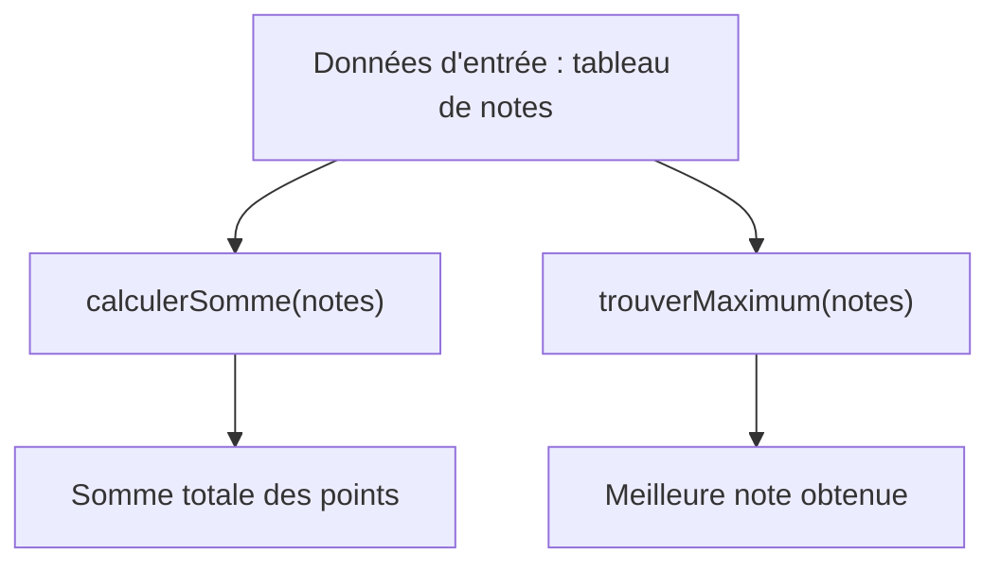
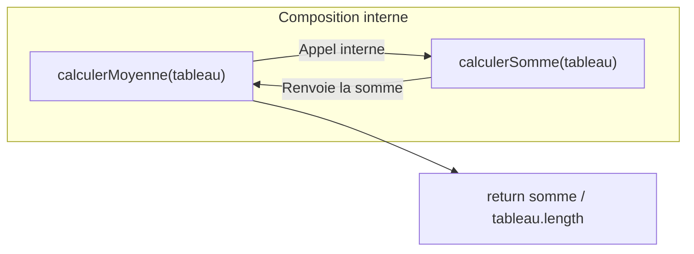
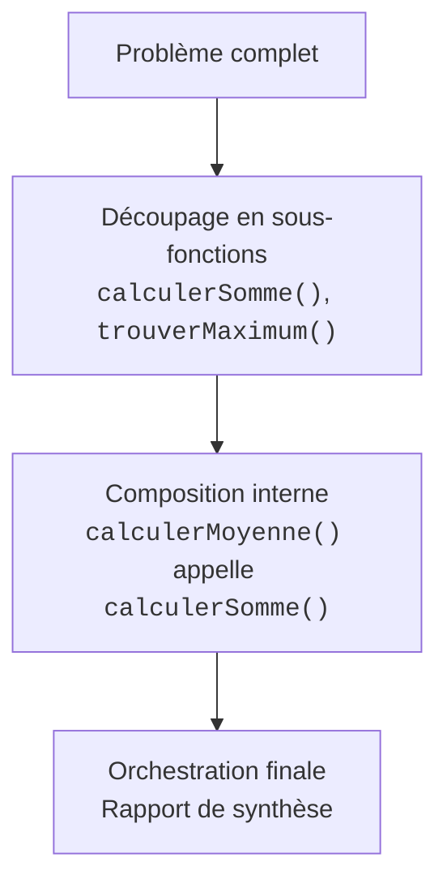

## 1. Objectif

Dans ce tutoriel de synthèse, vous allez apprendre à **combiner et composer plusieurs fonctions** pour résoudre un problème complet.

Vous allez apprendre à :
* découper un traitement complexe en fonctions spécialisées indépendantes ;
* faire appel à une fonction à l'intérieur d'une autre fonction (**composition**) ;
* orchestrer plusieurs fonctions pour analyser un jeu de données et produire un résultat clair.

## 2. Prérequis

* Avoir suivi le tutoriel [Transformer les algorithmes élémentaires en fonctions](/tutos/transformer-algorithmes-fonctions/).
* Savoir transmettre un tableau en paramètre et récupérer des valeurs avec `return`.
* Savoir stocker le résultat d'une fonction dans une variable.

---

## Partie 1 — Théorie

### 1.1. Découpage en fonctions spécialisées

En programmation, chaque fonction doit avoir une **seule responsabilité** claire et précise.

Au lieu d'écrire un programme long et difficile à corriger, on écrit de petites fonctions spécialisées (`calculerSomme`, `trouverMaximum`) que l'on assemble selon les besoins.



### 1.2. La composition : une fonction qui en appelle une autre

Une fonction peut appeler une autre fonction pour lui déléguer une partie de son travail.

Par exemple, pour calculer une moyenne, on a besoin de la somme de tous les éléments. La fonction `calculerMoyenne` peut directement appeler `calculerSomme` au lieu de réécrire une boucle `for` inutilement !



**Exemple exécutable :**

```javascript
function calculerSomme(tableau) {
    let somme = 0;
    for (let i = 0; i < tableau.length; i++) {
        somme += tableau[i];
    }
    return somme;
}

// Composition : calculerMoyenne délègue la somme à calculerSomme
function calculerMoyenne(tableau) {
    let somme = calculerSomme(tableau);
    return somme / tableau.length;
}

let notes = [12, 14, 16];
console.log("Moyenne calculée : " + calculerMoyenne(notes));
```

**Résultat attendu dans la console :**
```text
Moyenne calculée : 14
```

### 1.3. L'orchestration : coordonner les résultats

L'orchestration consiste à appeler successivement les fonctions nécessaires, à stocker leurs valeurs retournées dans des variables descriptives, puis à formater l'affichage final.

**Exemple exécutable :**

```javascript
function trouverMaximum(tableau) {
    let max = tableau[0];
    for (let i = 1; i < tableau.length; i++) {
        if (tableau[i] > max) {
            max = tableau[i];
        }
    }
    return max;
}

let scores = [45, 82, 63];
let meilleurScore = trouverMaximum(scores);

console.log("Meilleur score : " + meilleurScore);
```

**Résultat attendu dans la console :**
```text
Meilleur score : 82
```

---

## Partie 2 — Pratique guidée

Le but de cette pratique est de valider votre compréhension avec le **strict minimum de code**.

### 2.1. Composer et orchestrer un bilan d'évaluation

Vous allez assembler trois fonctions spécialisées pour analyser une série de notes :

1. Déclarez `calculerSomme(tableau)` : additionne tous les éléments du tableau.
2. Déclarez `calculerMoyenne(tableau)` : calcule la moyenne en appelant directement `calculerSomme(tableau)` en interne.
3. Déclarez `trouverMaximum(tableau)` : recherche et renvoie la plus grande note.
4. Sur le tableau `notes = [15, 12, 18, 11]`, récupérez la moyenne et la note maximale, puis affichez le bilan final.

**Code à écrire dans `fonctions.js` :**

```javascript
// ==============================================================
// Livrable : Combiner plusieurs fonctions
// Emplacement : algo/fonctions/combiner-plusieurs-fonctions/fonctions.js
// ==============================================================

// 1. Fonction de base : calcul de la somme
function calculerSomme(tableau) {
    let somme = 0;
    for (let i = 0; i < tableau.length; i++) {
        somme += tableau[i];
    }
    return somme;
}

// 2. Composition : calculerMoyenne réutilise calculerSomme
function calculerMoyenne(tableau) {
    let somme = calculerSomme(tableau);
    return somme / tableau.length;
}

// 3. Fonction de sélection : recherche de l'extremum
function trouverMaximum(tableau) {
    let max = tableau[0];
    for (let i = 1; i < tableau.length; i++) {
        if (tableau[i] > max) {
            max = tableau[i];
        }
    }
    return max;
}

// 4. Orchestration du programme principal
let notes = [15, 12, 18, 11];

let moyenne = calculerMoyenne(notes);
let noteMax = trouverMaximum(notes);

console.log("=== BILAN DE CLASSE ===");
console.log("Moyenne : " + moyenne + " / 20");
console.log("Meilleure note : " + noteMax + " / 20");

// --- Bilan personnel ---
// La composition permet de réutiliser une fonction existante sans dupliquer
// de boucle for, rendant le code modulaire, lisible et facile à faire évoluer.
```

**Résultat attendu dans la console :**
```text
=== BILAN DE CLASSE ===
Moyenne : 14 / 20
Meilleure note : 18 / 20
```

### 2.2. Livrable & Critères de réussite

#### Emplacement obligatoire dans votre dépôt

Déposez votre fichier dans votre dépôt annuel de tutoriels au chemin suivant :

```text
algo/fonctions/combiner-plusieurs-fonctions/fonctions.js
```

> **Rappel :** N'utilisez pas de codes de modules (`UA.121.14` ou `T.121.146`) dans vos noms de dossiers, utilisez uniquement des noms de dossiers clairs et lisibles.

#### Critères d'auto-évaluation

Avant de valider et de commiter votre travail sur GitHub :
* [ ] Chaque fonction accomplit une seule tâche clairement définie.
* [ ] La fonction `calculerMoyenne` utilise la composition en appelant `calculerSomme`.
* [ ] Les résultats sont stockés dans des variables explicites avant d'être affichés.
* [ ] Tout le fichier s'exécute sans erreur avec `node fonctions.js`.
* [ ] Le fichier est commité dans votre dépôt à l'emplacement `algo/fonctions/combiner-plusieurs-fonctions/fonctions.js`.

---

## 3. Bilan



## 4. Glossaire

* **Composition :** mécanisme par lequel une fonction fait appel à une autre fonction pour exécuter une sous-tâche.
* **Responsabilité unique :** principe de conception où chaque fonction ne réalise qu'un seul traitement précis.
* **Orchestration :** agencement logique de plusieurs fonctions indépendantes pour résoudre un problème global.
