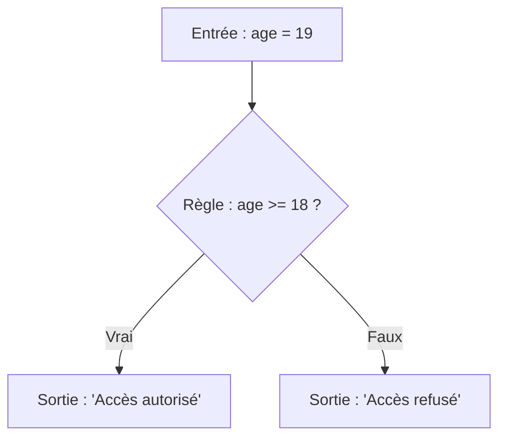
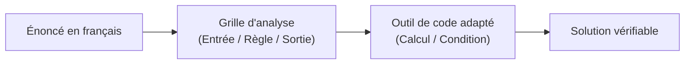

## 1. Objectif

Dans ce tutoriel, vous allez apprendre à **analyser un problème avant d'écrire la moindre ligne de code**.

Vous allez apprendre à :
* décomposer tout énoncé selon le modèle universel : **Entrées → Règles / Traitement → Sortie** ;
* identifier les informations disponibles et le résultat attendu ;
* formaliser votre raisonnement sous forme de grille d'analyse simple ;
* traduire cette analyse en une solution de code minimale et vérifiable.

## 2. Prérequis

* Savoir déclarer des variables et écrire une condition simple (`if ... else`).
* Savoir créer une fonction avec un paramètre et utiliser `return`.
* Savoir afficher un message avec `console.log()`.

---

## Partie 1 — Théorie

### 1.1. Pourquoi analyser avant de coder ?

Écrire du code directement sans réfléchir conduit souvent à des erreurs de logique et à des blocages.

Tout problème algorithmique décrit une **transformation logique** : on part de données initiales (les entrées) pour arriver à un résultat précis (la sortie) en appliquant des règles claires.


### 1.2. La grille d'analyse d'un problème

Pour résoudre n'importe quel problème avec méthode, on répond à 4 questions systématiques :

1. **Entrée :** Quelles sont les valeurs fournies au départ ?
2. **Sortie :** Quel est le résultat final attendu ?
3. **Règle :** Quelle condition ou formule mathématique relie l'entrée à la sortie ?
4. **Traitement :** Quel outil informatique utiliser (calcul, condition `if`, boucle, fonction) ?

**Exemple concret :** *"Calculer le prix TTC d'un article à partir de son prix HT avec 20% de TVA."*

| Étape d'analyse | Question à se poser | Réponse pour ce problème |
| :--- | :--- | :--- |
| **Entrée** | Quelles sont les données fournies ? | Le prix HT (`prixHT = 100`) |
| **Règle** | Quelle formule s'applique ? | `TTC = HT * 1.20` |
| **Sortie** | Quel résultat afficher ? | Le prix TTC calculé (`120 DH`) |
| **Traitement** | Quel outil de code ? | Une fonction avec calcul arithmétique et `return` |

**Code autonome correspondant :**

```javascript
function calculerTTC(prixHT) {
    return prixHT * 1.20;
}

let montantTTC = calculerTTC(100);
console.log("Montant TTC : " + montantTTC + " DH");
```

**Résultat attendu dans la console :**
```text
Montant TTC : 120 DH
```

### 1.3. Exemple avec décision : la validation d'accès

Lorsque le problème dépend d'une condition, la règle détermine quel chemin emprunter.

**Énoncé :** *"Vérifier si un utilisateur peut entrer selon son âge (minimum 18 ans)."*



**Code autonome correspondant :**

```javascript
function verifierAcces(age) {
    if (age >= 18) {
        return "Accès autorisé";
    }
    return "Accès refusé";
}

console.log("Âge 19 : " + verifierAcces(19));
console.log("Âge 15 : " + verifierAcces(15));
```

**Résultat attendu dans la console :**
```text
Âge 19 : Accès autorisé
Âge 15 : Accès refusé
```

---

## Partie 2 — Pratique guidée

Le but de cette pratique est de valider votre compréhension avec le **strict minimum de code**.

### 2.1. Analyser et résoudre un problème de livraison

Considérez le problème suivant :
> Une boutique en ligne applique la règle suivante :  
> Si le montant de la commande est supérieur ou égal à 200 DH, la livraison est gratuite (0 DH).  
> Sinon, les frais de livraison sont facturés 20 DH.

Dans votre fichier `solution.js` :
1. Notez la grille d'analyse en commentaire (Entrée, Règle, Sortie, Traitement).
2. Écrivez la fonction `calculerFraisLivraison(montant)` appliquant cette règle.
3. Testez votre fonction avec une commande de 250 DH, puis une commande de 150 DH.

**Code à écrire dans `solution.js` :**

```javascript
// ==============================================================
// Livrable : Comprendre un problème algorithmique
// Emplacement : algo/resolution-problemes/comprendre-probleme-algorithmique/solution.js
// ==============================================================

/*
--- Grille d'analyse du problème ---
1. Entrée     : montant de la commande (ex: montant = 250)
2. Règle      : gratuit (0 DH) si montant >= 200, sinon 20 DH
3. Sortie     : montant des frais de livraison (0 ou 20)
4. Traitement : fonction avec condition if / else et return
*/

function calculerFraisLivraison(montant) {
    if (montant >= 200) {
        return 0;
    }
    return 20;
}

// Tests de validation
console.log("Commande 250 DH -> Frais : " + calculerFraisLivraison(250) + " DH");
console.log("Commande 150 DH -> Frais : " + calculerFraisLivraison(150) + " DH");

// --- Bilan personnel ---
// Formaliser les entrées, règles et sorties avant de coder
// permet d'écrire la bonne condition du premier coup sans hésitation.
```

**Résultat attendu dans la console :**
```text
Commande 250 DH -> Frais : 0 DH
Commande 150 DH -> Frais : 20 DH
```

### 2.2. Livrable & Critères de réussite

#### Emplacement obligatoire dans votre dépôt

Déposez votre fichier dans votre dépôt annuel de tutoriels au chemin suivant :

```text
algo/resolution-problemes/comprendre-probleme-algorithmique/solution.js
```

> **Rappel :** N'utilisez pas de codes de modules (`UA.121.15` ou `T.121.151`) dans vos noms de dossiers, utilisez uniquement des noms de dossiers clairs et lisibles.

#### Critères d'auto-évaluation

Avant de valider et de commiter votre travail sur GitHub :
* [ ] Le fichier commence par la grille d'analyse en commentaire (Entrée, Règle, Sortie, Traitement).
* [ ] La fonction `calculerFraisLivraison` utilise une condition pour appliquer la règle de seuil.
* [ ] Les deux cas (commande >= 200 et commande < 200) sont testés et affichés.
* [ ] Tout le fichier s'exécute sans erreur avec `node solution.js`.
* [ ] Le fichier est commité dans votre dépôt à l'emplacement `algo/resolution-problemes/comprendre-probleme-algorithmique/solution.js`.

---

## 3. Bilan



## 4. Glossaire

* **Entrée :** information ou valeur initiale fournie au programme pour exécuter le traitement.
* **Sortie :** résultat attendu produit par le programme à destination de l'utilisateur.
* **Règle métier :** condition logique ou calcul arithmétique imposé par le problème pour transformer l'entrée en sortie.
