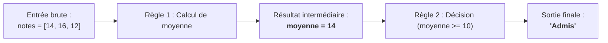
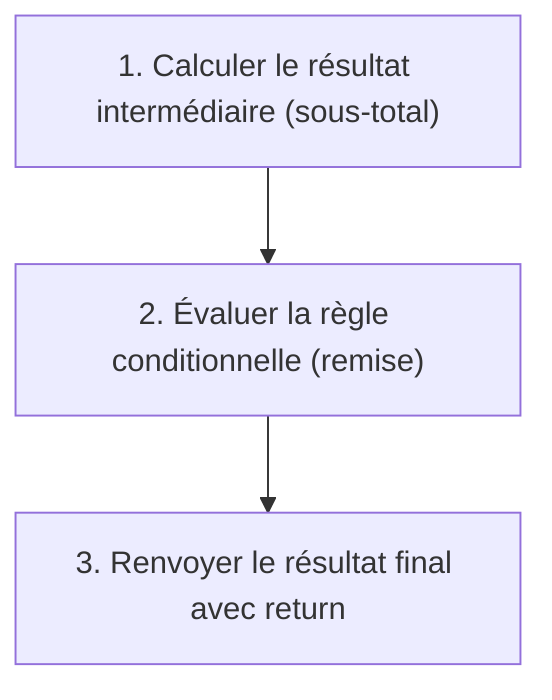

## 1. Objectif

Dans ce tutoriel, vous allez apprendre à analyser des problèmes complexes comportant **plusieurs règles et des résultats intermédiaires**.

Vous allez apprendre à :
* distinguer les **données d'entrée initiales** et les **résultats intermédiaires** de calcul ;
* décomposer un problème en une suite logique de règles ordonnées ;
* cartographier l'enchaînement des étapes avant de rédiger le code ;
* implémenter une solution vérifiable avec des conditions basées sur des valeurs calculées.

## 2. Prérequis

* Avoir suivi le tutoriel [Comprendre un problème algorithmique](/tutos/comprendre-probleme-algorithmique/).
* Savoir utiliser une boucle `for` pour additionner les éléments d'un tableau.
* Savoir utiliser une condition `if ... else`.

---

## Partie 1 — Théorie

### 1.1. Les résultats intermédiaires : un pont entre deux règles

Dans de nombreux problèmes, il est impossible de produire la sortie finale en une seule opération directe.

On doit d'abord calculer une valeur pivot appelée **résultat intermédiaire** (ex. le total des ventes ou la moyenne de notes), qui sert ensuite à évaluer la règle de décision suivante.



### 1.2. Cartographier un problème à règles multiples

Pour ne rien oublier lors de l'analyse, on structure les règles de manière chronologique :

1. **Entrées :** Données brutes fournies au départ.
2. **Règle 1 (Calcul) :** Transformation arithmétique des entrées → produit un résultat intermédiaire.
3. **Règle 2 (Décision) :** Test conditionnel sur le résultat intermédiaire → produit la sortie finale.

**Exemple concret :** *"Un magasin applique 10% de réduction sur une facture si le client achète plus de 5 articles."*

| Étape | Question | Réponse pour ce problème |
| :--- | :--- | :--- |
| **Entrées** | Quelles données au départ ? | `prixUnitaire = 20`, `quantite = 6` |
| **Règle 1** | Comment calculer le montant brut ? | `sousTotal = prixUnitaire * quantite` (Résultat intermédiaire) |
| **Règle 2** | Quelle condition de remise ? | Si `quantite > 5`, appliquer `sousTotal * 0.90` |
| **Sortie** | Quel montant final facturer ? | Le total net calculé (`108 DH`) |

**Code autonome correspondant :**

```javascript
function calculerPrixFacture(prixUnitaire, quantite) {
    let sousTotal = prixUnitaire * quantite;
    if (quantite > 5) {
        return sousTotal * 0.90; // 10% de remise
    }
    return sousTotal;
}

console.log("6 articles à 20 DH : " + calculerPrixFacture(20, 6) + " DH");
console.log("3 articles à 20 DH : " + calculerPrixFacture(20, 3) + " DH");
```

**Résultat attendu dans la console :**
```text
6 articles à 20 DH : 108 DH
3 articles à 20 DH : 60 DH
```

### 1.3. Ordonner rigoureusement l'exécution des règles

Une erreur fréquente consiste à vouloir tester une condition avant d'avoir calculé la valeur nécessaire. L'ordre d'écriture dans votre fonction doit respecter l'ordre d'analyse.



---

## Partie 2 — Pratique guidée

Le but de cette pratique est de valider votre compréhension avec le **strict minimum de code**.

### 2.1. Analyser et résoudre un problème de prime commerciale

Considérez l'énoncé suivant :
> Un employé reçoit un salaire de base fixe ainsi qu'une liste de ventes réalisées dans le mois.  
> 1. On calcule le total cumulé de ses ventes.  
> 2. Si le total des ventes dépasse 5 000 DH, l'employé reçoit une prime de 500 DH. Sinon, sa prime est de 0 DH.  
> 3. Le salaire final versé est égal au salaire de base augmenté de la prime.

Dans votre fichier `solution.js` :
1. Notez en commentaire la grille d'analyse identifiant les entrées, le résultat intermédiaire et la règle de prime.
2. Écrivez la fonction `calculerSalaireFinal(salaireBase, ventes)`.
3. Testez votre fonction sur deux profils d'employés distincts.

**Code à écrire dans `solution.js` :**

```javascript
// ==============================================================
// Livrable : Identifier les données et les règles
// Emplacement : algo/resolution-problemes/identifier-donnees-regles/solution.js
// ==============================================================

/*
--- Grille d'analyse ---
1. Entrées                : salaireBase (ex: 4000), ventes = [2000, 4000]
2. Règle 1 (Cumul)        : somme des ventes
3. Résultat intermédiaire : totalVentes (ex: 6000 DH)
4. Règle 2 (Prime)        : si totalVentes > 5000 -> prime = 500 DH, sinon 0 DH
5. Sortie finale          : salaireBase + prime (ex: 4500 DH)
*/

function calculerSalaireFinal(salaireBase, ventes) {
    // Calcul du résultat intermédiaire
    let totalVentes = 0;
    for (let i = 0; i < ventes.length; i++) {
        totalVentes += ventes[i];
    }

    // Application de la règle de prime
    let prime = 0;
    if (totalVentes > 5000) {
        prime = 500;
    }

    return salaireBase + prime;
}

// Tests de validation
let ventesEmployeA = [2000, 4000]; // Total 6000 > 5000 -> Prime 500 DH
let ventesEmployeB = [1000, 2500]; // Total 3500 <= 5000 -> Prime 0 DH

console.log("Salaire Employé A : " + calculerSalaireFinal(4000, ventesEmployeA) + " DH");
console.log("Salaire Employé B : " + calculerSalaireFinal(4000, ventesEmployeB) + " DH");

// --- Bilan personnel ---
// Identifier le résultat intermédiaire (totalVentes) évite
// de mélanger le calcul de la boucle et la condition de la prime.
```

**Résultat attendu dans la console :**
```text
Salaire Employé A : 4500 DH
Salaire Employé B : 4000 DH
```

### 2.2. Livrable & Critères de réussite

#### Emplacement obligatoire dans votre dépôt

Déposez votre fichier dans votre dépôt annuel de tutoriels au chemin suivant :

```text
algo/resolution-problemes/identifier-donnees-regles/solution.js
```

> **Rappel :** N'utilisez pas de codes de modules (`UA.121.15` ou `T.121.152`) dans vos noms de dossiers, utilisez uniquement des noms de dossiers clairs et lisibles.

#### Critères d'auto-évaluation

Avant de valider et de commiter votre travail sur GitHub :
* [ ] Le résultat intermédiaire (`totalVentes`) est clairement identifié et calculé en premier.
* [ ] La condition de prime s'applique sur le résultat intermédiaire et non directement sur les ventes individuelles.
* [ ] Les deux cas (avec prime et sans prime) sont testés et affichés en console.
* [ ] Tout le fichier s'exécute sans erreur avec `node solution.js`.
* [ ] Le fichier est commité dans votre dépôt à l'emplacement `algo/resolution-problemes/identifier-donnees-regles/solution.js`.

---

## 3. Bilan


## 4. Glossaire

* **Résultat intermédiaire :** valeur temporaire calculée au cours du traitement et indispensable pour appliquer les règles suivantes.
* **Chaînage de règles :** succession logique où le résultat d'une première règle devient l'entrée de la règle suivante.
* **Données brutes :** ensemble des valeurs fournies en entrée avant toute transformation.
