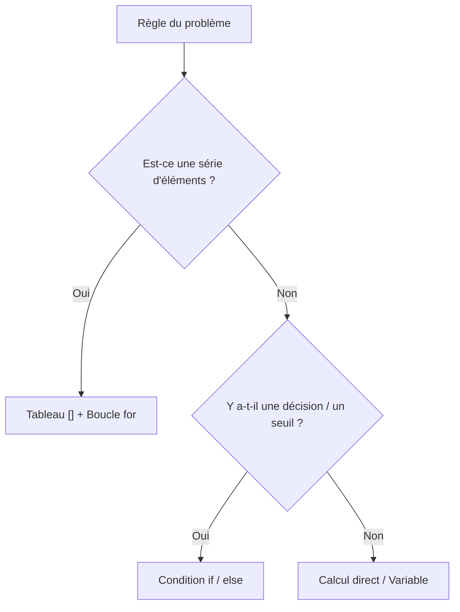
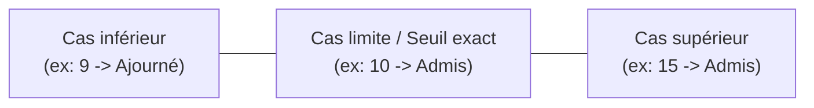
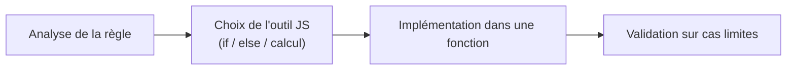

## 1. Objectif

Dans ce tutoriel, vous allez apprendre à **traduire une analyse de problème en code JavaScript fonctionnel**.

Vous allez apprendre à :
* faire correspondre chaque besoin algorithmique à l'outil JavaScript approprié (variable, condition, boucle, fonction) ;
* construire la solution étape par étape sans chercher à tout écrire d'un bloc ;
* tester systématiquement les cas normaux et les **cas limites** pour valider votre code.

## 2. Prérequis

* Avoir suivi le tutoriel [Identifier les données et les règles](/tutos/identifier-donnees-regles/).
* Savoir utiliser les conditions `if ... else` et les fonctions avec `return`.
* Savoir manipuler les opérateurs arithmétiques et de comparaison (`<=`, `===`).

---

## Partie 1 — Théorie

### 1.1. Choisir le bon outil dans sa boîte à outils

Chaque notion programmatique répond à un besoin logique précis. Face à une règle, choisissez l'outil correspondant :

| Besoin algorithmique du problème | Outil JavaScript adapté |
| :--- | :--- |
| Mémoriser une valeur unique | Variable (`let`) |
| Stocker une liste ordonnée d'éléments | Tableau (`[]`) |
| Faire un choix selon une règle | Condition (`if ... else`) |
| Répéter un traitement sur chaque élément | Boucle (`for`) |
| Isoler et rendre le traitement réutilisable | Fonction (`function ... return`) |



### 1.2. Construire la solution pas à pas

On ne rédige pas un programme d'un seul coup. On isole d'abord le traitement principal dans une fonction, puis on applique les règles logiques.

**Exemple concret :** *"Calculer la moyenne de 3 notes d'un apprenant, et renvoyer 'Admis' (si moyenne >= 10) ou 'Ajourné'."*

```javascript
function calculerMoyenne(notes) {
    let somme = 0;
    for (let i = 0; i < notes.length; i++) {
        somme += notes[i];
    }
    return somme / notes.length;
}

function determinerStatut(moyenne) {
    if (moyenne >= 10) {
        return "Admis";
    }
    return "Ajourné";
}

let notesApprenant = [12, 14, 10];
let moy = calculerMoyenne(notesApprenant);

console.log("Moyenne : " + moy + " -> Statut : " + determinerStatut(moy));
```

**Résultat attendu dans la console :**
```text
Moyenne : 12 -> Statut : Admis
```

### 1.3. L'importance des cas limites lors des tests

Tester avec une valeur évidente (ex: 15 pour une moyenne) ne suffit pas à garantir qu'un programme fonctionne.

Il faut impérativement tester les **cas limites** (la valeur exacte du seuil, par exemple 10) pour s'assurer que l'opérateur de comparaison choisi (`>=` ou `>`) correspond fidèlement à la règle de l'énoncé.



---

## Partie 2 — Pratique guidée

Le but de cette pratique est de valider votre compréhension avec le **strict minimum de code**.

### 2.1. Construire et tester le radar de vitesse

Considérez le problème suivant :
> Sur une route limitée à 80 km/h :  
> 1. Si la vitesse est inférieure ou égale à 80 km/h, la fonction renvoie `"Conforme"`.  
> 2. Si la vitesse dépasse 80 km/h, la fonction calcule le dépassement (`vitesse - 80`) et renvoie `"Excès de X km/h"`.

Dans votre fichier `solution.js` :
1. Écrivez la fonction `verifierVitesse(vitesse)` appliquant cette règle.
2. Testez les trois cas représentatifs : 75 km/h (inférieur), 80 km/h (cas limite), et 95 km/h (excès).

**Code à écrire dans `solution.js` :**

```javascript
// ==============================================================
// Livrable : Construire une solution simple
// Emplacement : algo/resolution-problemes/construire-solution-simple/solution.js
// ==============================================================

function verifierVitesse(vitesse) {
    let limite = 80;
    if (vitesse <= limite) {
        return "Conforme";
    }
    let exces = vitesse - limite;
    return "Excès de " + exces + " km/h";
}

// Tests de validation des différents cas (inférieur, seuil, supérieur)
console.log("Vitesse 75 km/h : " + verifierVitesse(75));
console.log("Vitesse 80 km/h : " + verifierVitesse(80));
console.log("Vitesse 95 km/h : " + verifierVitesse(95));

// --- Bilan personnel ---
// Tester le cas limite (80 km/h) vérifie que l'opérateur <=
// est bien respecté et n'affiche pas d'excès à la vitesse exacte autorisée.
```

**Résultat attendu dans la console :**
```text
Vitesse 75 km/h : Conforme
Vitesse 80 km/h : Conforme
Vitesse 95 km/h : Excès de 15 km/h
```

### 2.2. Livrable & Critères de réussite

#### Emplacement obligatoire dans votre dépôt

Déposez votre fichier dans votre dépôt annuel de tutoriels au chemin suivant :

```text
algo/resolution-problemes/construire-solution-simple/solution.js
```

> **Rappel :** N'utilisez pas de codes de modules (`UA.121.15` ou `T.121.153`) dans vos noms de dossiers, utilisez uniquement des noms de dossiers clairs et lisibles.

#### Critères d'auto-évaluation

Avant de valider et de commiter votre travail sur GitHub :
* [ ] La fonction `verifierVitesse` renvoie une valeur avec `return` pour chaque situation.
* [ ] Le calcul d'excès est effectué uniquement lorsque la vitesse est supérieure à la limite.
* [ ] Le cas limite (80 km/h) renvoie bien `"Conforme"`.
* [ ] Tout le fichier s'exécute sans erreur avec `node solution.js`.
* [ ] Le fichier est commité dans votre dépôt à l'emplacement `algo/resolution-problemes/construire-solution-simple/solution.js`.

---

## 3. Bilan



## 4. Glossaire

* **Boîte à outils :** ensemble des notions de programmation (variables, conditions, boucles, fonctions) mobilisables pour résoudre un problème.
* **Cas limite (ou cas frontière) :** valeur située exactement sur le seuil d'une condition (ex: 80 pour `<= 80`), indispensable pour valider la robustesse du code.
* **Conformité :** capacité du code à répondre exactement aux exigences formulées dans le problème.
