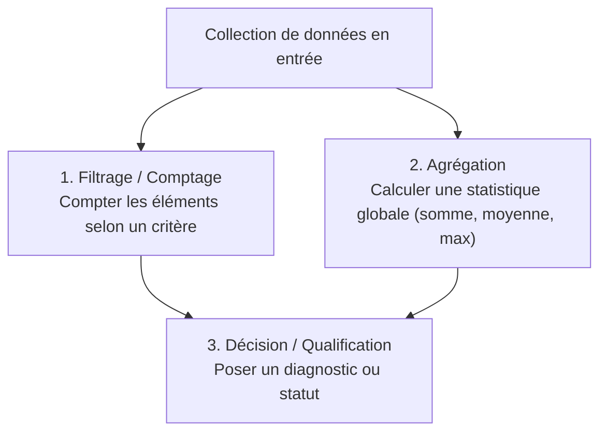
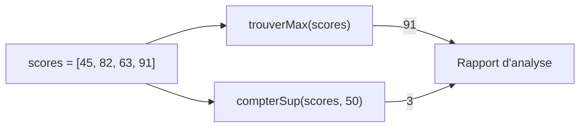
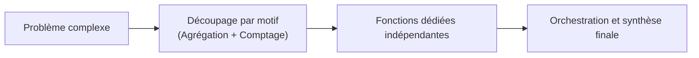

## 1. Objectif

Dans ce tutoriel, vous allez vous entraîner à **choisir les bons traitements pour résoudre un problème complet**.

Vous allez apprendre à :
* identifier les motifs algorithmiques classiques : **filtrage**, **agrégation** et **décision** ;
* décomposer un problème demandant plusieurs indicateurs sur une même série de données ;
* rédiger un code propre et modulaire articulant plusieurs fonctions de traitement.

## 2. Prérequis

* Avoir suivi le tutoriel [Construire une solution simple](/tutos/construire-solution-simple/).
* Savoir parcourir un tableau avec une boucle `for` pour trouver un maximum ou compter des éléments.
* Savoir récupérer les valeurs retournées par des fonctions avec `return`.

---

## Partie 1 — Théorie

### 1.1. Les motifs algorithmiques universels

La quasi-totalité des problèmes sur des séries de données se résout à l'aide de trois motifs combinés :



| Motif | Rôle de l'algorithme | Outil de code | Exemple de fonction |
| :--- | :--- | :--- | :--- |
| **Agrégation** | Résumer toute la collection en une seule valeur globale. | Boucle `for` + accumulateur ou extremum | `trouverMax(tab)`, `calculerMoyenne(tab)` |
| **Filtrage / Comptage** | Dénombrer les éléments vérifiant une condition. | Boucle `for` + `if` + compteur | `compterSuperieurs(tab, seuil)` |
| **Décision** | Renvoyer un verdict selon un seuil. | Condition `if ... else` | `estConforme(valeur)` |

### 1.2. Résoudre un problème à indicateurs multiples

Lorsqu'un énoncé pose plusieurs questions sur un même jeu de données (par exemple : *"Quel est le meilleur score ?"* et *"Combien de participants ont plus de 50 points ?"*), **on n'écrit pas une seule boucle confuse**.

On sépare chaque question dans sa propre fonction autonome. Le programme principal appelle ensuite chaque fonction sur le tableau et présente le rapport d'analyse.



### 1.3. Validation méthodique par les tests

Pour chaque fonction créée, assurez-vous de vérifier :
1. Que le parcours explore la totalité du tableau (de `0` à `length - 1`).
2. Que les compteurs et accumulateurs sont initialisés à `0` ou `tableau[0]` au début de la fonction.
3. Que l'instruction `return` est bien située **après** la fin de la boucle `for`.

---

## Partie 2 — Pratique guidée

Le but de cette pratique est de valider votre compréhension avec le **strict minimum de code**.

### 2.1. Résoudre le problème du bilan météorologique

Considérez l'énoncé suivant :
> Une station météo relève les températures maximales quotidiennes d'une semaine.  
> 1. Déterminez la température la plus chaude de la semaine.  
> 2. Comptez le nombre de jours de forte chaleur (température strictement supérieure à 25°C).

Dans votre fichier `solution.js` :
1. Écrivez la fonction `trouverMax(tableau)` appliquant l'algorithme d'extremum.
2. Écrivez la fonction `compterJoursChauds(tableau, seuil)` appliquant le comptage conditionnel.
3. Testez ces deux fonctions sur la série `[22, 28, 19, 31, 24, 29, 20]` et affichez le bilan.

**Code à écrire dans `solution.js` :**

```javascript
// ==============================================================
// Livrable : Exercices de résolution algorithmique
// Emplacement : algo/resolution-problemes/exercices-resolution-algorithmique/solution.js
// ==============================================================

// 1. Algorithme d'agrégation : recherche du maximum
function trouverMax(tableau) {
    let max = tableau[0];
    for (let i = 1; i < tableau.length; i++) {
        if (tableau[i] > max) {
            max = tableau[i];
        }
    }
    return max;
}

// 2. Algorithme de comptage : filtrage selon un seuil
function compterJoursChauds(tableau, seuil) {
    let compteur = 0;
    for (let i = 0; i < tableau.length; i++) {
        if (tableau[i] > seuil) {
            compteur++;
        }
    }
    return compteur;
}

// 3. Application sur les relevés de la semaine
let releveSemaine = [22, 28, 19, 31, 24, 29, 20];

let tMax = trouverMax(releveSemaine);
let nbChauds = compterJoursChauds(releveSemaine, 25);

console.log("=== BILAN MÉTÉO DE LA SEMAINE ===");
console.log("Température maximale : " + tMax + "°C");
console.log("Jours avec plus de 25°C : " + nbChauds);

// --- Bilan personnel ---
// Séparer l'extremum et le comptage dans deux fonctions rend chaque
// traitement immédiatement réutilisable pour d'autres stations météo.
```

**Résultat attendu dans la console :**
```text
=== BILAN MÉTÉO DE LA SEMAINE ===
Température maximale : 31°C
Jours avec plus de 25°C : 3
```

### 2.2. Livrable & Critères de réussite

#### Emplacement obligatoire dans votre dépôt

Déposez votre fichier dans votre dépôt annuel de tutoriels au chemin suivant :

```text
algo/resolution-problemes/exercices-resolution-algorithmique/solution.js
```

> **Rappel :** N'utilisez pas de codes de modules (`UA.121.15` ou `T.121.154`) dans vos noms de dossiers, utilisez uniquement des noms de dossiers clairs et lisibles.

#### Critères d'auto-évaluation

Avant de valider et de commiter votre travail sur GitHub :
* [ ] La fonction `trouverMax` initialise son maximum au premier élément du tableau.
* [ ] La fonction `compterJoursChauds` filtre les éléments grâce au paramètre `seuil`.
* [ ] Chaque fonction contient son instruction `return` en dehors de la boucle `for`.
* [ ] Tout le fichier s'exécute sans erreur avec `node solution.js`.
* [ ] Le fichier est commité dans votre dépôt à l'emplacement `algo/resolution-problemes/exercices-resolution-algorithmique/solution.js`.

---

## 3. Bilan



## 4. Glossaire

* **Agrégation :** opération qui synthétise un ensemble de valeurs en une seule grandeur statistique (somme, moyenne, extremum).
* **Filtrage :** sélection ou comptage des éléments d'une collection qui satisfont une condition donnée.
* **Seuil :** valeur de référence utilisée par une condition pour scinder des données en deux catégories.
