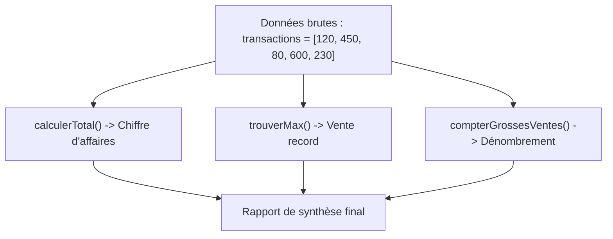
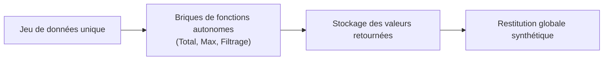

## 1. Objectif

Dans ce tutoriel, vous allez apprendre à résoudre un problème global en combinant **plusieurs briques de traitement autonomes**.

Vous allez apprendre à :
* associer chaque exigence d'un énoncé à une fonction de traitement dédiée ;
* exécuter plusieurs analyses distinctes sur une même série de données brutes sans effet de bord ;
* rassembler les résultats retournés dans un tableau de bord clair et synthétique.

## 2. Prérequis

* Avoir suivi le tutoriel [Exercices de résolution algorithmique](/tutos/exercices-resolution-algorithmique/).
* Savoir transmettre un tableau en argument et manipuler plusieurs fonctions dans un même fichier.
* Savoir formater un affichage console combinant texte et variables.

---

## Partie 1 — Théorie

### 1.1. L'approche modulaire : un problème = une suite de briques

Face à un problème comportant plusieurs questions (par exemple : analyser les ventes d'une journée), il ne faut pas concevoir un script monolithique encombré de boucles entremêlées.

L'approche modulaire consiste à associer chaque question de l'énoncé à une **fonction indépendante** :



| Question posée dans l'énoncé | Fonction dédiée | Résultat produit |
| :--- | :--- | :--- |
| Quel est le total des ventes ? | `calculerTotal(tab)` | Somme cumulée |
| Quelle est la vente la plus élevée ? | `trouverMax(tab)` | Valeur maximale |
| Combien de ventes dépassent 200 DH ? | `compterGrossesVentes(tab, 200)` | Nombre d'occurrences |

### 1.2. Absence d'effets de bord

Chaque fonction doit être purement calculatoire :
* elle reçoit le tableau en **lecture seule** sans en modifier les éléments ;
* elle utilise ses propres variables locales (`somme`, `max`, `compteur`) qui disparaissent dès la fin de son exécution ;
* elle communique son résultat au programme principal uniquement via le mot-clé `return`.

### 1.3. L'assemblage dans le programme principal

Le rôle du programme principal est d'agir comme un chef d'orchestre :
1. Définir les données de départ.
2. Déclencher chaque fonction successivement et stocker chaque résultat dans une variable parlante.
3. Afficher le rapport formaté.

---

## Partie 2 — Pratique guidée

Le but de cette pratique est de valider votre compréhension avec le **strict minimum de code**.

### 2.1. Construire le tableau de bord des transactions du jour

Considérez l'énoncé suivant :
> Un commerce étudie les 5 transactions de sa journée : `[120, 450, 80, 600, 230]`.  
> 1. Calculez le chiffre d'affaires total de la journée (`calculerTotal`).  
> 2. Déterminez la vente la plus élevée (`trouverMax`).  
> 3. Comptez le nombre de ventes supérieures à 200 DH (`compterGrossesVentes`).  
> 4. Affichez le rapport commercial complet dans la console.

Dans votre fichier `solution.js` :
1. Écrivez les trois fonctions indépendantes.
2. Exécutez-les sur le tableau de transactions.
3. Affichez les trois indicateurs sous un en-tête lisible.

**Code à écrire dans `solution.js` :**

```javascript
// ==============================================================
// Livrable : Construire une solution avec plusieurs traitements
// Emplacement : algo/resolution-problemes/construire-solution-plusieurs-traitements/solution.js
// ==============================================================

// Brique 1 : Cumul du chiffre d'affaires
function calculerTotal(tableau) {
    let total = 0;
    for (let i = 0; i < tableau.length; i++) {
        total += tableau[i];
    }
    return total;
}

// Brique 2 : Recherche de la transaction maximale
function trouverMax(tableau) {
    let max = tableau[0];
    for (let i = 1; i < tableau.length; i++) {
        if (tableau[i] > max) {
            max = tableau[i];
        }
    }
    return max;
}

// Brique 3 : Comptage des transactions supérieures au seuil
function compterGrossesVentes(tableau, seuil) {
    let compteur = 0;
    for (let i = 0; i < tableau.length; i++) {
        if (tableau[i] > seuil) {
            compteur++;
        }
    }
    return compteur;
}

// Programme principal : orchestration
let transactions = [120, 450, 80, 600, 230];

let caTotal = calculerTotal(transactions);
let recordVente = trouverMax(transactions);
let nbGrossesVentes = compterGrossesVentes(transactions, 200);

console.log("=== RAPPORT DU COMMERCE ===");
console.log("Chiffre d'affaires total : " + caTotal + " DH");
console.log("Vente record : " + recordVente + " DH");
console.log("Ventes > 200 DH : " + nbGrossesVentes);

// --- Bilan personnel ---
// Chaque fonction est isolée et réutilisable. Si le seuil d'analyse change,
// seule la fonction compterGrossesVentes est impactée.
```

**Résultat attendu dans la console :**
```text
=== RAPPORT DU COMMERCE ===
Chiffre d'affaires total : 1480 DH
Vente record : 600 DH
Ventes > 200 DH : 3
```

### 2.2. Livrable & Critères de réussite

#### Emplacement obligatoire dans votre dépôt

Déposez votre fichier dans votre dépôt annuel de tutoriels au chemin suivant :

```text
algo/resolution-problemes/construire-solution-plusieurs-traitements/solution.js
```

> **Rappel :** N'utilisez pas de codes de modules (`UA.121.15` ou `T.121.155`) dans vos noms de dossiers, utilisez uniquement des noms de dossiers clairs et lisibles.

#### Critères d'auto-évaluation

Avant de valider et de commiter votre travail sur GitHub :
* [ ] Chaque indicateur demandé est calculé par sa propre fonction dédiée.
* [ ] Aucune fonction ne modifie les valeurs du tableau de départ.
* [ ] Les résultats sont stockés dans des variables avant l'affichage de synthèse.
* [ ] Tout le fichier s'exécute sans erreur avec `node solution.js`.
* [ ] Le fichier est commité dans votre dépôt à l'emplacement `algo/resolution-problemes/construire-solution-plusieurs-traitements/solution.js`.

---

## 3. Bilan



## 4. Glossaire

* **Modularité :** décomposition d'un programme en sous-parties autonomes (fonctions) interchangeables et faciles à tester.
* **Effet de bord :** modification indésirable de données externes (comme altérer le tableau d'entrée) lors de l'exécution d'une fonction.
* **Rapport de synthèse :** présentation structurée réunissant plusieurs indicateurs calculés sur une même collection.
