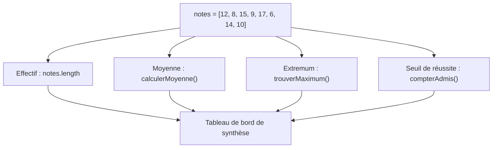
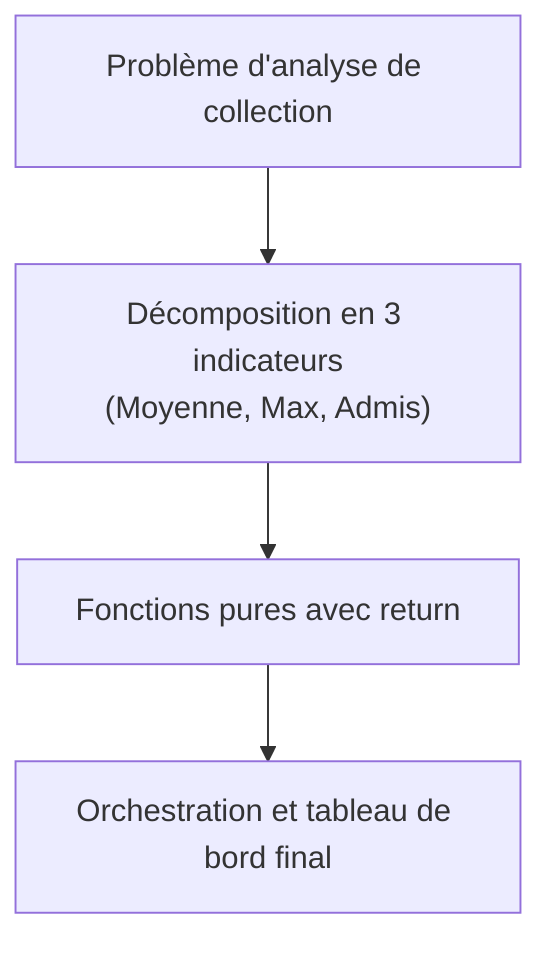

## 1. Objectif

Dans ce tutoriel de synthèse, vous allez mobiliser l'ensemble de la démarche de résolution pour **analyser une collection complète de données**.

Vous allez apprendre à :
* transformer un besoin métier d'analyse en une grille d'indicateurs clairs ;
* concevoir des fonctions d'analyse spécialisées et réutilisables ;
* orchestrer l'ensemble des traitements pour générer un bilan d'évaluation complet.

## 2. Prérequis

* Avoir suivi le tutoriel [Construire une solution avec plusieurs traitements](/tutos/construire-solution-plusieurs-traitements/).
* Maîtriser le parcours de tableau avec accumulateur (`somme`), extremum (`max`) et compteur (`if ... compteur++`).
* Savoir structurer un programme avec des fonctions pures utilisant `return`.

---

## Partie 1 — Théorie

### 1.1. De l'énoncé brut au plan d'analyse

Face à une collection de données (par exemple : les résultats d'un groupe d'apprenants), l'analyse consiste à extraire plusieurs grandeurs complémentaires :



### 1.2. Architecture des fonctions d'analyse

Pour garantir un code professionnel et maintenable :
1. Chaque indicateur fait l'objet d'une **fonction dédiée**.
2. Les fonctions ne dépendent d'aucune variable globale : elles reçoivent le tableau en paramètre.
3. Aucune fonction n'utilise `console.log()` en interne pour afficher son calcul : elles renvoient leur résultat avec `return`.

### 1.3. L'exploitation des résultats

Le script principal se contente de :
- déclarer la collection de données à analyser ;
- appeler chaque fonction d'analyse ;
- présenter un tableau de bord lisible à destination de l'utilisateur final.

---

## Partie 2 — Pratique guidée

Le but de cette pratique est de valider votre compréhension avec le **strict minimum de code**.

### 2.1. Construire l'analyseur de résultats du groupe

Considérez les notes suivantes obtenues par un groupe d'apprenants :
`[12, 8, 15, 9, 17, 6, 14, 10]`.

Dans votre fichier `solution.js` :
1. Écrivez la fonction `calculerMoyenne(notes)` : renvoie la moyenne arithmétique.
2. Écrivez la fonction `trouverMaximum(notes)` : renvoie la note la plus haute.
3. Écrivez la fonction `compterAdmis(notes)` : compte le nombre de notes supérieures ou égales à 10.
4. Orchestrez ces trois fonctions et affichez le rapport global dans la console.

**Code à écrire dans `solution.js` :**

```javascript
// ==============================================================
// Livrable : Algorithme de synthèse : analyser une collection
// Emplacement : algo/resolution-problemes/algorithme-synthese-analyser-collection/solution.js
// ==============================================================

// 1. Calcul de la moyenne générale
function calculerMoyenne(notes) {
    let somme = 0;
    for (let i = 0; i < notes.length; i++) {
        somme += notes[i];
    }
    return somme / notes.length;
}

// 2. Recherche de la note maximale
function trouverMaximum(notes) {
    let max = notes[0];
    for (let i = 1; i < notes.length; i++) {
        if (notes[i] > max) {
            max = notes[i];
        }
    }
    return max;
}

// 3. Comptage des admis (seuil >= 10)
function compterAdmis(notes) {
    let compteur = 0;
    for (let i = 0; i < notes.length; i++) {
        if (notes[i] >= 10) {
            compteur++;
        }
    }
    return compteur;
}

// Programme principal : exécution de l'analyse
let notesGroupe = [12, 8, 15, 9, 17, 6, 14, 10];

let moy = calculerMoyenne(notesGroupe);
let max = trouverMaximum(notesGroupe);
let admis = compterAdmis(notesGroupe);

console.log("=== BILAN GLOBAL DU GROUPE ===");
console.log("Effectif total : " + notesGroupe.length + " apprenants");
console.log("Moyenne générale : " + moy + " / 20");
console.log("Note maximale : " + max + " / 20");
console.log("Apprenants admis : " + admis + " / " + notesGroupe.length);

// --- Bilan personnel ---
// Une même collection de données peut alimenter plusieurs fonctions d'analyse
// indépendantes pour produire un diagnostic complet sans redondance de code.
```

**Résultat attendu dans la console :**
```text
=== BILAN GLOBAL DU GROUPE ===
Effectif total : 8 apprenants
Moyenne générale : 11.375 / 20
Note maximale : 17 / 20
Apprenants admis : 5 / 8
```

### 2.2. Livrable & Critères de réussite

#### Emplacement obligatoire dans votre dépôt

Déposez votre fichier dans votre dépôt annuel de tutoriels au chemin suivant :

```text
algo/resolution-problemes/algorithme-synthese-analyser-collection/solution.js
```

> **Rappel :** N'utilisez pas de codes de modules (`UA.121.15` ou `T.121.156`) dans vos noms de dossiers, utilisez uniquement des noms de dossiers clairs et lisibles.

#### Critères d'auto-évaluation

Avant de valider et de commiter votre travail sur GitHub :
* [ ] Chaque fonction d'analyse est indépendante et reçoit le tableau en paramètre.
* [ ] Toutes les fonctions restituent leur valeur avec `return`.
* [ ] L'affichage final présente l'effectif, la moyenne, la note maximale et le nombre d'admis.
* [ ] Tout le fichier s'exécute sans erreur avec `node solution.js`.
* [ ] Le fichier est commité dans votre dépôt à l'emplacement `algo/resolution-problemes/algorithme-synthese-analyser-collection/solution.js`.

---

## 3. Bilan



## 4. Glossaire

* **Collection :** ensemble de données regroupées dans une même structure ordonnée (tableau).
* **Tableau de bord :** vue récapitulative combinant plusieurs indicateurs statistiques calculés sur un jeu de données.
* **Fonction pure :** fonction qui calcule et renvoie un résultat sans modifier l'état extérieur ni produire d'effet secondaire.
