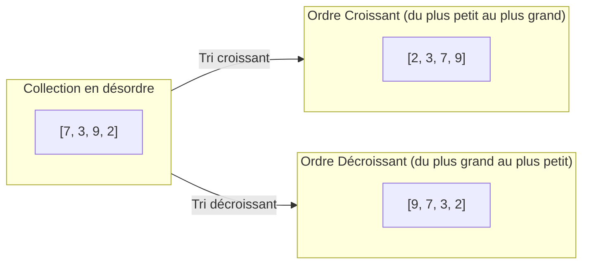
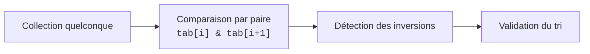

## 1. Objectif

Dans ce tutoriel, vous allez découvrir le concept d'**ordonnancement et de tri d'une collection**.

Vous allez apprendre à :
* comprendre la notion d'ordre au sein d'une liste de données ;
* distinguer l'ordre **croissant** (du plus petit au plus grand) et **décroissant** (du plus grand au plus petit) ;
* comparer deux éléments voisins pour détecter une anomalie d'ordre ;
* vérifier par algorithme si une collection est déjà triée ou non.

## 2. Prérequis

* Avoir suivi le tutoriel [Parcourir un tableau](/tutos/parcourir-tableau/).
* Savoir comparer des nombres à l'aide des opérateurs de comparaison (`<`, `>`).
* Savoir déclarer une fonction avec `return`.

---

## Partie 1 — Théorie

### 1.1. Qu'est-ce que l'ordre dans une collection ?

Trier une collection signifie réorganiser ses éléments selon une règle mathématique d'ordre prédéfinie.

* **Ordre croissant :** chaque élément est inférieur ou égal à l'élément qui le suit (`a <= b`).
* **Ordre décroissant :** chaque élément est supérieur ou égal à l'élément qui le suit (`a >= b`).



### 1.2. Comparer deux éléments voisins

L'opération élémentaire au cœur de tout algorithme de tri est la **comparaison par paire**.

Si l'on souhaite un ordre croissant et que l'on observe `tableau[i] > tableau[i + 1]`, alors les deux éléments se trouvent dans le désordre.

**Exemple exécutable :**

```javascript
let a = 8;
let b = 3;

if (a > b) {
    console.log("8 et 3 sont dans le désordre pour un tri croissant.");
}
```

**Résultat attendu dans la console :**
```text
8 et 3 sont dans le désordre pour un tri croissant.
```

### 1.3. Vérifier si un tableau est trié

Pour vérifier si un tableau est trié, on le parcourt jusqu'à l'avant-dernier élément (`length - 2`) et on compare chaque case `tableau[i]` avec sa voisine de droite `tableau[i + 1]`.

Dès qu'une seule inversion est trouvée, on peut immédiatement affirmer que le tableau n'est pas trié.

```mermaid
flowchart TD
    A["Parcourir de l'index 0 à length - 2"] --> B{"tableau[i] > tableau[i + 1] ?"}
    B -->|Oui| C["Inversion détectée -> Non trié (return false)"]
    B -->|Non| D["Continuer vers l'élément suivant"]
    D --> E["Fin du parcours sans anomalie -> Trié (return true)"]
```



**Exemple exécutable :**

```javascript
function estTrieCroissant(tableau) {
    for (let i = 0; i < tableau.length - 1; i++) {
        if (tableau[i] > tableau[i + 1]) {
            return false;
        }
    }
    return true;
}

console.log("[2, 5, 8] trié : " + estTrieCroissant([2, 5, 8]));
console.log("[8, 2, 5] trié : " + estTrieCroissant([8, 2, 5]));
```

**Résultat attendu dans la console :**
```text
[2, 5, 8] trié : true
[8, 2, 5] trié : false
```

---

## Partie 2 — Pratique guidée

Le but de cette pratique est de valider votre compréhension avec le **strict minimum de code**.

### 2.1. Détecter l'état de tri d'une série de valeurs

Dans votre fichier `tri.js` :
1. Écrivez la fonction `estTrieCroissant(tableau)` qui retourne `true` si les valeurs sont dans l'ordre croissant et `false` sinon.
2. Testez votre fonction sur une série ordonnée (`[2, 5, 8, 12, 19]`) puis sur une série désordonnée (`[2, 8, 5, 12, 19]`).

**Code à écrire dans `tri.js` :**

```javascript
// ==============================================================
// Livrable : Comprendre l'ordre et le tri
// Emplacement : algo/tri/comprendre-ordre-tri/tri.js
// ==============================================================

function estTrieCroissant(tableau) {
    for (let i = 0; i < tableau.length - 1; i++) {
        if (tableau[i] > tableau[i + 1]) {
            return false;
        }
    }
    return true;
}

// Séries de test
let listeValidee = [2, 5, 8, 12, 19];
let listeDesordonnee = [2, 8, 5, 12, 19];

console.log("Liste ordonnée triée : " + estTrieCroissant(listeValidee));
console.log("Liste désordonnée triée : " + estTrieCroissant(listeDesordonnee));

// --- Bilan personnel ---
// Vérifier le tri consiste à comparer chaque case avec sa voisine de droite.
// Une seule comparaison incorrecte suffit à conclure que la collection n'est pas triée.
```

**Résultat attendu dans la console :**
```text
Liste ordonnée triée : true
Liste désordonnée triée : false
```

### 2.2. Livrable & Critères de réussite

#### Emplacement obligatoire dans votre dépôt

Déposez votre fichier dans votre dépôt annuel de tutoriels au chemin suivant :

```text
algo/tri/comprendre-ordre-tri/tri.js
```

> **Rappel :** N'utilisez pas de codes de modules (`UA.121.16` ou `T.121.161`) dans vos noms de dossiers, utilisez uniquement des noms de dossiers clairs et lisibles.

#### Critères d'auto-évaluation

Avant de valider et de commiter votre travail sur GitHub :
* [ ] La boucle `for` s'arrête bien à `tableau.length - 1` pour éviter de comparer en dehors du tableau.
* [ ] La condition `tableau[i] > tableau[i + 1]` détecte toute inversion d'ordre croissant.
* [ ] Les deux cas (tableau ordonné et tableau désordonné) sont testés et affichés.
* [ ] Tout le fichier s'exécute sans erreur avec `node tri.js`.
* [ ] Le fichier est commité dans votre dépôt à l'emplacement `algo/tri/comprendre-ordre-tri/tri.js`.

---

## 3. Bilan



## 4. Glossaire

* **Tri :** réorganisation des éléments d'une collection selon une règle d'ordre déterminée.
* **Ordre croissant :** organisation où chaque valeur est plus petite ou égale à la valeur suivante.
* **Ordre décroissant :** organisation où chaque valeur est plus grande ou égale à la valeur suivante.
* **Inversion :** situation où deux éléments voisins ne respectent pas la règle d'ordre attendue.
