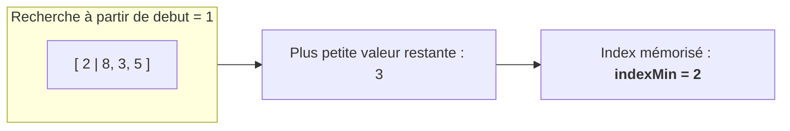
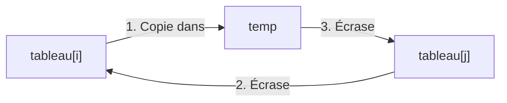
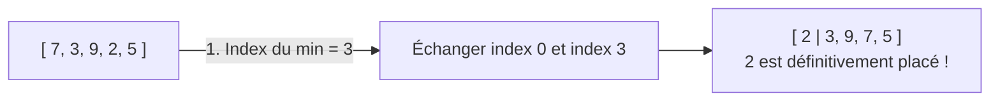
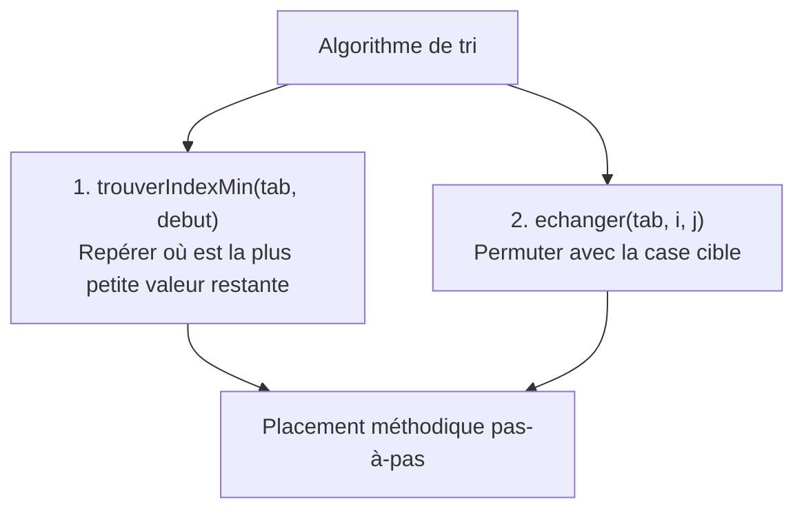

## 1. Objectif

Dans ce tutoriel, vous allez construire les **deux opérations fondamentales** nécessaires pour concevoir un algorithme de tri par sélection.

Vous allez apprendre à :
* trouver la **position (index)** du minimum dans une portion de tableau à partir d'un index de départ ;
* **échanger** deux éléments d'un tableau à l'aide d'une variable temporaire ;
* placer la plus petite valeur en tête de tableau en combinant recherche et échange.

## 2. Prérequis

* Avoir suivi le tutoriel [Comprendre l'ordre et le tri](/tutos/comprendre-ordre-tri/).
* Savoir modifier la valeur d'une case de tableau par affectation (`tableau[i] = valeur`).
* Savoir chercher le minimum dans une collection.

---

## Partie 1 — Théorie

### 1.1. Trouver la position du minimum dans une sous-partie

Pour trier, connaître la valeur du minimum ne suffit pas : il faut savoir **à quel index** elle se trouve afin de pouvoir la déplacer.

De plus, au fur et à mesure que le tri avance, on ne recherche plus à partir du début, mais à partir d'un index `debut` donné (pour ne pas perturber les éléments déjà rangés).



**Exemple exécutable :**

```javascript
function trouverIndexMin(tableau, debut) {
    let indexMin = debut;
    for (let i = debut + 1; i < tableau.length; i++) {
        if (tableau[i] < tableau[indexMin]) {
            indexMin = i;
        }
    }
    return indexMin;
}

let notes = [7, 3, 9, 2, 5];
let position = trouverIndexMin(notes, 0);
console.log("Index du minimum : " + position + " (valeur : " + notes[position] + ")");
```

**Résultat attendu dans la console :**
```text
Index du minimum : 3 (valeur : 2)
```

### 1.2. Échanger deux éléments dans un tableau

Pour intervertir les valeurs de deux cases `tableau[i]` et `tableau[j]` sans en écraser une au passage, on utilise une variable temporaire :



**Exemple exécutable :**

```javascript
function echanger(tableau, i, j) {
    let temp = tableau[i];
    tableau[i] = tableau[j];
    tableau[j] = temp;
}

let nombres = [10, 20];
echanger(nombres, 0, 1);
console.log("Après échange : " + nombres);
```

**Résultat attendu dans la console :**
```text
Après échange : 20,10
```

### 1.3. La combinaison : placer le premier élément trié

En trouvant l'index du plus petit élément et en l'échangeant avec la case d'index `0`, on place définitivement la première valeur triée du tableau.



---

## Partie 2 — Pratique guidée

Le but de cette pratique est de valider votre compréhension avec le **strict minimum de code**.

### 2.1. Construire et tester les deux fonctions pivots du tri

Dans votre fichier `tri.js` :
1. Implémentez la fonction `trouverIndexMin(tableau, debut)`.
2. Implémentez la fonction `echanger(tableau, i, j)`.
3. Sur le tableau `[14, 5, 20, 3, 9]`, trouvez l'index du minimum et échangez-le avec l'index `0`.
4. Affichez le tableau avant et après l'opération pour vérifier le placement de la plus petite valeur.

**Code à écrire dans `tri.js` :**

```javascript
// ==============================================================
// Livrable : Construire les opérations nécessaires au tri
// Emplacement : algo/tri/construire-operations-tri/tri.js
// ==============================================================

// Opération 1 : Chercher la position du minimum à partir d'un index
function trouverIndexMin(tableau, debut) {
    let indexMin = debut;
    for (let i = debut + 1; i < tableau.length; i++) {
        if (tableau[i] < tableau[indexMin]) {
            indexMin = i;
        }
    }
    return indexMin;
}

// Opération 2 : Échanger deux cases du tableau
function echanger(tableau, i, j) {
    let temp = tableau[i];
    tableau[i] = tableau[j];
    tableau[j] = temp;
}

// Application : placer le plus petit élément en première position
let serie = [14, 5, 20, 3, 9];
console.log("Avant échange : " + serie);

let idxMin = trouverIndexMin(serie, 0);
echanger(serie, 0, idxMin);

console.log("Index du minimum trouvé : " + idxMin + " (valeur " + serie[0] + ")");
console.log("Après premier placement : " + serie);

// --- Bilan personnel ---
// Trouver l'index du minimum puis l'échanger avec la case de départ
// place la plus petite valeur à sa position finale définitive.
```

**Résultat attendu dans la console :**
```text
Avant échange : 14,5,20,3,9
Index du minimum trouvé : 3 (valeur 3)
Après premier placement : 3,5,20,14,9
```

### 2.2. Livrable & Critères de réussite

#### Emplacement obligatoire dans votre dépôt

Déposez votre fichier dans votre dépôt annuel de tutoriels au chemin suivant :

```text
algo/tri/construire-operations-tri/tri.js
```

> **Rappel :** N'utilisez pas de codes de modules (`UA.121.16` ou `T.121.162`) dans vos noms de dossiers, utilisez uniquement des noms de dossiers clairs et lisibles.

#### Critères d'auto-évaluation

Avant de valider et de commiter votre travail sur GitHub :
* [ ] La fonction `trouverIndexMin` renvoie bien l'index (la position) et non la valeur.
* [ ] Le paramètre `debut` permet d'ignorer les cases précédentes déjà triées.
* [ ] La fonction `echanger` permute les deux cases sans perdre de valeur grâce à `temp`.
* [ ] Le tableau final débute par la plus petite valeur (`3`).
* [ ] Tout le fichier s'exécute sans erreur avec `node tri.js`.
* [ ] Le fichier est commité dans votre dépôt à l'emplacement `algo/tri/construire-operations-tri/tri.js`.

---

## 3. Bilan



## 4. Glossaire

* **Index du minimum :** numéro de la case où se situe la valeur la plus faible du tableau.
* **Variable temporaire (`temp`) :** zone mémoire relais servant à stocker temporairement une valeur pendant une permutation.
* **Permutation (ou échange) :** action d'intervertir le contenu de deux cases d'un tableau.
