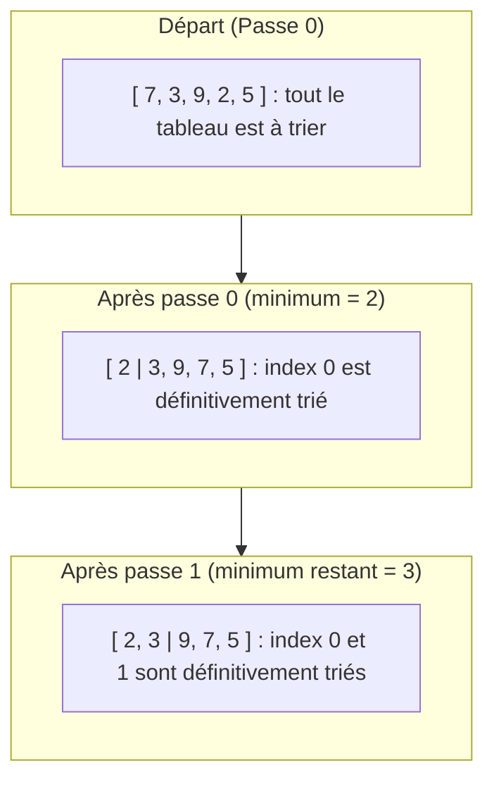

## 1. Objectif

Dans ce tutoriel, vous allez appliquer manuellement les opérations élémentaires pour exécuter les **premières étapes (passes)** d'un tri par sélection.

Vous allez apprendre à :
* distinguer la partie triée de la partie non triée d'un tableau ;
* exécuter la première passe pour placer le plus petit élément à l'index 0 ;
* exécuter la deuxième passe pour placer le deuxième plus petit élément à l'index 1 ;
* observer comment le tableau s'organise progressivement de gauche à droite.

## 2. Prérequis

* Avoir suivi le tutoriel [Construire les opérations nécessaires au tri](/tutos/construire-operations-tri/).
* Savoir utiliser les fonctions `trouverIndexMin(tableau, debut)` et `echanger(tableau, i, j)`.

---

## Partie 1 — Théorie

### 1.1. Découpage : partie triée et partie restante

Le tri par sélection divise virtuellement le tableau en deux zones à chaque étape :
1. **La partie triée (à gauche) :** contient les éléments définitivement rangés à leur bonne place.
2. **La partie non triée (à droite) :** contient les éléments restants parmi lesquels on doit chercher le prochain minimum.



### 1.2. Exécuter la première passe (position 0)

À la position initiale `i = 0` :
1. On cherche la position du minimum dans tout le tableau (de l'index `0` à la fin).
2. On échange l'élément de l'index `0` avec cet élément minimum.

**Exemple exécutable :**

```javascript
function trouverIndexMin(tableau, debut) {
    let indexMin = debut;
    for (let i = debut + 1; i < tableau.length; i++) {
        if (tableau[i] < tableau[indexMin]) {
            indexMin = i;
        }
    }
    return indexMin;
}

function echanger(tableau, i, j) {
    let temp = tableau[i];
    tableau[i] = tableau[j];
    tableau[j] = temp;
}

let nombres = [7, 3, 9, 2, 5];
console.log("Départ : " + nombres);

// Passe 0 : recherche depuis l'index 0
let minPos0 = trouverIndexMin(nombres, 0);
echanger(nombres, 0, minPos0);

console.log("Après passe 0 : " + nombres);
```

**Résultat attendu dans la console :**
```text
Départ : 7,3,9,2,5
Après passe 0 : 2,3,9,7,5
```

### 1.3. Enchaîner avec la deuxième passe (position 1)

L'élément à l'index `0` est maintenant figé. On passe à la position `i = 1` :
1. On cherche la position du minimum dans le sous-tableau restant (de l'index `1` à la fin).
2. On échange l'élément de l'index `1` avec ce minimum trouvé.

**Exemple exécutable :**

```javascript
// Suite avec le tableau [2, 3, 9, 7, 5]
// Passe 1 : recherche depuis l'index 1
let minPos1 = trouverIndexMin(nombres, 1);
echanger(nombres, 1, minPos1);

console.log("Après passe 1 : " + nombres);
```

**Résultat attendu dans la console :**
```text
Après passe 1 : 2,3,9,7,5
```

L'élément `3` était déjà à la bonne position (`indexMin = 1`), l'échange avec lui-même n'a rien modifié, ce qui est tout à fait normal.

---

## Partie 2 — Pratique

### 2.1. Exercice d'application : Enchaîner deux passes manuelles

Dans cet exercice, vous allez manipuler un tableau non ordonné et enchaîner manuellement la passe 0 puis la passe 1.

**Données de départ :**
```javascript
let nombres = [29, 10, 14, 37, 13];
```

**Consignes :**
1. Déclarez les fonctions `trouverIndexMin` et `echanger`.
2. Affichez le tableau initial.
3. Exécutez la **passe 0** :
   * trouvez l'index du minimum à partir de l'index `0` ;
   * échangez les valeurs aux index `0` et `minPos0` ;
   * affichez le tableau mis à jour.
4. Exécutez la **passe 1** :
   * trouvez l'index du minimum à partir de l'index `1` ;
   * échangez les valeurs aux index `1` et `minPos1` ;
   * affichez le tableau mis à jour.

**Code solution à tester :**

```javascript
function trouverIndexMin(tableau, debut) {
    let indexMin = debut;
    for (let i = debut + 1; i < tableau.length; i++) {
        if (tableau[i] < tableau[indexMin]) {
            indexMin = i;
        }
    }
    return indexMin;
}

function echanger(tableau, i, j) {
    let temp = tableau[i];
    tableau[i] = tableau[j];
    tableau[j] = temp;
}

let nombres = [29, 10, 14, 37, 13];
console.log("Initial : " + nombres);

// Étape 1 : Passe 0
let min0 = trouverIndexMin(nombres, 0);
echanger(nombres, 0, min0);
console.log("Après passe 0 : " + nombres);

// Étape 2 : Passe 1
let min1 = trouverIndexMin(nombres, 1);
echanger(nombres, 1, min1);
console.log("Après passe 1 : " + nombres);
```

**Résultat attendu dans le terminal :**
```text
Initial : 29,10,14,37,13
Après passe 0 : 10,29,14,37,13
Après passe 1 : 10,13,14,37,29
```

### 2.2. Livrable attendu

Créez le fichier de code dans votre dépôt annuel de travail :

```text
algo/tri/exercices-ordre-tri/tri.js
```

Exécutez-le avec Node.js pour valider le résultat :
```bash
node algo/tri/exercices-ordre-tri/tri.js
```

---

## Bilan

* Une **passe** consiste à chercher le minimum d'une portion et à le placer à la position courante `i`.
* À chaque passe `i`, la recherche commence à l'index `debut = i` pour ne pas modifier la zone déjà triée.
* En répétant cette opération pour chaque position du tableau jusqu'à l'avant-dernière case, le tableau sera entièrement trié : c'est le principe du **tri par sélection**.

## Glossaire

* **Passe de tri** : étape unitaire consistant à trouver le minimum d'une sous-partie et à le déplacer à la position courante.
* **Partie triée** : portion du tableau située à gauche de l'index courant, contenant des éléments ordonnés et définitifs.
* **Partie non triée** : portion du tableau située à partir de l'index courant jusqu'à la fin, contenant les éléments encore à trier.