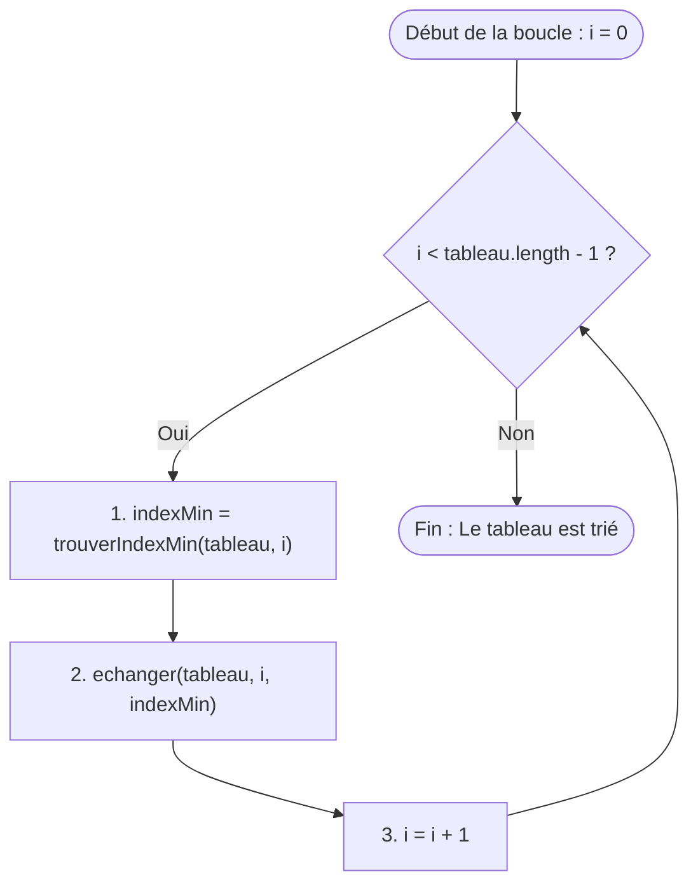

## 1. Objectif

Dans ce tutoriel, vous allez rassembler les opérations élémentaires pour construire l'algorithme complet du **tri par sélection**.

Vous allez apprendre à :
* automatiser la répétition des passes grâce à une boucle principale ;
* comprendre pourquoi la boucle s'arrête à l'avant-dernier élément (`length - 1`) ;
* encapsuler l'algorithme dans une fonction réutilisable `trierSelection(tableau)` ;
* vérifier le résultat sur une collection complète.

## 2. Prérequis

* Avoir suivi le tutoriel [Exercices sur l'ordre et le tri](/tutos/exercices-ordre-tri/).
* Maîtriser les fonctions `trouverIndexMin(tableau, debut)` et `echanger(tableau, i, j)`.
* Savoir utiliser une boucle `for`.

---

## Partie 1 — Théorie

### 1.1. Automatiser les passes avec une boucle

Dans le tutoriel précédent, nous avons exécuté manuellement la passe `i = 0`, puis `i = 1`. Pour trier tout le tableau, il suffit de répéter ce même motif pour chaque index `i` :



À chaque itération `i` :
1. On cherche le minimum à partir de l'index `i`.
2. On place ce minimum à l'index `i` via un échange.
3. La zone triée grandit d'un élément vers la droite.

### 1.2. Pourquoi s'arrêter à l'avant-dernière case (`length - 1`) ?

Considérons un tableau de 5 éléments :
* Lorsque les 4 premiers éléments (index `0`, `1`, `2`, `3`) sont rangés à leur position définitive, l'élément restant à l'index `4` est obligatoirement le plus grand de tous.
* Il n'y a donc aucun besoin d'exécuter une passe pour la dernière case : elle est déjà à sa place.

La condition d'arrêt de la boucle est donc strictement :
```javascript
for (let i = 0; i < tableau.length - 1; i++) {
    // traitement d'une passe
}
```

### 1.3. L'algorithme complet `trierSelection`

En assemblant les trois fonctions, nous obtenons une solution complète et modulaire.

**Exemple exécutable :**

```javascript
function trouverIndexMin(tableau, debut) {
    let indexMin = debut;
    for (let i = debut + 1; i < tableau.length; i++) {
        if (tableau[i] < tableau[indexMin]) {
            indexMin = i;
        }
    }
    return indexMin;
}

function echanger(tableau, i, j) {
    let temp = tableau[i];
    tableau[i] = tableau[j];
    tableau[j] = temp;
}

function trierSelection(tableau) {
    for (let i = 0; i < tableau.length - 1; i++) {
        let indexMin = trouverIndexMin(tableau, i);
        echanger(tableau, i, indexMin);
    }
    return tableau;
}

let nombres = [64, 25, 12, 22, 11];
console.log("Avant tri : " + nombres);

trierSelection(nombres);
console.log("Après tri : " + nombres);
```

**Résultat attendu dans la console :**
```text
Avant tri : 64,25,12,22,11
Après tri : 11,12,22,25,64
```

---

## Partie 2 — Pratique

### 2.1. Exercice d'application : Trier un tableau et observer chaque étape

Dans cet exercice, vous allez exécuter le tri par sélection sur une série de valeurs et afficher l'état du tableau à l'issue de chaque passe de boucle.

**Données de départ :**
```javascript
let notes = [15, 8, 12, 4, 19];
```

**Consignes :**
1. Reprenez les fonctions `trouverIndexMin` et `echanger`.
2. Dans la fonction `trierSelection(tableau)` :
   * bouclez de `0` à `tableau.length - 1` ;
   * cherchez le minimum à partir de `i` ;
   * effectuez l'échange ;
   * affichez `console.log("Passe " + i + " : " + tableau)`.
3. Testez votre fonction sur le tableau `notes`.

**Code solution à tester :**

```javascript
function trouverIndexMin(tableau, debut) {
    let indexMin = debut;
    for (let i = debut + 1; i < tableau.length; i++) {
        if (tableau[i] < tableau[indexMin]) {
            indexMin = i;
        }
    }
    return indexMin;
}

function echanger(tableau, i, j) {
    let temp = tableau[i];
    tableau[i] = tableau[j];
    tableau[j] = temp;
}

function trierSelection(tableau) {
    for (let i = 0; i < tableau.length - 1; i++) {
        let indexMin = trouverIndexMin(tableau, i);
        echanger(tableau, i, indexMin);
        console.log("Passe " + i + " : " + tableau);
    }
    return tableau;
}

let notes = [15, 8, 12, 4, 19];
console.log("Tableau initial : " + notes);

trierSelection(notes);
console.log("Tableau final trié : " + notes);
```

**Résultat attendu dans le terminal :**
```text
Tableau initial : 15,8,12,4,19
Passe 0 : 4,8,12,15,19
Passe 1 : 4,8,12,15,19
Passe 2 : 4,8,12,15,19
Passe 3 : 4,8,12,15,19
Tableau final trié : 4,8,12,15,19
```

### 2.2. Livrable attendu

Créez le fichier de code dans votre dépôt annuel de travail :

```text
algo/tri/construire-tri-selection/tri.js
```

Exécutez-le avec Node.js pour valider le résultat :
```bash
node algo/tri/construire-tri-selection/tri.js
```

---

## Bilan

* Le **tri par sélection** parcourt le tableau avec une boucle principale de l'index `0` à `length - 2`.
* À chaque itération, il sélectionne le plus petit élément restant et le place à la position courante `i`.
* La modification du tableau se fait **sur place** (in-place) : le tableau d'origine est directement réorganisé sans créer de copie.

## Glossaire

* **Tri par sélection** : algorithme de tri qui sélectionne successivement le plus petit élément de la partie non triée pour l'échanger avec l'élément courant.
* **Boucle principale** : boucle externe qui contrôle l'avancement de la position de référence `i`.
* **Tri sur place (in-place)** : algorithme qui réorganise les données directement dans la structure mémoire existante, sans créer de second tableau.