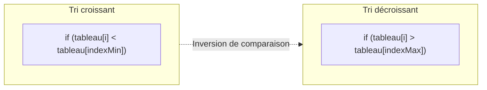

## 1. Objectif

Dans ce tutoriel, vous allez apprendre à tester la robustesse de votre algorithme de tri et à l'adapter pour réaliser un **tri décroissant**.

Vous allez apprendre à :
* tester un algorithme de tri face à des cas particuliers (tableau déjà trié, inversé, valeurs en double) ;
* repérer l'impact d'un opérateur de comparaison sur le comportement global de l'algorithme ;
* construire la variante `trierSelectionDecroissant(tableau)` ;
* vérifier la préservation de toutes les données d'origine.

## 2. Prérequis

* Avoir suivi le tutoriel [Construire le tri par sélection](/tutos/construire-tri-selection/).
* Savoir modifier une condition logique (`<` vers `>`).

---

## Partie 1 — Théorie

### 1.1. Tester les cas limites

Un algorithme de tri fiable doit produire le bon résultat quel que soit le tableau fourni en entrée :

| Cas de test | Exemple d'entrée | Résultat attendu | Vigilance |
| :--- | :--- | :--- | :--- |
| **Cas normal** | `[5, 2, 8, 1]` | `[1, 2, 5, 8]` | Vérifier l'ordre complet |
| **Déjà trié** | `[1, 2, 3, 4]` | `[1, 2, 3, 4]` | Aucun échange destructeur |
| **Totalement inversé** | `[9, 7, 5, 3]` | `[3, 5, 7, 9]` | Nombre maximal d'échanges |
| **Avec doublons** | `[4, 2, 4, 1]` | `[1, 2, 4, 4]` | Aucun doublon ne doit disparaître |
| **Tableau à 1 élément** | `[42]` | `[42]` | La boucle ne fait aucun tour (`length - 1 = 0`) |

### 1.2. Adapter l'algorithme au tri décroissant

Pour trier du plus grand au plus petit :
* Au lieu de chercher la plus petite valeur pour la placer au début, on cherche la **plus grande valeur**.
* On remplace `trouverIndexMin` par `trouverIndexMax`, en changeant simplement l'opérateur `<` par `>` :



### 1.3. L'algorithme de tri décroissant

**Exemple exécutable :**

```javascript
function trouverIndexMax(tableau, debut) {
    let indexMax = debut;
    for (let i = debut + 1; i < tableau.length; i++) {
        if (tableau[i] > tableau[indexMax]) {
            indexMax = i;
        }
    }
    return indexMax;
}

function echanger(tableau, i, j) {
    let temp = tableau[i];
    tableau[i] = tableau[j];
    tableau[j] = temp;
}

function trierSelectionDecroissant(tableau) {
    for (let i = 0; i < tableau.length - 1; i++) {
        let indexMax = trouverIndexMax(tableau, i);
        echanger(tableau, i, indexMax);
    }
    return tableau;
}

let scores = [40, 10, 95, 25];
trierSelectionDecroissant(scores);
console.log("Scores du plus haut au plus bas : " + scores);
```

**Résultat attendu dans la console :**
```text
Scores du plus haut au plus bas : 95,40,25,10
```

---

## Partie 2 — Pratique

### 2.1. Exercice d'application : Tester le tri décroissant avec doublons

Dans cet exercice, vous allez implémenter le tri par sélection décroissant et vérifier qu'il traite correctement un tableau contenant des valeurs en double.

**Données de départ :**
```javascript
let donnees = [12, 45, 12, 8, 90, 3];
```

**Consignes :**
1. Écrivez la fonction `trouverIndexMax(tableau, debut)`.
2. Écrivez la fonction `echanger(tableau, i, j)`.
3. Écrivez la fonction `trierSelectionDecroissant(tableau)`.
4. Appliquez le tri sur le tableau `donnees` et affichez le résultat.
5. Vérifiez que la longueur du tableau final est identique (6 éléments) et que les deux `12` sont bien conservés.

**Code solution à tester :**

```javascript
function trouverIndexMax(tableau, debut) {
    let indexMax = debut;
    for (let i = debut + 1; i < tableau.length; i++) {
        if (tableau[i] > tableau[indexMax]) {
            indexMax = i;
        }
    }
    return indexMax;
}

function echanger(tableau, i, j) {
    let temp = tableau[i];
    tableau[i] = tableau[j];
    tableau[j] = temp;
}

function trierSelectionDecroissant(tableau) {
    for (let i = 0; i < tableau.length - 1; i++) {
        let indexMax = trouverIndexMax(tableau, i);
        echanger(tableau, i, indexMax);
    }
    return tableau;
}

let donnees = [12, 45, 12, 8, 90, 3];
console.log("Avant tri : " + donnees);

trierSelectionDecroissant(donnees);
console.log("Après tri décroissant : " + donnees);
console.log("Nombre d'éléments conservés : " + donnees.length);
```

**Résultat attendu dans le terminal :**
```text
Avant tri : 12,45,12,8,90,3
Après tri décroissant : 90,45,12,12,8,3
Nombre d'éléments conservés : 6
```

### 2.2. Livrable attendu

Créez le fichier de code dans votre dépôt annuel de travail :

```text
algo/tri/tester-adapter-algorithme-tri/tri.js
```

Exécutez-le avec Node.js pour valider le résultat :
```bash
node algo/tri/tester-adapter-algorithme-tri/tri.js
```

---

## Bilan

* Un algorithme de tri doit être testé avec plusieurs configurations de données pour s'assurer de sa robustesse.
* Le passage d'un ordre croissant à un ordre décroissant repose uniquement sur le sens de la comparaison (`>` à la place de `<`).
* Le tri par sélection préserve l'intégrité de toutes les données du tableau d'origine, y compris les doublons.

## Glossaire

* **Tri décroissant** : organisation des éléments du plus grand au plus petit ($A \ge B \ge C$).
* **Cas limite** : cas d'exécution particulier (tableau vide, un seul élément, données déjà triées) permettant de tester la robustesse d'un algorithme.
* **Doublon** : valeur apparaissant plusieurs fois dans une même collection.