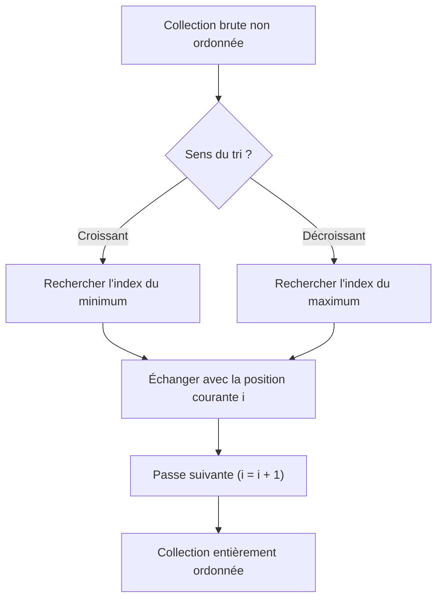

## 1. Objectif

Dans ce tutoriel de synthèse, vous allez réunir l'ensemble des compétences de l'unité d'apprentissage pour concevoir un algorithme complet de tri de collection paramétrable (croissant ou décroissant).

Vous allez apprendre à :
* modéliser le flux complet d'un tri de collection ;
* unifier la recherche de la valeur cible (minimum ou maximum) selon le sens demandé ;
* trier une collection de données réelles pour établir un classement ;
* vérifier la validité de la solution de bout en bout.

## 2. Prérequis

* Avoir suivi tous les tutoriels de l'UA.121.16 (de T.121.161 à T.121.165).
* Maîtriser le principe des passes, la recherche d'index et l'échange de cases.

---

## Partie 1 — Théorie

### 1.1. Architecture globale du tri de collection

L'algorithme de tri par sélection repose sur une séparation claire des responsabilités :



### 1.2. Unifier la recherche d'extremum

Au lieu d'écrire deux algorithmes entièrement séparés, on paramètre la condition de comparaison selon l'ordre souhaité (`"croissant"` ou `"decroissant"`) :

**Exemple exécutable :**

```javascript
function trouverIndexCible(tableau, debut, ordre) {
    let indexCible = debut;
    for (let i = debut + 1; i < tableau.length; i++) {
        let doitRemplacer = (ordre === "croissant")
            ? (tableau[i] < tableau[indexCible])
            : (tableau[i] > tableau[indexCible]);

        if (doitRemplacer) {
            indexCible = i;
        }
    }
    return indexCible;
}

let valeurs = [45, 12, 89, 3];
console.log("Min depuis 0 : index " + trouverIndexCible(valeurs, 0, "croissant"));
console.log("Max depuis 0 : index " + trouverIndexCible(valeurs, 0, "decroissant"));
```

**Résultat attendu dans la console :**
```text
Min depuis 0 : index 3
Max depuis 0 : index 2
```

### 1.3. La fonction de tri paramétrable

**Exemple exécutable :**

```javascript
function echanger(tableau, i, j) {
    let temp = tableau[i];
    tableau[i] = tableau[j];
    tableau[j] = temp;
}

function trierCollection(tableau, ordre) {
    for (let i = 0; i < tableau.length - 1; i++) {
        let indexCible = trouverIndexCible(tableau, i, ordre);
        echanger(tableau, i, indexCible);
    }
    return tableau;
}

let prix = [150, 49, 999, 12];
trierCollection(prix, "croissant");
console.log("Prix croissants : " + prix);
```

**Résultat attendu dans la console :**
```text
Prix croissants : 12,49,150,999
```

---

## Partie 2 — Pratique

### 2.1. Exercice d'application : Établir le classement d'un concours

Dans cet exercice, vous devez traiter les scores d'une compétition afin de déterminer le classement final par ordre décroissant et afficher les 3 premiers (le podium).

**Données de départ :**
```javascript
let scores = [88, 95, 72, 60, 99, 81];
```

**Consignes :**
1. Déclarez la fonction `trouverIndexCible(tableau, debut, ordre)`.
2. Déclarez la fonction `echanger(tableau, i, j)`.
3. Déclarez la fonction `trierCollection(tableau, ordre)`.
4. Triez le tableau `scores` dans l'ordre décroissant.
5. Affichez les scores triés ainsi que les trois scores du podium (index 0, 1 et 2).

**Code solution à tester :**

```javascript
function trouverIndexCible(tableau, debut, ordre) {
    let indexCible = debut;
    for (let i = debut + 1; i < tableau.length; i++) {
        let doitRemplacer = (ordre === "croissant")
            ? (tableau[i] < tableau[indexCible])
            : (tableau[i] > tableau[indexCible]);

        if (doitRemplacer) {
            indexCible = i;
        }
    }
    return indexCible;
}

function echanger(tableau, i, j) {
    let temp = tableau[i];
    tableau[i] = tableau[j];
    tableau[j] = temp;
}

function trierCollection(tableau, ordre) {
    for (let i = 0; i < tableau.length - 1; i++) {
        let indexCible = trouverIndexCible(tableau, i, ordre);
        echanger(tableau, i, indexCible);
    }
    return tableau;
}

let scores = [88, 95, 72, 60, 99, 81];
console.log("Scores initiaux : " + scores);

trierCollection(scores, "decroissant");
console.log("Classement décroissant : " + scores);
console.log("Podium (Top 3) : 1er=" + scores[0] + ", 2e=" + scores[1] + ", 3e=" + scores[2]);
```

**Résultat attendu dans le terminal :**
```text
Scores initiaux : 88,95,72,60,99,81
Classement décroissant : 99,95,88,81,72,60
Podium (Top 3) : 1er=99, 2e=95, 3e=88
```

### 2.2. Livrable attendu

Créez le fichier de code dans votre dépôt annuel de travail :

```text
algo/tri/algorithme-synthese-trier-collection/tri.js
```

Exécutez-le avec Node.js pour valider le résultat :
```bash
node algo/tri/algorithme-synthese-trier-collection/tri.js
```

---

## Bilan

* Vous maîtrisez désormais l'intégralité du cycle du tri par sélection : comparaison, recherche de cible, échange et bouclage des passes.
* Grâce au paramétrage du sens, votre algorithme peut s'adapter indifféremment à un besoin de tri croissant ou décroissant.
* Ce traitement élémentaire constitue une base essentielle avant d'aborder des algorithmes de tri plus avancés en N2.

## Glossaire

* **Extremum** : valeur remarquable d'une série numérique, correspondant soit à son minimum, soit à son maximum.
* **Critère de tri** : règle définissant les conditions sous lesquelles un élément doit précéder un autre dans une collection.
* **Podium** : ensemble des premières positions d'un classement (généralement les trois premières valeurs ordonnées).