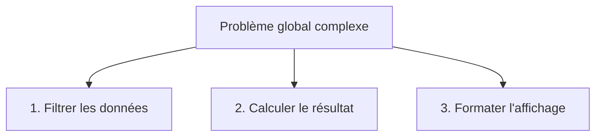

## 1. Objectif

Dans ce tutoriel, vous allez apprendre à aborder un problème de programmation complexe en le divisant en plusieurs **sous-problèmes plus simples**.

Vous allez apprendre à :
* distinguer un problème global de ses étapes élémentaires ;
* attribuer un rôle unique et précis à chaque sous-problème ;
* éviter d'écrire un programme monolithique (tout dans un seul gros bloc de code) ;
* identifier les traitements intermédiaires nécessaires.

## 2. Prérequis

* Avoir suivi les tutoriels sur les fonctions (UA.121.14).
* Savoir parcourir un tableau, accumuler une somme et poser une condition `if`.

---

## Partie 1 — Théorie

### 1.1. Le piège du code monolithique

Lorsqu'un énoncé contient plusieurs demandes, l'erreur classique est de tout coder au même endroit dans une seule boucle confuse :
* le code devient difficile à lire ;
* une erreur dans un calcul bloque tout le reste ;
* il est impossible de tester ou de réutiliser une étape isolée.

La solution consiste à **décomposer** :



### 1.2. Le principe de responsabilité unique

Chaque sous-traitement doit avoir **une seule responsabilité** :
* il répond à une seule question précise ;
* il ne fait pas le travail de l'étape suivante.

| Mauvaise approche (mélange) | Bonne approche (décomposée) |
| :--- | :--- |
| Une seule fonction qui calcule la somme, applique la TVA, cherche le client et écrit le message. | 1. Calculer la somme brute.<br>2. Appliquer la TVA.<br>3. Mettre en forme le reçu. |

### 1.3. Exemple concret : Traiter une série de notes

Pour déterminer la moyenne des élèves ayant la moyenne (notes >= 10) :
1. Étape 1 : isoler les notes valides.
2. Étape 2 : calculer la moyenne de ces notes isolées.

**Exemple exécutable :**

```javascript
// Étape 1 : filtrer
function filtrerAdmis(notes) {
    let admises = [];
    for (let note of notes) {
        if (note >= 10) {
            admises.push(note);
        }
    }
    return admises;
}

// Étape 2 : calculer la moyenne
function calculerMoyenne(tableau) {
    let somme = 0;
    for (let valeur of tableau) {
        somme += valeur;
    }
    return somme / tableau.length;
}

let toutesLesNotes = [8, 14, 9, 16, 12];
let notesValides = filtrerAdmis(toutesLesNotes);
let moyenneAdmis = calculerMoyenne(notesValides);

console.log("Notes admises : " + notesValides);
console.log("Moyenne des admis : " + moyenneAdmis);
```

**Résultat attendu dans la console :**
```text
Notes admises : 14,16,12
Moyenne des admis : 14
```

---

## Partie 2 — Pratique

### 2.1. Exercice d'application : Décomposer le calcul d'un panier d'achat

Dans cet exercice, vous devez calculer le montant final à payer pour un panier d'achats en le divisant en deux sous-traitements distincts :
1. Calculer la somme brute de tous les articles.
2. Appliquer une remise commerciale de 10% si le montant brut dépasse 80 €.

**Données de départ :**
```javascript
let panier = [20, 50, 30];
```

**Consignes :**
1. Écrivez une première fonction `calculerTotalBrut(prix)` qui additionne les prix.
2. Écrivez une deuxième fonction `appliquerRemise(montant)` qui retire 10% si `montant > 80`, sinon renvoie le montant inchangé.
3. Exécutez les deux étapes à la suite et affichez le montant brut puis le montant net.

**Code solution à tester :**

```javascript
function calculerTotalBrut(prix) {
    let total = 0;
    for (let p of prix) {
        total += p;
    }
    return total;
}

function appliquerRemise(montant) {
    if (montant > 80) {
        return montant * 0.90;
    }
    return montant;
}

let panier = [20, 50, 30];
let totalBrut = calculerTotalBrut(panier);
let totalNet = appliquerRemise(totalBrut);

console.log("Total brut : " + totalBrut + " €");
console.log("Total net après remise : " + totalNet + " €");
```

**Résultat attendu dans le terminal :**
```text
Total brut : 100 €
Total net après remise : 90 €
```

### 2.2. Livrable attendu

Créez le fichier de code dans votre dépôt annuel de travail :

```text
algo/decomposition/comprendre-decomposition/solution.js
```

Exécutez-le avec Node.js pour valider le résultat :
```bash
node algo/decomposition/comprendre-decomposition/solution.js
```

---

## Bilan

* Décomposer un problème consiste à le scinder en sous-objectifs indépendants et simples.
* Chaque fonction se concentre sur une seule action concrète (calculer, filtrer, transformer).
* Cette méthode rend les programmes plus faciles à construire, tester et corriger.

## Glossaire

* **Décomposition** : méthode consistant à découper un algorithme complexe en sous-parties autonomes.
* **Sous-problème** : unité élémentaire de traitement ayant une tâche précise au sein d'un problème global.
* **Responsabilité unique** : principe selon lequel un bloc de code ou une fonction ne doit accomplir qu'une seule tâche métier.