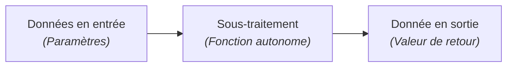
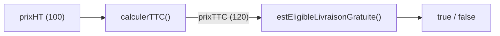

## 1. Objectif

Dans ce tutoriel, vous allez apprendre à définir avec précision les **entrées et les sorties** de chaque étape d'un algorithme décomposé avant d'en écrire le code.

Vous allez apprendre à :
* modéliser une fonction sous la forme d'une boîte noire (Entrée → Traitement → Sortie) ;
* identifier les types de données échangés (nombre, booléen, tableau) ;
* vérifier la compatibilité entre la sortie d'un traitement et l'entrée du suivant ;
* concevoir des contrats de fonctions clairs et sans ambiguïté.

## 2. Prérequis

* Avoir suivi le tutoriel [Comprendre la décomposition d'un problème](/tutos/comprendre-decomposition-probleme/).
* Savoir transmettre des paramètres et utiliser l'instruction `return`.

---

## Partie 1 — Théorie

### 1.1. Le modèle Entrée — Traitement — Sortie

Pour qu'un sous-traitement soit réutilisable et simple à vérifier, il doit fonctionner comme une machine isolée :
1. **Entrées :** les données fournies en paramètres nécessaires au calcul.
2. **Traitement :** les opérations internes (calcul, boucle, condition).
3. **Sortie :** le résultat unique renvoyé avec `return`.



### 1.2. Spécifier le contrat d'un sous-traitement

Avant d'écrire le moindre algorithme, on rédige sa **spécification** :

| Fonction | Donnée reçue (Entrée) | Opération réalisée | Donnée renvoyée (Sortie) |
| :--- | :--- | :--- | :--- |
| `calculerTVA` | `prixHT` *(nombre)* | Multiplier par 0.20 | Montant TVA *(nombre)* |
| `estAdmis` | `moyenne` *(nombre)* | Vérifier si >= 10 | Statut *(booléen : true/false)* |
| `extrairePairs` | `nombres` *(tableau)* | Filtrer les éléments divisibles par 2 | Nouveau tableau *(tableau)* |

### 1.3. Aligner le flux de données

Quand deux étapes se suivent, la valeur de sortie de la première fonction doit correspondre au type attendu en entrée de la seconde :



**Exemple exécutable :**

```javascript
function calculerTTC(prixHT) {
    return prixHT * 1.20;
}

function estEligibleLivraisonGratuite(prixTTC) {
    return prixTTC >= 100;
}

let montantHT = 90;
let montantTTC = calculerTTC(montantHT);
let livraisonOfferte = estEligibleLivraisonGratuite(montantTTC);

console.log("Montant TTC : " + montantTTC + " €");
console.log("Livraison gratuite : " + livraisonOfferte);
```

**Résultat attendu dans la console :**
```text
Montant TTC : 108 €
Livraison gratuite : true
```

---

## Partie 2 — Pratique

### 2.1. Exercice d'application : Convertir une température et détecter une alerte

Dans cet exercice, vous allez modéliser et coder deux fonctions dépendantes :
1. `celsiusVersFahrenheit(degresC)` : reçoit une température en Celsius et renvoie la valeur équivalente en Fahrenheit selon la formule : `F = (C * 9 / 5) + 32`.
2. `estAlerteChaleur(degresF)` : reçoit la température en Fahrenheit et renvoie `true` si la valeur est supérieure ou égale à 100°F, sinon `false`.

**Données de départ :**
```javascript
let tempCelsius = 38;
```

**Consignes :**
1. Déclarez la fonction `celsiusVersFahrenheit` avec son paramètre d'entrée et sa valeur de retour.
2. Déclarez la fonction `estAlerteChaleur` avec son paramètre d'entrée et son retour booléen.
3. Calculez la température en Fahrenheit à partir de `tempCelsius`.
4. Passez ce résultat à la fonction d'alerte.
5. Affichez les valeurs intermédiaires et le résultat final.

**Code solution à tester :**

```javascript
function celsiusVersFahrenheit(degresC) {
    return (degresC * 9 / 5) + 32;
}

function estAlerteChaleur(degresF) {
    return degresF >= 100;
}

let tempCelsius = 38;
let tempFahrenheit = celsiusVersFahrenheit(tempCelsius);
let alerte = estAlerteChaleur(tempFahrenheit);

console.log("Température Celsius : " + tempCelsius + " °C");
console.log("Température Fahrenheit : " + tempFahrenheit + " °F");
console.log("Alerte canicule active : " + alerte);
```

**Résultat attendu dans le terminal :**
```text
Température Celsius : 38 °C
Température Fahrenheit : 100.4 °F
alerte canicule active : true
```

### 2.2. Livrable attendu

Créez le fichier de code dans votre dépôt annuel de travail :

```text
algo/decomposition/definir-entrees-sorties/solution.js
```

Exécutez-le avec Node.js pour valider le résultat :
```bash
node algo/decomposition/definir-entrees-sorties/solution.js
```

---

## Bilan

* Définir les entrées et les sorties permet de clarifier le rôle d'une fonction avant même d'écrire son code.
* Une entrée est transmise via les paramètres ; une sortie est produite à l'aide de l'instruction `return`.
* Le chaînage de plusieurs traitements repose sur la circulation fluide de ces résultats intermédiaires.

## Glossaire

* **Entrée (Input)** : information transmise à une fonction pour qu'elle puisse accomplir sa tâche.
* **Sortie (Output)** : valeur ou résultat produit par une fonction à destination du reste du programme.
* **Flux de données** : chemin parcouru par les informations d'un sous-traitement à l'autre au sein de l'application.