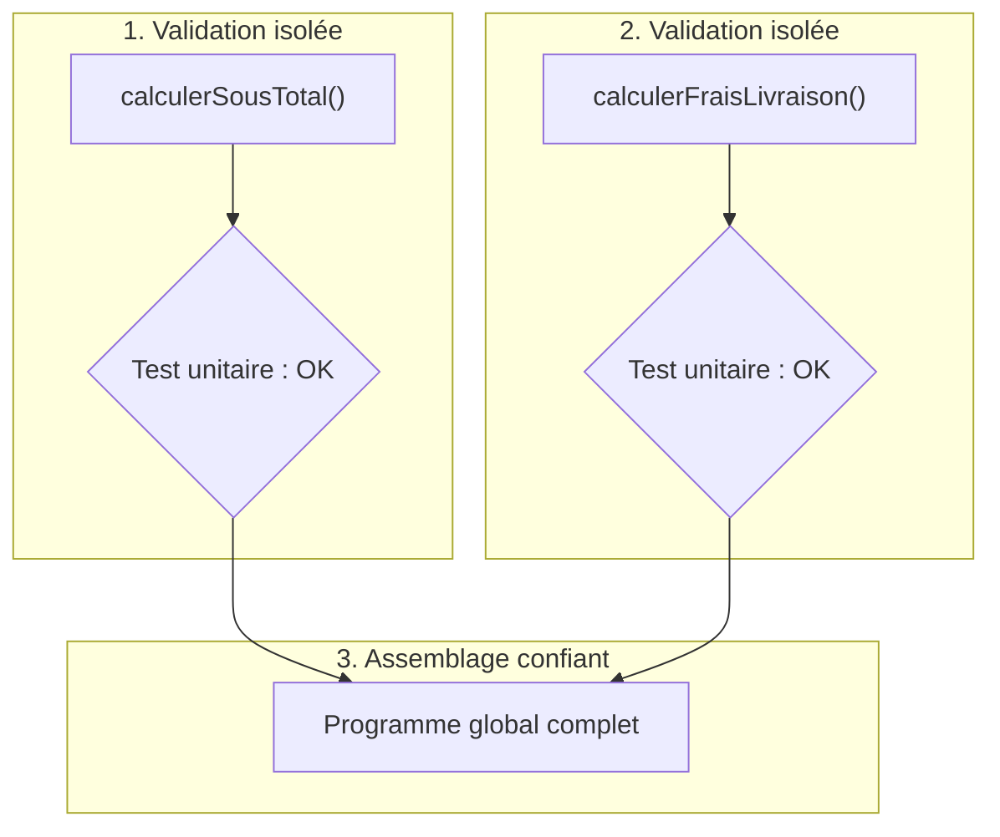

## 1. Objectif

Dans ce tutoriel, vous allez apprendre à programmer et à valider chaque sous-traitement de manière **isolée et autonome** avant de les assembler dans un programme global.

Vous allez apprendre à :
* construire une fonction dédiée sans dépendre du reste du programme ;
* tester un sous-traitement avec des valeurs de test connues ;
* repérer et corriger immédiatement une erreur sans chercher dans l'ensemble du projet ;
* valider les cas normaux et les cas particuliers pour chaque brique logicielle.

## 2. Prérequis

* Avoir suivi le tutoriel [Définir les entrées et sorties des traitements](/tutos/definir-entrees-sorties-traitements/).
* Savoir déclarer et appeler une fonction en lui passant des arguments.

---

## Partie 1 — Théorie

### 1.1. L'avantage du développement isolé

Si vous assemblez 4 fonctions non testées et que le résultat final est faux, il est très difficile de savoir où se trouve l'erreur.
En revanche, si chaque fonction est vérifiée individuellement :
* chaque bloc est garanti exact ;
* l'intégration finale devient simple et sans surprise.



### 1.2. Comment tester un sous-traitement isolé ?

Pour tester une fonction de façon autonome :
1. Choisissez 2 ou 3 jeux de valeurs simples dont vous connaissez d'avance le résultat calculé à la main.
2. Appelez la fonction avec ces valeurs.
3. Comparez la sortie affichée avec le résultat attendu.

**Exemple exécutable :**

```javascript
function calculerRemise(montant, tauxPourcentage) {
    if (montant <= 0 || tauxPourcentage <= 0) {
        return 0;
    }
    return montant * (tauxPourcentage / 100);
}

// Tests unitaires ciblés :
console.log("Test 1 (100€ à 20%) : " + calculerRemise(100, 20) + " (attendu : 20)");
console.log("Test 2 (50€ à 10%) : " + calculerRemise(50, 10) + " (attendu : 5)");
console.log("Test 3 (0€ à 15%) : " + calculerRemise(0, 15) + " (attendu : 0)");
```

**Résultat attendu dans la console :**
```text
Test 1 (100€ à 20%) : 20 (attendu : 20)
Test 2 (50€ à 10%) : 5 (attendu : 5)
Test 3 (0€ à 15%) : 0 (attendu : 0)
```

---

## Partie 2 — Pratique

### 2.1. Exercice d'application : Construire et tester deux sous-traitements d'une commande

Dans cet exercice, vous allez créer et tester séparément deux fonctions de gestion de commande :
1. `calculerSousTotal(quantite, prixUnitaire)` : renvoie le prix total brut des articles.
2. `calculerFraisLivraison(sousTotal, express)` :
   * si `express` est `true`, les frais sont de **10 €** ;
   * si `express` est `false` : les frais sont de **0 €** si le sous-total est supérieur ou égal à 50 €, sinon ils sont de **5 €**.

**Consignes :**
1. Écrivez la fonction `calculerSousTotal` et testez-la avec un achat de 3 articles à 20 €.
2. Écrivez la fonction `calculerFraisLivraison` et testez ses 3 cas possibles (livraison gratuite, livraison standard payante, livraison express).
3. Affichez clairement chaque test dans le terminal.

**Code solution à tester :**

```javascript
// Sous-traitement 1 : calculer le sous-total
function calculerSousTotal(quantite, prixUnitaire) {
    return quantite * prixUnitaire;
}

// Sous-traitement 2 : déterminer les frais d'expédition
function calculerFraisLivraison(sousTotal, express) {
    if (express) {
        return 10;
    }
    if (sousTotal >= 50) {
        return 0;
    }
    return 5;
}

// Phase de vérification isolée (tests unitaires)
let sousTotalArticle = calculerSousTotal(3, 20);
console.log("Vérification sous-total : " + sousTotalArticle + " €");

console.log("Frais standard sur 60 € (attendu 0) : " + calculerFraisLivraison(60, false) + " €");
console.log("Frais standard sur 30 € (attendu 5) : " + calculerFraisLivraison(30, false) + " €");
console.log("Frais express sur 60 € (attendu 10) : " + calculerFraisLivraison(60, true) + " €");
```

**Résultat attendu dans le terminal :**
```text
Vérification sous-total : 60 €
Frais standard sur 60 € (attendu 0) : 0 €
Frais standard sur 30 € (attendu 5) : 5 €
Frais express sur 60 € (attendu 10) : 10 €
```

### 2.2. Livrable attendu

Créez le fichier de code dans votre dépôt annuel de travail :

```text
algo/decomposition/construire-sous-traitements/solution.js
```

Exécutez-le avec Node.js pour valider le résultat :
```bash
node algo/decomposition/construire-sous-traitements/solution.js
```

---

## Bilan

* Un sous-traitement doit être validé indépendamment avant d'être intégré dans un flux de traitements.
* Les tests unitaires simples avec `console.log` permettent de vérifier immédiatement les différents cas de figure.
* Travailler par briques isolées réduit drastiquement les risques de bugs dans un projet informatique.

## Glossaire

* **Sous-traitement autonome** : bloc logique conçu pour s'exécuter sans nécessiter l'existence du reste de l'application.
* **Test unitaire** : test ciblant une unique unité de code (une fonction) pour s'assurer qu'elle respecte son contrat d'entrée/sortie.
* **Découplage** : propriété d'un code où les différents composants sont indépendants les uns des autres.