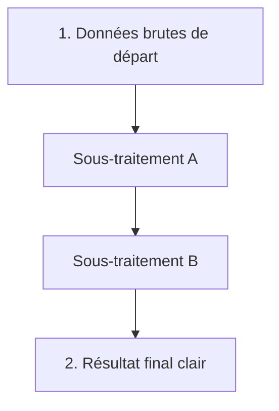

## 1. Objectif

Dans ce tutoriel d'exercices, vous allez vous entraîner à décomposer un énoncé complet en plusieurs sous-traitements autonomes et cohérents.

Vous allez apprendre à :
* lire un besoin métier et repérer les étapes de calcul nécessaires ;
* concevoir la structure des fonctions avant d'écrire le code ;
* faire communiquer les résultats intermédiaires ;
* obtenir un résultat final exact et facilement lisible.

## 2. Prérequis

* Avoir suivi le tutoriel [Construire les sous-traitements](/tutos/construire-sous-traitements/).
* Savoir transmettre le retour d'une fonction vers une autre.

---

## Partie 1 — Théorie

### 1.1. La méthode d'analyse en 3 questions

Face à un problème à résoudre, posez-vous systématiquement 3 questions simples :
1. **Quelles sont les données de départ ?** *(entrées initiales)*
2. **Quelles sont les étapes de transformation intermédiaires ?** *(sous-traitements)*
3. **Quel est le résultat final attendu ?** *(sortie finale)*



### 1.2. Exemple guidé : Calcul de rémunération

**Énoncé :** Calculer le salaire net d'un employé payé à l'heure :
* Sous-traitement 1 : multiplier les heures par le taux horaire pour obtenir le brut.
* Sous-traitement 2 : déduire 20% de cotisations sociales sur le montant brut.

**Exemple exécutable :**

```javascript
function calculerSalaireBrut(heures, tauxHoraire) {
    return heures * tauxHoraire;
}

function deduireCotisations(salaireBrut) {
    let cotisations = salaireBrut * 0.20;
    return salaireBrut - cotisations;
}

let brut = calculerSalaireBrut(35, 12);
let net = deduireCotisations(brut);

console.log("Salaire brut : " + brut + " €");
console.log("Salaire net : " + net + " €");
```

**Résultat attendu dans la console :**
```text
Salaire brut : 420 €
Salaire net : 336 €
```

---

## Partie 2 — Pratique

### 2.1. Exercice d'application : Décomposer l'addition d'un restaurant

Dans cet exercice, vous devez traiter l'addition d'un restaurant à partir de la liste des plats commandés :
* **Sous-traitement 1 (`calculerTotalPlats`) :** calcule la somme des prix des plats commandés.
* **Sous-traitement 2 (`calculerPourboire`) :** suggère un pourboire selon le montant total :
  * si le total est inférieur à 50 €, le pourboire est de **10%** ;
  * si le total est supérieur ou égal à 50 €, le pourboire est de **15%**.
* **Résultat final :** total à payer = total des plats + pourboire.

**Données de départ :**
```javascript
let plats = [15, 25, 10, 10];
```

**Consignes :**
1. Écrivez la fonction `calculerTotalPlats(plats)`.
2. Écrivez la fonction `calculerPourboire(total)`.
3. Appelez `calculerTotalPlats` sur le tableau `plats`.
4. Transmettez le total obtenu à `calculerPourboire`.
5. Calculez le montant final et affichez le détail (plats, pourboire, montant final).

**Code solution à tester :**

```javascript
function calculerTotalPlats(plats) {
    let total = 0;
    for (let p of plats) {
        total += p;
    }
    return total;
}

function calculerPourboire(total) {
    if (total < 50) {
        return total * 0.10;
    }
    return total * 0.15;
}

let plats = [15, 25, 10, 10];
let total = calculerTotalPlats(plats);
let pourboire = calculerPourboire(total);
let montantFinal = total + pourboire;

console.log("Total plats : " + total + " €");
console.log("Pourboire conseillé : " + pourboire + " €");
console.log("Montant final à régler : " + montantFinal + " €");
```

**Résultat attendu dans le terminal :**
```text
Total plats : 60 €
Pourboire conseillé : 9 €
Montant final à régler : 69 €
```

### 2.2. Livrable attendu

Créez le fichier de code dans votre dépôt annuel de travail :

```text
algo/decomposition/exercices-decomposition/solution.js
```

Exécutez-le avec Node.js pour valider le résultat :
```bash
node algo/decomposition/exercices-decomposition/solution.js
```

---

## Bilan

* La décomposition transforme un énoncé en une succession logique de fonctions simples.
* Chaque fonction se concentre sur un calcul unique et renvoie sa valeur avec `return`.
* Le programme principal n'a plus qu'à organiser la circulation des données entre ces fonctions.

## Glossaire

* **Décomposition fonctionnelle** : technique de programmation consistant à traduire chaque exigence d'un problème par une fonction dédiée.
* **Résultat intermédiaire** : valeur issue d'un premier sous-traitement, utilisée pour alimenter une étape suivante.
* **Pipeline** : enchaînement d'opérations où chaque étape prend en entrée le produit de l'étape précédente.