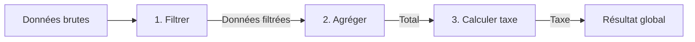

## 1. Objectif

Dans ce tutoriel, vous allez apprendre à organiser et relier plusieurs sous-traitements successifs à travers une **chaîne de traitement (pipeline)** et une **fonction chef d'orchestre**.

Vous allez apprendre à :
* faire circuler les données de sortie d'une fonction vers l'entrée de la suivante ;
* concevoir une fonction chef d'orchestre qui coordonne toutes les étapes ;
* regrouper et structurer les résultats finals sous forme d'un objet descriptif ;
* maintenir un code ordonné et facile à suivre de bout en bout.

## 2. Prérequis

* Avoir suivi le tutoriel [Exercices de décomposition](/tutos/exercices-decomposition/).
* Savoir manipuler des objets simples en JavaScript (`{ cle: valeur }`).

---

## Partie 1 — Théorie

### 1.1. Le concept de pipeline

Un pipeline organise l'exécution séquentielle de plusieurs fonctions : chaque fonction effectue une transformation précise avant de passer le témoin à la suivante.



### 1.2. La fonction chef d'orchestre

Pour éviter d'encombrer le script principal avec de multiples variables intermédiaires, on crée une **fonction coordinatrice** (ou chef d'orchestre) :
* elle reçoit la collection de départ ;
* elle appelle tour à tour chaque sous-fonction dans le bon ordre ;
* elle compile et renvoie le bilan final.

**Exemple exécutable :**

```javascript
function filtrerPositifs(nombres) {
    let resultats = [];
    for (let n of nombres) {
        if (n > 0) resultats.push(n);
    }
    return resultats;
}

function calculerSomme(valeurs) {
    let total = 0;
    for (let v of valeurs) total += v;
    return total;
}

// Fonction orchestratrice
function analyserNombres(liste) {
    let positifs = filtrerPositifs(liste);
    let somme = calculerSomme(positifs);
    return { quantite: positifs.length, somme: somme };
}

let bilan = analyserNombres([-5, 10, -2, 20]);
console.log("Positifs trouvés : " + bilan.quantite + ", Somme : " + bilan.somme);
```

**Résultat attendu dans la console :**
```text
Positifs trouvés : 2, Somme : 30
```

---

## Partie 2 — Pratique

### 2.1. Exercice d'application : Pipeline de gestion budgétaire

Dans cet exercice, vous devez traiter un inventaire de prix d'articles selon 3 étapes successives :
1. **`filtrerArticlesChers(prix, seuil)` :** ne conserve que les prix supérieurs ou égaux à 10 €.
2. **`calculerTotal(prix)` :** additionne les prix conservés pour obtenir le total hors taxes (HT).
3. **`calculerTaxe(montant, taux)` :** calcule la taxe à appliquer (20%).
4. **`genererRapportBudget(articles)` :** orchestre ces 3 étapes et renvoie un objet avec les articles retenus, le total HT, la taxe et le total TTC.

**Données de départ :**
```javascript
let inventaire = [10, 5, 20, 8, 30, 4];
```

**Consignes :**
1. Déclarez les trois sous-fonctions `filtrerArticlesChers`, `calculerTotal` et `calculerTaxe`.
2. Déclarez la fonction coordinatrice `genererRapportBudget`.
3. Exécutez le rapport sur la liste `inventaire` et affichez les résultats.

**Code solution à tester :**

```javascript
// 1. Filtrer
function filtrerArticlesChers(prix, seuil) {
    let resultats = [];
    for (let p of prix) {
        if (p >= seuil) {
            resultats.push(p);
        }
    }
    return resultats;
}

// 2. Calculer le total
function calculerTotal(prix) {
    let total = 0;
    for (let p of prix) {
        total += p;
    }
    return total;
}

// 3. Calculer la taxe
function calculerTaxe(montant, taux) {
    return montant * (taux / 100);
}

// 4. Orchestration
function genererRapportBudget(articles) {
    let chers = filtrerArticlesChers(articles, 10);
    let totalHT = calculerTotal(chers);
    let taxe = calculerTaxe(totalHT, 20);
    let totalTTC = totalHT + taxe;

    return {
        articlesChers: chers,
        totalHT: totalHT,
        taxe: taxe,
        totalTTC: totalTTC
    };
}

let inventaire = [10, 5, 20, 8, 30, 4];
let rapport = genererRapportBudget(inventaire);

console.log("Articles retenus (>= 10 €) : " + rapport.articlesChers);
console.log("Total HT : " + rapport.totalHT + " €");
console.log("TVA (20%) : " + rapport.taxe + " €");
console.log("Total TTC : " + rapport.totalTTC + " €");
```

**Résultat attendu dans le terminal :**
```text
Articles retenus (>= 10 €) : 10,20,30
Total HT : 60 €
TVA (20%) : 12 €
Total TTC : 72 €
```

### 2.2. Livrable attendu

Créez le fichier de code dans votre dépôt annuel de travail :

```text
algo/decomposition/chainer-traitements/solution.js
```

Exécutez-le avec Node.js pour valider le résultat :
```bash
node algo/decomposition/chainer-traitements/solution.js
```

---

## Bilan

* Le chaînage permet de lier plusieurs sous-traitements spécialisés en une suite logique fluide.
* La fonction orchestratrice prend en charge la séquence des appels et la construction du résultat d'ensemble.
* Chaque étape reste testable et modifiable indépendamment sans casser l'architecture globale.

## Glossaire

* **Chaînage de traitements** : enchaînement d'étapes de calcul où le produit de chacune alimente la suivante.
* **Fonction chef d'orchestre** : fonction coordinatrice dont le rôle est de piloter l'appel des différentes sous-fonctions.
* **Pipeline de données** : flux séquentiel de transformations appliqué à un jeu de données initial.