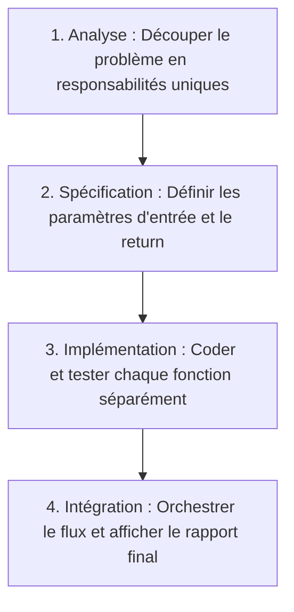

## 1. Objectif

Dans ce tutoriel de synthèse, vous allez mobiliser l'ensemble des compétences acquises pour concevoir un **traitement algorithmique complet** à partir d'un énoncé concret.

Vous allez apprendre à :
* analyser un cahier des charges et le décomposer en sous-traitements clairs ;
* spécifier et développer chaque sous-fonction avec ses entrées et sa sortie ;
* intégrer l'ensemble au sein d'une fonction principale de délibération ;
* valider les résultats produits sur un jeu de données réel.

## 2. Prérequis

* Avoir suivi l'ensemble des tutoriels de l'UA.121.17 (de T.121.171 à T.121.175).
* Savoir combiner filtrage, calcul d'agrégat (somme, moyenne) et recherche d'extremum.

---

## Partie 1 — Théorie

### 1.1. Méthodologie globale de conception

Face à un problème algorithmique d'envergure, appliquez systématiquement la démarche en 4 temps :



### 1.2. Architecture modulaire d'un bilan d'évaluation

Pour analyser une promotion d'étudiants, nous séparons distinctement 3 calculs :
1. **Filtrer :** isoler les étudiants ayant obtenu la moyenne (>= 10).
2. **Calculer la moyenne :** sommer les valeurs et diviser par le nombre d'éléments.
3. **Trouver le maximum :** identifier la meilleure note de la promotion.

Chacune de ces opérations constitue une fonction autonome réutilisable.

---

## Partie 2 — Pratique

### 2.1. Exercice d'application : Générer le bilan de délibération d'une promotion

Dans cet exercice, vous devez traiter les résultats d'un examen à partir d'une liste de notes.

**Données de départ :**
```javascript
let notesPromotion = [14, 8, 18, 6, 12, 16, 10];
```

**Consignes :**
1. Écrivez la fonction `filtrerAdmis(notes)` qui extrait les notes >= 10.
2. Écrivez la fonction `calculerMoyenne(notes)` qui calcule la moyenne arithmétique.
3. Écrivez la fonction `trouverMaximum(notes)` qui trouve la note la plus élevée.
4. Écrivez la fonction chef d'orchestre `genererBilanPromotion(toutesLesNotes)` qui produit un objet récapitulatif.
5. Affichez les indicateurs clés du bilan dans la console.

**Code solution à tester :**

```javascript
// 1. Filtrer les notes admises
function filtrerAdmis(notes) {
    let admis = [];
    for (let n of notes) {
        if (n >= 10) {
            admis.push(n);
        }
    }
    return admis;
}

// 2. Calculer la moyenne
function calculerMoyenne(notes) {
    if (notes.length === 0) return 0;
    let somme = 0;
    for (let n of notes) {
        somme += n;
    }
    return somme / notes.length;
}

// 3. Trouver la note maximale
function trouverMaximum(notes) {
    if (notes.length === 0) return 0;
    let max = notes[0];
    for (let i = 1; i < notes.length; i++) {
        if (notes[i] > max) {
            max = notes[i];
        }
    }
    return max;
}

// 4. Fonction orchestratrice
function genererBilanPromotion(toutesLesNotes) {
    let admises = filtrerAdmis(toutesLesNotes);
    let moyenneGenerale = calculerMoyenne(toutesLesNotes);
    let moyenneAdmis = calculerMoyenne(admises);
    let meilleureNote = trouverMaximum(admises);

    return {
        totalCandidats: toutesLesNotes.length,
        nombreAdmis: admises.length,
        moyenneGenerale: moyenneGenerale,
        moyenneAdmis: moyenneAdmis,
        meilleureNote: meilleureNote
    };
}

let notesPromotion = [14, 8, 18, 6, 12, 16, 10];
let bilan = genererBilanPromotion(notesPromotion);

console.log("Nombre total de candidats : " + bilan.totalCandidats);
console.log("Nombre d'admis : " + bilan.nombreAdmis);
console.log("Moyenne générale : " + bilan.moyenneGenerale + " / 20");
console.log("Moyenne des admis : " + bilan.moyenneAdmis + " / 20");
console.log("Meilleure note : " + bilan.meilleureNote + " / 20");
```

**Résultat attendu dans le terminal :**
```text
Nombre total de candidats : 7
Nombre d'admis : 5
Moyenne générale : 12 / 20
Moyenne des admis : 14 / 20
Meilleure note : 18 / 20
```

### 2.2. Livrable attendu

Créez le fichier de code dans votre dépôt annuel de travail :

```text
algo/decomposition/synthese-traitement-complet/solution.js
```

Exécutez-le avec Node.js pour valider le résultat :
```bash
node algo/decomposition/synthese-traitement-complet/solution.js
```

---

## Bilan

* Vous êtes désormais capable de mener à bien l'analyse, la décomposition et le codage d'un problème algorithmique complet.
* Grâce au découpage en fonctions à responsabilité unique, chaque bloc est simple à lire, à tester et à maintenir.
* Cette compétence constitue le fondement du développement logiciel professionnel et clôture avec succès le socle d'algorithmique N1.

## Glossaire

* **Traitement complet** : flux d'instructions assemblant plusieurs fonctions spécialisées pour répondre à l'intégralité d'un besoin.
* **Fonction orchestratrice** : composant chargé de structurer les appels séquentiels et de construire la réponse finale.
* **Intégration** : étape consistant à connecter des sous-programmes testés séparément pour former un système unifié.